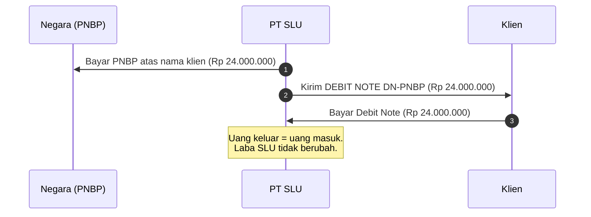
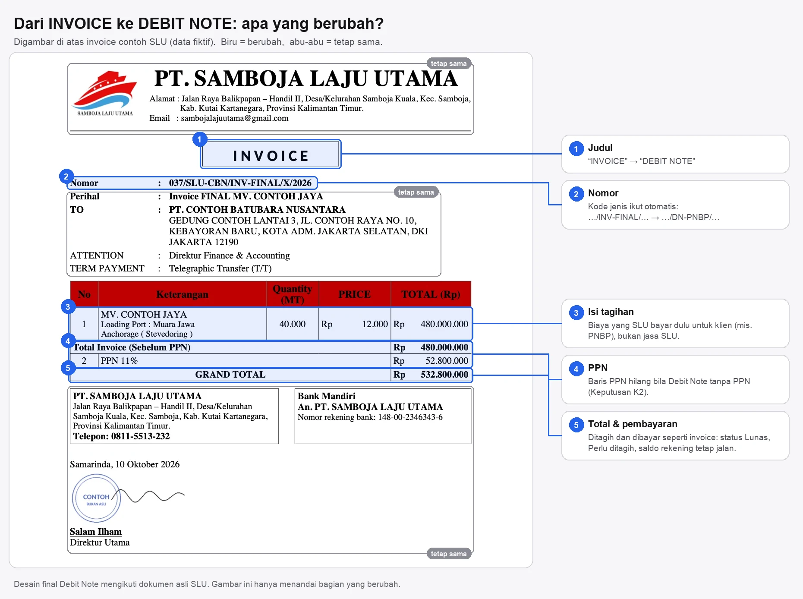
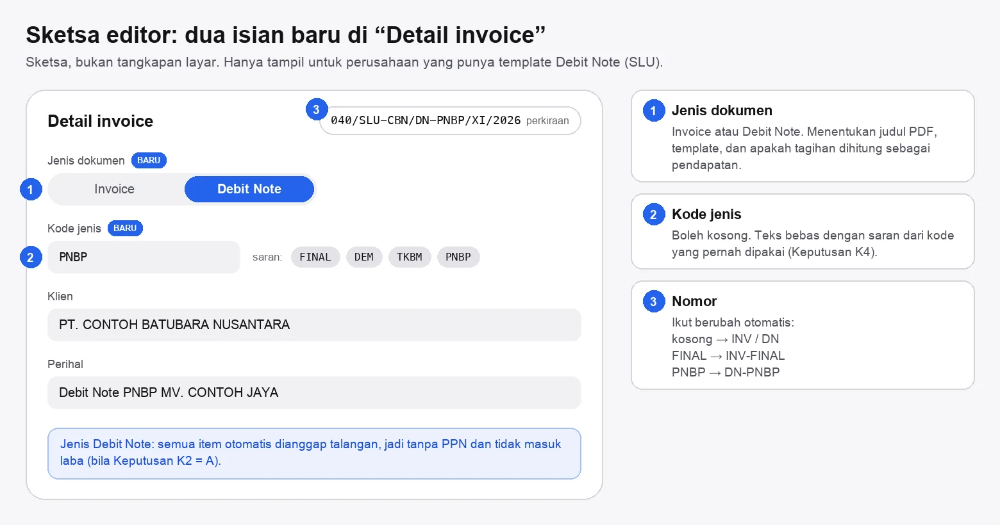
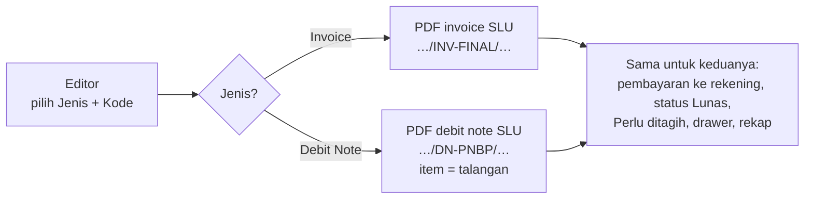

# Debit Note PT SLU: penjelasan & pilihan keputusan

> **Status:** usulan, **menunggu keputusan**. Belum ada kode yang diubah.
> **Asumsi utama (belum dikonfirmasi SLU):** Debit Note `DN-PNBP` menagih kembali biaya yang SLU bayar lebih dulu atas nama klien, **bukan** jasa SLU.
> **Cara memberi keputusan:** centang pilihan di deskripsi PR, atau balas dengan format `K1: A, K2: A, …`.

---

## Ringkasan satu menit

- **Kebutuhan:** selain invoice, PT Samboja Laju Utama (SLU) menerbitkan **Debit Note**, mis. `DN-PNBP`. Template SLU yang sekarang hanya bisa mencetak "INVOICE".
- **Usulan:** Debit Note menjadi **jenis dokumen di modul Invoice**, bukan modul baru. Tabel `invoices` mendapat dua kolom baru: **jenis** (Invoice / Debit Note) dan **kode** (FINAL, DEM, TKBM, PNBP, …).
- **Dampak:** nomor jadi otomatis lengkap dengan kode, PDF berjudul DEBIT NOTE, dan (bila asumsi benar) Debit Note **tanpa PPN dan tidak dihitung sebagai laba**.
- **Yang perlu diputuskan:** 6 keputusan. **K2 dan K3 harus dijawab SLU**; sisanya keputusan tim dan sudah ada rekomendasinya.
- **Yang dibutuhkan:** 1–2 contoh Debit Note asli SLU (Word/PDF).

---

## 1. Istilah

| Istilah | Artinya di dokumen ini |
|---|---|
| **Debit Note (DN)** | Surat tagihan untuk biaya yang SLU bayar lebih dulu atas nama klien. Bukan tagihan jasa SLU. |
| **PNBP** | Penerimaan Negara Bukan Pajak: biaya resmi yang dibayar ke negara (bukan pajak). |
| **Talangan** | Uang yang SLU keluarkan dulu untuk klien, lalu diganti klien lewat Debit Note. |
| **Titipan** | Mekanisme yang **sudah ada** di aplikasi untuk uang yang hanya lewat (sekarang dipakai untuk "titipan pajak klien"): tidak masuk pendapatan, tidak masuk dasar PPN. |

---

## 2. Bagaimana uangnya bergerak

Contoh fiktif: PNBP Rp 24.000.000 untuk kapal MV. CONTOH JAYA.



Bedanya dengan invoice:

| | Invoice | Debit Note (asumsi) |
|---|---|---|
| Yang ditagih | Jasa SLU (stevedoring, demurrage, waiting TKBM) | Biaya yang SLU talangi (mis. PNBP) |
| Pendapatan SLU? | Ya | **Tidak**, hanya penggantian |
| PPN | Ya (SLU PKP, 11%) | Biasanya tidak (perlu dikonfirmasi bagian pajak SLU) |
| Nomor | `…/INV-FINAL/…` | `…/DN-PNBP/…` |
| Dibayar ke rekening, status Lunas, Perlu ditagih | Ya | Ya, **sama persis** |

---

## 3. Kondisi sekarang: kalau Debit Note dibuat sebagai invoice biasa

| | Yang terjadi hari ini | Akibatnya |
|---|---|---|
| **Judul PDF** | Selalu "I N V O I C E" | Dokumen salah jenis |
| **PPN** | SLU perusahaan PKP, jadi sakelar PPN **menyala bawaan** | Klien ditagih Rp 26.640.000 (+ PPN Rp 2.640.000) bila staf lupa mematikannya |
| **Laba Rugi** | Rp 24.000.000 masuk **pendapatan**; PNBP yang dibayar ke negara masuk **beban** | Laba bersih sama, tapi omzet dan beban sama-sama membengkak |
| **Nomor** | Kode harus diketik manual dan tidak cocok dengan format nomor | Urutan tidak tercatat; nomor otomatis berikutnya **mundur ke 001** (lihat di bawah) |

Masalah nomor, dengan data contoh seeder:

```text
Format nomor SLU sekarang : {NO}/{PT}-{KLIEN}/INV/{BLN_ROMAWI}/{THN}

037/SLU-CBN/INV-FINAL/X/2026   ✗ "INV-FINAL" bukan "INV" → urutan tidak tercatat
038/SLU-CBN/INV-DEM/X/2026     ✗
039/SLU-CBN/INV-TKBM/X/2026    ✗
Nomor otomatis berikutnya  →   001/SLU-CBN/INV/XI/2026   ← seharusnya 040
```

---

## 4. Gambaran perubahan

### Pada dokumen



### Pada editor



### Pada nomor

Token baru `{KODE}` di format nomor. Format SLU menjadi `{NO}/{PT}-{KLIEN}/{KODE}/{BLN_ROMAWI}/{THN}`:

| Jenis | Kode | `{KODE}` menjadi | Contoh nomor |
|---|---|---|---|
| Invoice | (kosong) | `INV` | `040/SLU-CBN/INV/XI/2026` |
| Invoice | FINAL | `INV-FINAL` | `040/SLU-CBN/INV-FINAL/XI/2026` |
| Debit Note | PNBP | `DN-PNBP` | `041/SLU-CBN/DN-PNBP/XI/2026` |

Nomor 037–039 yang sudah ada cocok dengan format baru, jadi urutannya bisa diisi ulang (perintah `invoice:backfill-sequence` yang sudah ada) dan nomor berikutnya kembali benar (040). Perusahaan lain tidak terpengaruh selama formatnya tidak memakai `{KODE}`.

### Di dalam sistem



### Pada pencatatan (bila K2 = A)

Sama seperti "titipan pajak klien" yang sudah ada: satu akun penampung yang terisi lalu kosong lagi, tanpa menyentuh Laba Rugi.

| Kejadian | Dicatat di | Jurnal (tampilan) | Laba Rugi |
|---|---|---|---|
| SLU membayar PNBP ke negara | Arus Kas › Pengeluaran, kategori Pendanaan **"Bayar Talangan Klien"** (baru) | Debit *Talangan Biaya Klien* / Kredit Bank | tidak masuk |
| Klien membayar Debit Note | Catat pembayaran di Debit Note (seperti invoice) | Debit Bank / Kredit *Talangan Biaya Klien* | tidak masuk |
| **Saldo akun Talangan** | | **0, impas** | |

---

## 5. Keputusan yang dibutuhkan

⭐ = rekomendasi.

### K1. Debit Note diletakkan di mana? *(tim)*

| Pilihan | Artinya | Catatan |
|---|---|---|
| **A. Jenis dokumen di Invoice** ⭐ | Dua kolom baru di `invoices`; pembayaran, status, rekening, drawer, dan rekap dipakai ulang | Kode baru paling sedikit; invoice lama otomatis berjenis Invoice |
| B. Modul/menu terpisah | Tabel, pembayaran, status, jurnal, rekap, dan izin sendiri | Pekerjaan berlipat; rumus saldo rekening (yang membaca pembayaran invoice) harus diubah; rawan selisih angka |
| C. Hanya ganti judul di PDF | Tanpa data baru | Murah, tapi masalah PPN, laba, dan nomor di bagian 3 tetap ada |

### K2. Debit Note pendapatan SLU atau talangan? *(SLU / bagian pajak)*

| Pilihan | Artinya | Catatan |
|---|---|---|
| **A. Talangan** ⭐ bila asumsi benar | Item Debit Note otomatis ditandai titipan → tanpa PPN, tidak dihitung laba. Pembayaran PNBP ke negara dicatat di kategori Pendanaan baru "Bayar Talangan Klien" | Memakai mekanisme titipan yang sudah ada dan sudah teruji di Laba Rugi & jurnal |
| B. Pendapatan | Debit Note = invoice biasa dengan judul & kode berbeda; PPN mengikuti sakelar; PNBP ke negara = beban | Paling sedikit perubahan, tapi omzet & beban membengkak |

**Penentunya:** apakah SLU menagih PNBP **persis sebesar yang dibayar**, tanpa tambahan? Ya → A. Ada margin/jasa di dalamnya → B (atau pisahkan: jasa di invoice, biaya talangan di Debit Note).

### K3. Urutan nomor Debit Note *(SLU)*

| Pilihan | Contoh | Catatan |
|---|---|---|
| **A. Satu urutan bersama invoice** ⭐ | `039/…/INV-TKBM`, `040/…/DN-PNBP`, `041/…/INV-FINAL` | Sama dengan kode invoice sekarang (037–039 berurutan lintas kode). Paling sederhana |
| B. Urutan sendiri per jenis | Invoice `040, 041…`; Debit Note `001, 002…` | Hitungan nomor dan aturan "Kembalikan ke draft" harus dipisah per jenis |

**Penentunya:** nomor Debit Note SLU yang sudah pernah terbit.

### K4. Daftar kode jenis *(tim)*

| Pilihan | Artinya | Catatan |
|---|---|---|
| **A. Teks bebas + saran** ⭐ | Saran dari kode yang pernah dipakai (FINAL, DEM, TKBM, PNBP) | Tanpa halaman pengaturan baru; saran mengurangi salah ketik |
| B. Daftar tetap di Pengaturan › Penomoran invoice | Admin mengelola daftar kode | Paling rapi, perlu isian pengaturan baru |
| C. Ditulis di kode (folder template SLU) | Konsisten dengan template statis | Menambah kode = deploy |

### K5. Tiga angka yang masih menghitung titipan sebagai laba *(tim, temuan saat menyusun usulan ini)*

Laba Rugi dan jurnal sudah mengecualikan titipan dengan benar. Tiga tempat ini belum:

| Tempat | Yang terjadi | Kode |
|---|---|---|
| Statistik daftar invoice | "Laba kotor" = total − PPN − HPP; titipan ikut dihitung laba | `InvoiceController::index` |
| Ringkasan | Laba = semua pembayaran − PPN − HPP; titipan ikut | `DashboardController` |
| Rekap Excel/PDF | Omzet = total − PPN; titipan ikut omzet, PPh final dihitung dari situ | `InvoiceController::buildRecapData` |

Dengan Debit Note (K2 = A), nilainya bisa besar: seluruh Debit Note akan tampil sebagai laba di tiga tempat ini.

| Pilihan | Catatan |
|---|---|
| A. Perbaiki di PR Debit Note | Satu PR, tapi mengubah angka **semua perusahaan** yang memakai titipan pajak |
| **B. PR kecil terpisah, digabung sebelum Debit Note** ⭐ | Mudah ditinjau dan diumumkan sendiri: angka laba invoice bertitipan pajak akan turun (menjadi benar) |
| C. Biarkan | Debit Note SLU terlihat sebagai laba di tiga tempat itu |

### K6. Rapikan fondasi template dulu? *(tim)*

Template SLU sekarang menulis langsung alamat, telepon, rekening, dan nama penanda tangan di kode, padahal Profil perusahaan sudah punya kolomnya. Isian Perihal & keterangan item juga tampil untuk semua perusahaan, padahal hanya tercetak di template SLU.

| Pilihan | Catatan |
|---|---|
| **A. Ya, di awal PR Debit Note** ⭐ | Template Debit Note langsung memakai data dari Profil; ganti rekening/direktur cukup lewat Pengaturan; data SLU tidak lagi tersimpan di repo publik |
| B. Nanti | Teks statis disalin ke template kedua; dua tempat yang harus diubah bila ada perubahan |

---

## 6. Di luar cakupan

- **Potongan PPh 23** pada invoice SLU: PR terpisah (mengubah hitungan total & status Lunas).
- **Debit Note untuk perusahaan lain:** otomatis tersedia bila perusahaan itu diberi template `debit-note` sendiri; tidak ada yang berubah sampai saat itu.
- **Credit Note** (pengurangan tagihan): tidak termasuk.

---

## 7. Yang dibutuhkan dari SLU

- [ ] 1–2 contoh **Debit Note asli** (Word/PDF). Desain ditiru seperti invoice; data di seeder tetap fiktif.
- [ ] Jawaban **K2**: PNBP ditagih persis sebesar yang dibayar? Dikenai PPN?
- [ ] Jawaban **K3**: contoh nomor Debit Note yang pernah terbit.
- [ ] Daftar kode yang dipakai (FINAL, DEM, TKBM, PNBP, …).

---

## 8. Rencana kerja bila semua rekomendasi dipilih

| Urutan | PR | Isi | Ukuran |
|---|---|---|---|
| 1 | Titipan bukan laba (K5) | Statistik daftar invoice, Ringkasan, Rekap mengecualikan titipan + tes | Kecil |
| 2 | Debit Note SLU | Fondasi template (K6) → kolom `document_type` & `document_code` (migration tenant) → token `{KODE}` + isi ulang urutan nomor SLU → editor (Jenis, Kode, item otomatis talangan, PPN disembunyikan) → template `debit-note.blade.php` SLU → jurnal & kategori "Bayar Talangan Klien" → filter jenis di daftar & rekap → dokumentasi modul, panduan, terjemahan, tes | Menengah |

File yang akan disentuh di PR 2: `CompanyInvoiceTemplate`, `InvoiceNumberService`, `InvoiceController`, `StoreInvoiceRequest`/`InvoicePreviewRequest`, `JournalService` + `resources/js/lib/journal.ts`, `CategoryTemplateService`, `resources/views/pdf/perusahaan/samboja-laju-utama/`, `resources/js/pages/invoices/*`, `docs/module/invoices.md`, `video/invoices/guide.ts`.
