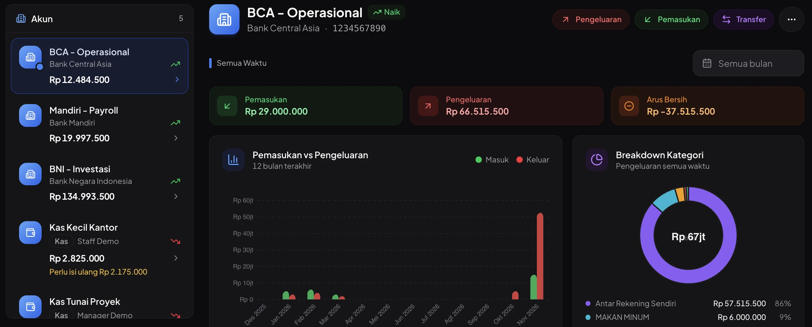
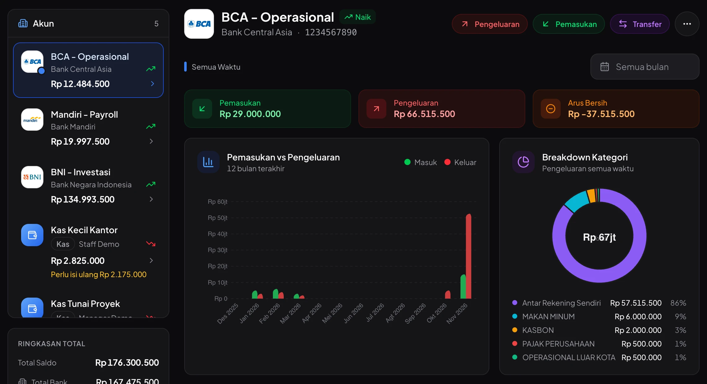
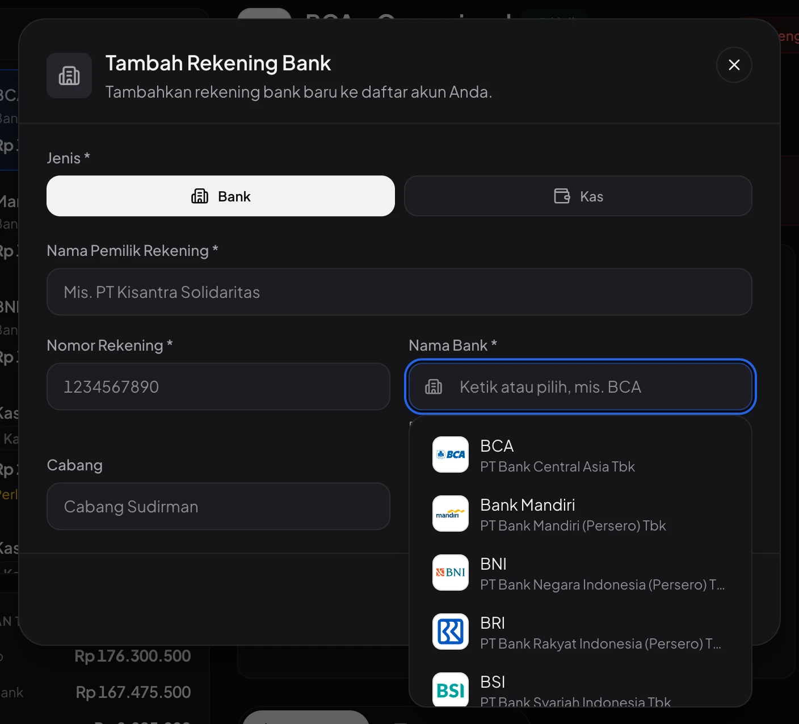
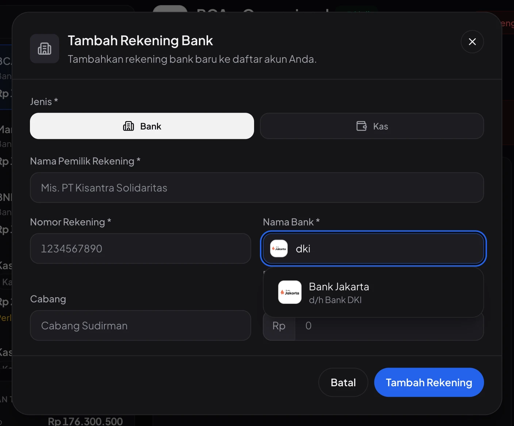
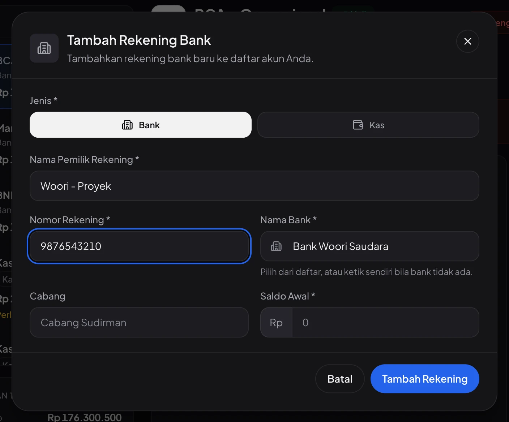
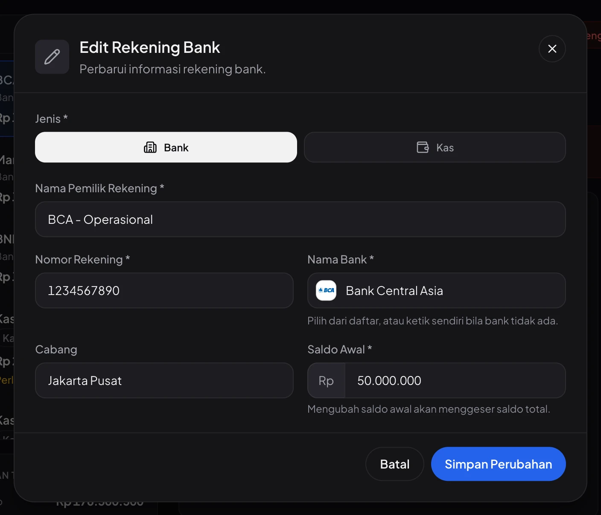
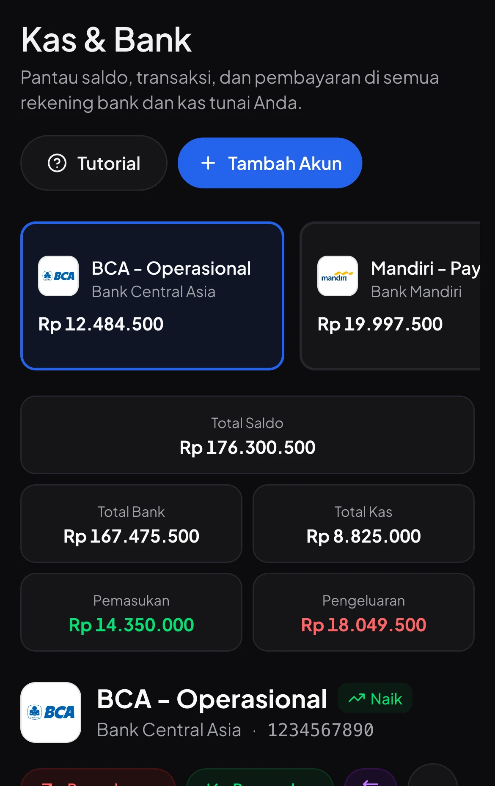
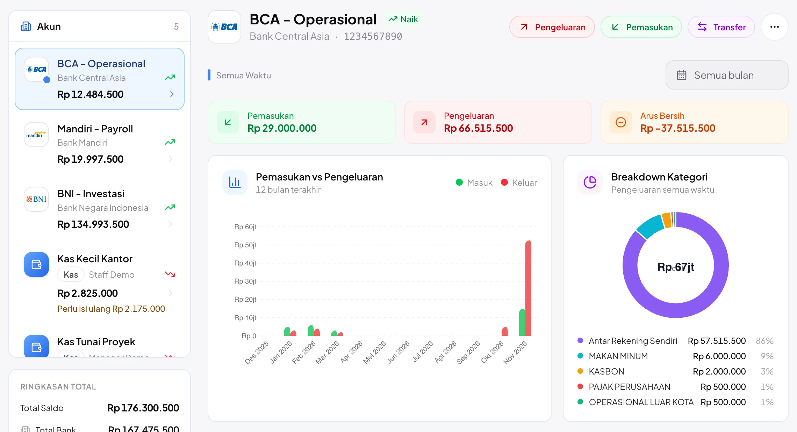
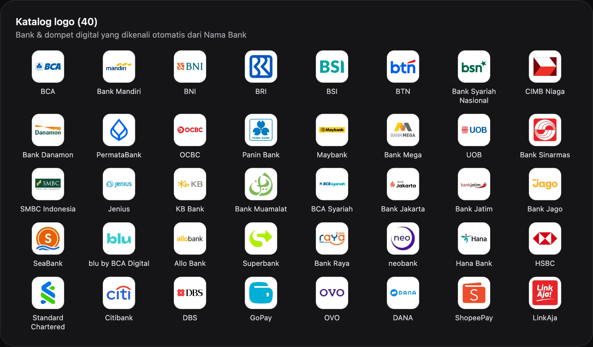

# Logo bank otomatis & saran Nama Bank — Kas & Bank

Halaman **Keuangan › Kas & Bank** sekarang menampilkan **logo asli bank** untuk setiap rekening. Kolom **Nama Bank** di form menjadi isian yang **bisa dipilih dari daftar, tapi tetap bisa diketik bebas**.

Tidak ada perubahan database, endpoint, atau izin. Data lama tidak diubah: logo dikenali otomatis dari nama bank yang sudah tersimpan.

---

## Sebelum → sesudah

**Sebelum** — semua rekening memakai ikon gedung yang sama.

**Sesudah** — rekening tampil dengan logo banknya; akun kas tetap berikon dompet.

---

## Yang berubah

### 1. Logo bank di daftar akun & header

- Logo tampil di **daftar akun** (desktop), **kartu akun** (ponsel), dan **header akun terpilih**.
- **Akun kas** dan **bank yang tidak dikenali** tetap memakai ikon biru seperti sebelumnya.
- Logo berada di kotak putih di tema gelap maupun terang, karena logo resmi bank dirancang untuk latar terang.

### 2. Nama Bank: pilih dari daftar atau ketik sendiri

| Klik kolom → semua bank tampil dengan logonya | Ketik singkatan / nama lama → langsung ketemu |
|---|---|
|  |  |

| Bank di luar daftar tetap bisa disimpan | Data lama langsung dikenali saat diedit |
|---|---|
|  |  |

Cara pakai:

- **Klik** kolom Nama Bank → daftar bank muncul (logo + nama + nama resmi).
- **Ketik** beberapa huruf untuk menyaring. Pencarian juga mengenali singkatan dan nama lama, mis. "dki" → Bank Jakarta, "btpn" → SMBC Indonesia, "bukopin" → KB Bank.
- Pilih dengan **klik**, atau **↓ / ↑ lalu Enter**. **Esc** hanya menutup daftar, dialog tetap terbuka.
- Bank tidak ada di daftar? **Ketik saja** namanya: tetap tersimpan, dengan ikon gedung.
- Ikon di kiri kolom langsung berubah menjadi logo bank yang sedang diketik.

### 3. Ponsel & tema terang

| Ponsel | Tema terang |
|---|---|
|  |  |

### 4. Katalog 40 logo

Isinya bank besar, bank digital, bank daerah, bank asing, dan dompet digital (GoPay, OVO, DANA, ShopeePay, LinkAja). Logo memakai versi terbaru yang tersedia di Wikimedia Commons atau situs resmi bank per November 2026, mis. **BRI** (logo baru Des 2025), **Bank Jago 2026**, **Danamon 2024**, dan **Bank DKI → Bank Jakarta**.

---

## Cara kerjanya (singkat)

1. `bank_name` **tetap teks bebas** — tidak ada migrasi dan tidak ada validasi baru.
2. Katalog bank ada di `resources/js/lib/banks.ts`; logonya ada di `public/images/banks/{slug}.svg` (disimpan di repo, **tidak diambil dari internet** saat aplikasi berjalan).
3. `findBank()` mencocokkan nama bank dengan nama, singkatan, dan nama lama di katalog sebagai **kata utuh**; kalau ada beberapa yang cocok, yang terpanjang menang:

   | Nama bank yang tersimpan | Dikenali sebagai |
   |---|---|
   | `Bank Central Asia`, `PT. BCA Tbk`, `BCA KCP Sudirman` | BCA |
   | `BCA Syariah` | BCA Syariah (bukan BCA) |
   | `Bank DKI` | Bank Jakarta |
   | `Danamas`, `Bank Woori Saudara`, `Tunai` | tidak dikenali → ikon biasa |

4. Logo dibersihkan (tanpa skrip, metadata, atau tautan luar) dan dibuat **persegi**. Logo yang terlalu lebar dipotong ke simbolnya bila simbol itu sudah dikenal (mis. CIMB, HSBC, SeaBank, GoPay).

---

## File yang berubah

| File | Isi |
|---|---|
| `resources/js/lib/banks.ts` | **Baru** — katalog 40 bank, `findBank()`, `bankLogoUrl()` |
| `public/images/banks/*.svg` | **Baru** — 40 logo persegi (±300 KB total) |
| `resources/js/components/shared/bank-logo.tsx` | **Baru** — komponen `BankLogo` (tile logo + cadangan bila tidak dikenali) |
| `resources/js/components/ui/autocomplete.tsx` | **Baru** — komponen `Autocomplete`: teks bebas + daftar saran (keyboard & mouse) |
| `resources/js/pages/bank-accounts/components/account-sidebar.tsx` | `AccountAvatar`: logo atau ikon, dipakai di daftar akun & kartu ponsel |
| `resources/js/pages/bank-accounts/index.tsx` | Header akun terpilih memakai `AccountAvatar` |
| `resources/js/pages/bank-accounts/components/account-form-dialog.tsx` | Nama Bank memakai `Autocomplete` |
| `docs/module/bank-accounts.md`, `docs/module/README.md` | Dokumentasi modul: bagian "Logo bank & saran Nama Bank" + invarian |
| `video/bank-accounts/guide.ts`, `steps.ts` | Panduan pengguna: langkah "Menambah rekening bank" |
| `CLAUDE.md`, `.claude/design-systems/archipelago.md` | Katalog komponen: `Autocomplete`, `BankLogo` |

---

## Cara mencoba

1. `npm run build` (atau `composer dev`), lalu login sebagai admin.
2. Buka **Keuangan › Kas & Bank** → rekening BCA, Mandiri, BNI tampil dengan logonya.
3. Klik **Tambah Akun** → klik **Nama Bank** → coba ketik `bca`, `dki`, atau nama bank bebas.
4. Buka **••• › Edit Rekening** pada rekening lama → logo langsung muncul dari nama bank yang tersimpan.

## Pengujian

- [x] `tsc --noEmit` dan `npm run build` lolos
- [x] Pencocokan nama bank: 33/33 contoh ejaan lulus (termasuk `BCA Syariah` ≠ BCA, `Danamas` tidak dikenali)
- [x] 40/40 logo termuat, semua SVG valid
- [x] Dicoba langsung di aplikasi: tema gelap & terang, desktop & ponsel, keyboard (↓ ↑ Enter Esc Tab), klik mouse, teks bebas, mode edit
- [x] `php artisan test tests/Feature/KasBankTest.php tests/Feature/BankAccountControllerTest.php` — 20 lulus (tidak ada perubahan backend)

## Catatan

- **bank bjb** dan **Bank Jateng** belum masuk katalog karena tidak ada logo yang layak. Namanya tetap bisa diketik (ikon biasa).
- Logo **Mandiri** berbentuk lebar sehingga agak kecil di daftar akun (36 px); di layar Retina tetap tajam.
- Logo **Muamalat, Sinarmas, KB Bank, blu** hanya tersedia sebagai gambar raster (disematkan sebagai WebP di dalam SVG); sisanya vektor.
- Screenshot di halaman **/panduan** belum diambil ulang (teks panduannya sudah diperbarui).
- Semua logo adalah merek dagang milik bank masing-masing dan hanya dipakai untuk menandai bank rekening.
- Data di screenshot adalah data contoh dari seeder.

<b>Sumber tiap logo</b> (klik untuk membuka)

| Logo | Sumber | Bentuk di tile |
|---|---|---|
| `bca` | [Commons: Bank Central Asia.svg](https://commons.wikimedia.org/wiki/File:Bank_Central_Asia.svg) | logo utuh |
| `mandiri` | [Commons: Bank Mandiri logo 2016.svg](https://commons.wikimedia.org/wiki/File:Bank_Mandiri_logo_2016.svg) | logo utuh |
| `bni` | [Commons: Bank Negara Indonesia logo (2004).svg](https://commons.wikimedia.org/wiki/File:Bank_Negara_Indonesia_logo_%282004%29.svg) | logo utuh |
| `bri` | [Commons: BRI 2025 (symbol).svg](https://commons.wikimedia.org/wiki/File:BRI_2025_%28symbol%29.svg) | simbol resmi |
| `bsi` | [Commons: Bank Syariah Indonesia.svg](https://commons.wikimedia.org/wiki/File:Bank_Syariah_Indonesia.svg) | huruf "BSI" saja |
| `bsn` | [Commons: Logo Bank Syariah Nasional (without full name).svg](https://commons.wikimedia.org/wiki/File:Logo_Bank_Syariah_Nasional_%28without_full_name%29.svg) | logo utuh |
| `btn` | [Commons: BTN 2024.svg](https://commons.wikimedia.org/wiki/File:BTN_2024.svg) | logo utuh |
| `cimb-niaga` | [Commons: CIMB Niaga logo.svg](https://commons.wikimedia.org/wiki/File:CIMB_Niaga_logo.svg) | simbol saja |
| `danamon` | [Commons: Danamon (2024).svg](https://commons.wikimedia.org/wiki/File:Danamon_%282024%29.svg) | logo utuh |
| `permata` | [Commons: Permata Bank (2024).svg](https://commons.wikimedia.org/wiki/File:Permata_Bank_%282024%29.svg) | simbol saja |
| `ocbc` | [Commons: Logo-ocbc.svg](https://commons.wikimedia.org/wiki/File:Logo-ocbc.svg) | logo utuh |
| `panin` | [Commons: Logo Panin Bank.svg](https://commons.wikimedia.org/wiki/File:Logo_Panin_Bank.svg) | simbol saja |
| `maybank` | [Wikipedia (en): Maybank logo.svg](https://en.wikipedia.org/wiki/File:Maybank_logo.svg) | logo utuh |
| `mega` | [Commons: Bank Mega 2013.svg](https://commons.wikimedia.org/wiki/File:Bank_Mega_2013.svg) | logo utuh |
| `uob` | [Commons: UOB Logo (2022).svg](https://commons.wikimedia.org/wiki/File:UOB_Logo_%282022%29.svg) | logo utuh |
| `sinarmas` | [Situs resmi Bank Sinarmas](https://www.banksinarmas.com) | simbol saja |
| `smbc` | [Commons: SMBC Indonesia logo.svg](https://commons.wikimedia.org/wiki/File:SMBC_Indonesia_logo.svg) | logo utuh |
| `jenius` | [Situs resmi Jenius](https://www.jenius.com) | logo utuh |
| `kb-bank` | [Commons: KB Bank logo.png](https://commons.wikimedia.org/wiki/File:KB_Bank_logo.png) | simbol + "KB" |
| `muamalat` | [Commons: Muamalat Logo.png](https://commons.wikimedia.org/wiki/File:Muamalat_Logo.png) | simbol saja |
| `bca-syariah` | [Commons: BCA Syariah.svg](https://commons.wikimedia.org/wiki/File:BCA_Syariah.svg) | logo utuh |
| `bank-jakarta` | [Commons: Bank Jakarta.svg](https://commons.wikimedia.org/wiki/File:Bank_Jakarta.svg) | logo utuh |
| `bank-jatim` | [Commons: Logo Bank Jatim.svg](https://commons.wikimedia.org/wiki/File:Logo_Bank_Jatim.svg) | logo utuh |
| `jago` | [Commons: Bank Jago 2026.svg](https://commons.wikimedia.org/wiki/File:Bank_Jago_2026.svg) | logo utuh |
| `seabank` | [Commons: SeaBank.svg](https://commons.wikimedia.org/wiki/File:SeaBank.svg) | simbol saja |
| `blu` | [Situs resmi blu](https://blubybcadigital.id) | logo utuh |
| `allo` | [Commons: Allo Bank logo.svg](https://commons.wikimedia.org/wiki/File:Allo_Bank_logo.svg) | logo utuh |
| `superbank` | [Commons: Superbank.svg](https://commons.wikimedia.org/wiki/File:Superbank.svg) | simbol saja |
| `bank-raya` | [Commons: Bank Raya 2023.svg](https://commons.wikimedia.org/wiki/File:Bank_Raya_2023.svg) | logo utuh |
| `neobank` | [Commons: Neo Bank logo.svg](https://commons.wikimedia.org/wiki/File:Neo_Bank_logo.svg) | simbol saja |
| `hana` | [Commons: Hana Bank Logo (eng).svg](https://commons.wikimedia.org/wiki/File:Hana_Bank_Logo_%28eng%29.svg) | simbol + "Hana" |
| `hsbc` | [Commons: HSBC logo (2018).svg](https://commons.wikimedia.org/wiki/File:HSBC_logo_%282018%29.svg) | simbol saja |
| `stanchart` | [Commons: Standard Chartered Logo (2021, Logo only).svg](https://commons.wikimedia.org/wiki/File:Standard_Chartered_Logo_%282021%2C_Logo_only%29.svg) | simbol resmi |
| `citi` | [Commons: Citi logo March 2023.svg](https://commons.wikimedia.org/wiki/File:Citi_logo_March_2023.svg) | logo utuh |
| `dbs` | [Wikipedia (en): DBS Bank Logo (alternative).svg](https://en.wikipedia.org/wiki/File:DBS_Bank_Logo_%28alternative%29.svg) | logo utuh |
| `gopay` | [Commons: GoPay logo.svg](https://commons.wikimedia.org/wiki/File:GoPay_logo.svg) | simbol saja |
| `ovo` | [Commons: Logo ovo purple.svg](https://commons.wikimedia.org/wiki/File:Logo_ovo_purple.svg) | logo utuh |
| `dana` | [Commons: Logo dana blue.svg](https://commons.wikimedia.org/wiki/File:Logo_dana_blue.svg) | logo utuh |
| `shopeepay` | [Situs resmi ShopeePay](https://shopeepay.co.id) | simbol saja |
| `linkaja` | [Commons: LinkAja.svg](https://commons.wikimedia.org/wiki/File:LinkAja.svg) | logo utuh |

