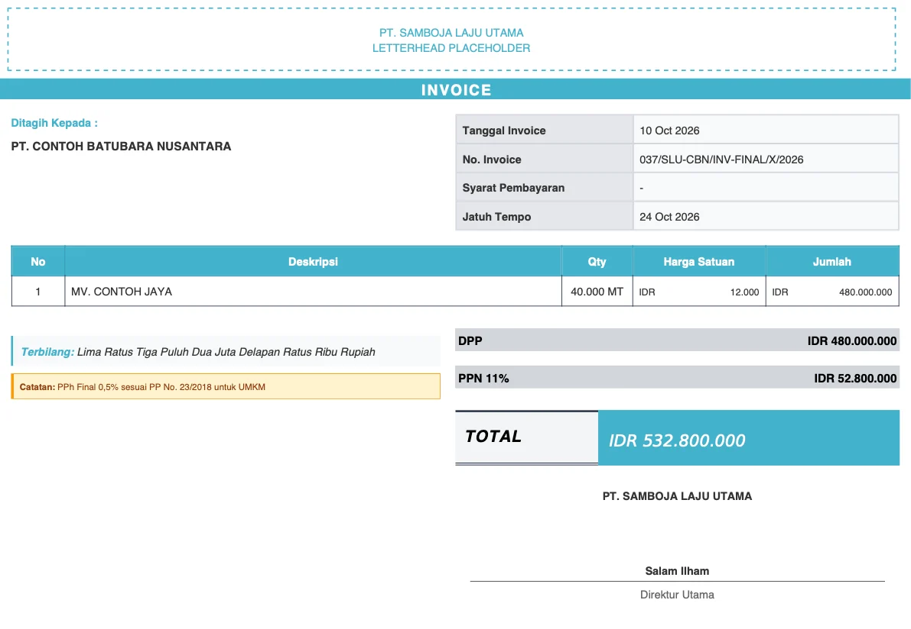
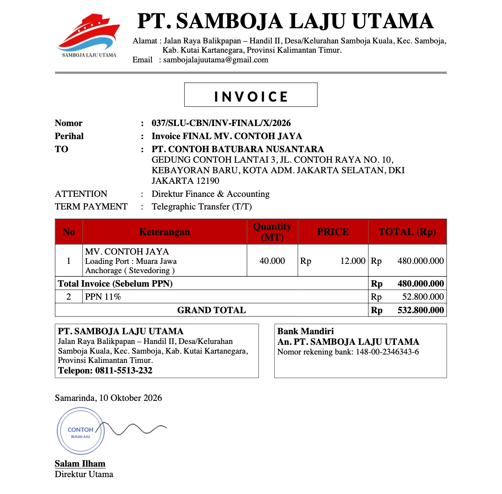
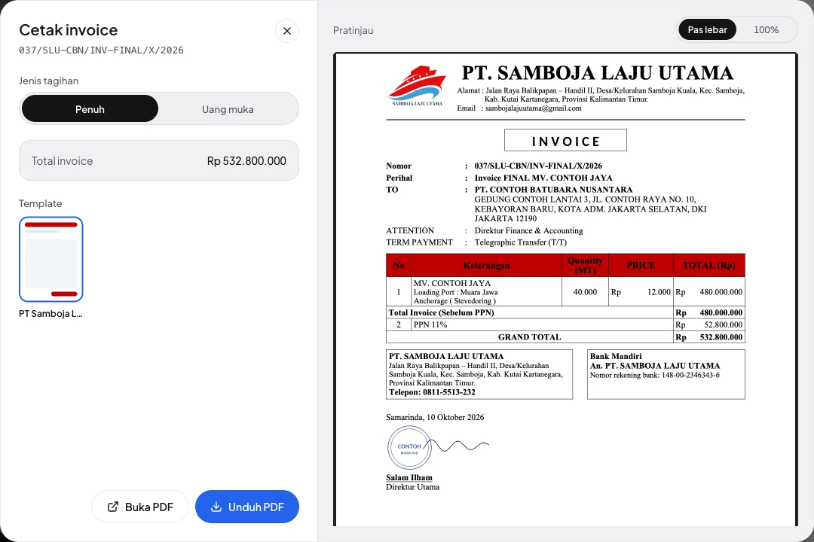
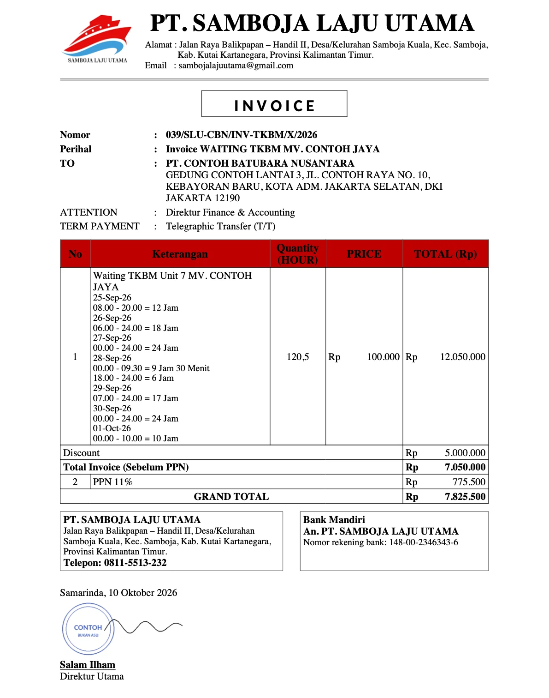
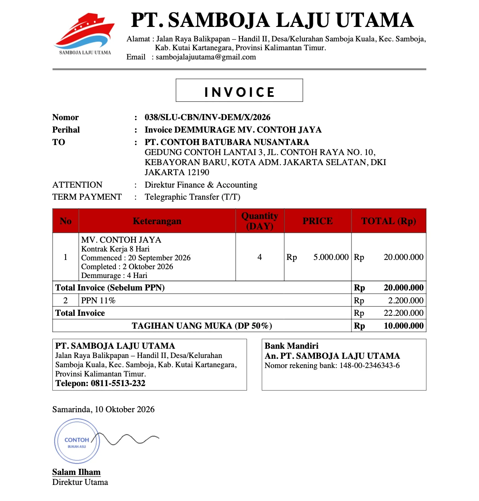
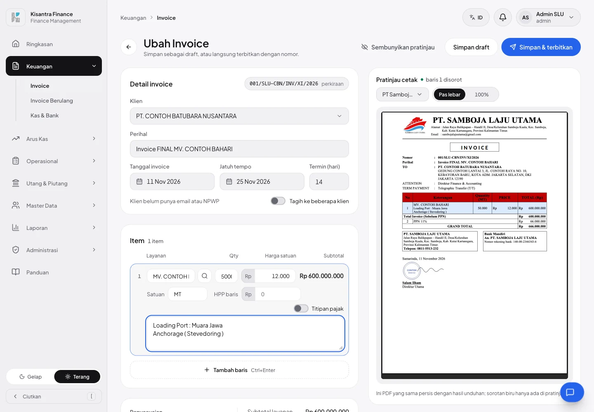

# Template invoice per perusahaan — contoh pertama PT Samboja Laju Utama

Invoice **PT Samboja Laju Utama (SLU)** sekarang tercetak dengan **desain invoice SLU sendiri**, ditiru dari invoice Word perusahaan: kop berlogo kapal, judul berkotak, tabel berjudul merah, kotak alamat & rekening Bank Mandiri, dan blok tanda tangan. Desainnya **statis di kode**; yang berubah per invoice hanya datanya. Perusahaan lain tidak berubah.

Ada satu migration tenant (dua kolom opsional) dan seeder contoh baru. Tidak ada perubahan izin.

---

## Sebelum → sesudah

Invoice yang sama dari PT SLU.

| Sebelum — semua perusahaan memakai template Kisantra | Sesudah — template milik SLU |
|---|---|
|  |  |

---

## Yang berubah

### 1. Template per perusahaan (statis)

- Satu perusahaan = satu folder `resources/views/pdf/perusahaan/{slug}/` (Blade + logo + font). Mengganti desain = ubah file, lalu deploy.
- Perusahaan yang punya folder ini **hanya** memakai templatenya: dialog cetak dan editor hanya menawarkan template itu, dan template bawaan lain ditolak lewat URL (404).
- Perusahaan tanpa folder **tidak berubah**: tetap Kisantra/Semesta/AGSA/Generik + template builder.
- Hitungan (DPP, PPN, total, uang muka, pelunasan) tetap dari sistem; template hanya menampilkan.



### 2. Template SLU

- Font mengikuti dokumen asli: **Times New Roman** (kop 26/10 pt, isi 11 pt, judul kolom 12 pt tebal hitam di atas merah). Judul memakai **Carlito**, pengganti Calibri yang ukurannya identik (lisensi OFL, disertakan).
- Kop terulang di setiap halaman, dan rincian total tidak pernah terpisah dari tabelnya.
- Mode **Uang muka** dan **Pelunasan** didukung.
- **Gambar tanda tangan & stempel tidak disimpan di repo** (repo publik). Template mengambilnya dari upload **Pengaturan › Profil perusahaan**; kalau kosong, tersedia ruang untuk tanda tangan basah.

| Keterangan item beberapa baris | Uang muka |
|---|---|
|  |  |

### 3. Editor: Perihal & keterangan item

- **Perihal** (opsional) di bawah Klien.
- **Tambah keterangan** di tiap item: teks beberapa baris di bawah nama layanan, mis. pelabuhan muat atau rincian jam.
- Keduanya tercetak bila template perusahaan memakainya; template bawaan mengabaikannya.



### 4. Seeder contoh SLU

```bash
php artisan tenants:migrate
php artisan db:seed --class=ContohInvoiceSluSeeder
```

| Akun | Password | Peran |
|---|---|---|
| `admin.slu@mitragroup.id` | `password` | admin PT SLU |
| `staff.slu@mitragroup.id` | `password` | staff PT SLU |

Keduanya hanya anggota PT SLU, jadi setelah login langsung masuk ke SLU. Seeder hanya membuat perusahaan SLU (bukan 10 perusahaan Mitra Group), lalu mengisi profil dan format nomor `{NO}/{PT}-{KLIEN}/INV/{BLN_ROMAWI}/{THN}` (urut per tahun), satu klien, tiga invoice terbit, dan satu draft. **Semua datanya fiktif**, termasuk gambar tanda tangan bertuliskan "CONTOH". Aman dijalankan ulang dan bersama `MitraGroupSeeder`; tanda tangan yang sudah diunggah tidak ditimpa.

---

## Cara kerjanya (singkat)

1. `CompanyInvoiceTemplate` mencari view `pdf.perusahaan.{slug}.invoice` untuk perusahaan aktif. Kalau ada, template `perusahaan` menjadi bawaan dan satu-satunya pilihan Blade; kalau tidak ada, perilaku lama.
2. Frontend diberi tahu lewat prop `companyTemplate` (daftar invoice, editor) dan `company_template` (data drawer).
3. Kolom baru di database perusahaan: `invoices.subject` dan `invoice_items.description`, keduanya boleh kosong.
4. Perbaikan DomPDF: `renderPdf()` memanggil `setOptions()` tanpa config, sehingga file font di `resources/` ditolak diam-diam dan judul jatuh ke Helvetica. Untuk template perusahaan, folder proyek dan cache font dipasang, dan font di-subset (PDF hanya +4 KB).

---

## File yang berubah

| File | Isi |
|---|---|
| `app/Services/CompanyInvoiceTemplate.php` | **Baru** — cari template perusahaan, daftar template sah, aset & path di folder perusahaan |
| `resources/views/pdf/perusahaan/samboja-laju-utama/` | **Baru** — `invoice.blade.php`, `logo.jpg`, `fonts/Carlito-Bold.ttf` + lisensi OFL |
| `database/migrations/tenant/2026_11_11_171709_add_subject_and_item_description_to_invoices.php` | **Baru** — `invoices.subject`, `invoice_items.description` |
| `database/seeders/ContohInvoiceSluSeeder.php` | **Baru** — PT SLU + akun + data contoh fiktif |
| `app/Services/InvoicePrintService.php` | View per perusahaan, tanda tangan/stempel dari profil, opsi DomPDF untuk font template |
| `routes/web.php`, `app/Http/Controllers/InvoiceController.php` | Template bawaan & daftar sah dari `CompanyInvoiceTemplate`; simpan/kirim perihal & keterangan |
| `app/Http/Requests/StoreInvoiceRequest.php`, `InvoicePreviewRequest.php`, `app/Models/Invoice.php`, `InvoiceItem.php` | Validasi & kolom baru |
| `resources/js/pages/invoices/create.tsx`, `edit.tsx`, `index.tsx`, `components/print-invoice-dialog.tsx`, `components/invoice-drawer.tsx` | Isian Perihal & keterangan, pilihan template perusahaan |
| `resources/js/locales/{en,zh}.json`, `lang/{en,zh}.json` | Teks baru (3 bahasa) |
| `docs/module/invoices.md`, `video/invoices/guide.ts` | Dokumentasi modul & panduan pengguna |
| `tests/Feature/CompanyInvoiceTemplateTest.php`, `ContohInvoiceSluSeederTest.php` | **Baru** — 10 tes |

---

## Cara mencoba

1. `php artisan tenants:migrate`, lalu `php artisan db:seed --class=ContohInvoiceSluSeeder`, lalu `npm run build` (atau `composer dev`).
2. Login `admin.slu@mitragroup.id` / `password` → **Invoice** → tab **Perlu ditagih** → buka invoice → **Cetak**. Coba **Penuh** dan **Uang muka**.
3. Buka draft → **Ubah** → isi **Perihal** dan **Tambah keterangan**; pratinjau di kanan ikut berubah.
4. Login sebagai perusahaan lain → dialog cetak tetap menampilkan template bawaan seperti sebelumnya.

## Pengujian

- [x] `CompanyInvoiceTemplateTest` (7) dan `ContohInvoiceSluSeederTest` (3)
- [x] Suite Unit + Feature: 1.010 lulus, 1 dilewati (`KoneksiClaudeTest` butuh `php artisan passport:keys` di worktree baru — sama seperti CI di #25)
- [x] `tsc --noEmit`, `npm run build`, `npm run i18n:check` 0 galat
- [x] Dicoba langsung: login akun SLU, dialog cetak (Penuh & Uang muka), editor + pratinjau, invoice dua halaman

## Belum termasuk / catatan

- **PPh 23 belum.** Grand total masih sebelum potongan PPh 23 (invoice asli SLU memotong 2%). Agar status Lunas tetap benar, potongan ini harus masuk hitungan invoice → PR terpisah.
- **DEBIT NOTE dan kode jenis di nomor** (`INV-FINAL`, `INV-DEM`, `DN-PNBP`) belum. Nomor contoh diisi manual; nomor otomatis berikutnya `001/SLU-CBN/INV/XI/2026`.
- Dibanding dokumen Word: "Prihal" ditulis "Perihal", angka memakai format Indonesia (`480.000.000`), dan PPN dibulatkan biasa tanpa koreksi manual.
- **Tanda tangan asli SLU** diunggah lewat Profil perusahaan di server. Jangan di-commit ke repo.
- Template Builder memanggil `setOptions()` dengan cara yang sama, jadi font kustomnya mungkin kena masalah chroot yang sama. Belum dicek.
- Screenshot di **/panduan** belum diambil ulang (teks panduannya sudah diperbarui).
- Semua data di screenshot adalah data fiktif dari seeder.
