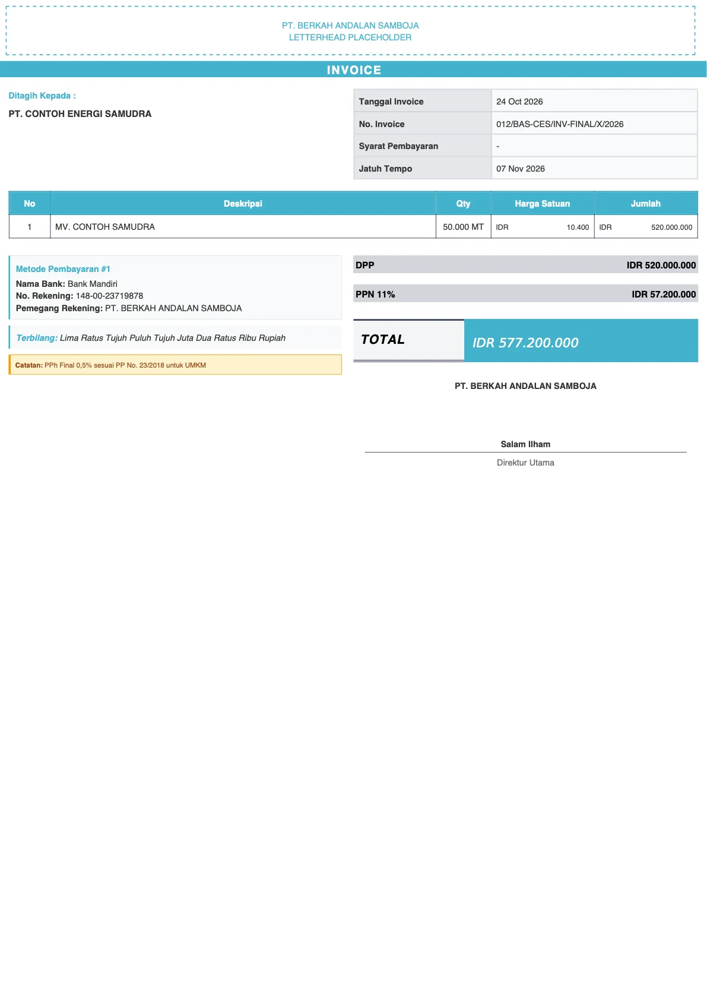
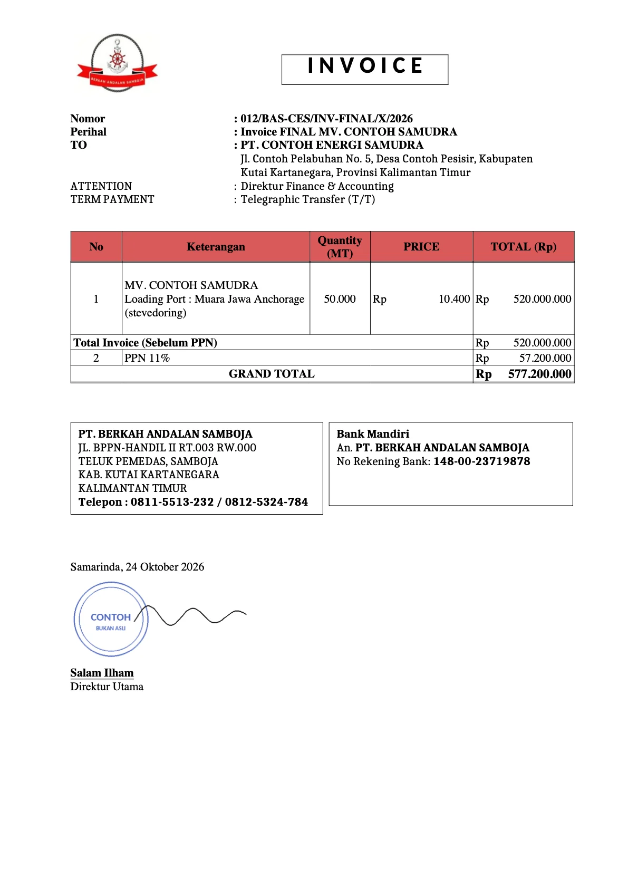
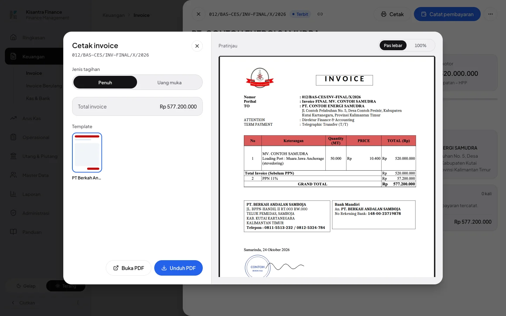
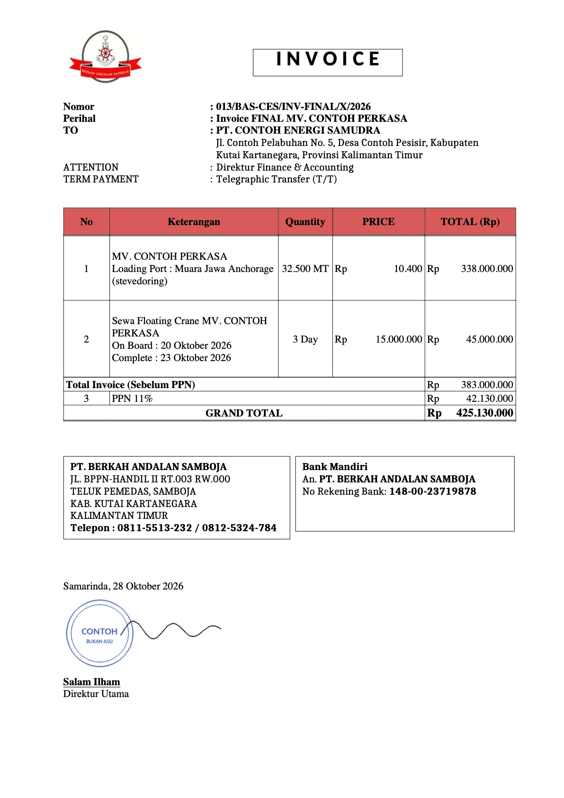
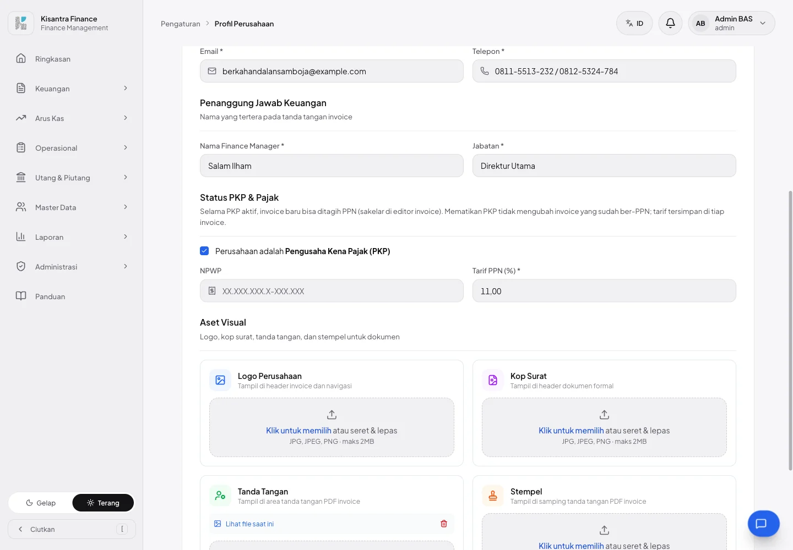
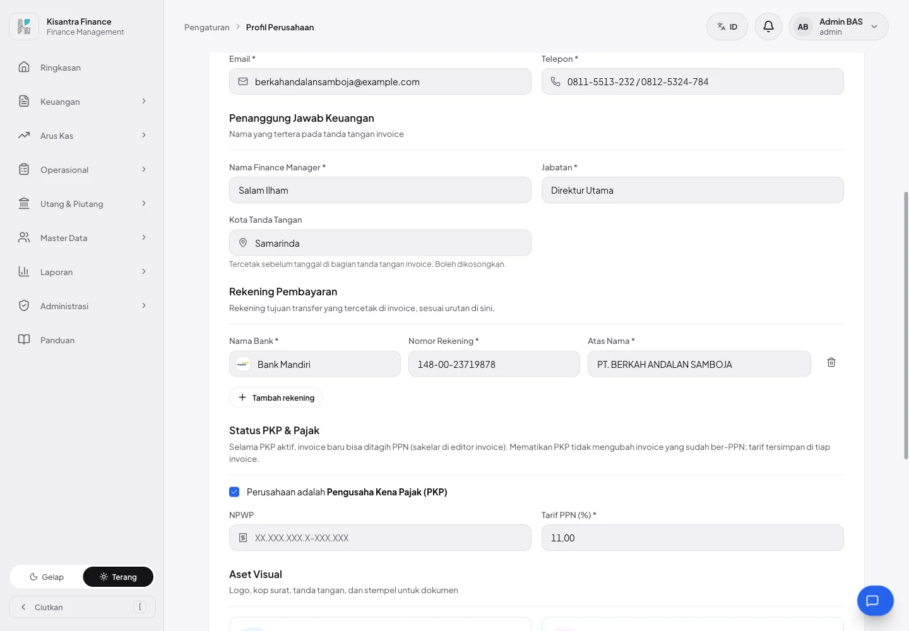
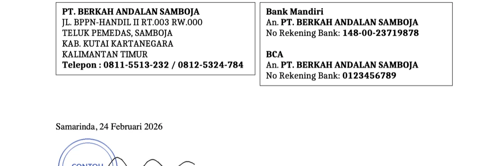
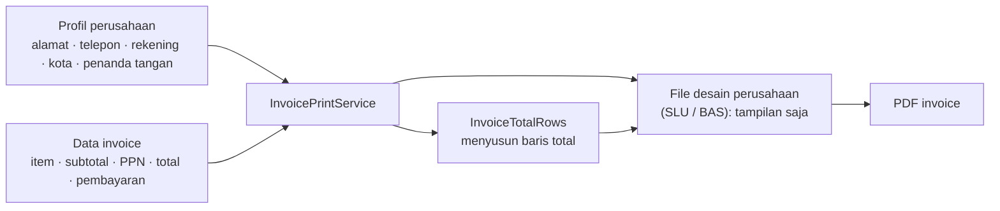

# Template invoice PT BAS + data perusahaan dari Profil perusahaan

PR ini berisi dua hal:

1. **PT Berkah Andalan Samboja (BAS) punya desain invoice sendiri**, ditiru dari invoice Word perusahaan, dengan cara kerja yang sama seperti PT SLU (#31).
2. **Data perusahaan di invoice tidak lagi ditulis di kode.** Alamat, telepon, rekening, kota, dan penanda tangan di invoice SLU & BAS sekarang diambil dari **Pengaturan › Profil perusahaan**. Admin bisa mengubahnya sendiri tanpa menunggu programmer atau deploy.

Tidak ada perubahan izin. Ada dua migration tenant kecil (satu kolom baru + pengisian awal data).

---

## Ringkasan singkat

| | Sebelum | Sesudah |
|---|---|---|
| Invoice PT BAS | Memakai desain bawaan Kisantra | Desain BAS sendiri, mirip dokumen Word |
| Alamat, telepon, rekening, kota, penanda tangan di invoice SLU | Ditulis di file desain; ganti rekening = minta programmer | Diambil dari Profil perusahaan; admin mengubahnya sendiri |
| Rekening di Profil perusahaan | Tidak ada isiannya di layar | Bagian baru **Rekening Pembayaran** (maks. 5 rekening) |
| Kota di bagian tanda tangan | Ditulis di file desain ("Samarinda") | Isian baru **Kota Tanda Tangan** |
| Baris total (PPN, grand total, uang muka, pelunasan) | Disusun ulang di setiap file desain | Disusun sistem di satu tempat; desain hanya mengatur tampilannya |

**Yang tidak berubah:** tampilan invoice SLU (dicek per piksel, identik), perusahaan lain yang memakai desain bawaan, cara menghitung invoice dan status Lunas, serta hak akses.

---

## 1. Invoice PT BAS

Invoice contoh yang sama dari PT BAS (data fiktif).

| Sebelum — desain bawaan Kisantra | Sesudah — desain milik BAS |
|---|---|
|  |  |

Isi desain BAS, mengikuti `INVOICE FINAL … .docx`:

- Logo BAS di kiri atas dan judul **I N V O I C E** dalam kotak (hanya di halaman pertama, seperti dokumen asli).
- Blok **Nomor, Perihal, TO** (nama & alamat klien), **ATTENTION**, **TERM PAYMENT**.
- Tabel item dengan judul kolom merah: No · Keterangan · Quantity · PRICE · TOTAL (Rp).
- Baris total: Total Invoice (Sebelum PPN), PPN, GRAND TOTAL. Mode **Uang muka** dan **Pelunasan** juga didukung.
- Kotak alamat perusahaan dan kotak rekening, lalu kota-tanggal dan tanda tangan.
- Huruf mengikuti Word: Times New Roman; judul memakai **Carlito** (pengganti Calibri) dan alamat/kotak info memakai **Caladea** (pengganti Cambria). Keduanya gratis, ukurannya sama dengan aslinya, lisensinya ikut disertakan.
- Posisi teks dibandingkan dengan render dokumen Word asli: selisih ≤ 1 mm.

Akun BAS hanya melihat desain BAS di dialog cetak (sama seperti SLU):



Invoice dengan dua item bersatuan berbeda (MT dan Day) — satuan pindah ke tiap baris, nomor baris PPN melanjutkan nomor item:



---

## 2. Tampilan (UI) — Profil perusahaan

| Sebelum | Sesudah |
|---|---|
|  |  |

Yang baru di halaman **Pengaturan › Profil perusahaan**:

- **Kota Tanda Tangan** (di bagian Penanggung Jawab Keuangan) — opsional. Bila diisi, tercetak sebelum tanggal, mis. "Samarinda, 24 Oktober 2026". Kosong = tanggal saja.
- **Rekening Pembayaran** (bagian baru):
  - Tiap baris: **Nama Bank** (bisa diketik bebas atau dipilih dari daftar, lengkap dengan logo bank seperti di Kas & Bank), **Nomor Rekening**, **Atas Nama**.
  - Tombol **Tambah rekening** (maks. 5) dan ikon hapus per baris.
  - Baris yang dibiarkan kosong diabaikan saat disimpan; baris yang terisi sebagian ditolak dengan pesan per baris ("Nomor rekening 1 wajib diisi.").
  - Urutan di layar = urutan cetak di invoice. Menghapus semua baris = invoice tercetak tanpa rekening.
- Rekening ini dipakai semua desain invoice yang mencetak rekening (Kisantra, Semesta, Generik, SLU, BAS) — sebelumnya isinya hanya bisa diisi lewat seeder.
- Teks baru tersedia dalam 3 bahasa (Indonesia, English, 中文).

Contoh: profil BAS dengan dua rekening — kotak rekening di invoice ikut memanjang:



---

## 3. Database

Hanya database **perusahaan** (tenant) yang berubah, dan hanya tabel `company_profiles`. Database pusat, tabel invoice, dan izin tidak berubah.

| Kolom `company_profiles` | Sebelum | Sesudah |
|---|---|---|
| `bank_accounts` (JSON) | Sudah ada, tetapi tidak bisa diisi dari layar (hanya lewat seeder/tinker) | Diisi dari bagian **Rekening Pembayaran**. Isinya daftar `{bank, account_number, account_name}`, maks. 5; tanpa rekening = `null` |
| `signature_city` | Belum ada | **Kolom baru**, teks maks. 100 karakter, boleh kosong |

Dua migration tenant:

| Migration | Isi |
|---|---|
| `2026_11_12_224347_add_signature_city_to_company_profiles_table` | Menambah kolom `signature_city`. |
| `2026_11_12_224348_isi_rekening_dan_kota_template_perusahaan` | Untuk **SLU dan BAS saja**: mengisi rekening dan kota dengan nilai yang dulu tertulis di file desain — **hanya bila isiannya masih kosong**. Tujuannya supaya invoice SLU yang sudah dipakai tidak kehilangan rekening saat deploy. Perusahaan lain tidak tersentuh. |

---

## 4. Cara kerja di balik layar



| Bagian | Sebelum (setelah #31) | Sesudah |
|---|---|---|
| Data perusahaan di invoice SLU | Ditulis langsung di file desain | Dibaca dari Profil perusahaan. File desain boleh mengatur gayanya (mis. nama selalu huruf kapital) tetapi tidak menulis isinya |
| Baris total | Setiap file desain menyusun sendiri (diskon, DPP, PPN, DP, pelunasan) | Disusun satu kelas, `InvoiceTotalRows`. File desain hanya menampilkan dan memberi gaya per jenis baris. Aturan baru nanti (mis. **PPh 23**) cukup ditambahkan sekali, semua desain perusahaan ikut |
| Seeder contoh | Satu seeder SLU berisi semua langkah | Satu kelas dasar (`ContohInvoicePerusahaanSeeder`); seeder SLU & BAS hanya berisi data |
| Menambah perusahaan berdesain sendiri | Folder desain baru + data ditulis di file | Folder desain baru saja; datanya diisi admin di Profil |

**Bukti tampilan tidak berubah:** PDF SLU dan BAS dirender sebelum dan sesudah pemindahan data untuk 7 kasus (penuh, uang muka, pelunasan, diskon, beberapa halaman, tanpa PPN, satuan berbeda) lalu dibandingkan per piksel — 17 dari 17 halaman identik.

---

## 5. Yang perlu dilakukan saat deploy

1. `./deploy.sh` seperti biasa (menjalankan `tenants:migrate` dan build).
2. Rekening dan kota SLU & BAS **terisi otomatis** bila masih kosong.
3. **Periksa Profil perusahaan SLU dan BAS di server.** Nama, alamat, telepon, serta nama & jabatan penanda tangan sekarang dicetak dari sana. Untuk BAS, tulis alamat **per baris** dan dua nomor telepon (`0811-5513-232 / 0812-5324-784`) supaya sama dengan dokumen Word.

---

## 6. File yang berubah

| File | Isi |
|---|---|
| `resources/views/pdf/perusahaan/berkah-andalan-samboja/` | **Baru** — desain invoice BAS, logo, font Carlito & Caladea + lisensi |
| `resources/views/pdf/perusahaan/samboja-laju-utama/invoice.blade.php` | Data perusahaan & baris total tidak lagi ditulis di file |
| `app/Services/InvoiceTotalRows.php` | **Baru** — penyusun baris total |
| `app/Services/InvoicePrintService.php` | Meneruskan baris total dan kota tanda tangan ke desain |
| `app/Http/Controllers/Settings/CompanyController.php`, `app/Http/Requests/Settings/UpdateCompanyRequest.php`, `app/Models/CompanyProfile.php` | Simpan & validasi rekening dan kota |
| `resources/js/pages/settings/company.tsx` | Isian Kota Tanda Tangan dan bagian Rekening Pembayaran |
| `database/migrations/tenant/2026_11_12_2243{47,48}_*.php` | **Baru** — kolom kota + pengisian awal SLU/BAS |
| `database/seeders/ContohInvoicePerusahaanSeeder.php`, `ContohInvoiceBasSeeder.php`, `ContohInvoiceSluSeeder.php` | **Baru**/diringkas — data contoh SLU & BAS |
| `resources/js/locales/{en,zh}.json`, `lang/{en,zh}.json` | Teks baru (3 bahasa) |
| `docs/module/invoices.md`, `docs/module/settings.md`, `video/settings/guide.ts` | Dokumentasi modul & panduan pengguna |
| `tests/Feature/…` | Tes baru: template BAS, seeder BAS, baris total, rekening & kota di profil, migration pengisian awal |

---

## 7. Cara mencoba

```bash
php artisan tenants:migrate
php artisan db:seed --class=ContohInvoiceBasSeeder
npm run build   # atau composer dev
```

| Akun | Password | Peran |
|---|---|---|
| `admin.bas@mitragroup.id` | `password` | admin PT BAS |
| `staff.bas@mitragroup.id` | `password` | staff PT BAS |

1. Login `admin.bas@mitragroup.id` → **Invoice** → tab **Perlu ditagih** → buka invoice → **Cetak**. Coba **Penuh** dan **Uang muka**.
2. **Pengaturan › Profil perusahaan** → **Tambah rekening** → isi → **Simpan Perubahan** → cetak invoice lagi: rekening baru ikut tercetak.
3. Login perusahaan lain → dialog cetak tetap menampilkan desain bawaan seperti sebelumnya.

## 8. Pengujian

- [x] 222 tes terkait (invoice, seeder, pengaturan, multi bahasa) lulus, termasuk 20 tes baru
- [x] Suite `TenancyReal` (migrasi sungguhan per database perusahaan): 44 lulus
- [x] Render SLU & BAS sebelum/sesudah pemindahan data: 17/17 halaman identik per piksel
- [x] `npm run i18n:check` 0 galat, `tsc --noEmit` bersih, `npm run build`
- [x] Dicoba langsung: login BAS, dialog cetak, menambah rekening di Profil lalu mencetak ulang

## 9. Belum termasuk / catatan

- **PPh 23 belum.** Invoice Word BAS memotong PPh 23 0,5% (SLU 2%). Baris "Total Invoice + PPN (belum dipotong PPh)" dan "PPh 23" belum tercetak; GRAND TOTAL = total termasuk PPN. Agar status Lunas tetap benar, potongan ini harus masuk hitungan invoice → PR terpisah (cukup ditambahkan di `InvoiceTotalRows`).
- **Debit Note** belum (4 dari 5 dokumen contoh BAS adalah Debit Note); usulannya dibahas terpisah.
- Dibanding dokumen Word: "Prihal" ditulis "Perihal", angka memakai format Indonesia (`10.400`, bukan `10,400.00`), dan satuan ikut di judul kolom ("Quantity (MT)") — sama seperti keputusan di SLU.
- Logo BAS diambil dari dokumen Word (219×163 px, kecil). Bila ada berkas logo yang lebih besar, cukup ganti `logo.jpg`.
- Email di profil contoh BAS memakai `@example.com` karena dokumen asli tidak mencantumkan email.
- Nomor rekening SLU & BAS ada di migration pengisian awal (repo publik), sama seperti sebelumnya tertulis di desain SLU. Tanda tangan & stempel tetap tidak disimpan di repo.
- Screenshot halaman Profil perusahaan di **/panduan** belum diambil ulang (teks panduannya sudah diperbarui).
- Semua data di screenshot adalah data fiktif dari seeder.
