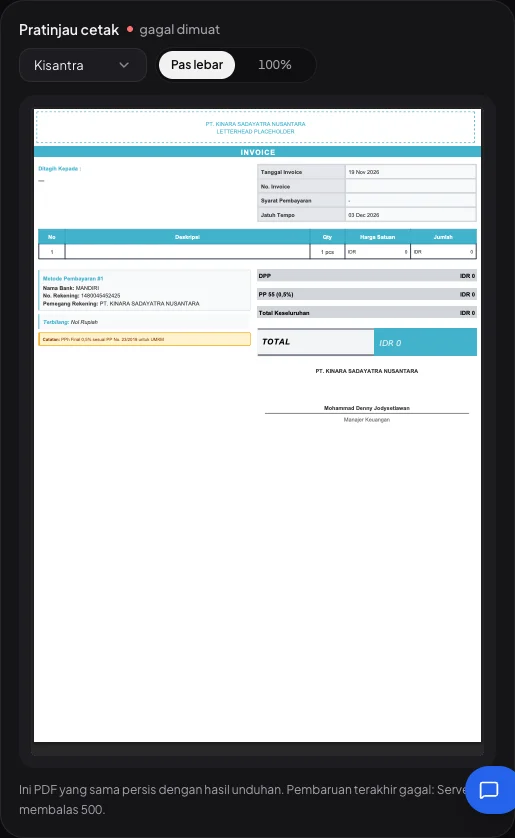
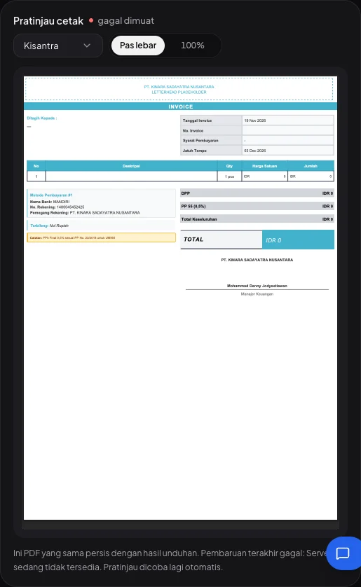
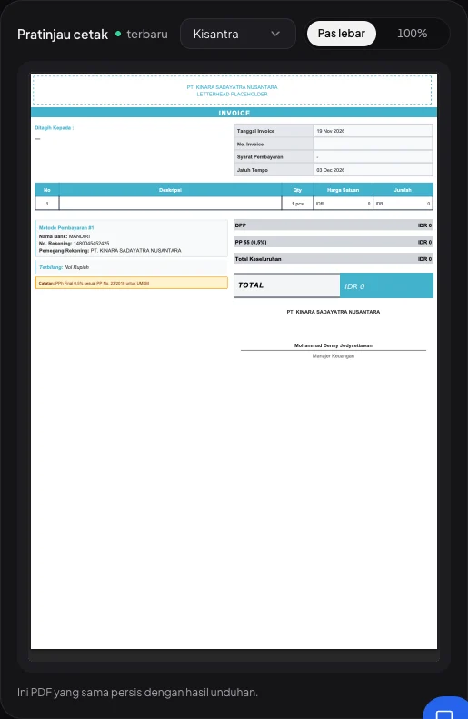
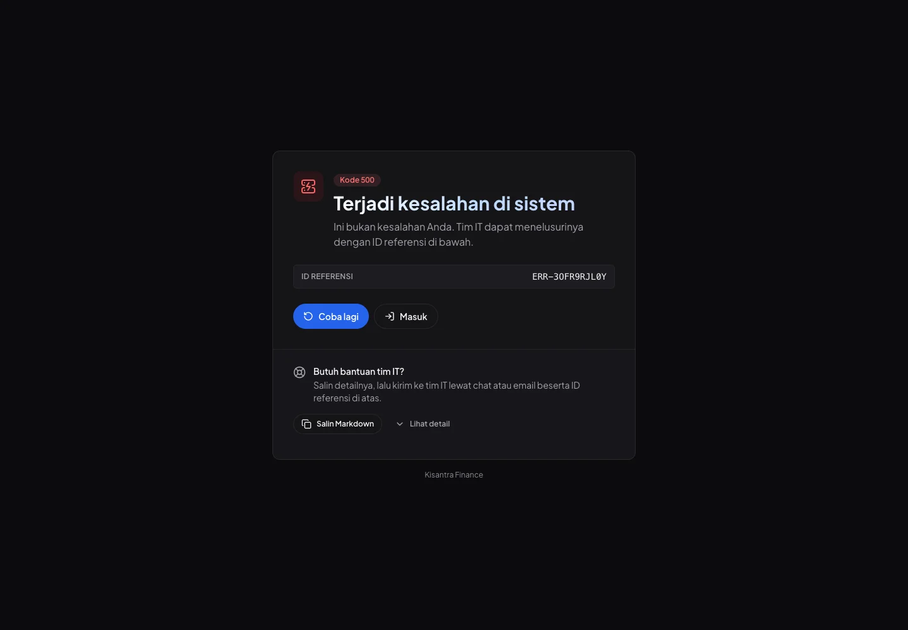
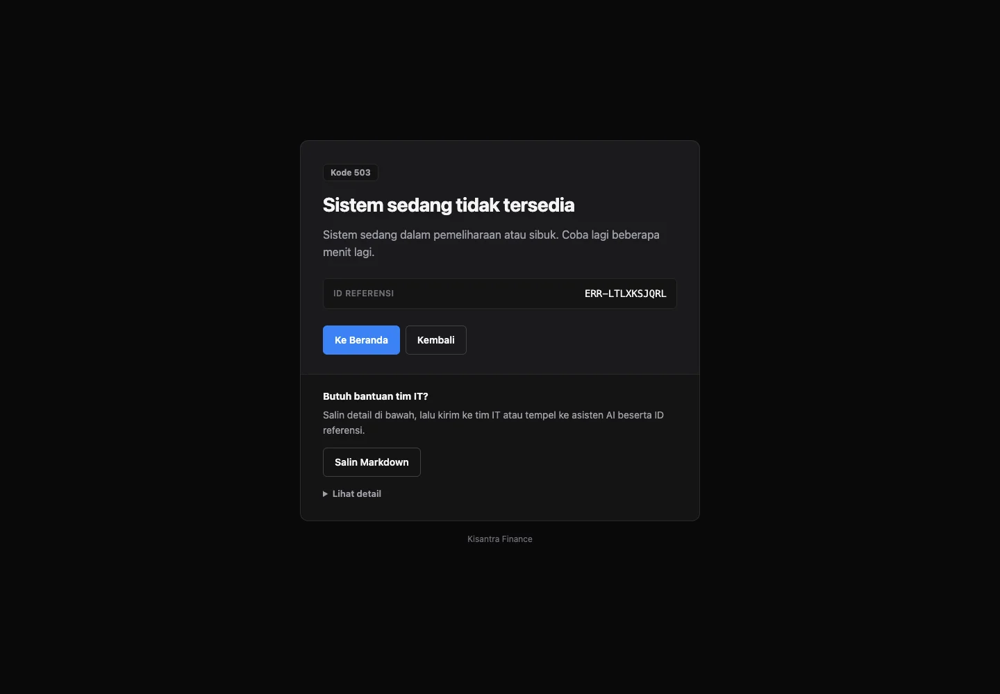

# Watchpost #18: MySQL restart → 503 + pratinjau invoice pulih sendiri

| | |
|---|---|
| Watchpost | [#18](https://watchpost.kisantra.com/errors/18) · tiket [#19](https://watchpost.kisantra.com/tickets/19) |
| Exception | `Illuminate\Database\QueryException`: `SQLSTATE[HY000] [2002] Connection refused (Connection: mysql, … Database: kisantra-finance_central, SQL: update sessions …)` |
| Request | `POST /c/utama/invoices/preview` (`invoices.preview`), 2 kali pada detik yang sama, 1 pengguna |
| Rilis produksi | `d542083` |
| Waktu sebenarnya | **2026-11-17 08:46:33 UTC** (Watchpost menampilkan `16:46:33+00:00`, lihat "Catatan waktu") |

## Penyebab

Server MySQL (Percona) produksi **di-restart oleh systemd** tepat saat itu. Dibaca dari server
(`systemctl show mysql`, hanya-baca):

| | |
|---|---|
| `ExecMainStartTimestamp` | 2026-11-17 **08:45:52** UTC |
| `ActiveEnterTimestamp` | 2026-11-17 **08:46:34** UTC (42 detik pemulihan InnoDB) |
| `Restart` / `NRestarts` | `on-failure` / **3** sejak boot 2026-11-05 05:37 UTC |

Error terjadi pukul 08:46:33, satu detik sebelum MySQL siap. Request pratinjau sudah membaca sesi
dan merender PDF, lalu `StartSession` menulis sesi ke database pusat; koneksinya sudah putus,
Laravel menyambung ulang, dan ditolak (`Connection refused`).

**Ini bukan bug di kode aplikasi**: aplikasi tidak bisa mencegah database mati. Alasan MySQL
gagal (kemungkinan besar OOM killer: `mysqld` memakai 1,1 GB RSS dan `oom_score` 739, tertinggi di
server) hanya bisa dipastikan dengan akses root, lihat "Di server".

Yang bisa diperbaiki adalah **apa yang dialami pengguna** selama ±40 detik itu.

## Sebelum

Direproduksi di `main` (`cbb6e0f`) dengan proxy TCP di depan MySQL lokal: proxy meneruskan
koneksi, lalu begitu melihat `update sessions` ia memutus semua koneksi dan menolak koneksi baru,
sama seperti MySQL yang mati di tengah request. `laravel.log` berisi exception yang **sama persis**
dengan Watchpost (`[2002] Connection refused … SQL: update sessions …`, jejak
`DatabaseSessionHandler::write` → `StartSession::saveSession`).

- Pratinjau: **"gagal dimuat · Pembaruan terakhir gagal: Server membalas 500."** dan diam di situ
  sampai pengguna mengetik lagi atau menekan Coba lagi.
- Halaman yang dibuka selama gangguan: **500 "Terjadi kesalahan di sistem"** dengan tombol
  **"Masuk"**, seolah pengguna keluar (sesinya tidak terbaca).

## Perubahan

1. **`ErrorReportService::respond()`**: bila exception (atau rantai previous-nya) adalah
   `QueryException`/`PDOException` yang dikenali `LostConnectionDetector` Laravel ("Connection
   refused", "server has gone away", …), balasannya **503 + `Retry-After: 10`**:
   - halaman → cadangan Blade `errors.503` ("Sistem sedang tidak tersedia"), tanpa mencoba
     halaman Inertia yang propnya butuh database;
   - JSON → `{"message": "Sistem sedang dalam pemeliharaan atau sibuk. …"}` (sudah ada di kamus en/zh).

   Exception tetap dilaporkan ke log dan Watchpost. Error query lain (mis. kolom tidak ada) tetap 500
   seperti sebelumnya. Mode debug tidak berubah.
2. **Pratinjau invoice** (`useLivePreview`): balasan 503 dicoba lagi otomatis setelah `Retry-After`
   (dibatasi 2–30 detik, paling banyak 12 kali berturut-turut) dengan pesan *"Server sedang tidak
   tersedia. Pratinjau dicoba lagi otomatis."* (en/zh ditambahkan).
3. Dokumen modul: `docs/module/README.md` (Halaman error) dan `docs/module/invoices.md` (Pratinjau langsung).

## Sesudah

Skenario proxy yang sama:

```text
02:45:41 preview 200
02:45:45 preview 503  Retry-After: 10     ← MySQL "restart"
02:45:55 preview 200                      ← dicoba lagi sendiri, tanpa klik
02:45:58 GET /c/kisantra/invoices 503  Retry-After: 10
```

| | Sebelum | Sesudah |
|---|---|---|
| Pratinjau saat MySQL restart |  |  |
| Pratinjau setelah MySQL kembali | (tetap gagal sampai pengguna mengetik) |  |
| Halaman yang dibuka saat MySQL restart |  |  |

## Uji

`tests/Feature/DatabaseTidakTerjangkauTest.php` (baru, 5 tes):

| Tes | Tanpa perbaikan | Dengan perbaikan |
|---|---|---|
| pratinjau saat database restart → 503 + `Retry-After` dari halaman cadangan (pesan persis Watchpost #18) | ⨯ 500 | ✓ |
| `server has gone away` (PDOException mentah) → 503 | ⨯ 500 | ✓ |
| JSON → pesan 503 | ⨯ 500 | ✓ |
| exception tetap dilaporkan | ⨯ | ✓ |
| error query lain tetap 500 dengan halaman error biasa | ✓ | ✓ |

Lainnya: `ErrorPageTest`, `HalamanErrorCadanganTest`, `MultiBahasaTest`, `TeksServerMultiBahasaTest`
lulus; `npm run i18n:check` 0 galat; `tsc --noEmit` bersih; Pint bersih. Suite penuh seperti CI
(`./vendor/bin/phpunit`, env dari `.env.example`): **1.130 tes lulus**, 1 dilewati.

## Di server (perlu root, belum dilakukan)

MySQL sudah berjalan normal lagi sejak 08:46:34 dan Watchpost tidak mencatat kejadian baru, tetapi
`NRestarts=3` dalam 13 hari berarti MySQL **gagal tiga kali**. Untuk mencari sebabnya:

```bash
journalctl -u mysql --since "2026-11-17 08:40" --until "2026-11-17 08:47"
dmesg -T | grep -i -E "out of memory|killed process"
tail -n 200 /var/log/mysql/error.log
```

Bila OOM: kecilkan `innodb_buffer_pool_size` atau `pm.max_children` PHP-FPM per site, atau beri
`mysql.service` `OOMScoreAdjust=-500` supaya kernel tidak memilih database lebih dulu.

## Catatan waktu

Watchpost menampilkan `16:46:33+00:00`, padahal kejadiannya 08:46:33 UTC. Aplikasi mengirim
`2026-11-17T16:46:33+08:00` (zona `Asia/Makassar`) dengan benar; server Watchpost
(`ErrorIngestor`) menyimpan jam dindingnya ke kolom UTC tanpa konversi, jadi setiap error dari situs
WITA tampil 8 jam lebih lambat. Perbaikannya di repo Watchpost, bukan di sini.
