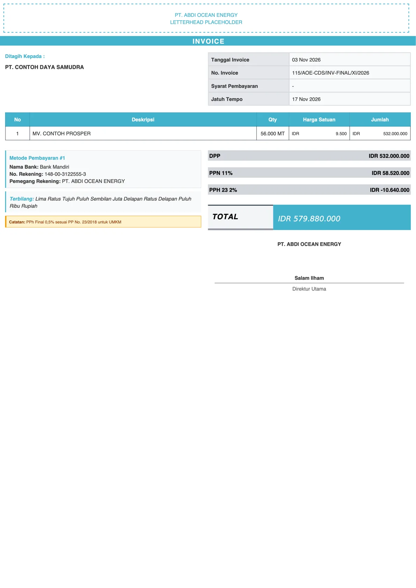
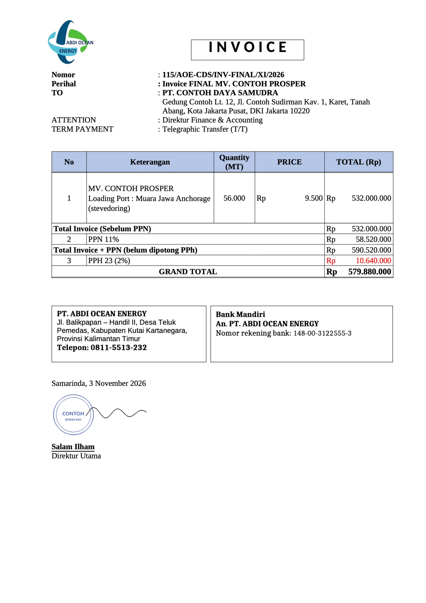
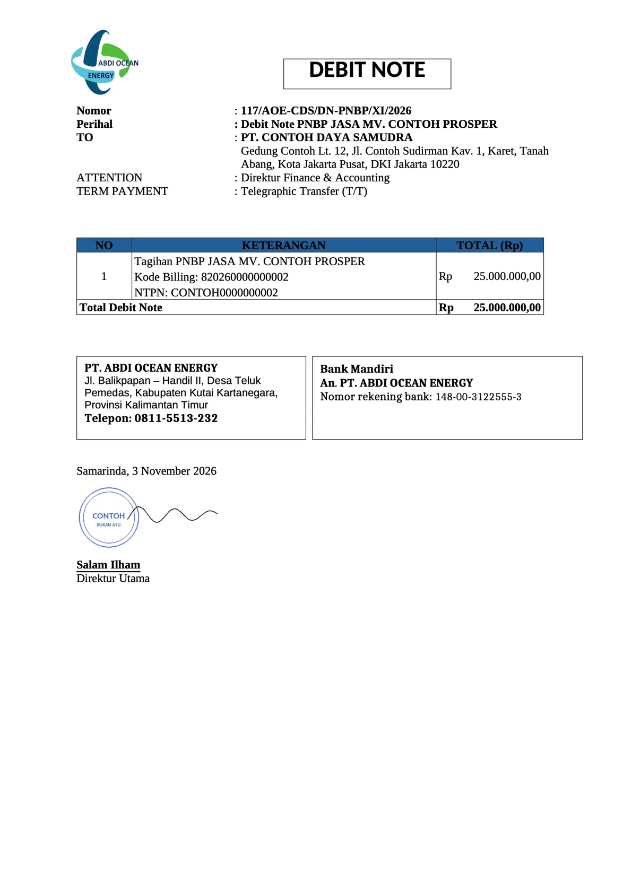
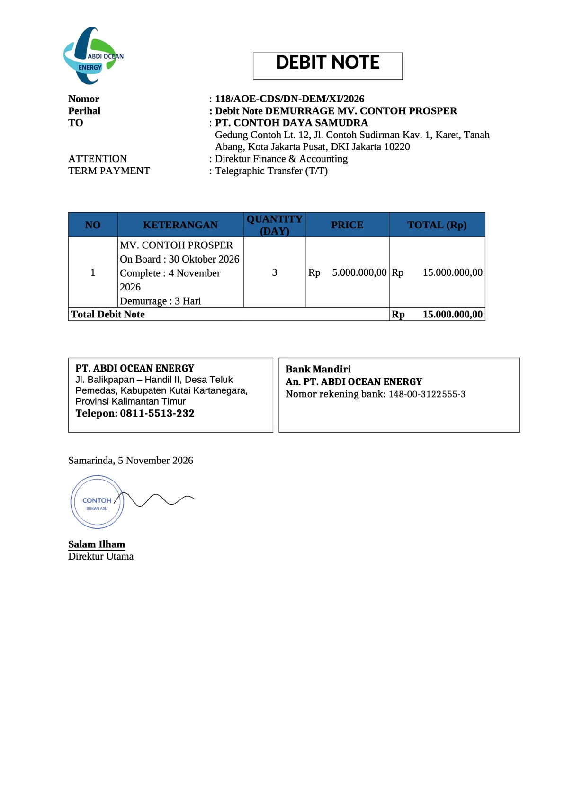
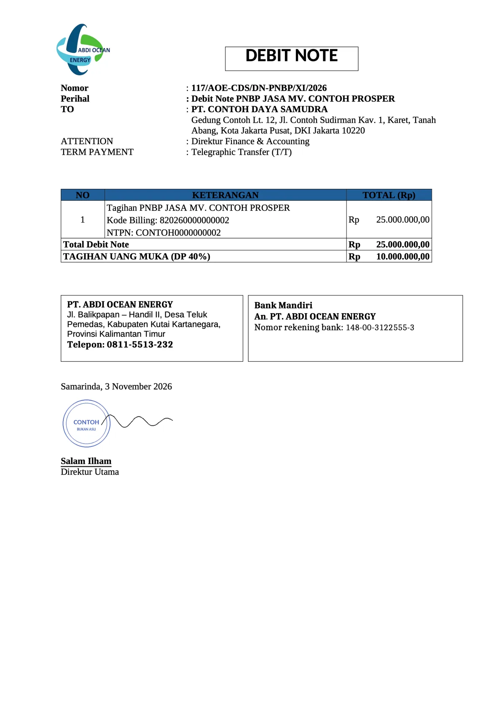
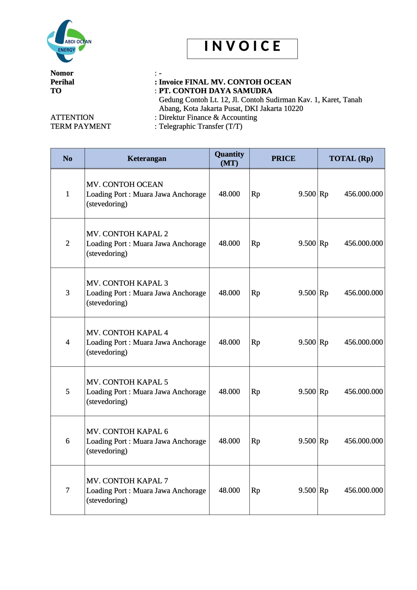
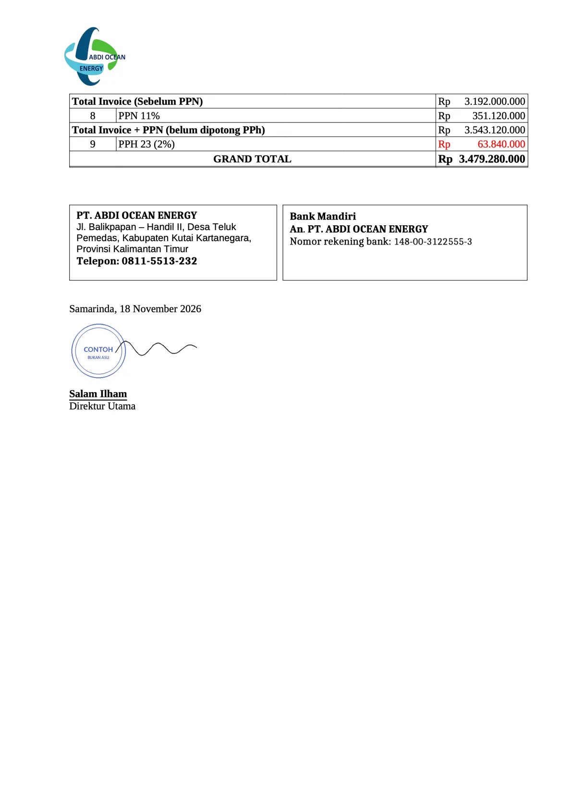

# [Invoice] Create - Template invoice & Debit Note PT Abdi Ocean Energy (AOE)

### 📋 Description

**Context:** PT Abdi Ocean Energy (AOE) punya dokumen Word sendiri untuk invoice (`INVOICE FINAL PT. AOE (DENGAN PPN DAN PPH).docx`) dan Debit Note (`DEBIT NOTE PT. AOE (TANPA PPN DAN PPH).docx`). PR ini menirunya sebagai template PDF di aplikasi, dengan cara kerja yang sama seperti SLU (#31, #35), BAS (#33, #40), serta MKB & BCB (#41).

**Tidak ada perubahan struktur.** Tidak ada tabel/kolom baru, dan model, controller, service, editor, alur status, serta izin tidak diubah. Template dikenali otomatis dari nama folder `abdi-ocean-energy`. Satu migration tenant hanya mengubah **isi data** AOE (sama persis dengan migration SLU/BAS/MKB/BCB).

---

## Ringkasan singkat

| | Sebelum | Sesudah |
|---|---|---|
| Invoice AOE | Desain bawaan Kisantra | Desain AOE, mengikuti dokumen Word |
| Debit Note (talangan) di AOE | Tidak tersedia | Bisa dipilih di editor (**Jenis dokumen › Debit Note**) |
| Nomor dokumen AOE | Format tanpa kode jenis | `115/AOE-SDAM/INV-FINAL/XI/2026`, `117/AOE-SDAM/DN-PNBP/XI/2026`, seperti dokumen asli |

---

## 🖼️ Hasil

Semua contoh memakai data seeder: klien, kapal, nomor, dan nominal **fiktif**. Tanda tangan "CONTOH" digambar seeder (tanda tangan asli diunggah di Profil perusahaan).

### 1. Invoice FINAL

| Sebelum — desain bawaan Kisantra | Sesudah — desain AOE |
|---|---|
|  |  |

- **Tanpa kop surat**: header Word AOE hanya berisi logo, jadi logo diulang di setiap halaman. Nama, alamat, dan telepon perusahaan tercetak di kotak alamat bawah.
- Judul **I N V O I C E** di **kotak bergaris** di kanan atas (hanya halaman pertama).
- Blok **Nomor · Perihal · TO** (nama & alamat klien) · **ATTENTION** · **TERM PAYMENT**.
- Tabel bergaya Excel dengan **judul kolom biru muda**: No · Keterangan · Quantity · PRICE · TOTAL (Rp). Lalu Total Sebelum PPN, PPN 11%, Total + PPN (belum dipotong PPh), **PPH 23 (merah)**, dan GRAND TOTAL.
- **Kotak alamat & kotak rekening** berdampingan, lalu kota-tanggal, tanda tangan, nama & jabatan.

### 2. Debit Note

| Tagihan sekali bayar (PNBP) | Berkolom QUANTITY/PRICE (demurrage 3 hari) |
|---|---|
|  |  |

- Judul **DEBIT NOTE** di kotak yang sama. Logo, blok klien, kotak alamat & rekening, dan tanda tangan sama dengan invoice.
- Tabel seperti Excel di dokumen asli: judul kolom **kapital di atas biru tua** (NO · KETERANGAN · TOTAL (Rp)).
- Kode Billing dan NTPN tercetak satu per baris (diisi lewat keterangan item).
- Nominal selalu ber-",00" (`Rp 25.000.000,00`), dan baris akhir **Total Debit Note** (bukan GRAND TOTAL).
- Kolom **QUANTITY & PRICE** hanya muncul bila ada item dengan jumlah selain 1, sama seperti perusahaan lain.
- Debit Note selalu talangan: tanpa PPN, tanpa PPh 23, dan tidak dihitung pendapatan.

### 3. Harga satuan bersen & tagihan uang muka

| Tarif USD → harga Rupiah bersen | Debit Note, tagihan uang muka |
|---|---|
|  |  |

- Invoice FINAL asli AOE memakai harga **Rp 9.459,46** (56.000 × Rp 9.459,46 = Rp 529.729.760). Angka persis ini bisa dibuat lewat fitur Tagihan USD: **Harga USD $0,5 × kurs 18.918,92**.
- Berbeda dengan MKB, kurs & tarif **tidak** dicetak di blok klien, karena dokumen AOE tidak memuatnya.
- Mode **Uang muka** dan **Pelunasan** didukung: baris "Total Debit Note" lalu "TAGIHAN UANG MUKA (DP x%)".

### 4. Invoice lebih dari satu halaman

| Halaman 1 | Halaman 2 |
|---|---|
|  |  |

Logo diulang di setiap halaman tanpa menimpa teks, judul kolom tabel ikut diulang, dan kotak judul hanya ada di halaman pertama.

---

## 🔧 Scope

- ✅ Template invoice AOE (`invoice.blade.php`): tabel Excel dokumen asli; isinya sama dengan invoice MKB kecuali warna judul kolom dan jarak di atas tabel.
- ✅ Template Debit Note AOE (`debit-note.blade.php`): tabel Excel Debit Note asli.
- ✅ Kerangka bersama (`kerangka.blade.php`): logo, kotak judul, blok klien, kotak alamat & rekening, dan tanda tangan.
- ✅ Logo dari dokumen Word.
- ✅ Font tertanam di PDF:
  - Times New Roman → **Tinos**
  - Calibri → **Carlito** (judul)
  - Cambria → **Caladea** (kotak info)
  - Arial → **Arimo** (alamat)

  Keempatnya gratis, berukuran identik dengan aslinya, dan lisensinya disertakan.
- ✅ Migration tenant khusus AOE: format nomor `{KODE}` + kategori Talangan Klien.
- ✅ Seeder contoh `ContohInvoiceAoeSeeder` + tes.
- ✅ Dokumentasi modul & panduan pengguna.

## 📁 Perubahan berkas

| Berkas | Isi |
|---|---|
| `resources/views/pdf/perusahaan/abdi-ocean-energy/kerangka.blade.php` | **Baru.** Logo (header, diulang tiap halaman), kotak judul, blok klien, kotak alamat & rekening, kota-tanggal, tanda tangan. Data perusahaan dibaca dari Profil perusahaan. |
| `resources/views/pdf/perusahaan/abdi-ocean-energy/invoice.blade.php` | **Baru.** Judul `I N V O I C E` + tabel item & baris total (judul kolom `#b4c6e7`). |
| `resources/views/pdf/perusahaan/abdi-ocean-energy/debit-note.blade.php` | **Baru.** Judul `DEBIT NOTE` + tabel Debit Note (judul kolom `#215f9a`, nominal ",00", Total Debit Note). |
| `resources/views/pdf/perusahaan/abdi-ocean-energy/logo.png`, `fonts/*` | **Baru.** Logo dari dokumen Word; font Tinos, Carlito, Caladea, Arimo + lisensinya. |
| `database/migrations/tenant/2026_11_20_141222_siapkan_debit_note_aoe.php` | **Baru.** Hanya untuk AOE, lihat bagian Database. |
| `database/seeders/ContohInvoiceAoeSeeder.php` | **Baru.** Contoh lokal: akun admin/staff AOE, profil, 1 klien fiktif, 1 invoice FINAL, 3 Debit Note, 1 draft. |
| `tests/Feature/TemplateInvoiceAoeTest.php` | **Baru.** 9 tes template, nomor, Debit Note, tarif USD, uang muka/pelunasan, migration. |
| `tests/Feature/ContohInvoiceAoeSeederTest.php` | **Baru.** 2 tes seeder (isi data & bisa dijalankan ulang). |
| `docs/module/invoices.md`, `docs/module/transaction-categories.md`, `docs/design/debit-note-slu/README.md`, `CLAUDE.md` | Menambahkan AOE ke daftar perusahaan bertemplate Debit Note + penjelasan template AOE. |
| `video/invoices/guide.ts` | Panduan **Membuat Debit Note** menyebut PT Abdi Ocean Energy. |
| `docs/pr/2026-11-20-template-invoice-aoe/` | Ringkasan PR ini + screenshot. |

## 🗄️ Database

Migration tenant `2026_11_20_141222_siapkan_debit_note_aoe` hanya berjalan untuk **AOE** dan **tidak menambah/mengubah kolom**:

1. Format nomor `…/INV/…` → `…/{KODE}/…`, **hanya bila masih persis format lama** `{NO}/{PT}-{KLIEN}/INV/{BLN_ROMAWI}/{THN}`.
2. Mengisi urutan dan kode jenis nomor lama berkode (mis. `…/INV-FINAL/…`), supaya nomor berikutnya tidak mulai lagi dari 001.
3. Membuat kategori Pendanaan **Talangan Klien › Bayar Talangan Klien** bila belum ada.

Nomor lama berawalan DN **tidak** diubah jenisnya (tinjau manual). Aman dijalankan berulang.

## ✅ Acceptance Criteria

- [x] AOE hanya memakai template AOE. Template bawaan lewat URL → 404.
- [x] Dialog cetak menawarkan "PT Abdi Ocean Energy".
- [x] Font Tinos, Carlito, Caladea, dan Arimo tertanam di PDF.
- [x] Invoice: logo, kotak judul, blok klien, tabel berjudul kolom biru muda, PPH 23 merah, GRAND TOTAL, kotak alamat & rekening, kota-tanggal, dan tanda tangan unggahan.
- [x] Editor AOE menawarkan **Debit Note** + **Kode jenis**. Nomor satu urutan dengan invoice (`001/AOE-CDS/INV-FINAL/XI/2026` → `002/AOE-CDS/DN-PNBP/XI/2026`).
- [x] Debit Note talangan: semua item titipan, tanpa PPN/PPh, laba kotor 0.
- [x] Debit Note berakhir "Total Debit Note" dengan nominal ",00"; kolom QUANTITY/PRICE hanya bila qty ≠ 1.
- [x] Mode uang muka & pelunasan memakai kata "Debit Note".
- [x] Tarif USD menghasilkan harga bersen persis invoice asli, tanpa baris kurs di blok klien.
- [x] Migration hanya mengubah AOE (perusahaan lain, termasuk MKB, tidak tersentuh) dan idempoten.
- [x] Perusahaan lain dan template SLU/BAS/MKB/BCB tidak berubah.

## 📝 Technical Notes

Ukuran dan posisi diturunkan dari XML dokumen Word (twip/EMU → cm), lalu PDF-nya dirender dan dicek.

```text
@page margin       3,43cm 1,6cm 2,54cm 2,54cm   ← "Nomor" di Word = margin 2,54cm + 2 baris kosong
logo (fixed)       2,39 × 2,29cm, 0,91cm dari atas   ← header Word, diulang tiap halaman
kotak judul        5,58 × 0,98cm, 9,42cm dari tepi kertas, 1,94cm dari atas (absolute, halaman 1)
titik dua          tab 5,25cm
tabel invoice      16,86cm (= MKB), judul kolom #b4c6e7 (Accent 1, 60% lebih terang)
tabel Debit Note   15,54cm, judul kolom #215f9a (Text 2 Office 2023, 25% lebih terang), baris 14,7pt
kotak info         alamat 7,6cm + rekening 8,96cm, 1,37cm di bawah baris total terakhir
tanda tangan       gambar 4,79 × 2,15cm, ruang 6 baris
```

Margin atas halaman sengaja 3,43 cm (bukan 2,54 cm seperti Word): logo header turun sampai 3,2 cm, jadi di Word asli teks halaman 2 menimpa logo. Halaman pertama tetap sama posisinya karena kotak judul ditaruh `position: absolute` di atas margin.

## ⚠️ Perbedaan dari dokumen Word (disengaja)

- **"Prihal" → "Perihal"**, mengikuti template perusahaan lain.
- Tanggal tercetak "3 November 2026" (dokumen asli "03 November 2026"), sama seperti template lain.
- Judul kolom menyertakan satuan, mis. "Quantity (MT)", sama seperti MKB.
- Di dokumen asli, kotak alamat menutupi sisa teks alamat PT MKB di belakangnya (dokumen AOE disalin dari dokumen MKB). Template hanya mencetak isi kotak.
- **GRAND TOTAL selisih Rp 1** pada contoh tarif USD: aplikasi 577.405.439 (= jumlah baris yang tercetak, 588.000.034 − 10.594.595), Excel asli 577.405.438 (dihitung dari PPN & PPh yang belum dibulatkan).

## 🚀 Yang perlu dilakukan saat deploy

1. `./deploy.sh` seperti biasa (migration tenant ikut jalan).
2. **Periksa Profil perusahaan AOE** di server: alamat (baris baru ikut tercetak), telepon, rekening, kota tanda tangan (Samarinda), nama & jabatan penanda tangan, pengaturan PKP/PPN 11% dan **PPh 23 2%**. Lalu **unggah gambar tanda tangan** (tanda tangan + cap + meterai).
3. Bila format nomor AOE di server bukan persis `{NO}/{PT}-{KLIEN}/INV/{BLN_ROMAWI}/{THN}`, ganti manual di **Pengaturan › Penomoran invoice** menjadi `{NO}/{PT}-{KLIEN}/{KODE}/{BLN_ROMAWI}/{THN}`.

## 🧪 Cara mencoba

```bash
php artisan tenants:migrate
php artisan db:seed --class=ContohInvoiceAoeSeeder
```

Login `admin.aoe@mitragroup.id` (password `password`) → Invoice → buka invoice atau Debit Note → **Cetak**.

Data contoh: klien, kapal, nomor, dan nominal fiktif. Alamat, telepon, dan rekening AOE diambil dari dokumen Word, seperti seeder MKB/BCB.

## Pengujian

- [x] `TemplateInvoiceAoeTest` (9) dan `ContohInvoiceAoeSeederTest` (2) lulus.
- [x] 94 tes terkait lulus: template perusahaan, Debit Note SLU/BAS/MKB/BCB/AOE, seeder contoh, Tagihan USD, baris total, Mitra Group, teks multi bahasa server.
- [x] Suite `TenancyReal` (migrasi sungguhan per database perusahaan): 44 lulus.
- [x] PDF dirender dan dicek: invoice FINAL, invoice tarif USD, Debit Note sekali bayar, Debit Note berkolom QUANTITY/PRICE, Debit Note uang muka, invoice 2 halaman.
