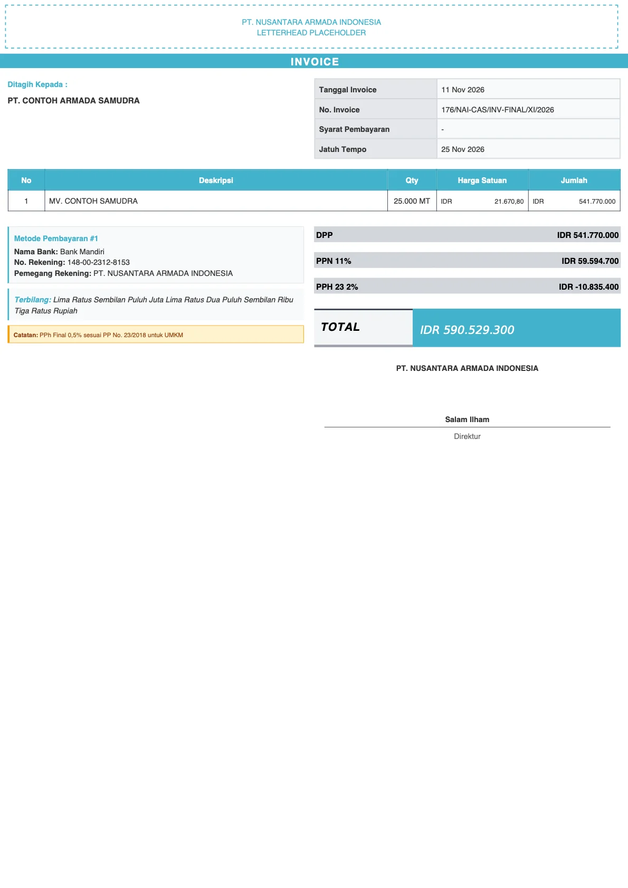
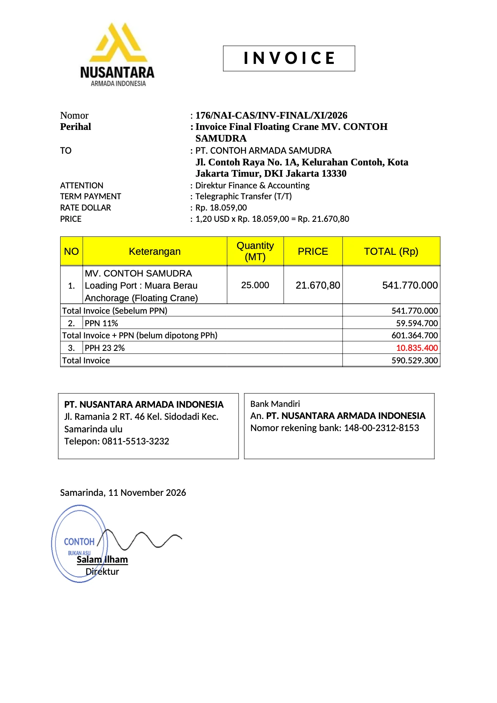
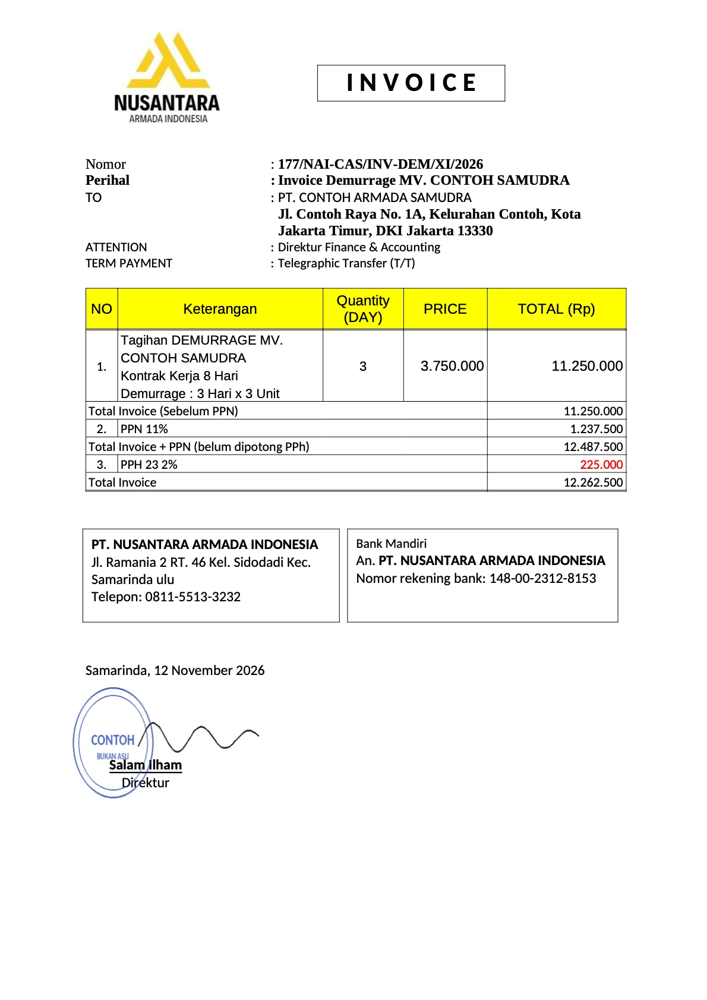
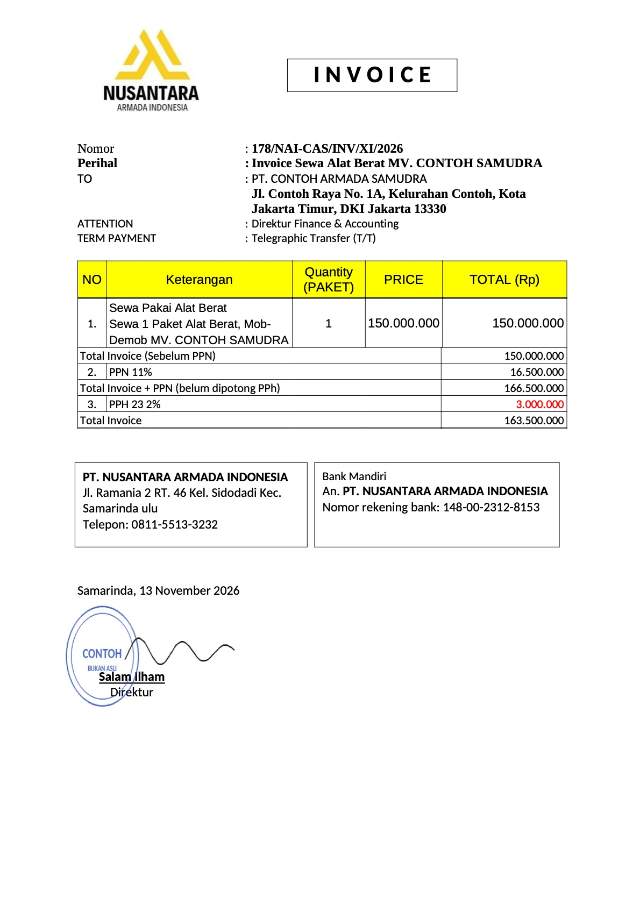
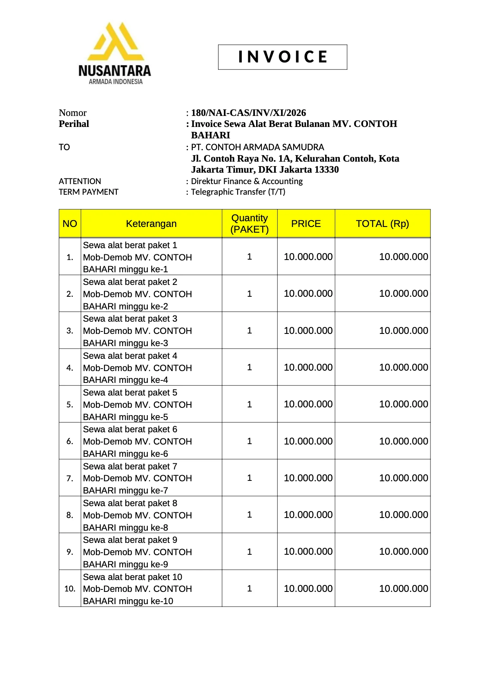
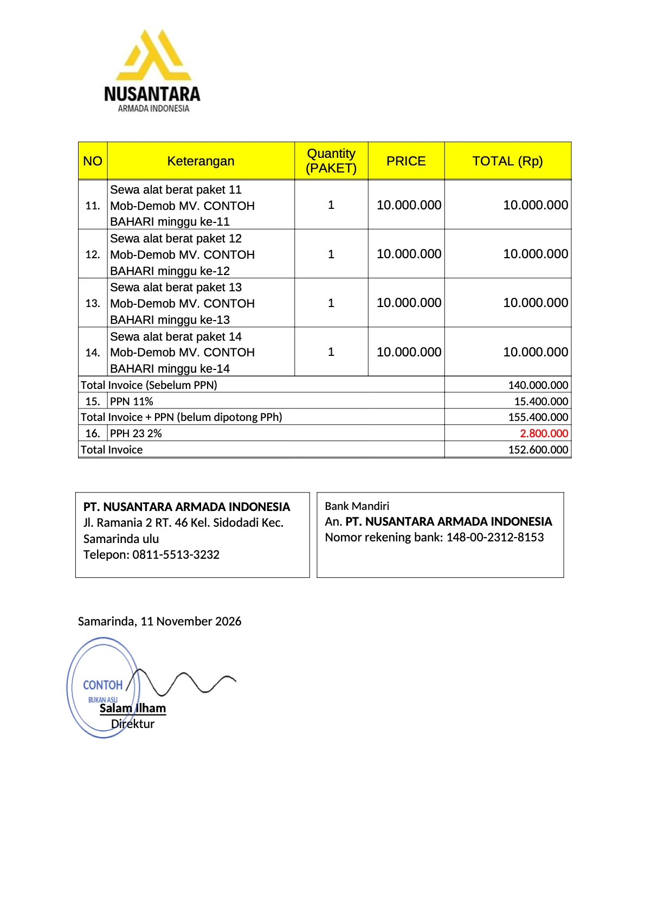
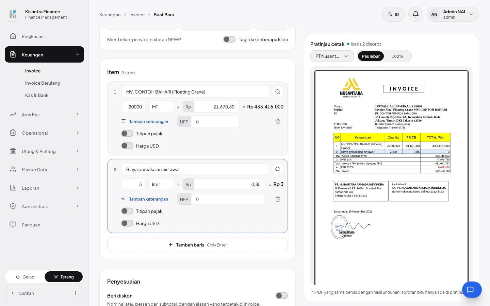
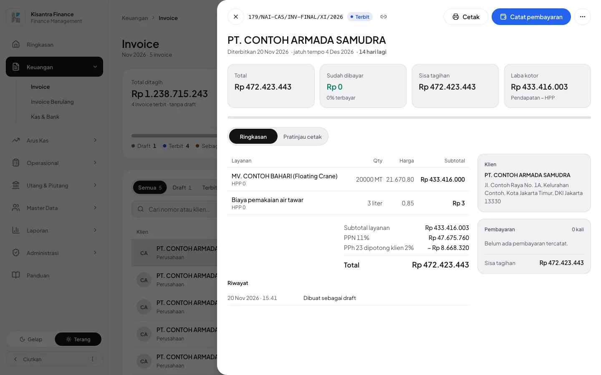
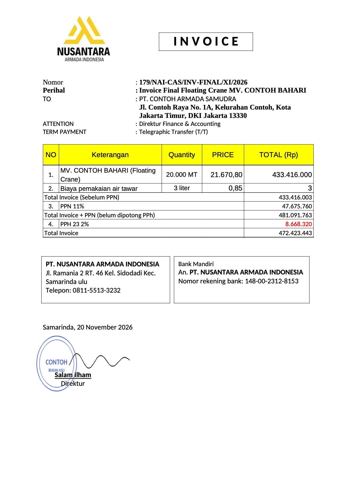
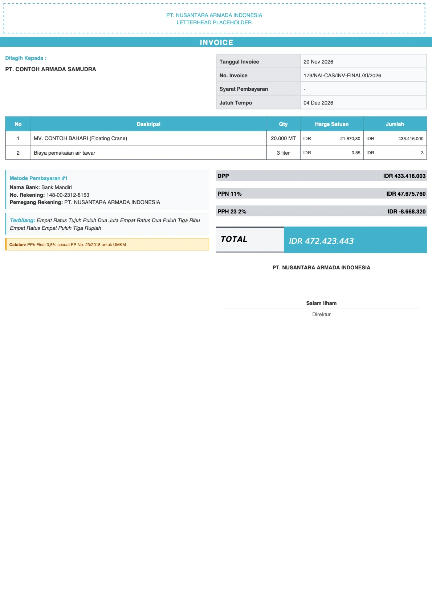

# [Invoice] Create - Template invoice PT Nusantara Armada Indonesia (NAI) & harga satuan bersen

### 📋 Description

**Context:** PR ini berisi dua perubahan di modul Invoice.

1. **Template invoice PT Nusantara Armada Indonesia (NAI).** NAI menagih dengan invoice Word sendiri. PR ini menirunya sebagai template PDF di aplikasi, dengan cara kerja yang sama seperti SLU (#31, #35), BAS (#33, #40), MKB & BCB (#41), dan AOE (#43). Acuannya invoice NAI terbaru (176, FINAL floating crane), yang ternyata salinan dokumen AOE/MKB: sisa teks alamat PT MKB masih ada di balik kotak alamatnya.
2. **Harga satuan boleh bersen.** Kolom **Harga satuan** di editor invoice dan Debit Note kini menerima desimal, mis. `0,85`, `4,35`, atau `9.459,46`, untuk **semua perusahaan**. Sebelumnya harga bersen hanya bisa lewat Harga USD × kurs, yang menuntut Tagihan USD menyala.

**Perubahan struktur:** satu kolom saja. `invoice_items.unit_price` berubah dari `bigint` ke `decimal(15,2)`. Jumlah baris (`amount`) dan semua nominal lain tetap Rupiah bulat, jadi pembukuan, pembayaran, dan laporan tidak berubah.

---

## Ringkasan singkat

| | Sebelum | Sesudah |
|---|---|---|
| Invoice NAI | Desain bawaan Kisantra | Desain NAI, mengikuti invoice Word terbaru |
| Nomor dokumen NAI | Format tanpa kode jenis | `176/NAI-CAS/INV-FINAL/XI/2026`, `177/NAI-CAS/INV-DEM/XI/2026`, seperti dokumen asli |
| Harga satuan item | Rupiah bulat (`0,85` tidak bisa diketik) | Boleh bersen, maks. 2 angka di belakang koma, di semua perusahaan, invoice maupun Debit Note |
| Jumlah baris | `round(qty × harga)` | Tetap `round(qty × harga)`, Rupiah bulat (3 × 0,85 = 2,55 → **Rp 3**) |

---

## 🖼️ Hasil

Semua contoh memakai data seeder: klien, kapal, nomor, dan nominal **fiktif**. Tanda tangan "CONTOH" digambar seeder (tanda tangan asli diunggah di Profil perusahaan).

### 1. Invoice FINAL NAI

| Sebelum — desain bawaan Kisantra | Sesudah — desain NAI |
|---|---|
|  |  |

- **Tanpa kop surat**, seperti AOE: logo NAI di header (diulang di setiap halaman) dan judul **I N V O I C E** di **kotak bergaris** di kanan atas (hanya halaman pertama).
- Blok klien dengan font campuran seperti aslinya: **Nomor · Perihal** (Times New Roman), **TO** (Calibri), alamat klien (Times tebal), **ATTENTION · TERM PAYMENT** (Calibri 11pt).
- Tagihan Rupiah bertarif USD menambah **RATE DOLLAR** dan **PRICE** di blok klien (`1,20 USD x Rp. 18.059,00 = Rp. 21.670,80`), seperti invoice FINAL asli.
- Tabel bergaya Excel: **judul kolom kuning**, item Arial, angka tanpa "Rp", nomor bertitik (`1.`). Lalu Total Sebelum PPN, PPN 11%, Total + PPN (belum dipotong PPh), **PPH 23 2% (merah)**, dan baris akhir **Total Invoice** (bukan GRAND TOTAL).
- **Kotak alamat & kotak rekening** berdampingan, lalu kota-tanggal dan tanda tangan.

### 2. Demurrage & invoice tanpa kode

| Demurrage (`…/INV-DEM/…`) | Sewa alat berat tanpa kode (`…/INV/…`) |
|---|---|
|  |  |

- Dokumen "DEBIT NOTE" asli NAI (demurrage) **ber-PPN 11% dan dipotong PPh 23**, jadi bukan talangan. Di aplikasi ia dibuat sebagai **invoice berkode `DEM`**: nomornya `…/INV-DEM/…`, sama dengan nomor aslinya. NAI **tidak** mendapat jenis dokumen Debit Note.
- Satuan berbeda antar-baris: satuan tercetak di kolom Quantity, bukan di judul kolom.

### 3. Tagihan uang muka & invoice lebih dari satu halaman

| Uang muka | Multi-halaman, hal. 1 | Multi-halaman, hal. 2 |
|---|---|---|
|  |  |  |

- Mode **Uang muka** dan **Pelunasan** memakai baris total sistem: "Total Invoice" lalu "TAGIHAN UANG MUKA (DP x%)".
- Logo dan judul kolom tabel diulang di halaman berikutnya tanpa menimpa teks; kotak judul hanya di halaman pertama. Kotak info & tanda tangan tidak terpotong antarhalaman.

### 4. Harga satuan bersen (semua perusahaan)

| Editor: `21.670,80` dan `0,85` | Drawer invoice |
|---|---|
|  |  |

| PDF template NAI | PDF template bawaan Kisantra |
|---|---|
|  |  |

- **Koma = desimal, titik = ribuan**, sama seperti kolom Harga USD. Nilai bersen tampil dua desimal (`21.670,80`). Harga bulat tetap `1.500.000`, tanpa `,00`.
- Jumlah baris dibulatkan ke Rupiah, sama di editor dan server: 20.000 × Rp 21.670,80 = **Rp 433.416.000**; 3 × Rp 0,85 = **Rp 3**.
- Lebih dari dua angka di belakang koma ditolak: "Harga satuan baris 1 maksimal dua angka di belakang koma."
- Tercetak di semua tampilan: drawer, PDF bawaan (Kisantra, Generik, Semesta), semua template perusahaan, kolom Harga Satuan template builder, dan alat Claude `detail-invoice`.

---

## 🔧 Scope

**Template NAI**
- ✅ Kerangka (`kerangka.blade.php`) & invoice (`invoice.blade.php`), logo dari dokumen Word, font tertanam:
  - Times New Roman → **Tinos**
  - Calibri (dan Calibri Light) → **Carlito** Regular/Bold
  - Arial → **Arimo**

  Ketiganya gratis, berukuran identik dengan aslinya, dan lisensinya disertakan. Carlito-Regular diambil dari `google/fonts` (sumber Carlito-Bold yang sudah ada, identik per byte).
- ✅ Migration tenant khusus NAI: format nomor `{KODE}`.
- ✅ Seeder contoh `ContohInvoiceNaiSeeder` + tes.

**Harga satuan bersen**
- ✅ Kolom `invoice_items.unit_price` → `decimal(15,2)` (migration tenant).
- ✅ Validasi `numeric`, `decimal:0,2`, `max` di simpan & pratinjau, dengan pesan id/en/zh.
- ✅ Editor `CurrencyInput decimals={2}`; drawer, PDF, template builder, dan MCP mencetak sen.
- ✅ Harga dari tarif USD kini disimpan sampai sen (`round(USD × kurs, 2)`), bukan dibulatkan ke Rupiah.

**Dokumentasi:** modul Invoice, indeks modul, Koneksi Claude, CLAUDE.md, dan panduan pengguna (`/panduan`).

## 📁 Perubahan berkas

| Berkas | Isi |
|---|---|
| `resources/views/pdf/perusahaan/nusantara-armada-indonesia/kerangka.blade.php` | **Baru.** Logo (diulang tiap halaman), kotak judul, blok klien (+ RATE DOLLAR & PRICE), kotak alamat & rekening, kota-tanggal, tanda tangan. Data perusahaan dari Profil perusahaan. |
| `resources/views/pdf/perusahaan/nusantara-armada-indonesia/invoice.blade.php` | **Baru.** Judul `I N V O I C E` + tabel item & baris total (judul kolom `#ffff00`, PPH 23 merah, Total Invoice). |
| `resources/views/pdf/perusahaan/nusantara-armada-indonesia/logo.jpg`, `fonts/*` | **Baru.** Logo dari dokumen Word; font Tinos, Carlito, Arimo + lisensinya. |
| `database/migrations/tenant/2026_11_20_150928_siapkan_nomor_invoice_nai.php` | **Baru.** Format nomor `{KODE}` khusus NAI, lihat Database. |
| `database/migrations/tenant/2026_11_20_152803_ubah_harga_satuan_invoice_jadi_desimal.php` | **Baru.** `invoice_items.unit_price` → `decimal(15,2)`. |
| `database/seeders/ContohInvoiceNaiSeeder.php` | **Baru.** Contoh lokal: akun admin/staff NAI, profil, 1 klien fiktif, 3 invoice terbit (FINAL bertarif USD, demurrage, sewa alat berat), 1 draft. |
| `database/seeders/ContohInvoicePerusahaanSeeder.php` | Harga dari tarif USD disimpan sampai sen, sama dengan editor. |
| `app/Models/InvoiceItem.php` | Cast `unit_price` → `float`. |
| `app/Http/Requests/StoreInvoiceRequest.php`, `InvoicePreviewRequest.php` | Validasi harga bersen + pesan baru. |
| `app/Http/Controllers/InvoiceController.php` | `buildInvoiceData()`: harga dibulatkan ke sen, jumlah baris tetap `round(qty × harga)`. |
| `app/Services/TemplateTokens.php`, `ItemColumns.php` | Kolom Harga Satuan template builder mencetak sen. |
| `app/Mcp/Tools/DetailInvoice.php`, `app/Mcp/Servers/KeuanganServer.php` | `harga_satuan` bersen dikirim sebagai desimal; deskripsi alat diperbarui. |
| `resources/views/pdf/{kisantra-invoice,invoice,semesta-invoice,single-invoice}.blade.php` | Harga satuan lewat `InvoiceTotalRows::format()` (dua desimal hanya bila bersen). |
| `resources/js/pages/invoices/create.tsx`, `components/ob.tsx`, `components/invoice-drawer.tsx` | Kolom harga `decimals={2}`; `rpSen()` untuk harga satuan di drawer & petunjuk Harga USD. |
| `resources/js/components/shared/currency-input.tsx` | Nilai pecahan tampil minimal dua desimal (`21.670,80`, juga USD `44.116,50`). |
| `lang/en.json`, `lang/zh.json` | Tiga pesan validasi baru. |
| `tests/Feature/TemplateInvoiceNaiTest.php`, `ContohInvoiceNaiSeederTest.php`, `HargaSatuanDesimalTest.php` | **Baru.** 9 + 2 + 5 tes. |
| `tests/Feature/TagihanUsdTest.php`, `tests/Feature/Mcp/AlatPenjualanTest.php` | Harga dari tarif USD bersen; kasus MCP `harga_satuan` bersen. |
| `docs/module/invoices.md`, `docs/module/README.md`, `docs/module/koneksi-claude.md`, `CLAUDE.md`, `video/invoices/guide.ts` | Template NAI, kode jenis tanpa Debit Note, harga satuan bersen. |
| `docs/pr/2026-11-20-template-invoice-nai/` | Ringkasan PR ini + screenshot. |

## 🗄️ Database

Dua migration tenant:

1. **`2026_11_20_150928_siapkan_nomor_invoice_nai`**: hanya untuk **NAI**, tanpa perubahan kolom.
   - Format nomor `…/INV/…` → `…/{KODE}/…`, **hanya bila masih persis format lama** `{NO}/{PT}-{KLIEN}/INV/{BLN_ROMAWI}/{THN}`.
   - Mengisi urutan dan kode jenis nomor lama berkode (mis. `…/INV-FINAL/…`, `…/INV-DEM/…`), supaya nomor berikutnya tidak mulai lagi dari 001.
   - **Tidak** membuat kategori Talangan Klien, karena NAI belum menerbitkan Debit Note.
   - Aman dijalankan berulang.
2. **`2026_11_20_152803_ubah_harga_satuan_invoice_jadi_desimal`**: **semua perusahaan**. `invoice_items.unit_price` `bigint` → `decimal(15,2) NOT NULL`. Nilai lama (bilangan bulat) tersalin apa adanya. `down()` mengembalikan ke `bigint` (sen dibulatkan MySQL).

## ✅ Acceptance Criteria

**Template NAI**
- [x] NAI hanya memakai template NAI. Template bawaan lewat URL → 404.
- [x] Dialog cetak menawarkan "PT Nusantara Armada Indonesia".
- [x] Font Tinos, Carlito Regular/Bold, dan Arimo tertanam di PDF.
- [x] Invoice: logo, kotak judul, blok klien, tabel berjudul kolom kuning, PPH 23 merah, Total Invoice, kotak alamat & rekening, kota-tanggal, dan tanda tangan unggahan.
- [x] Tagihan Rupiah bertarif USD mencetak RATE DOLLAR & PRICE; tagihan USD mencetak "Total Invoice (IDR)" dan TOTAL OUTSTANDING (USD).
- [x] Editor NAI menawarkan **Kode jenis** tanpa Debit Note. Nomor `001/NAI-CAS/INV-FINAL/XI/2026` → `002/NAI-CAS/INV-DEM/XI/2026` → `003/NAI-CAS/INV/XI/2026`. Debit Note dari NAI ditolak.
- [x] Migration hanya mengubah NAI (perusahaan lain, termasuk AOE, tidak tersentuh) dan idempoten.

**Harga satuan bersen**
- [x] Harga `0,85`, `4,35`, `9.459,46` tersimpan apa adanya, di invoice maupun Debit Note.
- [x] Jumlah baris Rupiah bulat: 3 × 0,85 → 3; 10 × 4,35 → 44; 56.000 × 9.459,46 → 529.729.760.
- [x] `0,855` ditolak di simpan & pratinjau.
- [x] Editor, halaman ubah, drawer, PDF bawaan, template perusahaan, template builder, dan MCP menampilkan sen; harga bulat tanpa `,00`.
- [x] Template perusahaan lain (SLU/BAS/MKB/BCB/AOE) tidak berubah.

## 📝 Technical Notes

**Template NAI.** Ukuran dan posisi diukur dari PDF 176 (posisi teks & gambar dari content stream; tabel adalah objek Excel tersemat), lalu render DomPDF ditumpuk di atas PDF asli dan disetel sampai berimpit (≤ 0,06 cm).

```text
@page margin       4,62cm 2,4cm 2,54cm 2,54cm   ← "Nomor" mulai 4,62cm (logo header NAI lebih besar dari AOE)
logo (fixed)       3,29 × 2,89cm, 0,83cm dari atas, 0,79cm di kanan margin kiri
kotak judul        5,58 × 1,08cm, 9,42cm dari tepi kertas, 1,94cm dari atas (= AOE), garis dasar 0,76cm
titik dua          tab 5,5cm
tabel              16,06cm: NO 5,9% · Keterangan 38% · Quantity 14,9% · PRICE 15,5% · TOTAL 25,7%
judul kolom        Arial 12pt di atas #ffff00, tinggi 1,19cm, garis bawah ganda
baris total        Calibri 11pt, 15,3pt per baris Excel
kotak info         alamat 7,6 × 2,75cm + rekening 8,01cm, sela 0,25cm, 1,1cm di bawah tabel
tanda tangan       gambar 5,74 × 3,55cm, 0,48cm keluar margin kiri, tepat di bawah tanggal
line-height        0,91 untuk Tinos, Arimo, dan Carlito (= spasi tunggal Word)
```

**Tanda tangan.** Gambar tanda tangan asli NAI sudah memuat nama & jabatan. Template mencetak nama & jabatan dari profil di posisi nama pada gambar itu, lalu menumpuk gambar unggahan di atasnya:
- mengunggah gambar yang sama = persis dokumen asli;
- gambar transparan tanpa nama = nama dari profil tetap terlihat;
- tanpa gambar = ruang tanda tangan basah ±2,6 cm.

**Harga satuan bersen.**
- Jumlah baris dihitung `round(qty × harga)` di server dan di editor (`lineAmount()`). Pembulatan PHP 8.4 `round()` dan JS `Math.round()` dibandingkan pada 200.004 kombinasi qty × harga dua desimal: tidak ada selisih.
- Cast `float` (bukan `decimal:2`) agar `unit_price` tetap angka di JSON Inertia dan Blade. `decimal:2` mengembalikan string, sehingga `CurrencyInput` dan operasi `+` di JS akan salah.
- Invoice berulang, pengajuan dana, dan katalog layanan tetap Rupiah bulat (di luar cakupan).

## ⚠️ Perbedaan dari dokumen asli NAI (disengaja)

- **Satu susunan saja.** Dokumen NAI tidak seragam. Template mengikuti 176. Invoice gaya lain (kotak "Bill To" · Description · Qty · Unit · Unit Price · Amount · "Say" · "Transfer To", dipakai invoice alat berat & BBM) **tidak** didukung.
- "Prihal" → "Perihal", mengikuti template perusahaan lain.
- Tanggal kurs "(11 November 2026)" di baris RATE DOLLAR tidak dicetak, karena aplikasi tidak menyimpan tanggal kurs.
- Label baris total memakai label sistem ("Total Invoice (Sebelum PPN)", "PPN 11%", "Total Invoice + PPN (belum dipotong PPh)"); baris kosong Excel antara subtotal dan PPH 23 tidak dicetak (dokumen speed boat NAI juga tanpa baris itu).
- Calibri Light di blok klien & nama bank dicetak dengan Carlito Regular (tidak ada padanan bebasnya).
- Tanggal tercetak "11 November 2026" (tanpa nol di depan), sama seperti template lain.

## 🚀 Yang perlu dilakukan saat deploy

1. `./deploy.sh` seperti biasa (kedua migration tenant ikut jalan).
2. **Periksa Profil perusahaan NAI** di server:
   - alamat, telepon, rekening Bank Mandiri, kota tanda tangan (Samarinda);
   - penanda tangan **Salam Ilham / Direktur**;
   - PKP/PPN 11% dan **PPh 23 2%**;
   - nyalakan **Tagihan USD** bila invoice FINAL bertarif USD (untuk RATE DOLLAR & PRICE);
   - lalu **unggah gambar tanda tangan**.
3. Bila format nomor NAI di server bukan persis `{NO}/{PT}-{KLIEN}/INV/{BLN_ROMAWI}/{THN}`, ganti manual di **Pengaturan › Penomoran invoice** menjadi `{NO}/{PT}-{KLIEN}/{KODE}/{BLN_ROMAWI}/{THN}`.

## 🧪 Cara mencoba

```bash
php artisan tenants:migrate
php artisan db:seed --class=ContohInvoiceNaiSeeder
```

Login `admin.nai@mitragroup.id` (password `password`) → Invoice → buka invoice → **Cetak**. Untuk harga bersen: **Buat Invoice** → ketik `0,85` di Harga satuan (koma untuk desimal).

Data contoh: klien, kapal, nomor, dan nominal fiktif. Alamat, telepon, dan rekening NAI diambil dari dokumen asli, seperti seeder MKB/BCB/AOE.

## Pengujian

- [x] `TemplateInvoiceNaiTest` (9), `ContohInvoiceNaiSeederTest` (2), dan `HargaSatuanDesimalTest` (5) lulus.
- [x] Seluruh suite Feature + Unit: 1.193 lulus, 1 dilewati.
- [x] Suite `TenancyReal` (migrasi sungguhan per database perusahaan): 44 lulus.
- [x] `npm run types` bersih, `npm run i18n:check` 0 galat, `npm run build` sukses.
- [x] Dicoba di browser (database contoh terpisah): ketik `21670,8` & `0,85` → tampil `21.670,80` & `0,85`, jumlah baris Rp 433.416.000 & Rp 3, simpan & terbitkan, drawer, dan halaman ubah memuat ulang harga yang sama.
- [x] PDF dirender dan dicek: invoice FINAL bertarif USD, demurrage, tanpa kode, uang muka, 2 halaman, harga bersen di template NAI & Kisantra.
