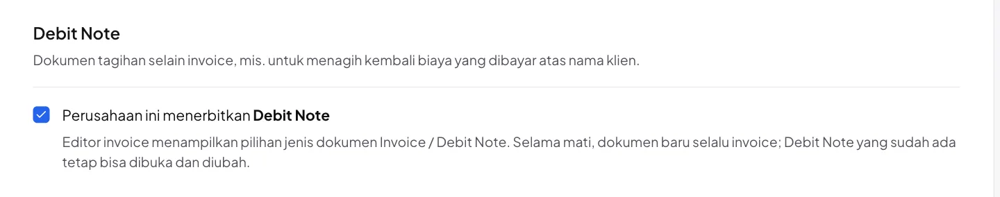
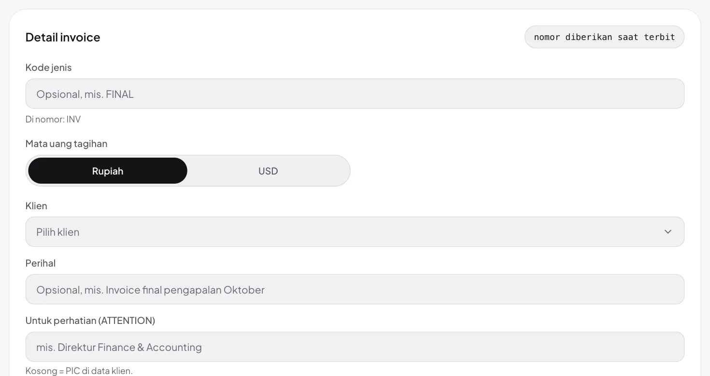
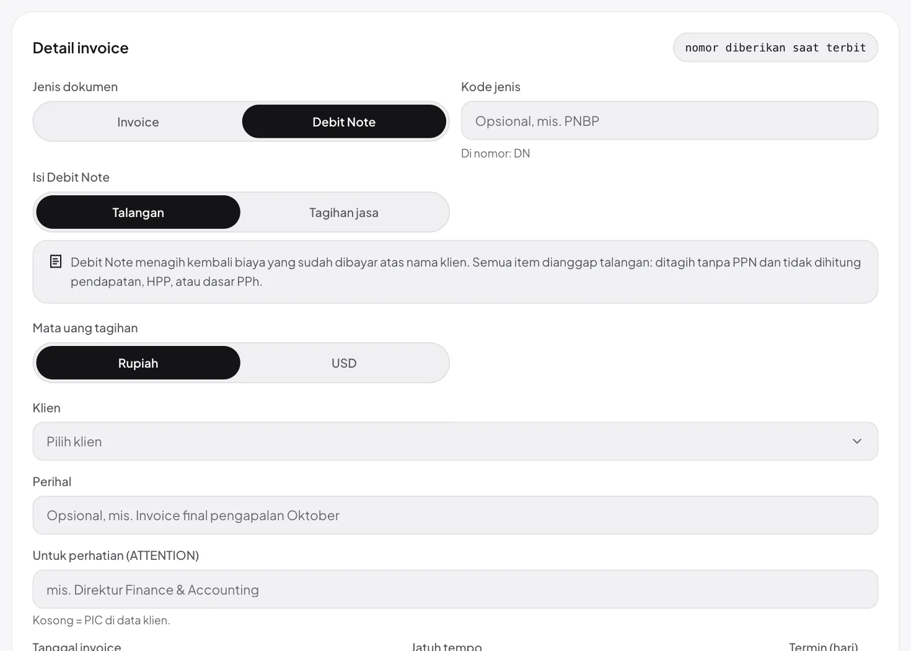
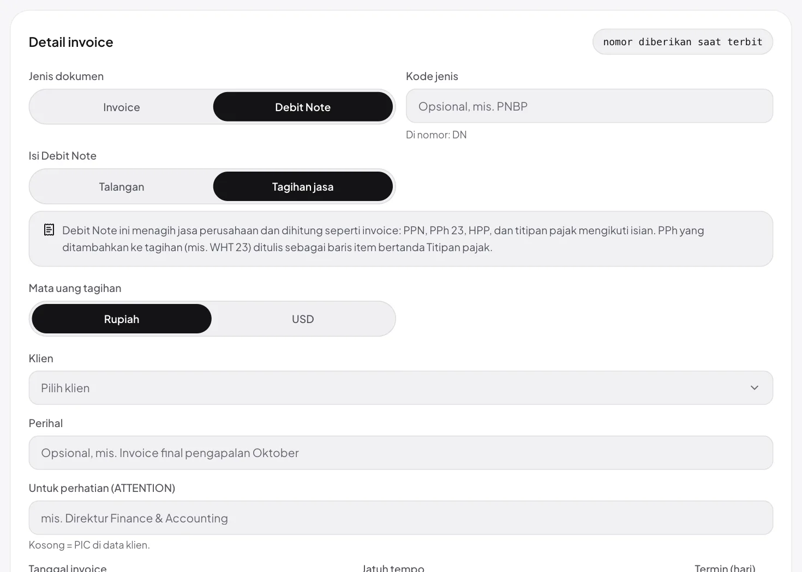
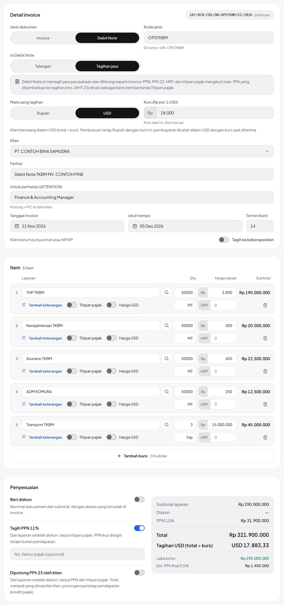
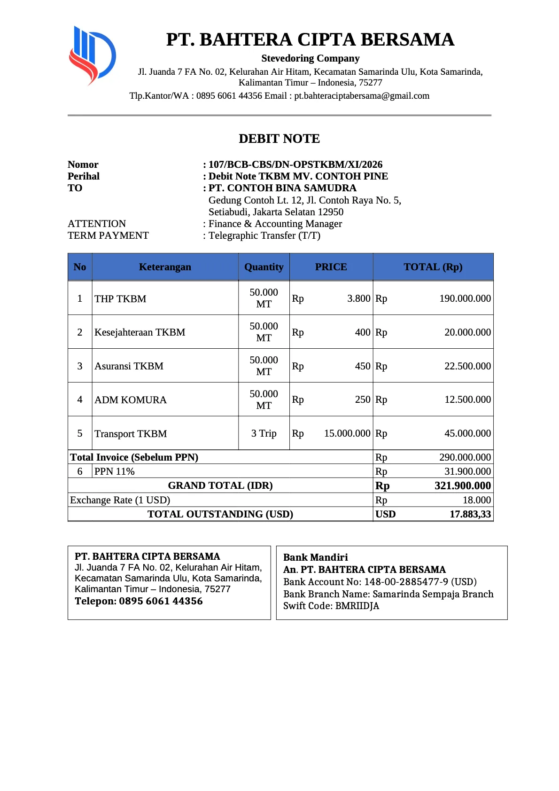
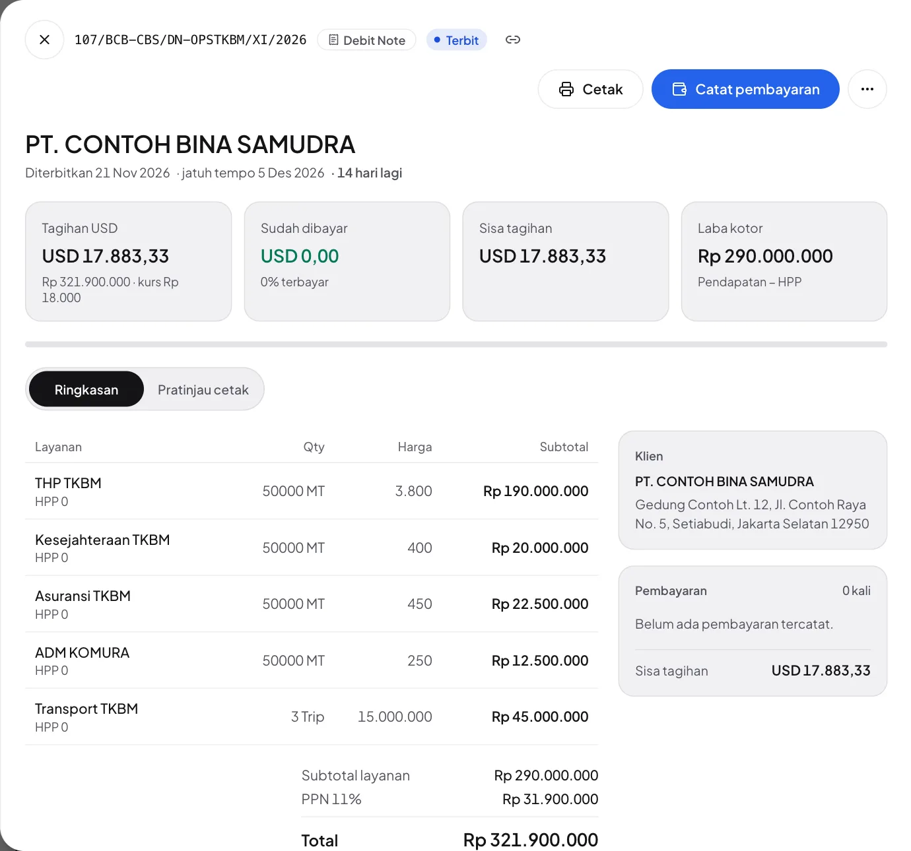
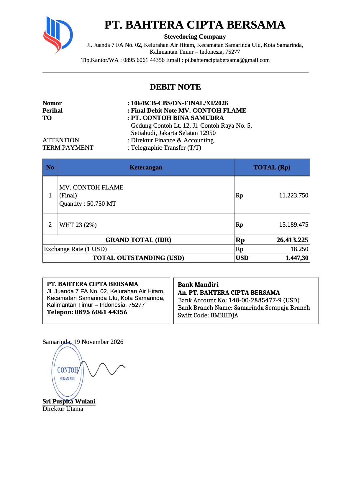

# [Invoice] Update - Debit Note tagihan jasa, sakelar Debit Note, isian ATTENTION & tombol tutup notifikasi

### 📋 Description

**Context:** PT BCB punya Debit Note untuk klien luar negeri (PROFORMA 103, TKBM 097, FINAL 099) yang **bukan talangan**. Isinya tagihan jasa: tonase × tarif USD, PPN 11% (TKBM), dan **WHT 23 (2%) yang ditambahkan** ke tagihan (FINAL). Selama ini aplikasi menganggap setiap Debit Note = talangan: semua item dipaksa titipan, tanpa PPN/PPh, dan bukan pendapatan. Akibatnya dokumen itu hanya bisa dibuat sebagai **Invoice** (judul INVOICE, nomor `INV-…`). PR ini berisi empat perubahan di modul Invoice:

1. **Sifat Debit Note: Talangan / Tagihan jasa.** Debit Note bisa dipilih sebagai talangan (bawaan, perilaku lama) atau **tagihan jasa**, yang dihitung persis seperti invoice: PPN, PPh 23, HPP, titipan pajak per baris, dan USD. Yang berbeda hanya judul DEBIT NOTE, nomor `DN-…`, dan template. WHT 23 yang ditambahkan ke tagihan dicatat sebagai **baris item bertanda Titipan pajak**.
2. **Debit Note jadi opsional.** Sakelar baru di **Pengaturan › Profil perusahaan › Debit Note**, bawaan mati. Selama mati, editor hanya membuat invoice tanpa pilihan Invoice / Debit Note. Debit Note yang sudah ada tetap bisa dibuka, diubah, dan diterbitkan.
3. **Isian ATTENTION per dokumen.** Baris **ATTENTION** di header PDF template perusahaan (mis. "Direktur Finance & Accounting") kini bisa diisi per invoice/Debit Note. Kosong = PIC di data klien, seperti sebelumnya.
4. **Notifikasi popup bisa ditutup.** Semua toast (berhasil, info, error) punya tombol **×**, jadi bisa ditutup tanpa menunggu durasinya habis.

**Perubahan struktur:** tiga kolom baru, semuanya nullable atau berbawaan sehingga data lama tidak berubah:
- `invoices.is_pass_through` (boolean, nullable): sifat Debit Note. `null` untuk invoice.
- `invoices.attention` (string, nullable): isi baris ATTENTION.
- `company_profiles.debit_note_enabled` (boolean, bawaan `false`): sakelar Debit Note.

---

## Ringkasan singkat

| | Sebelum | Sesudah |
|---|---|---|
| Debit Note BCB untuk klien luar negeri (jasa, PPN, WHT 23) | Hanya bisa sebagai Invoice (`…/INV-ORBIT/…`) | Debit Note **tagihan jasa** (`…/DN-ORBIT/…`, `…/DN-OPSTKBM/…`), dihitung seperti invoice |
| Debit Note talangan (PNBP, overtime, demurrage) | Semua item titipan, tanpa PPN/PPh | **Tetap sama** (sifat bawaan) |
| WHT 23 yang ditambahkan ke tagihan | Tidak bisa | Baris item bertanda **Titipan pajak**: ikut ditagih, bukan pendapatan, jurnal ke Titipan Pajak Klien |
| Pilihan Invoice / Debit Note di editor | Selalu tampil untuk perusahaan bertemplate Debit Note | Hanya bila sakelar **Debit Note** di Profil perusahaan menyala (bawaan mati) |
| Baris ATTENTION di PDF | Selalu PIC klien | Isian **Untuk perhatian (ATTENTION)** per dokumen; kosong = PIC klien |
| Toast berhasil/info | Tidak bisa ditutup, menunggu durasi habis | Ada tombol **×** |

---

## 🖼️ Hasil

Semua contoh memakai data seeder BCB di database contoh terpisah: klien, kapal, nomor, dan nominal **fiktif**. Tanda tangan "CONTOH" digambar seeder.

### 1. Sakelar Debit Note di Profil perusahaan

| Pengaturan › Profil perusahaan | Editor saat sakelar mati: tanpa Jenis dokumen |
|---|---|
|  |  |

- Bagian **Debit Note** hanya tampil untuk perusahaan yang punya template Debit Note (SLU, BAS, MKB, BCB, AOE).
- Selama mati, editor hanya menampilkan **Kode jenis** (bila format nomor memakai `{KODE}`), dan server menolak Debit Note baru.
- Debit Note yang sudah ada tetap menampilkan Jenis dokumen di editornya, agar tidak diam-diam berubah menjadi invoice.

### 2. Isi Debit Note: Talangan atau Tagihan jasa

| Talangan (bawaan) | Tagihan jasa |
|---|---|
|  |  |

- **Talangan:** perilaku lama. Semua item titipan; sakelar PPN, PPh 23, HPP, dan Titipan pajak tidak tampil; ringkasan menampilkan **Talangan**.
- **Tagihan jasa:** semua isian invoice tampil. Catatannya mengingatkan cara menulis WHT 23 yang ditambahkan ke tagihan.
- Sifat tidak membentuk nomor, jadi tetap bisa diganti setelah terbit (seperti isi item).

### 3. Debit Note TKBM tagihan jasa (ber-PPN, tagihan USD)

| Editor terisi | PDF | Drawer |
|---|---|---|
|  |  |  |

- Seperti Debit Note TKBM 097 BCB: empat komponen tarif per ton (50.000 MT × 3.800 / 400 / 450 / 250) + transport 3 × Rp 15.000.000 = Rp 290.000.000, **PPN 11%** Rp 31.900.000, GRAND TOTAL (IDR) **Rp 321.900.000**, kurs 18.000 → **TOTAL OUTSTANDING USD 17.883,33**.
- PDF: kolom Quantity & PRICE, "Total Invoice (Sebelum PPN)" lalu PPN bernomor, seperti dokumen TKBM aslinya.
- Drawer menampilkan **Laba kotor** dan PPN seperti invoice, bukan "Talangan".
- Baris **ATTENTION** tercetak dari isian editor ("Finance & Accounting Manager"), bukan PIC klien.

### 4. WHT 23 yang ditambahkan ke tagihan (Debit Note FINAL)



- Seperti Debit Note FINAL 099 BCB: baris 1 sisa tagihan setelah proforma (Rp 11.223.750, tonase akhir di keterangan), baris 2 **WHT 23 (2%)** Rp 15.189.475 bertanda Titipan pajak.
- Nominal WHT diketik manual karena dasarnya 2% dari **nilai final penuh** (50.750 MT × $0,82 × 18.250), bukan dari baris yang ditagih.
- GRAND TOTAL (IDR) Rp 26.413.225 → TOTAL OUTSTANDING **USD 1.447,30**. Pendapatan hanya Rp 11.223.750; WHT dijurnal ke **Titipan Pajak Klien**.

### 5. Tombol tutup notifikasi


Semua toast punya tombol **×** (label pembaca layar "Tutup notifikasi", ikut bahasa pengguna). Dicoba di browser: klik × langsung menutup toast.

---

## 🔧 Scope

**Sifat Debit Note**
- ✅ Kolom `invoices.is_pass_through`; `Invoice::isPassThrough()` (Debit Note tanpa sifat tersimpan dianggap talangan).
- ✅ `buildInvoiceData()`: pemaksaan titipan, HPP 0, tanpa PPN/PPh/faktur **hanya** untuk Debit Note talangan; tagihan jasa memakai `resolvePpnRate()`/`resolvePphRate()` seperti invoice.
- ✅ Jurnal pembayaran: `JournalService::depositAccountFor(bool $passThrough)` + cermin di `lib/journal.ts`. Talangan → Talangan Biaya Klien; tagihan jasa → Titipan Pajak Klien.
- ✅ Editor (isian **Isi Debit Note**), drawer, MCP `detail-invoice` (`sifat_debit_note`).
- ✅ Baris PPN/PPh di template Debit Note BAS, MKB, BCB, AOE ditata seperti invoice masing-masing (SLU memakai template invoice-nya).

**Sakelar Debit Note**
- ✅ Kolom `company_profiles.debit_note_enabled` + checkbox di Profil perusahaan.
- ✅ `CompanyInvoiceTemplate::offersDebitNote($invoice)` dipakai editor dan validasi simpan/pratinjau.

**ATTENTION**
- ✅ Kolom `invoices.attention`, isian editor (hanya perusahaan bertemplate sendiri), placeholder = PIC klien terpilih.
- ✅ Baris ATTENTION di keenam template perusahaan (SLU, BAS, MKB, BCB, AOE, NAI) memakai `$perhatian`.

**Notifikasi:** ✅ `closeButton` di `Toaster`.

**Dokumentasi:** modul Invoice, Pengaturan, Arus Kas, Koneksi Claude, desain Debit Note SLU, glosarium i18n, CLAUDE.md, dan panduan pengguna (`/panduan` Invoice & Pengaturan).

## 📁 Perubahan berkas

| Berkas | Isi |
|---|---|
| `database/migrations/tenant/2026_11_21_211500_add_is_pass_through_to_invoices_table.php` | **Baru.** `invoices.is_pass_through`; semua Debit Note lama = talangan. |
| `database/migrations/tenant/2026_11_21_231500_add_attention_to_invoices_table.php` | **Baru.** `invoices.attention`. |
| `database/migrations/tenant/2026_11_21_233000_add_debit_note_enabled_to_company_profiles_table.php` | **Baru.** `company_profiles.debit_note_enabled`, lihat Database. |
| `app/Models/Invoice.php`, `app/Models/CompanyProfile.php` | Kolom baru, `isPassThrough()`. |
| `app/Http/Controllers/InvoiceController.php` | `resolvePassThrough()`, pemaksaan talangan bersyarat, `attention`, `formOptions($invoice)` + PIC klien. |
| `app/Http/Requests/StoreInvoiceRequest.php`, `InvoicePreviewRequest.php`, `NextInvoiceNumberRequest.php` | `is_pass_through`, `attention`, `documentTypes($invoice)`. |
| `app/Services/CompanyInvoiceTemplate.php` | `offersDebitNote()`. |
| `app/Services/JournalService.php`, `resources/js/lib/journal.ts` | Akun titipan dari sifat Debit Note. |
| `app/Services/InvoicePrintService.php` | `$perhatian` untuk baris ATTENTION. |
| `app/Http/Controllers/Settings/CompanyController.php`, `app/Http/Requests/Settings/UpdateCompanyRequest.php`, `resources/js/pages/settings/company.tsx` | Sakelar Debit Note. |
| `app/Mcp/Tools/DetailInvoice.php`, `DaftarInvoice.php` | `sifat_debit_note`. |
| `resources/js/pages/invoices/create.tsx`, `edit.tsx`, `components/invoice-drawer.tsx` | Isi Debit Note, ATTENTION, keputusan hitungan memakai `isPassThrough`. |
| `resources/js/layouts/app-layout.tsx` | `Toaster closeButton`. |
| `resources/views/pdf/perusahaan/*/kerangka.blade.php`, `samboja-laju-utama/invoice.blade.php` | Baris ATTENTION dari `$perhatian`. |
| `resources/views/pdf/perusahaan/*/debit-note.blade.php` | Gaya baris `dpp`/`bruto`/`pph` untuk Debit Note tagihan jasa. |
| `database/seeders/ContohInvoice*Seeder.php` | Sakelar Debit Note menyala; contoh BCB `105/…/DN-ORBIT` dan `106/…/DN-FINAL` (dengan WHT 23) sebagai tagihan jasa. |
| `resources/js/locales/{en,zh}.json`, `lang/{en,zh}.json`, `docs/i18n/glosarium.md` | Terjemahan & istilah baru. |
| `tests/Feature/DebitNoteTagihanJasaTest.php`, `DebitNoteSakelarTest.php`, `AttentionInvoiceTest.php` | **Baru.** 7 + 4 + 4 tes. |
| `tests/Feature/{DebitNote,DebitNoteBas,TemplateInvoiceMkb,TemplateInvoiceBcb,TemplateInvoiceAoe,InvoicePph,HargaSatuanDesimal,ContohInvoiceBcbSeeder}Test.php` | Profil uji menyalakan sakelar Debit Note; contoh BCB baru; cek baris PPN/PPh lewat elemen `<tr>`. |
| `docs/module/*.md`, `docs/design/debit-note-slu/README.md`, `CLAUDE.md`, `video/{invoices,settings}/guide.ts` | Dokumentasi & panduan. |
| `docs/pr/2026-11-21-debit-note-tagihan-jasa/` | Ringkasan PR ini + screenshot. |

## 🗄️ Database

Tiga migration tenant, **semua perusahaan**:

1. **`2026_11_21_211500_add_is_pass_through_to_invoices_table`**: `invoices.is_pass_through` boolean nullable. Semua Debit Note yang sudah ada ditandai **talangan** (`true`), jadi angkanya tidak berubah.
2. **`2026_11_21_231500_add_attention_to_invoices_table`**: `invoices.attention` string nullable. Kosong = PIC klien, jadi PDF lama tidak berubah.
3. **`2026_11_21_233000_add_debit_note_enabled_to_company_profiles_table`**: `company_profiles.debit_note_enabled` boolean, bawaan `false`. **Perusahaan yang sudah pernah membuat Debit Note langsung dinyalakan**, agar alur kerjanya tidak hilang setelah deploy.

Ketiganya punya `down()`.

## ✅ Acceptance Criteria

**Sifat Debit Note**
- [x] Debit Note baru tanpa isian sifat = talangan (perilaku lama).
- [x] Tagihan jasa: PPN, PPh 23 (dipotong), HPP, faktur, dan titipan pajak per baris tersimpan seperti invoice; laba kotor = pendapatan − HPP.
- [x] Talangan tetap memaksa semua item titipan, tanpa PPN/PPh, walau payload mengirim `apply_ppn`/`apply_pph`.
- [x] Sifat bisa diganti setelah terbit tanpa mengubah nomor; invoice selalu `is_pass_through = null`.
- [x] Pembayaran: talangan → Talangan Biaya Klien; tagihan jasa dengan baris WHT 23 → Titipan Pajak Klien lalu Pendapatan dari Invoice; Laba Rugi hanya menghitung bagian jasa.
- [x] PDF BCB tagihan jasa: baris PPN bernomor, GRAND TOTAL (IDR), Exchange Rate, TOTAL OUTSTANDING (USD); baris WHT 23 sebagai item bernomor.

**Sakelar Debit Note**
- [x] Bawaan mati: editor tanpa Jenis dokumen; Debit Note baru ditolak di simpan & pratinjau.
- [x] Menyala dari Profil perusahaan: editor menawarkan Debit Note.
- [x] Sakelar mati: Debit Note lama tetap bisa dibuka, diubah, dipratinjau, dan diterbitkan; invoice tidak bisa diubah menjadi Debit Note.
- [x] Perusahaan tanpa template Debit Note tidak melihat sakelar dan tetap ditolak.

**ATTENTION**
- [x] Isian tersimpan (di-`trim`, kosong → `null`) dan tercetak di baris ATTENTION keenam template perusahaan.
- [x] Kosong = PIC klien; keduanya kosong = baris ATTENTION tidak tercetak. TO tetap nama & alamat klien.

**Notifikasi**
- [x] Setiap toast punya tombol tutup berlabel "Tutup notifikasi"; klik langsung menutup.

## 📝 Technical Notes

- **`isDebitNote()` vs `isPassThrough()`.** `isDebitNote()` hanya untuk judul, nomor, dan template. Semua keputusan akuntansi (titipan, akun jurnal, PPN/PPh, label Talangan di editor/drawer) memakai `isPassThrough()`. Ini dicatat sebagai invarian di `docs/module/invoices.md`.
- **WHT 23 = titipan pajak.** Mekanismenya sudah ada: baris titipan ikut ditagih, dikecualikan dari DPP, pendapatan, dan HPP, dan dijurnal "titipan dulu" ke Titipan Pajak Klien. Tidak ada rumus baru.
- **`next-number` tidak memeriksa sakelar.** Endpoint ini hanya menghitung nomor (tanpa menyimpan), jadi draft Debit Note lama tetap bisa diterbitkan dari editor walau sakelarnya mati.
- **Validasi jenis dokumen sadar dokumen.** `StoreInvoiceRequest::documentTypes($invoice)` mengizinkan `debit_note` bila sakelar menyala **atau** dokumen yang diedit sudah Debit Note (pola yang sama dengan Tagihan USD).
- **Placeholder ATTENTION** memakai `person_in_charge` yang kini ikut di opsi klien editor (`formOptions()['clients']`).

## ⚠️ Belum didukung / disengaja

- **Quantity sebagai keterangan saja.** Jumlah baris selalu qty × harga. Baris lump sum dengan tonase hanya keterangan (mis. 55.000 MT, Rp 76.843.262) ditulis dengan qty 1 dan tonase di keterangan (kolom Quantity tidak tercetak). Fitur "jumlah manual" per baris belum dibuat.
- **WHT 23 otomatis.** Nominal WHT diketik manual; tidak ada mode PPh "ditambahkan ke tagihan" yang dihitung dari DPP.
- **Alamat TO per dokumen** tidak ditambahkan (hanya ATTENTION).
- Debit Note panjang (5 baris item) mendorong tanda tangan ke halaman 2, sama seperti invoice panjang saat ini.

## 🚀 Yang perlu dilakukan saat deploy

1. `./deploy.sh` seperti biasa (ketiga migration tenant ikut jalan).
2. **Periksa sakelar Debit Note** di Pengaturan › Profil perusahaan untuk SLU, BAS, MKB, BCB, dan AOE. Perusahaan yang sudah punya Debit Note otomatis menyala; yang belum pernah membuatnya **mati** dan perlu dicentang bila memang menerbitkan Debit Note.
3. **BCB:** buat Debit Note klien luar negeri (PROFORMA, TKBM, FINAL) sebagai **Debit Note › Tagihan jasa**. WHT 23 yang ditambahkan = baris item **WHT 23 (2%)** bertanda Titipan pajak.

## 🧪 Cara mencoba

```bash
php artisan tenants:migrate
php artisan db:seed --class=ContohInvoiceBcbSeeder
```

Login `admin.bcb@mitragroup.id` (password `password`):
- **Pengaturan › Profil perusahaan › Debit Note**: matikan → **Buat Invoice** tanpa Jenis dokumen; nyalakan → pilih **Debit Note › Tagihan jasa**.
- Invoice → buka `105/BCB-CBS/DN-ORBIT/XI/2026` atau `106/BCB-CBS/DN-FINAL/XI/2026` → **Cetak**.
- Isi **Untuk perhatian (ATTENTION)** di editor lalu lihat pratinjau PDF.

## Pengujian

- [x] `DebitNoteTagihanJasaTest` (7), `DebitNoteSakelarTest` (4), dan `AttentionInvoiceTest` (4) lulus.
- [x] Seluruh suite Feature + Unit: 1.208 lulus, 1 dilewati.
- [x] `npm run types` bersih, `npm run i18n:check` 0 galat, `npm run build` sukses, Pint bersih.
- [x] Dicoba di browser (database contoh terpisah): sakelar Debit Note mati/menyala, Isi Debit Note Talangan/Tagihan jasa, Debit Note TKBM ber-PPN + USD disimpan & diterbitkan (`107/BCB-CBS/DN-OPSTKBM/XI/2026`), drawer, isian ATTENTION, dan tombol tutup toast.
- [x] PDF dirender dan dicek: TKBM tagihan jasa (PPN, USD, ATTENTION dari isian) dan FINAL (WHT 23 titipan, USD).
