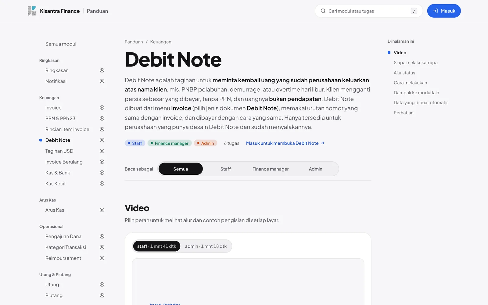
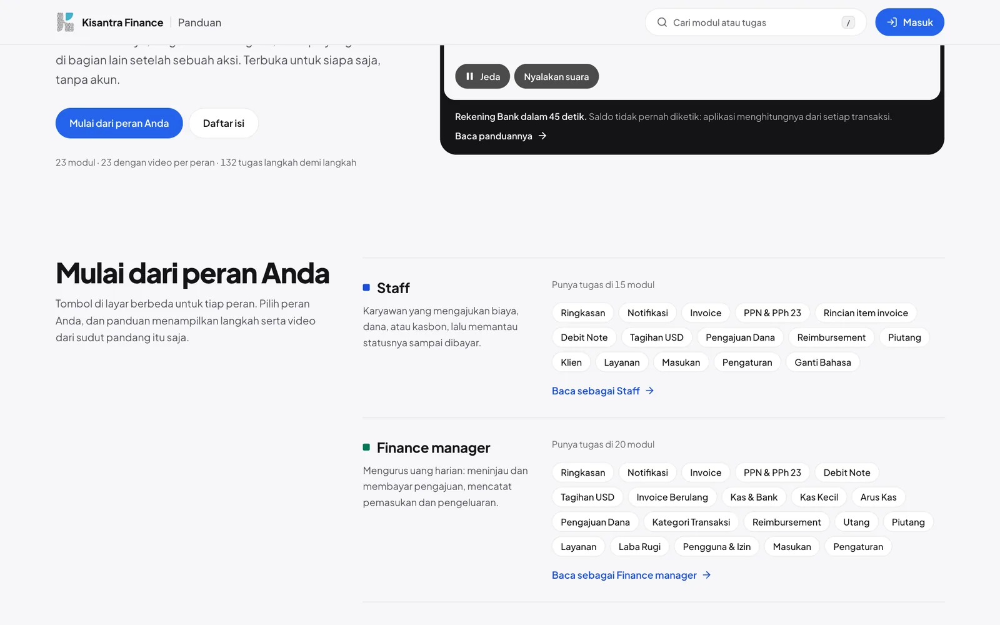
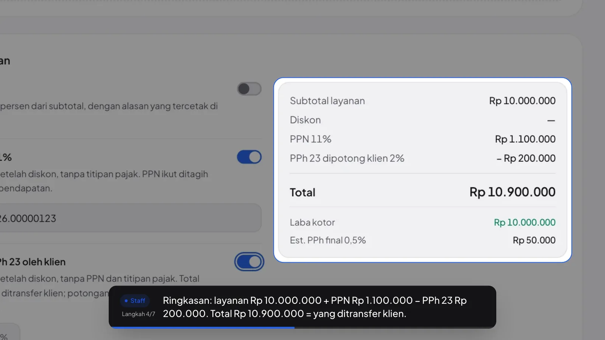
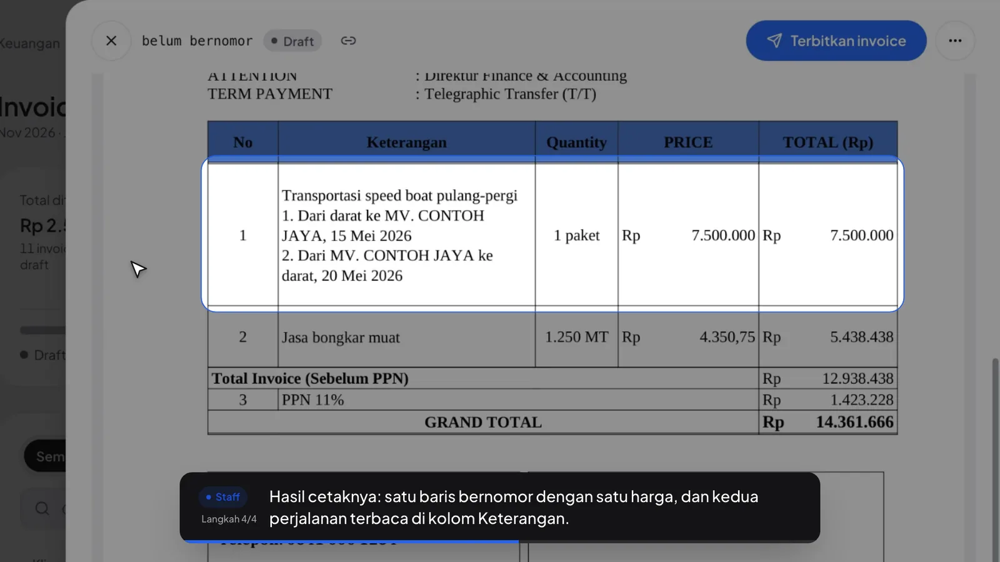
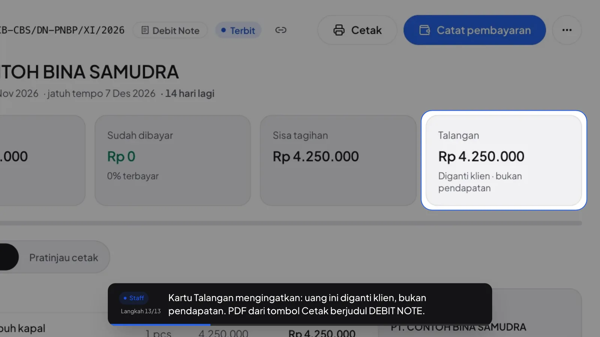
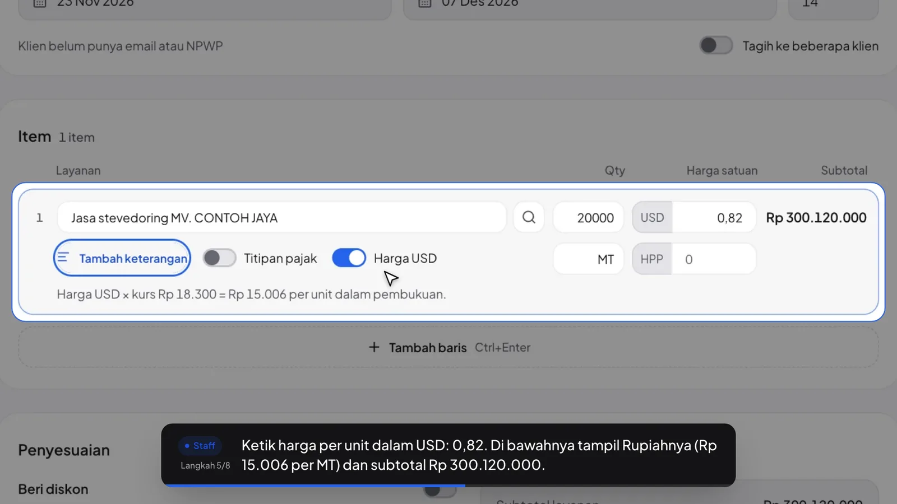
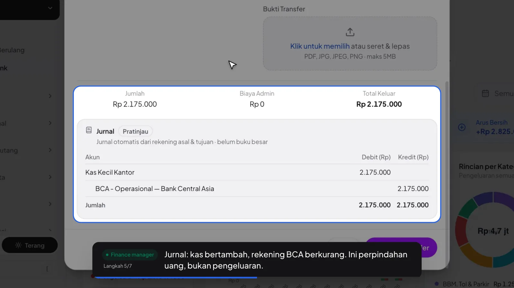
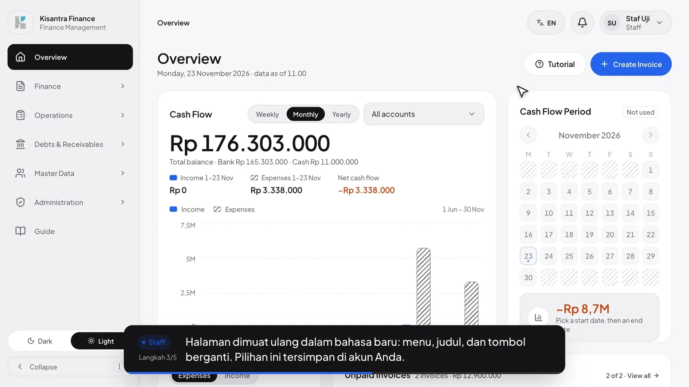

# [Panduan] Create - Panduan & video tutorial fitur baru: PPN & PPh 23, Rincian item invoice, Debit Note, Tagihan USD, Kas Kecil & Ganti Bahasa

### 📋 Description

**Context:** video di halaman `/panduan` terakhir diambil 12–13 Okt 2026. Sejak itu banyak fitur baru masuk: PPN per invoice, potongan PPh 23, Debit Note (talangan & tagihan jasa), Tagihan USD dengan kurs manual, harga satuan bersen, Perihal/ATTENTION/keterangan item, kas kecil, dan multi bahasa. Sebagian sudah disebut di **teks** panduan modul (Invoice, Kas & Bank), tetapi tanpa screenshot dan tanpa video, dan teksnya padat untuk pengguna baru. **Ganti Bahasa** belum ada di panduan sama sekali. Pemicunya pertanyaan tentang invoice NAI 115 (speed boat: dua baris perjalanan dengan satu harga gabungan), yang ternyata bisa dibuat tanpa ubah kode dengan **satu baris paket + keterangan bernomor**, tetapi belum ada panduannya.

PR ini menambah **6 halaman panduan baru** di `/panduan`. Masing-masing berisi teks ramah pemula (peran, langkah, contoh hitungan, dampak, perhatian, matriks akses) dan **video walkthrough per peran** dari screenshot asli aplikasi (data contoh):

1. **PPN & PPh 23** (Keuangan): contoh hitungan Rp 10.000.000 + PPN 11% − PPh 23 2% = Rp 10.900.000; sakelar di editor; cara menyalakan PKP & PPh 23 di Profil perusahaan.
2. **Rincian item invoice** (Keuangan): Perihal, ATTENTION, keterangan per baris, **baris paket** (satu harga untuk beberapa pekerjaan) beserta hasil cetaknya, harga bersen.
3. **Debit Note** (Keuangan): talangan vs tagihan jasa, kode jenis, terbit, jurnal Talangan Biaya Klien, mencatat biaya ke negara dengan kategori Bayar Talangan Klien.
4. **Tagihan USD** (Keuangan): kurs manual, harga USD per baris, pembayaran USD dengan kurs saat diterima, contoh selisih kurs.
5. **Kas Kecil** (Keuangan): akun berjenis Kas dengan penanggung jawab & plafon, Perlu isi ulang, **Isi ulang** lewat transfer.
6. **Ganti Bahasa** (Pengaturan): pengalih ID / EN / 中文 setelah masuk dan di halaman masuk; apa yang tetap berbahasa Indonesia.

**Tidak ada perubahan kode aplikasi, database, atau izin.** Yang berubah hanya isi panduan (`video/`), skrip capture, dan dokumentasi.

---

## Ringkasan singkat

| Fitur | Sebelum | Sesudah |
|---|---|---|
| PPN & PPh 23 | Satu langkah panjang di tugas "Membuat invoice" | Halaman sendiri + video Staff (51 dtk) & Admin (1 mnt 16 dtk) + contoh hitungan |
| Perihal, ATTENTION, keterangan, harga bersen, baris paket | Tersebar di satu langkah; baris paket belum dijelaskan | Halaman **Rincian item invoice** + video Staff dengan hasil cetak PDF |
| Debit Note | Tugas teks di panduan Invoice; dokumen modul mencatat "belum ada video" | Halaman sendiri + video Staff (1 mnt 41 dtk) & Admin (1 mnt 18 dtk) |
| Tagihan USD | Tugas teks di panduan Invoice | Halaman sendiri + video Staff, Finance manager, Admin |
| Kas kecil | Tugas teks di Kas & Bank; screenshot masih sebelum jenis akun Kas | Halaman **Kas Kecil** + video Finance manager & Admin |
| Ganti bahasa | Tidak ada | Halaman **Ganti Bahasa** + video |
| Jumlah modul di `/panduan` | 17 | **23** (semuanya bervideo) |

---

## 🖼️ Hasil

Semua screenshot diambil dari **database QC terpisah**: perusahaan demo Kisantra dan PT BCB contoh (`ContohInvoiceBcbSeeder`) dengan klien, kapal, nomor, dan nominal **fiktif**. Alamat, telepon, email, dan nomor rekening profil BCB diganti data contoh sebelum capture; tanda tangan "CONTOH" digambar seeder.

### 1. Halaman `/panduan`

| Halaman Debit Note (rel kiri: modul baru di kelompok Keuangan) | Beranda: modul baru ikut di jalur per peran |
|---|---|
|  |  |

- Halaman baru ditemukan otomatis dari folder `video/<slug>/` (tanpa daftar bersama yang perlu diedit), jadi langsung tampil di rel kiri, daftar isi, pencarian, dan jalur per peran.
- Beranda kini mencatat **23 modul · 23 dengan video per peran**.

### 2. PPN & PPh 23



- Video Staff: sakelar **Tagih PPN 11%**, nomor faktur, **Dipotong PPh 23 oleh klien**, ringkasan Total = yang ditransfer klien, mematikan PPh untuk klien yang tidak memotong (diingat per klien), kartu PPN di daftar.
- Video Admin: menyalakan PKP, NPWP, tarif PPN, dan PPh 23 di Profil perusahaan; dampak (PPN bukan pendapatan, PPh 23 tetap pendapatan).

### 3. Rincian item invoice: baris paket



- Kasus invoice speed boat NAI: **satu baris** "Transportasi speed boat pulang-pergi", Qty 1 paket, Rp 7.500.000, dua perjalanan ditulis bernomor di **Tambah keterangan**. Hasil cetaknya satu baris bernomor dengan satu harga, dan subtotal, PPN, serta PPh sama persis dengan dokumen asli.
- Panduan juga menjelaskan apa yang **tidak** boleh dilakukan: memecah harga menjadi 2 × Rp 3.750.000 atau menambah baris berharga 0.
- Harga bersen: 1.250 MT × Rp 4.350,75 = 5.438.437,5 → **Rp 5.438.438**.

### 4. Debit Note



- Video Staff (13 + 2 langkah): pilih **Debit Note**, kode **PNBP** (petunjuk "Di nomor: DN-PNBP"), sifat **Talangan**, klien & perihal, item + keterangan NTPN, ringkasan Talangan, **Simpan & terbitkan** → `107/BCB-CBS/DN-PNBP/XI/2026`; lalu sifat **Tagihan jasa** yang memunculkan lagi PPN & PPh 23.
- Video Admin: sakelar Debit Note di Profil perusahaan, jurnal pembayaran (kredit **Talangan Biaya Klien**), dan pengeluaran Pendanaan **Bayar Talangan Klien** yang tidak mengubah Laba Rugi.

### 5. Tagihan USD



- Contoh 20.000 MT × USD 0,82 dengan kurs 18.300 = Rp 300.120.000 → **USD 16.400,00**; dibayar dengan kurs 18.400 → Rp 301.760.000 masuk rekening, **selisih kurs Rp 1.640.000** (laba), status Lunas.
- Video Staff (membuat), Finance manager (mencatat pembayaran USD), Admin (menyalakan Tagihan USD + rekening USD, dampak selisih kurs).

### 6. Kas Kecil



- Video Finance manager: **Tambah Akun › Kas** (Kas Kecil Gudang, penanggung jawab Staf Uji, plafon Rp 3.000.000), lalu Kas Kecil Kantor yang **Perlu isi ulang Rp 2.175.000** diisi ulang dari BCA - Operasional sampai saldonya kembali sebesar plafon.
- Video Admin: isi ulang = transfer (Laba Rugi tetap); yang menjadi beban adalah belanjanya.

### 7. Ganti Bahasa



- Pengalih bahasa di kanan atas → English / 中文; formulir ikut berganti; halaman masuk untuk tamu.
- Panduan menegaskan yang tetap Bahasa Indonesia: PDF/Excel, data yang diketik, panduan & video; format Rupiah sama di semua bahasa.

---

## 🔧 Scope

**Halaman panduan baru** (`video/<slug>/guide.ts`, `shots.ts`, `steps.ts`, `tutorial.tsx`, `screens/*.webp`)
- ✅ `pajak-invoice`: komposisi `PajakInvoiceStaff`, `PajakInvoiceAdmin`.
- ✅ `rincian-invoice`: `RincianInvoiceStaff` (tiga bab: Perihal & ATTENTION, Baris paket, Harga bersen).
- ✅ `debit-note`: `DebitNoteStaff`, `DebitNoteAdmin`.
- ✅ `tagihan-usd`: `TagihanUsdStaff`, `TagihanUsdFinanceManager`, `TagihanUsdAdmin`.
- ✅ `kas-kecil`: `KasKecilFinanceManager`, `KasKecilAdmin`.
- ✅ `bahasa`: `BahasaStaff`.
- ✅ Setiap klaim di teks dicocokkan dengan kode dan dokumen modul (mis. siapa yang boleh mengubah Profil perusahaan, pembulatan harga bersen, pilihan PPh diingat per klien).

**Skrip capture** (`video/capture/*.js`, header tiap skrip memuat prasyarat data QC)
- ✅ `pajak-invoice.js`, `rincian-invoice.js` + `rincian-invoice-print.js` (pratinjau cetak dari gambar PDF asli), `debit-note.js`, `tagihan-usd.js` (bisa dilanjutkan lewat `RESUME_ID`), `kas-kecil.js` (bisa melewati bagian lewat `SKIP`), `bahasa.js` (selalu mengembalikan bahasa akun staff ke Indonesia).
- ✅ `invoices-pdf.py` menerima nama folder (`python video/capture/invoices-pdf.py rincian-invoice`); tanpa argumen tetap `invoices`.

**Dokumentasi:** `docs/module/invoices.md` (panduan fitur Invoice, catatan "belum ada video Debit Note" dihapus), `docs/module/bank-accounts.md` (panduan Kas Kecil), `docs/module/README.md` (panduan Ganti Bahasa).

## 📁 Perubahan berkas

| Berkas | Isi |
|---|---|
| `video/pajak-invoice/` | **Baru.** Panduan PPN & PPh 23 + 7 screenshot. |
| `video/rincian-invoice/` | **Baru.** Panduan Rincian item invoice + 7 screenshot. |
| `video/debit-note/` | **Baru.** Panduan Debit Note + 14 screenshot. |
| `video/tagihan-usd/` | **Baru.** Panduan Tagihan USD + 13 screenshot. |
| `video/kas-kecil/` | **Baru.** Panduan Kas Kecil + 8 screenshot. |
| `video/bahasa/` | **Baru.** Panduan Ganti Bahasa + 7 screenshot. |
| `video/capture/{pajak-invoice,rincian-invoice,rincian-invoice-print,debit-note,tagihan-usd,kas-kecil,bahasa}.js` | **Baru.** Skrip capture Playwright. |
| `video/capture/invoices-pdf.py` | Argumen folder opsional. |
| `docs/module/invoices.md`, `bank-accounts.md`, `README.md` | Catatan panduan baru + cara mengambil ulang screenshot. |
| `docs/pr/2026-11-23-panduan-fitur-baru/` | Ringkasan PR ini + screenshot. |

## 🗄️ Database

Tidak ada migration. Data contoh hanya dibuat di database QC lokal saat capture, tidak ikut PR.

## ✅ Acceptance Criteria

- [x] Enam halaman baru tampil di `/panduan` (rel kiri, daftar isi, pencarian, jalur per peran) dan terbuka tanpa error di console.
- [x] Setiap halaman punya video per peran yang termuat di pemutar, dengan tombol bab.
- [x] Screenshot memakai data contoh, bukan data perusahaan asli.
- [x] Sorotan, zoom, dan teks tiap langkah jatuh di elemen yang dijelaskan (dicek dengan render frame Remotion).
- [x] Panduan baris paket menghasilkan angka yang sama dengan dokumen asli (subtotal, PPN, PPh).
- [x] Dokumen modul mencatat panduan baru dan cara mengambil ulang screenshot.

## 📝 Technical Notes

- **Halaman terpisah, bukan bab di video lama.** Video Invoice dan Kas & Bank memakai screenshot 12–13 Okt; mencampur layar lama dan baru dalam satu video akan janggal. Tugas teks lama di `video/invoices/guide.ts` tetap ada sebagai rujukan lengkap.
- **Efek "diketik"** (`Step.type`) hanya dipakai bila screenshot sebelum dan sesudahnya berposisi sama, karena efek itu membuka gambar baru hanya di dalam kotaknya di atas gambar sebelumnya. Untuk itu skrip memakai posisi gulir tetap, dan kotak yang tidak bisa diukur otomatis (nilai input, teks di dalam PDF) diukur dari screenshot (px ÷ 1,5).
- **Pencatatan pembayaran ditunjukkan oleh Finance manager**, bukan Staff: Staff tidak punya izin `view bank-accounts`, sehingga `/api/bank-accounts` menjawab 403 dan dialog **Catat pembayaran** milik Staff gagal dimuat (halaman kosong, `accounts.find is not a function`). Lihat bagian di bawah.
- **Pratinjau cetak di headless.** Penampil PDF Chromium headless kosong, jadi `rincian-invoice-print.js` mengisi iframe pratinjau dengan gambar PDF asli (cara yang sama dengan `invoices-admin.js`).

## ⚠️ Belum didukung / disengaja

- **Koneksi Claude dan Perusahaan (multi-perusahaan)** tidak dibuatkan halaman sendiri (diputuskan tidak perlu); keduanya tetap dijelaskan di teks panduan Pengaturan dan Pengguna & Izin.
- **Video modul lama tidak diambil ulang.** Screenshot editor invoice di video Invoice masih tampilan 12 Okt.
- Halaman baru belum punya tombol **Tutorial** di header aplikasi; videonya dibuka dari `/panduan`.
- **Ditemukan, belum diperbaiki (di luar cakupan PR ini):**
  - Staff membuka **Catat pembayaran** → halaman kosong (lihat Technical Notes). Panduan Invoice yang lama masih menyebut Staff bisa mencatat pembayaran.
  - Tab **Pratinjau cetak** di drawer selalu berlabel "Template Kisantra", juga untuk perusahaan dengan desain invoice sendiri (teks tetap di `invoice-drawer.tsx`).

## 🚀 Yang perlu dilakukan saat deploy

1. `./deploy.sh` seperti biasa (build frontend ikut membundel panduan dan video baru). Tidak ada migration atau langkah manual.

## 🧪 Cara mencoba

```bash
npm run build
```

- Buka `/panduan` (tanpa login) → kelompok **Keuangan**: PPN & PPh 23, Rincian item invoice, Debit Note, Tagihan USD, Kas Kecil; kelompok **Pengaturan**: Ganti Bahasa.
- Remotion Studio: `npm run video`, lalu pilih komposisi `PajakInvoiceStaff`, `RincianInvoiceStaff`, `DebitNoteStaff`, `TagihanUsdStaff`, `KasKecilFinanceManager`, `BahasaStaff`, dst.

## Pengujian

- [x] `npm run types` bersih, `npm run i18n:check` 0 galat, `npm run build` sukses.
- [x] `GuidePageTest` (6) lulus.
- [x] Seluruh 143 berkas tes Unit + Feature lulus saat dijalankan per berkas. Run satu proses di worktree ini terpotong `set_time_limit(300)` milik `CashFlowExportService` (sisa suite sesudah tes ekspor harus selesai dalam 300 detik); PR ini tidak mengubah kode PHP maupun tes.
- [x] Dicoba di browser: keenam halaman terbuka, video termuat, tanpa error console; beranda mencatat 23 modul.
- [x] Frame video dirender (`npx remotion still`) dan dicek untuk keenam panduan.
