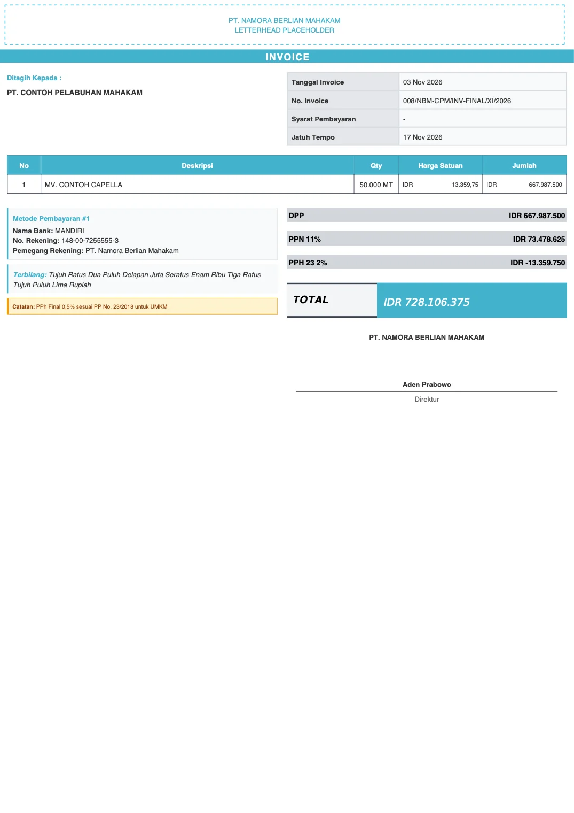
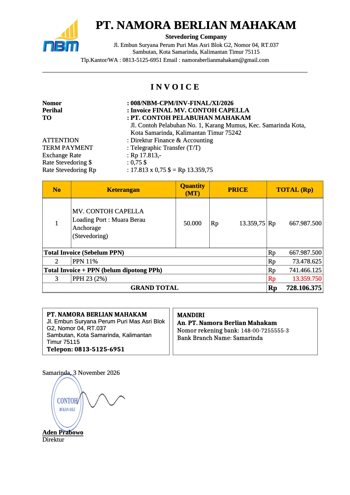
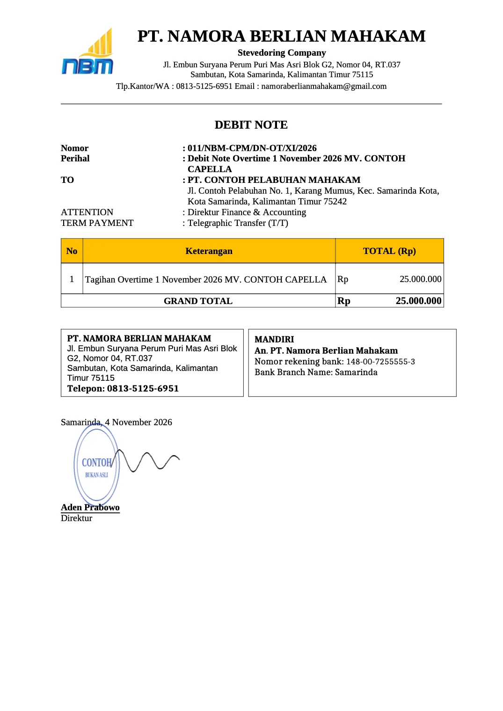
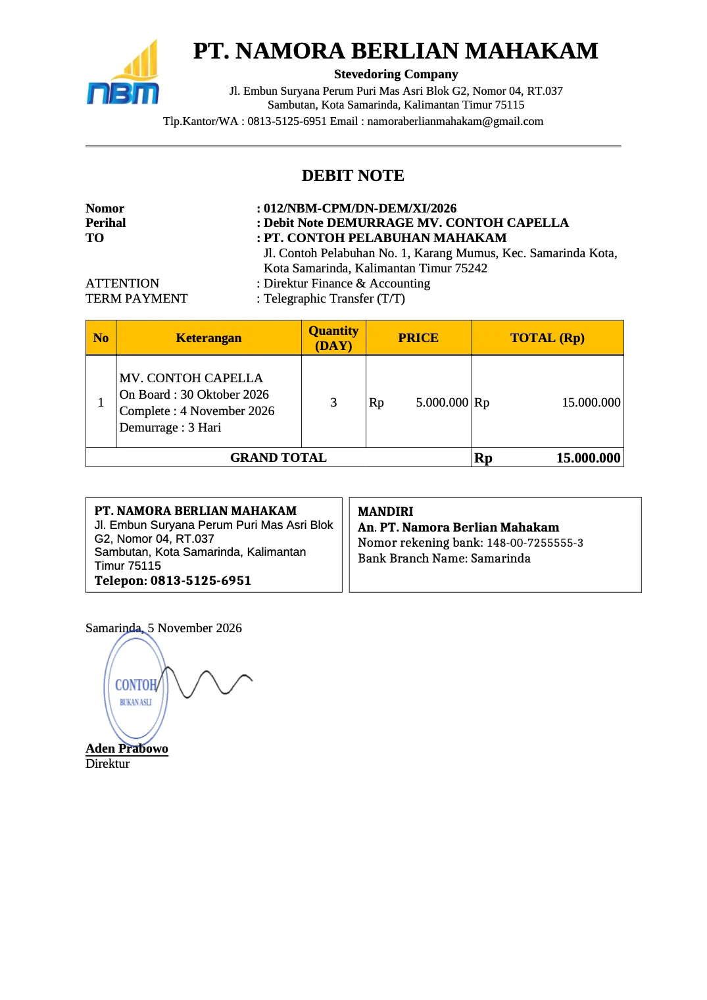
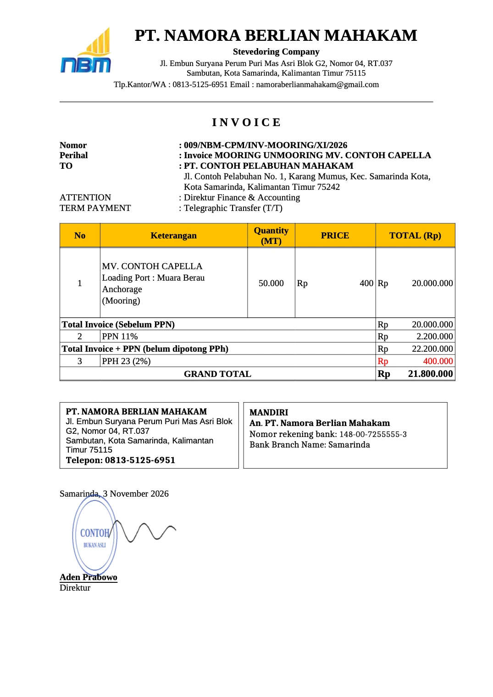
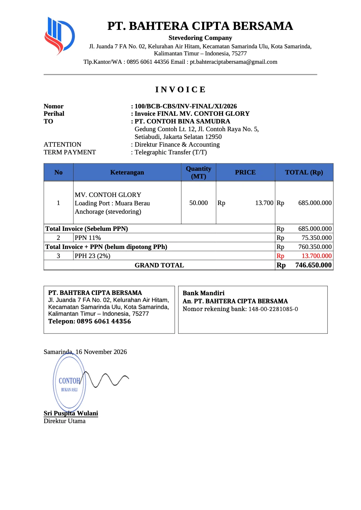

# [Invoice] Create - Template invoice & Debit Note PT Namora Berlian Mahakam (NBM)

### 📋 Description

**Context:** PT Namora Berlian Mahakam (NBM) membuat invoice (`INVOICE FINAL/MOORING/FENDER MV. … .xlsx`) dan Debit Note (`DN OVERTIME TKBM MV. … .xlsx`) di Excel. Dokumen itu satu keluarga dengan dokumen PT BCB: kop "Stevedoring Company", blok klien, tabel bergaya Excel, kotak alamat & rekening, dan tanda tangan. PR ini memberi NBM template PDF di aplikasi dengan **susunan template BCB** (#41). Bedanya hanya **logo NBM** dan **warna judul kolom oranye**.

**Tidak ada perubahan struktur.** Tidak ada tabel/kolom baru, dan model, controller, service, editor, alur status, serta izin tidak diubah. Template dikenali otomatis dari nama folder `namora-berlian-mahakam`. Satu migration tenant hanya mengubah **isi data** NBM (sama dengan migration MKB/BCB/AOE, ditambah menyalakan sakelar Debit Note).

---

## Ringkasan singkat

| | Sebelum | Sesudah |
|---|---|---|
| Invoice NBM | Desain bawaan Kisantra | Susunan BCB, logo NBM, judul kolom oranye |
| Debit Note (talangan) di NBM | Tidak tersedia | Bisa dipilih di editor (**Jenis dokumen › Debit Note**), sakelar sudah menyala |
| Nomor dokumen NBM | Format tanpa kode jenis | `008/NBM-PTB/INV-FINAL/IX/2026`, `004/NBM-KE/DN-OT/VIII/2026`, seperti dokumen asli |

---

## 🖼️ Hasil

Semua contoh memakai data seeder: klien, kapal, nomor, dan nominal **fiktif**. Tanda tangan "CONTOH" digambar seeder (tanda tangan asli diunggah di Profil perusahaan).

### 1. Invoice FINAL

| Sebelum — desain bawaan Kisantra | Sesudah — susunan BCB, logo & warna NBM |
|---|---|
|  |  |

- **Kop surat di setiap halaman** seperti BCB: logo NBM, nama perusahaan kapital, "Stevedoring Company", alamat, lalu baris "Tlp.Kantor/WA … Email …" dan garis ganda.
- Judul **I N V O I C E** tanpa kotak, lalu blok **Nomor · Perihal · TO** (nama & alamat klien) · **ATTENTION** · **TERM PAYMENT**.
- Invoice Rupiah bertarif USD mencetak **Exchange Rate**, **Rate Stevedoring $**, dan **Rate Stevedoring Rp** di blok klien, seperti invoice FINAL asli NBM. Tarif $0,75 × kurs 17.813 menghasilkan harga **Rp 13.359,75**, sama persis dengan lembar Excel.
- Tabel bergaya Excel dengan **judul kolom oranye `#ffc000`**: No · Keterangan · Quantity · PRICE · TOTAL (Rp). Lalu Total Sebelum PPN, PPN 11%, Total + PPN (belum dipotong PPh), **PPH 23 (merah)**, dan GRAND TOTAL.
- **Kotak alamat & kotak rekening** berdampingan, lalu kota-tanggal, tanda tangan, nama & jabatan.

### 2. Debit Note

| Tagihan sekali bayar (overtime) | Berkolom Quantity/PRICE (demurrage 3 hari) |
|---|---|
|  |  |

- Judul **DEBIT NOTE**. Kop, blok klien, kotak alamat & rekening, dan tanda tangan sama dengan invoice.
- Tabel Debit Note BCB (16 cm) dengan judul kolom oranye: No · Keterangan · TOTAL (Rp), GRAND TOTAL bergaris tunggal.
- Kolom **Quantity & PRICE** hanya muncul bila ada item dengan jumlah selain 1, sama seperti perusahaan lain.
- Debit Note talangan: tanpa PPN, tanpa PPh 23, dan tidak dihitung pendapatan. Sifat **Tagihan jasa** tetap bisa dipilih.

### 3. Dibandingkan dengan BCB

| Invoice MOORING NBM | Invoice FINAL BCB (dasar desain) |
|---|---|
|  |  |

Susunan, posisi, font, tabel, kotak, dan tanda tangan sama. Yang berbeda hanya logo dan warna judul kolom.

---

## 🔧 Scope

- ✅ Template invoice, Debit Note, dan kerangka NBM: **salinan template BCB** di folder sendiri, jadi mengubah BCB tidak ikut mengubah NBM.
- ✅ Logo NBM dari lembar Excel, tanpa tulisan nama di bawahnya (seperti logo di kop lembar DN asli NBM).
- ✅ Judul kolom tabel invoice & Debit Note oranye `#ffc000` (warna lembar Excel NBM; BCB biru `#4472c4`).
- ✅ Font tertanam sama dengan BCB: **Tinos** (Times New Roman), **Caladea** (Cambria, kotak info), **Arimo** (Arial, alamat), beserta lisensinya.
- ✅ Migration tenant khusus NBM: format nomor `{KODE}`, kategori Talangan Klien, sakelar Debit Note menyala.
- ✅ Seeder contoh `ContohInvoiceNbmSeeder` + tes.
- ✅ Dokumentasi modul & panduan pengguna.

## 📁 Perubahan berkas

| Berkas | Isi |
|---|---|
| `resources/views/pdf/perusahaan/namora-berlian-mahakam/kerangka.blade.php` | **Baru.** Salinan kerangka BCB: kop (diulang tiap halaman), blok klien + kurs USD, kotak alamat & rekening, kota-tanggal, tanda tangan. Logo NBM 2,21 × 2 cm, teks kop bergeser 0,22 cm agar jarak logo–teks tetap seperti BCB. |
| `resources/views/pdf/perusahaan/namora-berlian-mahakam/invoice.blade.php` | **Baru.** Salinan invoice BCB, judul kolom `#ffc000`. |
| `resources/views/pdf/perusahaan/namora-berlian-mahakam/debit-note.blade.php` | **Baru.** Salinan Debit Note BCB, judul kolom `#ffc000`. |
| `resources/views/pdf/perusahaan/namora-berlian-mahakam/logo.jpg`, `fonts/*` | **Baru.** Logo dari lembar Excel NBM; font Tinos, Caladea, Arimo + lisensinya. |
| `database/migrations/tenant/2026_11_23_143838_siapkan_debit_note_nbm.php` | **Baru.** Hanya untuk NBM, lihat bagian Database. |
| `database/seeders/ContohInvoiceNbmSeeder.php` | **Baru.** Contoh lokal: akun admin/staff NBM, profil, 1 klien fiktif, invoice FINAL (tarif USD) / MOORING / FENDER, 2 Debit Note, 1 draft. |
| `tests/Feature/TemplateInvoiceNbmTest.php` | **Baru.** 7 tes: template & font, kop & tabel oranye, Debit Note, kolom Quantity/PRICE & uang muka, tagihan USD, kurs di blok klien, migration. |
| `tests/Feature/ContohInvoiceNbmSeederTest.php` | **Baru.** 2 tes seeder (isi data & bisa dijalankan ulang). |
| `docs/module/invoices.md`, `docs/module/settings.md`, `docs/module/transaction-categories.md`, `docs/design/debit-note-slu/README.md`, `CLAUDE.md` | Menambahkan NBM ke daftar perusahaan bertemplate Debit Note + penjelasan template NBM. |
| `video/invoices/guide.ts`, `video/debit-note/guide.ts` | Panduan Debit Note menyebut PT Namora Berlian Mahakam. |
| `docs/pr/2026-11-23-template-invoice-nbm/` | Ringkasan PR ini + screenshot. |

## 🗄️ Database

Migration tenant `2026_11_23_143838_siapkan_debit_note_nbm` hanya berjalan untuk **NBM** dan **tidak menambah/mengubah kolom**:

1. Format nomor `…/INV/…` → `…/{KODE}/…`, **hanya bila masih persis format lama** `{NO}/{PT}-{KLIEN}/INV/{BLN_ROMAWI}/{THN}`.
2. Mengisi urutan dan kode jenis nomor lama berkode (mis. `…/INV-FINAL/…`, `…/INV-MOORING/…`), supaya nomor berikutnya tidak mulai lagi dari 001.
3. Membuat kategori Pendanaan **Talangan Klien › Bayar Talangan Klien** bila belum ada.
4. Menyalakan sakelar **Debit Note** di Profil perusahaan NBM, karena template Debit Note ini dibuat atas permintaan NBM. Bisa dimatikan lagi di Profil perusahaan.

Nomor lama berawalan DN **tidak** diubah jenisnya (tinjau manual). Aman dijalankan berulang.

## ✅ Acceptance Criteria

- [x] NBM hanya memakai template NBM. Template bawaan lewat URL → 404.
- [x] Dialog cetak menawarkan "PT Namora Berlian Mahakam".
- [x] Font Tinos, Caladea, dan Arimo tertanam di PDF.
- [x] Invoice: kop BCB dengan logo NBM, judul tanpa kotak, tabel berjudul kolom oranye, PPH 23 merah, GRAND TOTAL, kotak alamat & rekening, kota-tanggal, dan tanda tangan unggahan.
- [x] Invoice Rupiah bertarif USD: Exchange Rate & Rate Stevedoring di blok klien; 56.880 × Rp 13.359,75 → GRAND TOTAL 828.293.812, sama dengan lembar Excel asli.
- [x] Editor NBM menawarkan **Debit Note** + **Kode jenis**. Nomor satu urutan dengan invoice (`001/NBM-CPM/INV-FINAL/XI/2026` → `002/NBM-CPM/DN-OT/XI/2026`).
- [x] Debit Note talangan: semua item titipan, tanpa PPN/PPh; kolom Quantity/PRICE hanya bila qty ≠ 1; uang muka memakai kata "Debit Note".
- [x] Migration hanya mengubah NBM (perusahaan lain, termasuk BCB, tidak tersentuh) dan idempoten.
- [x] Perusahaan lain dan template SLU/BAS/MKB/BCB/AOE/NAI tidak berubah.

## ⚠️ Perbedaan dari dokumen Excel asli (disengaja)

- **Susunan mengikuti BCB**, bukan tata letak lembar Excel NBM: invoice asli NBM memakai logo + judul berkotak tanpa kop, sedangkan template memakai kop BCB di invoice maupun Debit Note (kop ini mirip kop lembar DN asli NBM).
- Baris kop "Tlp.Kantor/WA … Email …" mengikuti BCB (kop DN asli NBM hanya mencantumkan email).
- Label baris total dari sistem ("Total Invoice (Sebelum PPN)", bukan "Total Invoice Final ( Sebelum PPN )"), dan "Stavedoring" ditulis "Stevedoring".
- Judul kolom menyertakan satuan, mis. "Quantity (MT)", sama seperti BCB.

## 🚀 Yang perlu dilakukan saat deploy

1. `./deploy.sh` seperti biasa (migration tenant ikut jalan).
2. **Periksa Profil perusahaan NBM** di server: alamat (baris baru ikut tercetak), telepon, email, rekening (Mandiri, cabang Samarinda), kota tanda tangan (Samarinda), nama & jabatan penanda tangan, PKP/PPN 11%, **PPh 23 2%**, dan **Tagihan USD** (untuk invoice FINAL bertarif USD).
3. **Unggah gambar tanda tangan.** Gambar tanda tangan di lembar Excel NBM sudah memuat nama & jabatan, sedangkan template (seperti BCB) juga mencetak nama & jabatan dari profil. Unggah versi tanpa nama & jabatan agar tidak tercetak dua kali.
4. Penanda tangan: lembar invoice asli ditandatangani Aden Prabowo, lembar DN asli Salam Ilham. Profil hanya menyimpan satu penanda tangan untuk kedua dokumen.
5. Bila format nomor NBM di server bukan persis `{NO}/{PT}-{KLIEN}/INV/{BLN_ROMAWI}/{THN}`, ganti manual di **Pengaturan › Penomoran invoice** menjadi `{NO}/{PT}-{KLIEN}/{KODE}/{BLN_ROMAWI}/{THN}`.

## 🧪 Cara mencoba

```bash
php artisan tenants:migrate
php artisan db:seed --class=ContohInvoiceNbmSeeder
```

Login `admin.nbm@mitragroup.id` (password `password`) → Invoice → buka invoice atau Debit Note → **Cetak**.

Data contoh: klien, kapal, nomor, dan nominal fiktif. Alamat, email, telepon, dan rekening NBM diambil dari lembar Excel asli, seperti seeder MKB/BCB/AOE.

## Pengujian

- [x] `TemplateInvoiceNbmTest` (7) dan `ContohInvoiceNbmSeederTest` (2) lulus.
- [x] 120 tes terkait lulus: template perusahaan, Debit Note SLU/BAS/MKB/BCB/AOE/NBM, sakelar & tagihan jasa Debit Note, ATTENTION, baris total, seeder contoh, teks multi bahasa.
- [x] Suite `TenancyReal` (migrasi sungguhan per database perusahaan): 44 lulus.
- [x] PDF dirender dan dicek: invoice FINAL bertarif USD, invoice MOORING, Debit Note sekali bayar, Debit Note berkolom Quantity/PRICE, dibandingkan dengan invoice BCB.
