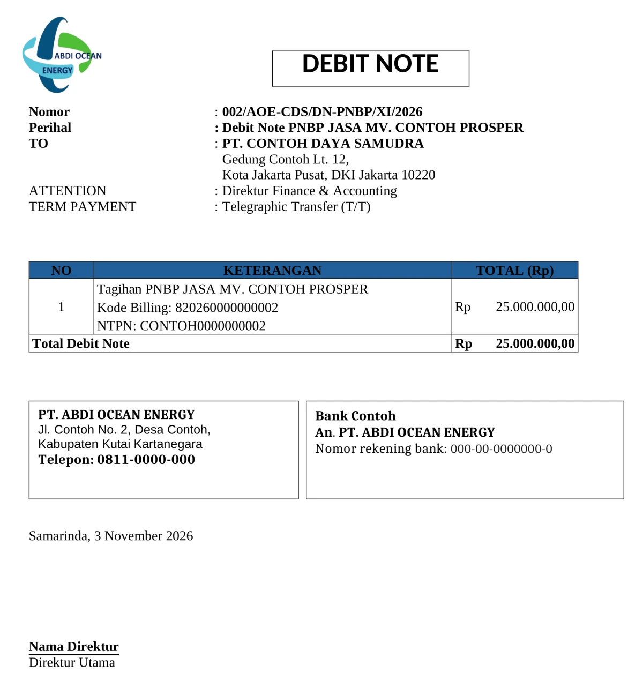
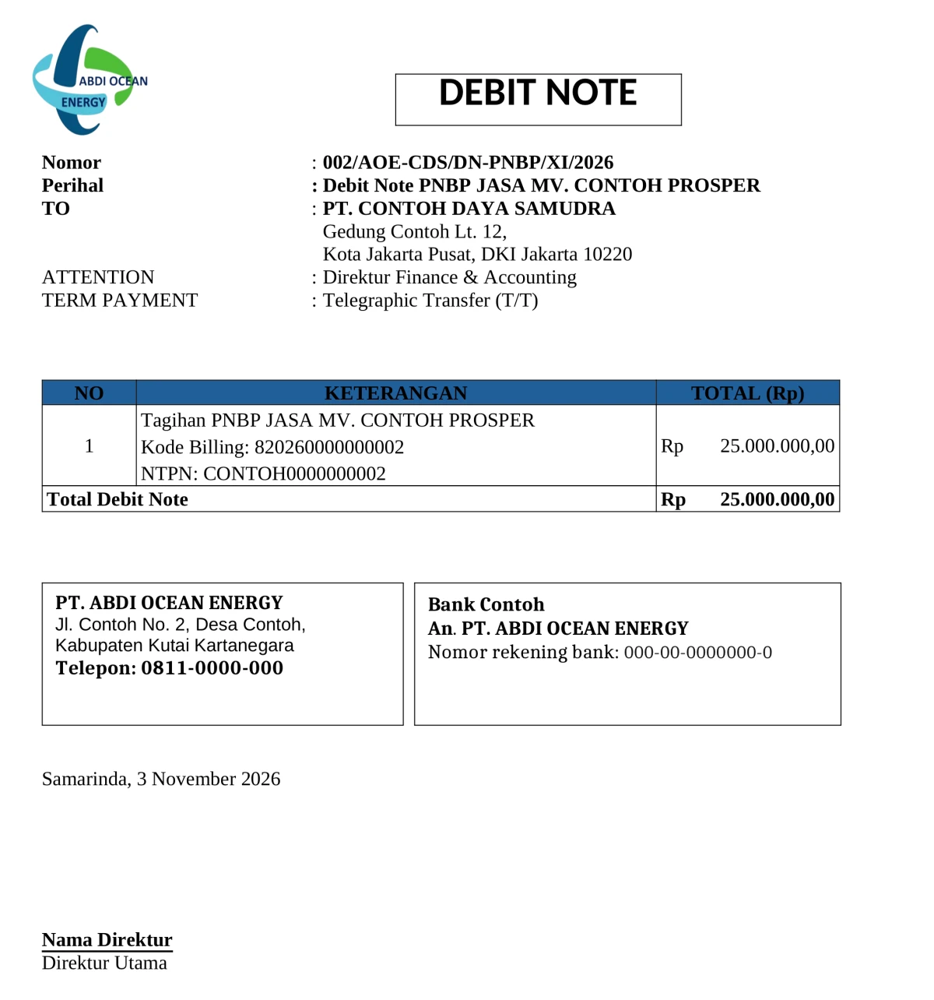
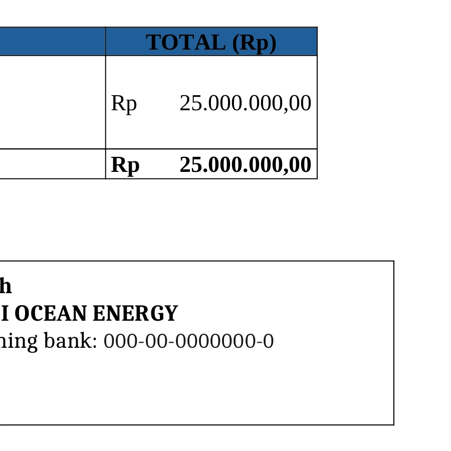
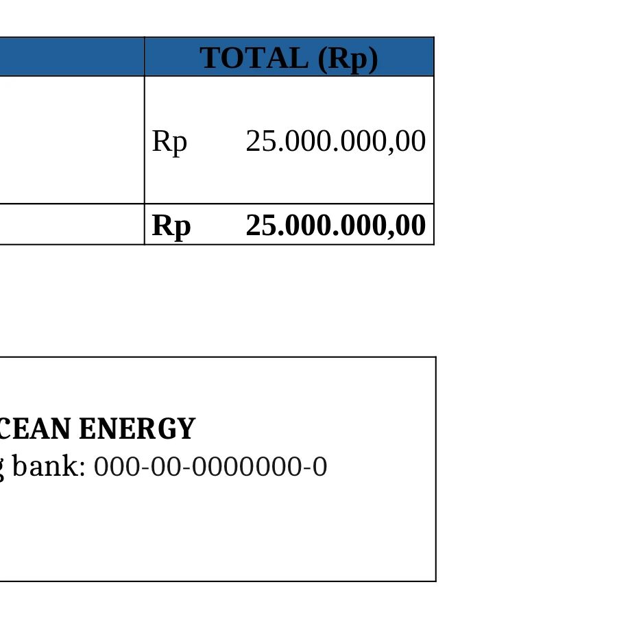

# [Invoice] Fix - Kotak alamat & rekening PDF AOE selebar tabel item

### 📋 Description

**Context:** Di PDF Debit Note PT Abdi Ocean Energy (AOE), kotak rekening menjorok **1,3 cm** melewati tepi kanan tabel item. Template AOE (#43) meniru dokumen Word AOE. Di dokumen itu kotak alamat & rekening selalu selebar 16,73 cm, padahal tabel Debit Note hanya 15,54 cm. PR ini membuat kedua kotak selebar tabel item, jadi tepi kanannya sejajar.

**Tidak ada perubahan struktur.** Yang berubah hanya template PDF AOE (kerangka + Debit Note). Tidak ada migration. Model, controller, service, editor, dan template perusahaan lain tidak diubah.

---

## Ringkasan singkat

| | Sebelum | Sesudah |
|---|---|---|
| Debit Note AOE | Kotak 16,73 cm, tepi kanan kotak rekening **1,30 cm** di kanan tabel | Kotak 15,54 cm, tepi kanan sejajar tabel (selisih 0,03 cm) |
| Invoice AOE | Kotak 16,73 cm, tepi kanan 0,03 cm di kiri tabel (16,86 cm) | Kotak 16,86 cm, selisih 0,03 cm. Di kertas tidak terlihat bedanya |

---

## 🖼️ Hasil

Contoh memakai data tes: klien, kapal, nomor, dan nominal **fiktif**. Tepi kanan diukur dari render 300 dpi.

### 1. Debit Note

| Sebelum: kotak rekening menjorok melewati tabel | Sesudah: kotak selebar tabel |
|---|---|
|  |  |

### 2. Tepi kanan diperbesar

| Sebelum | Sesudah |
|---|---|
|  |  |

- Perbandingan lebar kedua kotak tetap seperti dokumen Word (alamat 7,6 : rekening 8,96, sela 0,17 cm). Yang berubah hanya lebar totalnya, sekarang mengikuti tabel.
- Di Debit Note kedua kotak jadi lebih sempit (alamat −0,59 cm, rekening −0,68 cm). Alamat atau nama rekening yang panjang pindah baris lebih awal, dan kotak memanjang ke bawah seperti biasa.
- Di invoice, tabel item selebar area cetak (16,86 cm), dan kotak melebar 0,13 cm mengikutinya.

---

## 🔧 Scope

- ✅ `kerangka.blade.php`: lebar kotak dihitung dari `$lebarTabel` (bawaan 16,86 cm = area cetak). Lebar sel dikurangi 0,54 cm (padding 0,25 cm kiri-kanan + garis 0,5 pt kiri-kanan), karena DomPDF tidak memasukkan keduanya ke lebar sel.
- ✅ `debit-note.blade.php`: menyetel `$lebarTabel = 15.54` dan memakainya untuk lebar tabel item & baris total, jadi lebar tabel dan kotak diatur di satu tempat.
- ✅ Tes + dokumentasi modul.

## 📁 Perubahan berkas

| Berkas | Isi |
|---|---|
| `resources/views/pdf/perusahaan/abdi-ocean-energy/kerangka.blade.php` | Lebar `table.info` dan kedua sel kotak dihitung dari `$lebarTabel`, menggantikan angka tetap 16,73 / 7,1 / 8,46 cm. |
| `resources/views/pdf/perusahaan/abdi-ocean-energy/debit-note.blade.php` | `$lebarTabel = 15.54` untuk tabel item, baris total, dan kotak. |
| `tests/Feature/TemplateInvoiceAoeTest.php` | Tes baru `test_kotak_alamat_dan_rekening_selebar_tabel_item` (Debit Note 15,54 cm: sel 6,51 + 7,78 cm; invoice 16,86 cm: sel 7,12 + 8,49 cm). |
| `docs/module/invoices.md` | Template AOE: kotak alamat & rekening selebar tabel item. |
| `docs/pr/2026-11-24-aoe-lebar-kotak-info/` | Ringkasan PR ini + screenshot. |

## ✅ Acceptance Criteria

- [x] Debit Note AOE: tepi kanan kotak rekening sejajar tabel item (selisih 0,03 cm, sebelumnya 1,30 cm).
- [x] Invoice AOE: kotak selebar tabel item 16,86 cm.
- [x] Perbandingan lebar kotak alamat : rekening tetap seperti dokumen Word.
- [x] Template perusahaan lain tidak berubah (hanya folder `abdi-ocean-energy` yang disentuh).

## ⚠️ Perbedaan dari dokumen Word asli (disengaja)

- Di dokumen Word AOE kotak rekening Debit Note menjorok melewati tabel, karena kotaknya disalin dari dokumen invoice. Template sekarang menyejajarkannya dengan tabel.

## 🚀 Yang perlu dilakukan saat deploy

`./deploy.sh` seperti biasa. Tidak ada migration atau pengaturan yang perlu diubah.

## 🧪 Cara mencoba

```bash
php artisan db:seed --class=ContohInvoiceAoeSeeder
```

Login `admin.aoe@mitragroup.id` (password `password`) → Invoice → buka Debit Note → **Cetak**.

## Pengujian

- [x] `TemplateInvoiceAoeTest` (10, termasuk tes baru), `ContohInvoiceAoeSeederTest`, dan `CompanyInvoiceTemplateTest`: 25 lulus.
- [x] PDF Debit Note & invoice AOE dirender sebelum/sesudah, lalu tepi kanan tabel & kotak diukur pada 300 dpi.
