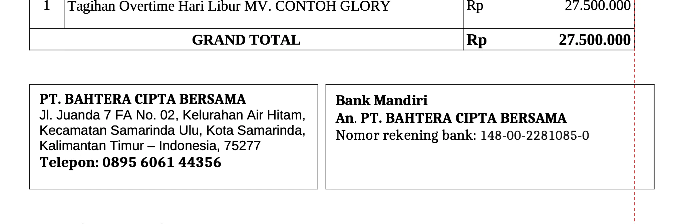
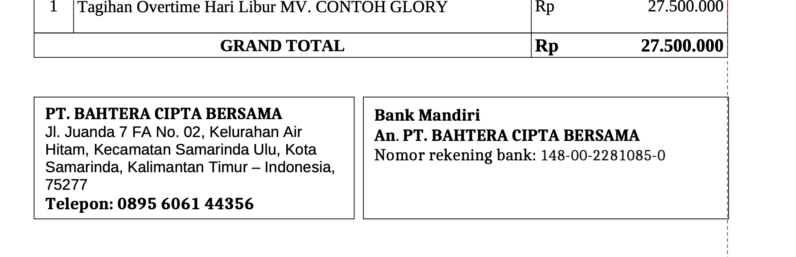
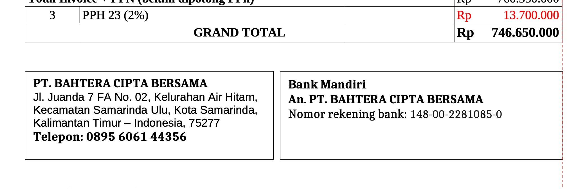
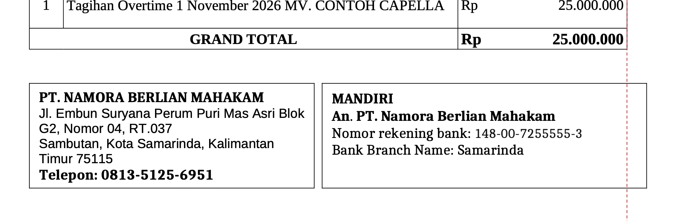
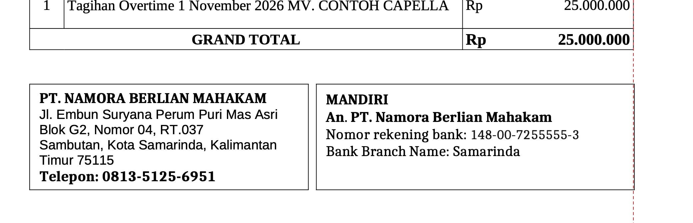
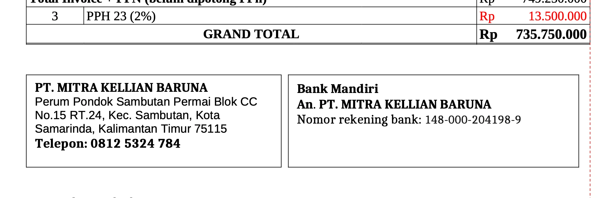
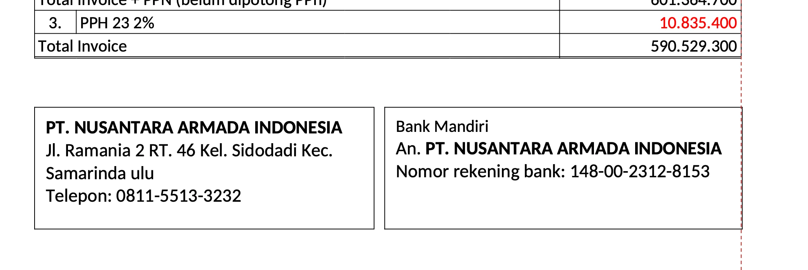
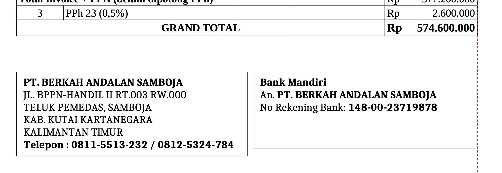

# [Invoice] Fix - Kotak alamat & rekening PDF selebar tabel item di semua template perusahaan

### 📋 Description

**Context:** Setelah perbaikan AOE (#49), PT Bahtera Cipta Bersama (BCB) ternyata punya masalah yang sama: kotak rekening di PDF Debit Note menjorok melewati tepi kanan tabel item. Semua template perusahaan lalu dicek dengan merender 40 invoice & Debit Note contoh (7 perusahaan) dan mengukur tepi kanan tabel dan kotak dari pikselnya. Lima template tidak sejajar, karena lebar kotaknya disalin tetap dari dokumen Word masing-masing, padahal lebar tabel invoice dan Debit Note berbeda. PR ini membuat kedua kotak selebar tabel item di semua template itu, dengan pola yang sama seperti AOE.

**Tidak ada perubahan struktur.** Yang berubah hanya template PDF BCB, NBM, MKB, NAI, dan BAS. Tidak ada migration. Model, controller, service, editor, dan template SLU & AOE tidak diubah.

---

## Ringkasan singkat

Selisih = tepi kanan kotak − tepi kanan tabel (+ = kotak menjorok, − = kotak berhenti sebelum tepi tabel).

| Perusahaan | Sebelum | Sesudah |
|---|---|---|
| BCB | Debit Note **+0,53 cm**, invoice **−0,34 cm** | +0,04 / +0,02 cm |
| NBM | Debit Note **+0,53 cm**, invoice **−0,34 cm** | +0,04 / +0,02 cm |
| MKB | Debit Note +0,07 cm, invoice **−0,34 cm** | +0,02 / +0,02 cm |
| NAI | invoice **−0,25 cm**, tepi kiri kotak 0,09 cm di kiri tabel | +0,02 cm, tepi kiri sejajar |
| BAS | invoice & Debit Note −0,05 cm | 0 s.d. −0,02 cm |
| AOE | sudah sejajar (#49) | tidak diubah |
| SLU | sudah sejajar (lebar persen) | tidak diubah |

Sisa selisih ≤ 0,04 cm (2 px pada render 1×) kira-kira setebal garis dan tidak terlihat di kertas.

---

## 🖼️ Hasil

Contoh memakai data seeder: klien, kapal, nomor, dan nominal **fiktif**. Garis merah putus-putus = tepi kanan tabel item.

### 1. BCB Debit Note: kotak rekening menjorok 0,53 cm

| Sebelum | Sesudah |
|---|---|
|  |  |

### 2. BCB invoice: kotak berhenti 0,34 cm sebelum tepi tabel

| Sebelum | Sesudah |
|---|---|
|  |  |

### 3. NBM Debit Note (salinan desain BCB)

| Sebelum | Sesudah |
|---|---|
|  |  |

NBM invoice sama seperti BCB invoice (−0,34 cm → +0,02 cm).

### 4. MKB invoice

| Sebelum | Sesudah |
|---|---|
|  |  |

### 5. NAI invoice: lebih sempit dan bergeser ke kiri

| Sebelum | Sesudah |
|---|---|
|  |  |

### 6. BAS invoice

| Sebelum | Sesudah |
|---|---|
|  |  |

- Perbandingan lebar kotak alamat : rekening tetap seperti dokumen Word tiap perusahaan. Yang berubah hanya lebar totalnya, sekarang mengikuti tabel.
- Di Debit Note BCB & NBM kedua kotak jadi lebih sempit 0,42 cm, jadi alamat yang panjang bisa pindah baris lebih awal dan kotak memanjang ke bawah seperti biasa. Di invoice, kotak justru sedikit melebar.

---

## 🔧 Scope

- ✅ `kerangka.blade.php` BCB, NBM, MKB, NAI, BAS: lebar `table.info` dan kedua sel kotak dihitung dari `$lebarTabel` (bawaan = lebar area cetak: 16,86 cm; NAI 16,06 cm), dibagi seperti dokumen Word. Lebar sel dikurangi 0,54 cm (padding 0,25 cm kiri-kanan + garis 0,5 pt kiri-kanan) karena DomPDF tidak memasukkan keduanya ke lebar sel. Di BAS garis & padding ada di `div.kotak` di dalam sel, jadi sel = kotak.
- ✅ `debit-note.blade.php` BCB, NBM (`$lebarTabel = 16`), MKB (`16.45`): lebar tabel item, baris total, dan kotak diatur di satu tempat.
- ✅ NAI: `margin-left: -0.09cm` (meniru posisi kotak di Word) dihapus supaya tepi kiri kotak sejajar tabel.
- ✅ Tes gabungan untuk semua template berkotak + dokumentasi modul.

## 📁 Perubahan berkas

| Berkas | Isi |
|---|---|
| `resources/views/pdf/perusahaan/{bahtera-cipta-bersama,namora-berlian-mahakam,mitra-kellian-baruna}/kerangka.blade.php` | Lebar kotak dari `$lebarTabel`, pembagian 7,6 : 8,66 (sela 0,16 cm), menggantikan 16,42 / 7,1 / 8,16 cm. |
| `resources/views/pdf/perusahaan/{bahtera-cipta-bersama,namora-berlian-mahakam,mitra-kellian-baruna}/debit-note.blade.php` | `$lebarTabel` (16 / 16 / 16,45 cm) untuk tabel item, baris total, dan kotak. |
| `resources/views/pdf/perusahaan/nusantara-armada-indonesia/kerangka.blade.php` | Lebar kotak dari `$lebarTabel` (bawaan 16,06 cm), pembagian 7,6 : 8,01 (sela 0,19 cm), tanpa margin kiri negatif. |
| `resources/views/pdf/perusahaan/berkah-andalan-samboja/kerangka.blade.php` | Lebar kotak dari `$lebarTabel` (bawaan 16,86 cm), pembagian 8,45 : 8,17 (sela 0,19 cm). |
| `tests/Feature/KotakInfoSelebarTabelTest.php` | **Baru** — 11 kasus (BCB, NBM, MKB, AOE, BAS × invoice & Debit Note, NAI invoice): `table.info` selebar tabel item, dan lebar kedua sel + sela + padding & garis = lebar itu. Gagal 9/11 pada template lama (yang lolos hanya AOE). |
| `docs/module/invoices.md` | Aturan "kotak alamat & rekening selalu selebar tabel item" untuk semua template + ukuran per perusahaan. |
| `docs/pr/2026-11-24-kotak-info-semua-perusahaan/` | Ringkasan PR ini + screenshot. |

## ✅ Acceptance Criteria

- [x] Debit Note BCB & NBM: tepi kanan kotak rekening sejajar tabel item (sebelumnya menjorok 0,53 cm).
- [x] Invoice BCB, NBM, MKB, NAI, BAS: kotak selebar tabel item (sebelumnya 0,05–0,34 cm lebih sempit).
- [x] NAI: tepi kiri kotak sejajar tabel.
- [x] Perbandingan lebar kotak alamat : rekening tetap seperti dokumen Word.
- [x] SLU & AOE tidak berubah; semua 40 dokumen contoh terukur sejajar (≤ 0,04 cm).

## ⚠️ Perbedaan dari dokumen Word asli (disengaja)

- Di dokumen Word, lebar kotak alamat & rekening tetap (BCB/NBM/MKB 16,42 cm, NAI 15,8 cm, BAS 16,81 cm), jadi tidak sejajar dengan tabel invoice maupun Debit Note. Template sekarang menyejajarkannya dengan tabel.

## 🚀 Yang perlu dilakukan saat deploy

`./deploy.sh` seperti biasa. Tidak ada migration atau pengaturan yang perlu diubah. PDF dibuat ulang setiap kali dicetak, jadi invoice & Debit Note yang sudah terbit langsung tercetak dengan kotak sejajar; datanya tidak berubah.

## 🧪 Cara mencoba

```bash
php artisan db:seed --class=ContohInvoiceBcbSeeder   # juga: Nbm, Mkb, Nai, Bas
```

Login `admin.bcb@mitragroup.id` (password `password`; perusahaan lain `admin.nbm`, `admin.mkb`, `admin.nai`, `admin.bas`) → Invoice → buka invoice atau Debit Note → **Cetak**.

## Pengujian

- [x] `KotakInfoSelebarTabelTest` (11, baru).
- [x] `TemplateInvoice*`, `DebitNote*`, `CompanyInvoiceTemplateTest`, `IsiRekeningTemplatePerusahaanTest`, `ContohInvoice*`, `AttentionInvoiceTest`: 116 lulus.
- [x] 40 PDF contoh (7 perusahaan) dirender sebelum/sesudah, lalu tepi kiri & kanan garis bawah tabel dan kotak diukur dari pikselnya.
