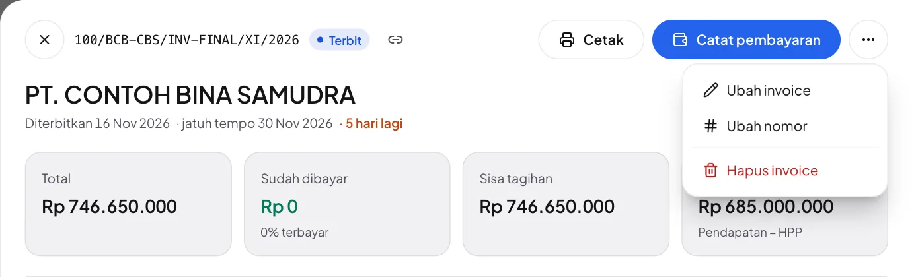
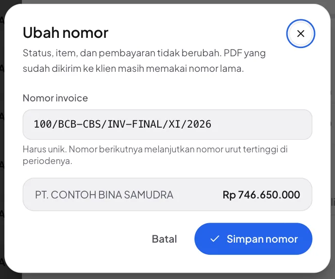
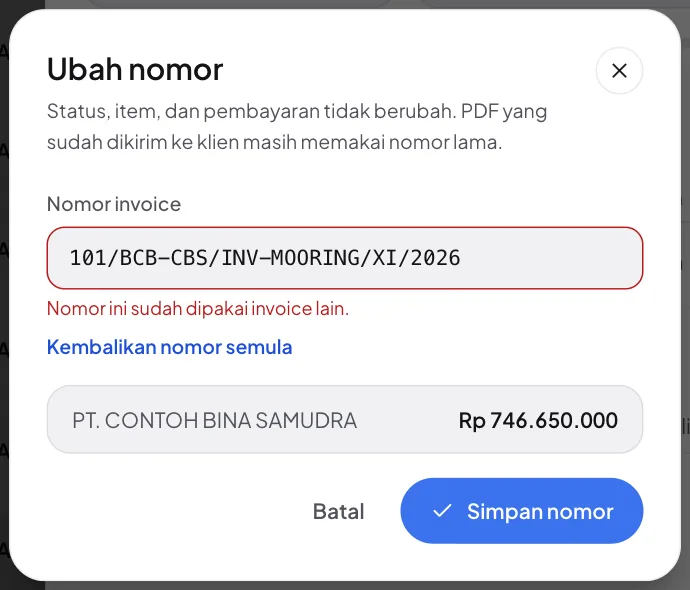
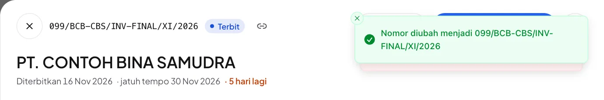
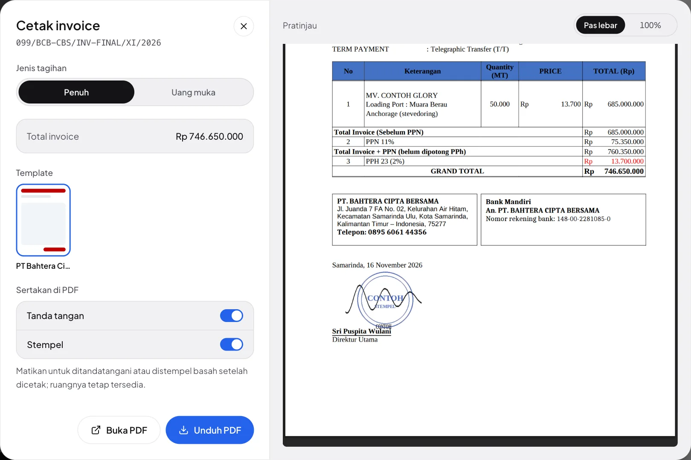
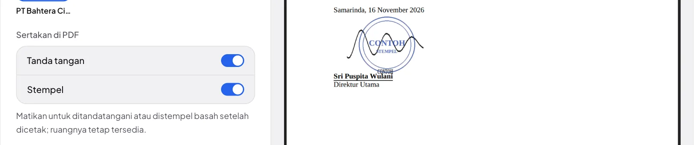
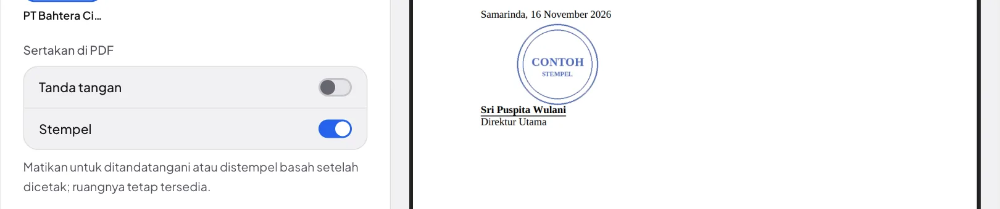
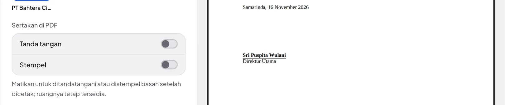

# [Invoice] Update - Ubah nomor invoice terbit & tanda tangan/stempel opsional saat cetak

### 📋 Description

**Context:** Dua permintaan pengguna untuk modul Invoice:

1. **Edit No. INV.** Nomor invoice yang sudah terbit tidak bisa diganti. Satu-satunya jalan adalah **Kembalikan ke draft**, yang hanya boleh untuk nomor urut terakhir di periodenya dan yang belum dibayar. Salah ketik atau nomor yang harus disamakan dengan nomor manual lama jadi terkunci.
2. **Tanda tangan & stempel opsional saat cetak/unduh.** Gambar tanda tangan dan stempel dari Profil perusahaan selalu ikut tercetak. Perusahaan yang menandatangani dan menstempel basah setelah dicetak tidak punya pilihan untuk mengosongkannya.

PR ini berisi tiga perubahan:

1. **Ubah nomor.** Menu **•••** › **Ubah nomor** di detail invoice bernomor (Terbit, Sebagian, Lunas). Nomor diganti tanpa kembali ke draft. Status, item, dan pembayaran tidak berubah.
2. **Sertakan di PDF.** Dialog **Cetak** punya sakelar **Tanda tangan** dan **Stempel** (bawaan menyala). Pratinjau, **Buka PDF**, dan **Unduh PDF** mengikuti pilihan itu, dan ruang tanda tangan di PDF tetap ada untuk tanda tangan & stempel basah.
3. **Perbaikan bug: gambar unggahan tidak tercetak di template bawaan.** Template Kisantra, Semesta, AGSA, dan Generik membaca gambar hanya lewat symlink `public/storage` (folder pusat), padahal sejak multi-perusahaan unggahan Profil perusahaan disimpan di `storage/tenant{slug}/…`. Akibatnya tanda tangan & stempel yang diunggah setelah konversi **tidak pernah tercetak** di template itu. Sekarang dibaca dari disk perusahaan, dengan symlink sebagai cadangan untuk berkas lama.

**Tidak ada perubahan struktur.** Tidak ada migration, kolom baru, atau izin baru. Ubah nomor memakai izin `edit invoices` yang sama dengan Terbitkan dan Kembalikan ke draft.

---

## Ringkasan singkat

| | Sebelum | Sesudah |
|---|---|---|
| Nomor invoice terbit salah | Hanya bisa diperbaiki lewat Kembalikan ke draft (nomor urut terakhir & belum dibayar) | **Ubah nomor** di menu •••, status apa pun selama sudah bernomor |
| Cetak tanpa tanda tangan / stempel | Tidak bisa | Sakelar **Tanda tangan** & **Stempel** di dialog Cetak, pilihan diingat per browser |
| Tanda tangan/stempel unggahan di template bawaan | Tidak tercetak (dicari di folder pusat) | Tercetak (dibaca dari folder perusahaan) |

---

## 🖼️ Hasil

Data contoh PT Bahtera Cipta Bersama dari DB demo (klien, kapal, dan nominal **fiktif**). Gambar tanda tangan & stempel bertuliskan **CONTOH** dibuat khusus untuk screenshot ini.

### 1. Ubah nomor invoice

| Menu ••• › Ubah nomor | Dialog terisi nomor sekarang |
|---|---|
|  |  |

| Nomor yang sudah dipakai ditolak | Berhasil: nomor di detail langsung berganti |
|---|---|
|  |  |

- Menu hanya tampil untuk invoice bernomor dan pemegang izin `edit invoices`.
- Nomor wajib diisi dan unik. Bila ditolak, tautan **Kembalikan nomor semula** mengisi ulang nomor lama. Nomor yang tidak diubah menutup dialog tanpa permintaan ke server.

### 2. Tanda tangan & stempel opsional saat cetak



| Keadaan | Hasil di PDF |
|---|---|
| Keduanya menyala (bawaan) |  |
| Tanda tangan dimatikan |  |
| Keduanya dimatikan |  |

- Sakelar nonaktif (dengan keterangan) bila gambarnya belum diunggah di Profil perusahaan. Stempel nonaktif di template Generik karena template itu memang tidak mencetak stempel.
- Template dari **Pengaturan › Template PDF** (builder) memasang gambarnya sendiri di editor, jadi bagian ini diganti catatan "Gambar di template ini diatur di Pengaturan › Template PDF."

---

## 🔧 Scope

- ✅ `PUT /invoices/{invoice}/number` (`can:edit invoices`) → `InvoiceController::updateNumber()`, divalidasi `UpdateInvoiceNumberRequest` (= `SendInvoiceRequest`: wajib, maks. 100, unik kecuali dirinya). Draft tanpa nomor ditolak 422. Hook `saving` model membaca ulang `invoice_sequence` dari nomor baru.
- ✅ Drawer: menu **Ubah nomor** + `EditNumberDialog` memakai `InvoiceNumberDialog` bersama (prop baru `hint`, `resetLabel`, `icon`).
- ✅ Rute `/invoice/{id}/download` & `/preview` menerima `signature=0` / `stamp=0`. Tanpa parameter = keduanya ikut, seperti sebelumnya, jadi tautan lama tidak berubah.
- ✅ `InvoicePrintService::generateSingleInvoicePdf()` / `renderPdf()` / `buildViewData()` menerima `$withSignature` / `$withStamp`. `buildViewData()` mengosongkan gambar di kedua jalur sekaligus: `$company['signature_base64']`/`['stamp_base64']` (template bawaan) dan `$tanda_tangan`/`$stempel` (template perusahaan).
- ✅ `InvoicePrintService::printImages()` → prop `printImages` (daftar) dan `print_images` (`/invoices/{id}/data`) agar dialog tahu gambar mana yang sudah diunggah.
- ✅ `getImageBase64()` membaca disk `public` perusahaan aktif dulu, lalu symlink `public/storage` sebagai cadangan.
- ✅ Dialog Cetak: bagian **Sertakan di PDF**; pilihan diingat di `localStorage` (`invoice.print.signature`, `invoice.print.stamp`). `readPref`/`writePref` dipindah dari `create.tsx` ke `components/ob.tsx` untuk dipakai bersama.
- ✅ Kamus en/zh (frontend & server), dokumentasi modul, dan panduan `/panduan/invoices`.

## 📁 Perubahan berkas

| Berkas | Isi |
|---|---|
| `app/Http/Controllers/InvoiceController.php` | `updateNumber()`; `printImages` di props daftar dan `print_images` di `data()`. |
| `app/Http/Requests/UpdateInvoiceNumberRequest.php` | **Baru** — aturan sama dengan `SendInvoiceRequest`. |
| `app/Services/InvoicePrintService.php` | Parameter `$withSignature`/`$withStamp`, `printImages()`, `getImageBase64()` dari disk perusahaan. |
| `routes/web.php` | Rute `invoices.number.update`; `signature`/`stamp` diteruskan ke rute download & preview. |
| `resources/js/pages/invoices/components/invoice-drawer.tsx` | Menu & dialog **Ubah nomor**; `print_images` ke dialog Cetak. |
| `resources/js/pages/invoices/components/invoice-number-dialog.tsx` | Prop `hint`, `resetLabel`, `icon`. |
| `resources/js/pages/invoices/components/print-invoice-dialog.tsx` | Bagian **Sertakan di PDF** (`IncludeRow`), parameter `signature`/`stamp`. |
| `resources/js/pages/invoices/components/ob.tsx`, `create.tsx` | `readPref`/`writePref` dipindah ke `ob.tsx`. |
| `resources/js/pages/invoices/index.tsx` | Prop `printImages` ke dialog Cetak. |
| `resources/js/locales/{en,zh}.json`, `lang/{en,zh}.json` | 12 kunci frontend, 2 kunci server. |
| `tests/Feature/UbahNomorInvoiceTest.php` | **Baru** — 6 kasus: nomor & urutan berubah, invoice Lunas tetap Lunas, nomor ganda/kosong ditolak, draft ditolak, pemegang hak baca 403. |
| `tests/Feature/CetakTandaTanganStempelTest.php` | **Baru** — 5 kasus: bawaan ikut tercetak (template bawaan dari disk perusahaan), tanda tangan saja / stempel saja dikosongkan, rute meneruskan pilihan (jumlah objek gambar di PDF), `print_images`. |
| `docs/module/invoices.md`, `docs/module/settings.md` | Bagian "Ubah Nomor Invoice (terbit)", pilihan cetak, invarian gambar lewat variabel view, catatan path gambar. |
| `video/invoices/guide.ts` | Langkah "Mengubah nomor invoice yang sudah terbit", langkah cetak, dampak, dan baris matriks hak akses. |
| `docs/pr/2026-11-25-ubah-nomor-ttd-stempel/` | Ringkasan PR ini + screenshot. |

## 🗄️ Database

Tidak ada migration. Ubah nomor hanya menulis `invoices.invoice_number` (dan `invoice_sequence` lewat hook model yang sudah ada).

## ✅ Acceptance Criteria

- [x] Nomor invoice/Debit Note yang sudah terbit bisa diubah dari detail invoice tanpa kembali ke draft.
- [x] Nomor baru wajib unik; nomor ganda ditolak dengan pesan di isian.
- [x] Status, item, dan pembayaran tidak berubah saat nomor diganti; invoice Lunas tetap Lunas.
- [x] Nomor otomatis berikutnya melanjutkan nomor urut tertinggi setelah nomor diubah.
- [x] Hanya pemegang `edit invoices` yang bisa mengubah nomor (server 403 & menu tersembunyi).
- [x] Tanda tangan dan stempel bisa dimatikan masing-masing saat cetak; pratinjau, Buka PDF, dan Unduh PDF mengikuti.
- [x] Tanpa pilihan, PDF tetap memuat tanda tangan & stempel seperti sebelumnya.
- [x] Ruang tanda tangan tetap ada saat gambarnya tidak dicetak, di semua template Blade.
- [x] Tanda tangan & stempel unggahan tercetak di template bawaan (Kisantra, Semesta, AGSA, Generik).

## 📝 Technical Notes

- Semua tabel lain merujuk invoice lewat FK, jadi pembayaran, Arus Kas, Kas & Bank, rekap, dan alat MCP langsung menampilkan nomor baru. Teks notifikasi lama tetap memuat nomor lama (teks tersimpan).
- Nomor di luar format penomoran membuat `invoice_sequence` = `null`, sama seperti nomor manual saat terbit. Mengganti nomor urut terakhir ke nomor manual membuat urutannya bisa terpakai ulang oleh invoice berikutnya.
- Template baru wajib mencetak tanda tangan/stempel dari variabel view (`$company[...]` atau `$tanda_tangan`/`$stempel`) dengan `@if`, bukan membaca `CompanyProfile` sendiri; dicatat sebagai invarian di `docs/module/invoices.md`.

## ⚠️ Belum didukung / disengaja

- Pilihan tanda tangan/stempel tidak berlaku untuk template builder (gambarnya elemen bebas di editor, tanpa penanda tanda tangan atau stempel).
- Pilihan cetak diingat per browser, bukan pengaturan perusahaan.
- Screenshot panduan `video/invoices/screens/print-dialog.webp` belum diambil ulang (butuh DB QC `finance_management_qc`), jadi gambar dialog Cetak di `/panduan/invoices` belum menampilkan bagian **Sertakan di PDF**. Teks panduannya sudah diperbarui.

## 🚀 Yang perlu dilakukan saat deploy

`./deploy.sh` seperti biasa. Tidak ada migration atau pengaturan yang perlu diubah.

Efek yang akan terlihat: perusahaan yang memakai template bawaan dan sudah mengunggah tanda tangan/stempel di Profil perusahaan akan mulai melihat gambar itu di PDF. Bila tidak diinginkan, matikan lewat sakelar baru di dialog Cetak.

## 🧪 Cara mencoba

```bash
php artisan db:seed --class=ContohInvoiceBcbSeeder
```

Login `admin.bcb@mitragroup.id` (password `password`) → **Invoice** → buka invoice terbit:
- menu **•••** › **Ubah nomor**: ganti nomor, coba juga nomor invoice lain (ditolak);
- **Cetak** → **Sertakan di PDF**: matikan **Tanda tangan** / **Stempel** dan lihat pratinjau, lalu **Unduh PDF**.

Seeder contoh hanya memasang satu gambar gabungan tanda tangan + stempel sebagai **Tanda tangan**; unggah gambar **Stempel** terpisah di Profil perusahaan untuk mencoba kedua sakelar.

## Pengujian

- [x] `UbahNomorInvoiceTest` (6, baru), `CetakTandaTanganStempelTest` (5, baru).
- [x] Seluruh suite: 1243 lulus, 1 dilewati.
- [x] `npx tsc --noEmit`, `npm run i18n:check` (0 galat), `npm run build`, Pint.
- [x] Dicoba di browser dengan DB demo BCB: menu, dialog, nomor ganda ditolak, nomor berubah, dan tiga keadaan sakelar di pratinjau PDF (screenshot di atas).
