# QA Pra-Rilis — Kas & Bank

_QA PRA-RILIS 6 NOVEMBER 2026 · KAS & BANK (cd01099) — 6 November 2026_

Eksekusi 22 test case di test-cases/kas-bank.md untuk fitur baru jenis akun Kas & Bank (commit cd01099): penamaan menu, akun kas dengan kode KAS- dan bank Tunai, penanggung jawab anggota perusahaan, plafon dan Isi ulang, total Bank/Kas di halaman dan Ringkasan, edit bank<->kas, tampilan ponsel, serta tampilan kas di picker modul lain. Aktor: Admin QA, Staff dan pengguna hanya-lihat (uji izin).

Dokumen sumber: [`test-cases/kas-bank.md`](../test-cases/kas-bank.md) (tabel + bukti per langkah), [`manifests/kas-bank.json`](../manifests/kas-bank.json), PDF: [`Laporan-QA-kas-bank.pdf`](Laporan-QA-kas-bank.pdf). Lingkungan & akun: [`README.md`](../README.md).

## Skor (dihitung dari tabel test case dan manifest)

```
 22  test case dijalankan (dari 22; belum diuji/blocked: 0)
 22  akhirnya lolos   (status tabel: Pass 22)
  0  gagal di percobaan pertama
  0  bug aplikasi diperbaiki
 18/18 case ber-lapisan FE/FE+BE punya bukti layar (gerbang check_evidence.py: LULUS)
```

Komposisi: A=8, C=4, N=10 (N normal, A tidak normal, C berantai); lapisan BE=4, FE=3, FE+BE=15.

## Ringkasan

Seluruh 22 test case lolos pada percobaan pertama; tidak ada bug aplikasi pada perubahan rilis ini. Aturan inti ditegakkan server, bukan hanya form: nomor & bank wajib hanya untuk rekening bank, penanggung jawab harus anggota perusahaan (termasuk pengguna pusat yang bukan anggota, pengguna terhapus, id fiktif), plafon bulat >= 0, dan field kas dibuang untuk rekening bank.

Kode KAS-0001/KAS-0002 dan bank Tunai terisi otomatis dan tidak berubah saat kas diedit; rekening lama bernomor 0000 yang diubah menjadi kas mempertahankan nomornya beserta transaksinya. Isi ulang membuka dialog Transfer yang sama dengan nilai yang benar (2.500.000 = plafon - saldo, biaya admin 0) dan hasilnya hanya muncul di Transfer & Penyesuaian. Total Bank + Total Kas = Total Saldo, sama dengan hitungan SQL.

Temuan yang perlu keputusan (bukan kegagalan test case): nama kas terpotong menjadi “Kas …” di layar 1280 px sehingga beberapa kas tak terbedakan (UX-01); Ringkasan menghitung transfer isi ulang sebagai pemasukan sekaligus pengeluaran (K-02, perilaku lama yang terdokumentasi tetapi akan lebih sering terlihat); dan tombol Tambah Akun/Edit/Hapus ditawarkan ke pengguna hanya-lihat lalu berakhir 403 (UX-02, perilaku lama).

## Bug yang ditemukan & diperbaiki

Tidak ada. Tidak ada case yang gagal karena cacat aplikasi, sehingga tidak ada perubahan kode, tes regresi, `npx tsc --noEmit`, `pint`, maupun PHPUnit yang perlu dijalankan dalam putaran ini. Temuan di luar kegagalan case ada di **Catatan tambahan**.

## Hasil per test case

Percobaan: 🟩 lolos · 🟥 gagal karena bug aplikasi · ⬜ terganggu kendala alat uji (bukan bug).

| ID | Skenario | Lapisan | Percobaan | Catatan | Status |
|---|---|---|---|---|---|
| **A. KONDISI NORMAL** | | | | | |
| N01 | Menu & halaman bernama Kas & Bank | FE | 🟩 | Sidebar Keuangan › Kas & Bank; judul, tab browser, breadcrumb sesuai. | Pass |
| N02 | Tambah rekening bank | FE+BE | 🟩 | DB #1 type=bank, custodian/plafon NULL. | Pass |
| N03 | Kas pertama: Tunai + KAS-0001, penanggung jawab & plafon | FE+BE | 🟩 | DB #2 cash, KAS-0001, Tunai, custodian 2, plafon 2.000.000. | Pass |
| N04 | Kas kedua: KAS-0002, tanpa plafon tanpa peringatan | FE+BE | 🟩 | DB #3 KAS-0002, custodian & plafon NULL. | Pass |
| N05 | Total Kas + Total Bank = Total Saldo = hitungan SQL | FE+BE | 🟩 | Layar 51.500.000 / 47.850.000 / 3.650.000 = SQL. | Pass |
| N06 | Ringkasan (dashboard) merinci Bank/Kas dan menandai kas | FE | 🟩 | Kartu Arus Kas & Rekening sesuai. | Pass |
| N07 | Edit kas mempertahankan kode KAS- | FE+BE | 🟩 | KAS-0001 & Tunai tetap; plafon 3.000.000. | Pass |
| N08 | Rekening kas palsu (bank) diubah menjadi Kas | FE+BE | 🟩 | Nomor 0000 dipertahankan, bank jadi Tunai, transaksi utuh. | Pass |
| N09 | Kas diubah menjadi Bank: wajib isi nomor & bank | FE+BE | 🟩 | KAS-0002/Tunai dikosongkan; simpan kosong ditolak; lalu tersimpan. | Pass |
| N10 | Tampilan ponsel: kas & isi ulang ditandai | FE | 🟩 | 390x844: kartu kas berikon dompet + Isi ulang Rp 250.000; ubin Total Bank/Total Kas. | Pass |
| **B. KONDISI TIDAK NORMAL / EDGE CASE** | | | | | |
| A01 | Rekening bank tanpa nomor & bank ditolak (UI + request langsung) | FE+BE | 🟩 | Pesan wajib dari server di form; request langsung 422. | Pass |
| A02 | Penanggung jawab bukan anggota ditolak server | BE | 🟩 | BE — request rakitan: pengguna pusat non-anggota (fixture), pengguna terhapus, id 99999 → 422 Penanggung jawab harus anggota perusahaan ini.; abc → Penanggung jawab tidak dikenal. UI hanya menawarkan anggota. | Pass |
| A03 | Plafon negatif/desimal ditolak | BE | 🟩 | BE — 422 Plafon tidak boleh negatif. / Plafon harus berupa angka rupiah tanpa desimal. CurrencyInput tidak bisa menghasilkannya. | Pass |
| A04 | Field kas dibuang untuk rekening bank | BE | 🟩 | BE — create & update bank dengan custodian/plafon → tersimpan NULL. Form bank tidak mengirim field ini. | Pass |
| A05 | Jenis akun tidak valid / tidak dikirim | BE | 🟩 | BE — tabungan → 422 Jenis akun harus Bank atau Kas.; tanpa type → diperlakukan bank. | Pass |
| A06 | Nomor rekening duplikat ditolak | FE+BE | 🟩 | UI dan request langsung (KAS-0001) sama-sama 422. | Pass |
| A07 | Staff tanpa izin tidak bisa membuka/mengubah Kas & Bank | FE+BE | 🟩 | Menu tersembunyi; halaman, POST, dan /api/bank-accounts 403. | Pass |
| A08 | Hanya-lihat: tanpa tombol Isi ulang, transfer ditolak | FE+BE | 🟩 | view bank-accounts saja: Isi ulang tersembunyi, custodianOptions kosong, transfer rakitan 403. Tambah Akun/Edit/Hapus tetap ditawarkan → UX-02 (perilaku lama). | Pass |
| **C. ALUR BERANTAI** | | | | | |
| C01 | Isi ulang kas kecil lewat dialog Transfer | FE+BE | 🟩 | Prefill 2.500.000/biaya 0; dua transaksi TRF; saldo layar = SQL; hanya di Transfer & Penyesuaian. | Pass |
| C02 | Kas di picker Input Pemasukan (Arus Kas) | FE+BE | 🟩 | Label {nama} — Tunai; pemasukan 100.000 menambah saldo kas. | Pass |
| C03 | Kas di picker pembayaran invoice | FE+BE | 🟩 | Label {nama} (Tunai); pembayaran 400.000 ke kas, invoice partially_paid. | Pass |
| C04 | Penanggung jawab dihapus → ditolak sampai diganti anggota | FE+BE | 🟩 | Pengguna dihapus tampil; simpan ditolak; ganti Putri → tersimpan. | Pass |

## Bukti visual langkah per langkah

Setiap case ber-lapisan FE/FE+BE direkam per langkah. Case BE tidak diberi gambar karena kondisinya tidak bisa dicapai dari layar; alasannya tertulis di kolom Hasil Aktual tabel test case.

### N01 · Menu & halaman bernama Kas & Bank — Pass

| # | Langkah & yang terlihat | Layar |
|---|---|---|
| 1 | Sidebar admin: grup **Keuangan** berisi Invoice, Invoice Berulang, dan **Kas & Bank** — label lama Rekening Bank sudah hilang. | 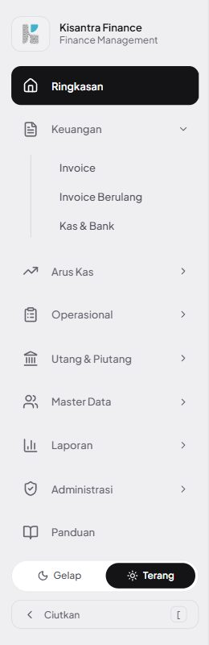 |
| 2 | Halaman `/c/qakb/bank-accounts`: judul & breadcrumb **Kas & Bank**, tombol Tambah Akun, kondisi kosong Belum ada akun. | 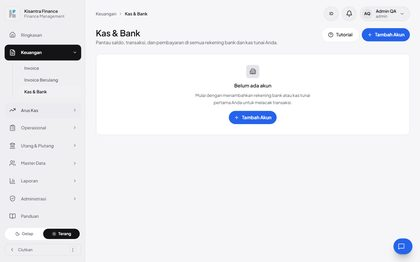 |

### N02 · Tambah rekening bank — Pass

| # | Langkah & yang terlihat | Layar |
|---|---|---|
| 1 | Jenis **Bank**: nomor, bank, cabang tampil dan terisi. Pesan merah adalah sisa percobaan A01 dan hilang saat dikirim ulang. | 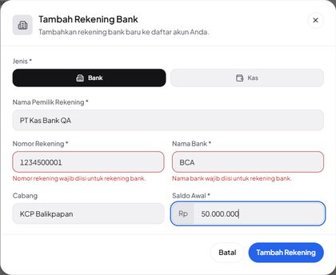 |
| 2 | Rekening muncul di daftar Akun; Ringkasan Total: Total Saldo = Total Bank Rp 50.000.000, Total Kas Rp 0. | 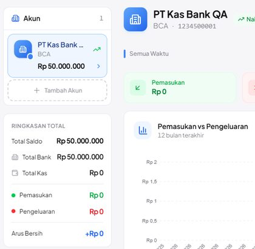 |

### N03 · Kas pertama: Tunai + KAS-0001, penanggung jawab & plafon — Pass

| # | Langkah & yang terlihat | Layar |
|---|---|---|
| 1 | Jenis **Kas**: nomor/bank/cabang disembunyikan; Penanggung Jawab hanya berisi 5 anggota perusahaan; Plafon 2.000.000. | 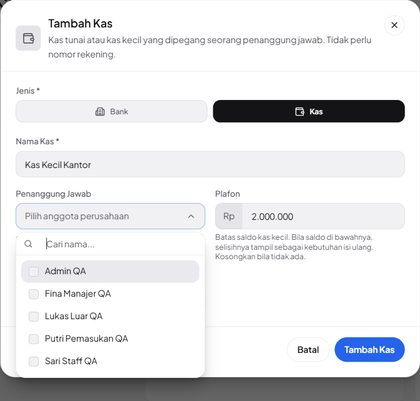 |
| 2 | Daftar: kas berlabel **Kas**, subjudul Kas tunai · Fina…, **Perlu isi ulang Rp 1.500.000**; Total Kas Rp 500.000. | 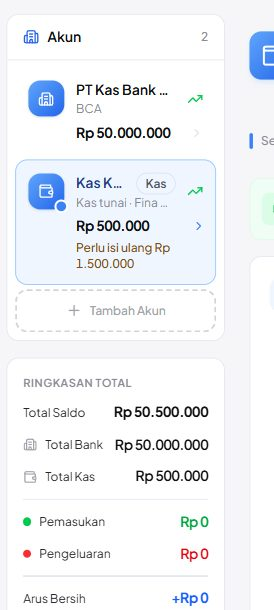 |
| 3 | Header kas: Plafon Rp 2.000.000 · perlu isi ulang Rp 1.500.000, tombol **Isi ulang**. | 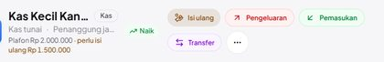 |

### N04 · Kas kedua: KAS-0002, tanpa plafon tanpa peringatan — Pass

| # | Langkah & yang terlihat | Layar |
|---|---|---|
| 1 | Kas kedua tanpa penanggung jawab dan plafon (0 = tanpa plafon). | 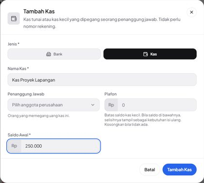 |
| 2 | Kas kedua hanya Kas tunai, tanpa peringatan isi ulang; Total Kas Rp 750.000. Nama kedua kas terpotong jadi Kas … (UX-01). | 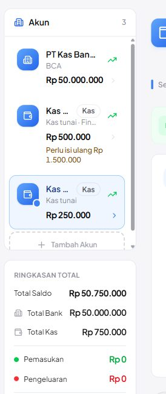 |

### N05 · Total Kas + Total Bank = Total Saldo = hitungan SQL — Pass

| # | Langkah & yang terlihat | Layar |
|---|---|---|
| 1 | Ringkasan Total setelah transaksi: Total Saldo 51.500.000 = Bank 47.850.000 + Kas 3.650.000, sama dengan hitungan SQL. | 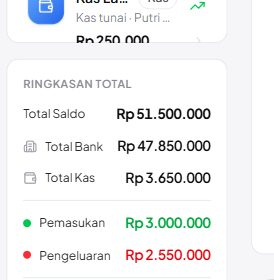 |

### N06 · Ringkasan (dashboard) merinci Bank/Kas dan menandai kas — Pass

| # | Langkah & yang terlihat | Layar |
|---|---|---|
| 1 | Kartu Arus Kas: Total saldo · Bank Rp 47.850.000 · Kas Rp 3.650.000. | 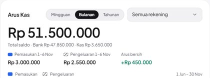 |
| 2 | Kartu Rekening: tile **KAS** + subjudul Kas tunai untuk akun kas; tile BCA/MAN untuk rekening. | 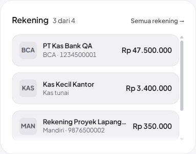 |

### N07 · Edit kas mempertahankan kode KAS- — Pass

| # | Langkah & yang terlihat | Layar |
|---|---|---|
| 1 | Edit Kas terisi data tersimpan; plafon diubah ke 3.000.000. |  |
| 2 | Header setelah simpan: Plafon Rp 3.000.000 · perlu isi ulang Rp 2.500.000 (DB: kode tetap KAS-0001). | 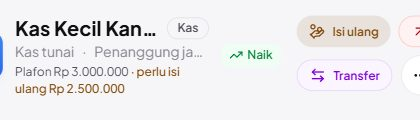 |

### N08 · Rekening kas palsu (bank) diubah menjadi Kas — Pass

| # | Langkah & yang terlihat | Layar |
|---|---|---|
| 1 | Rekening lama gaya kas palsu: Jenis Bank, nomor 0000, bank CASH. |  |
| 2 | Jenis diganti **Kas**: penanggung jawab Sari Staff QA, plafon 500.000. | 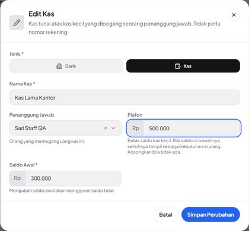 |
| 3 | Akun keempat kini berlabel Kas, saldo tetap Rp 250.000 (pengeluaran 50.000 utuh). DB: nomor 0000 dipertahankan. | 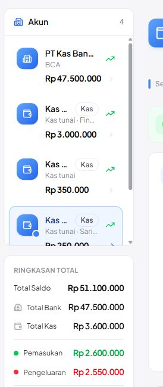 |

### N09 · Kas diubah menjadi Bank: wajib isi nomor & bank — Pass

| # | Langkah & yang terlihat | Layar |
|---|---|---|
| 1 | Kas diganti Bank: nomor & bank kosong (bukan KAS-0002/Tunai); simpan kosong ditolak dengan dua pesan wajib. | 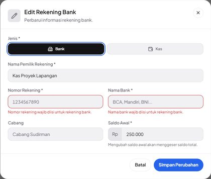 |
| 2 | Setelah diisi: Rekening Proyek Lapangan · Mandiri · 9876500002 sebagai rekening bank. | 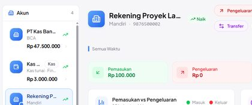 |

### N10 · Tampilan ponsel: kas & isi ulang ditandai — Pass

| # | Langkah & yang terlihat | Layar |
|---|---|---|
| 1 | Ponsel 390 px: kartu Kas Lama Kantor (ikon dompet, Kas tunai · Putri…, Isi ulang Rp 250.000), ubin **Total Bank** & **Total Kas**, header plafon + tombol Isi ulang. Ubin lama Total Saldo/Pemasukan/Pengeluaran memotong angka (UX-01). | 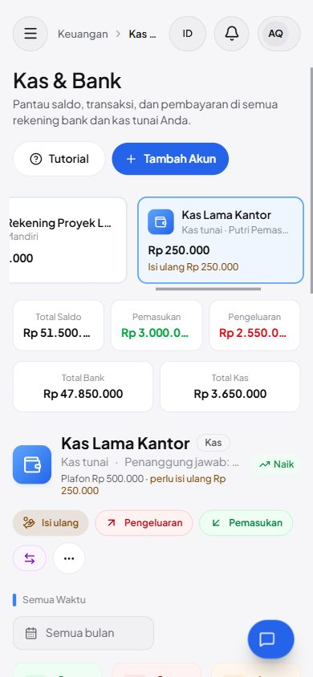 |

### A01 · Rekening bank tanpa nomor & bank ditolak (UI + request langsung) — Pass

| # | Langkah & yang terlihat | Layar |
|---|---|---|
| 1 | Simpan tanpa nomor & bank: dua pesan wajib dari server tampil di bawah field. | 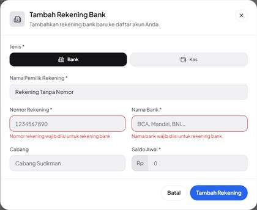 |

### A02 · Penanggung jawab bukan anggota ditolak server — Pass

_Tanpa langkah UI — BE — request rakitan: pengguna pusat non-anggota (fixture), pengguna terhapus, id 99999 → 422 Penanggung jawab harus anggota perusahaan ini.; abc → Penanggung jawab tidak dikenal. UI hanya menawarkan anggota._

### A03 · Plafon negatif/desimal ditolak — Pass

_Tanpa langkah UI — BE — 422 Plafon tidak boleh negatif. / Plafon harus berupa angka rupiah tanpa desimal. CurrencyInput tidak bisa menghasilkannya._

### A04 · Field kas dibuang untuk rekening bank — Pass

_Tanpa langkah UI — BE — create & update bank dengan custodian/plafon → tersimpan NULL. Form bank tidak mengirim field ini._

### A05 · Jenis akun tidak valid / tidak dikirim — Pass

_Tanpa langkah UI — BE — tabungan → 422 Jenis akun harus Bank atau Kas.; tanpa type → diperlakukan bank._

### A06 · Nomor rekening duplikat ditolak — Pass

| # | Langkah & yang terlihat | Layar |
|---|---|---|
| 1 | Nomor 1234500001 milik rekening BCA: Nomor rekening ini sudah dipakai akun lain. | 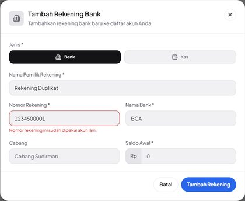 |

### A07 · Staff tanpa izin tidak bisa membuka/mengubah Kas & Bank — Pass

| # | Langkah & yang terlihat | Layar |
|---|---|---|
| 1 | Staff membuka URL Kas & Bank langsung: halaman 403 Akses ditolak (menu juga tidak tampil). | 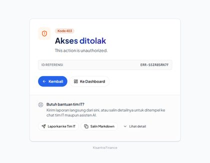 |

### A08 · Hanya-lihat: tanpa tombol Isi ulang, transfer ditolak — Pass

| # | Langkah & yang terlihat | Layar |
|---|---|---|
| 1 | Putri (hanya view bank-accounts): kas tetap menampilkan plafon & perlu isi ulang Rp 250.000, tetapi tanpa tombol Isi ulang/Pemasukan/Pengeluaran/Transfer. Tombol Tambah Akun masih tampil (UX-02). | 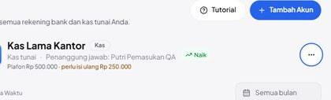 |
| 2 | Mencoba Tambah Akun → Kas lalu simpan: server menolak dan halaman berganti menjadi 403 Akses ditolak; tidak ada akun tercipta. | 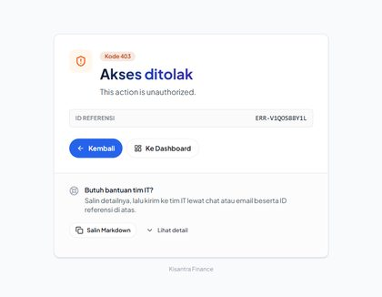 |

### C01 · Isi ulang kas kecil lewat dialog Transfer — Pass

| # | Langkah & yang terlihat | Layar |
|---|---|---|
| 1 | Klik **Isi ulang**: dialog Transfer yang sama, tujuan Kas Kecil Kantor, jumlah 2.500.000 (= 3.000.000 − 500.000), biaya admin 0, deskripsi terisi; sumber belum dipilih. | 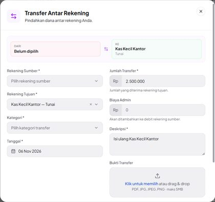 |
| 2 | Sumber PT Kas Bank QA — BCA dan kategori Antar Rekening Sendiri dipilih; nilai prefill tidak berubah. | 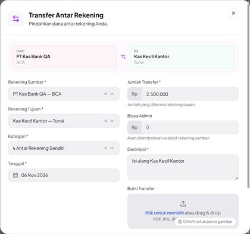 |
| 3 | Setelah transfer: BCA Rp 47.500.000, kas Rp 3.000.000 tanpa Perlu isi ulang; Total Bank 47.500.000, Total Kas 3.250.000. | 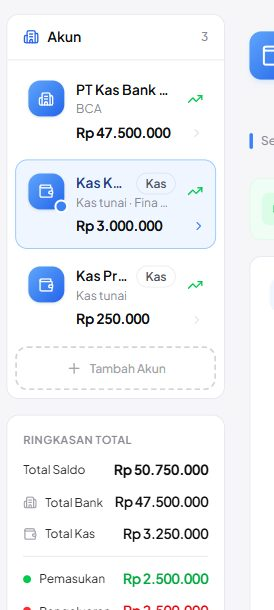 |
| 4 | Header kas: saldo sudah mencapai plafon, tombol Isi ulang hilang (nama kas kini muat penuh). | 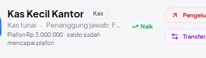 |
| 5 | Arus Kas › Transfer & Penyesuaian: 1 transfer PT Kas Bank QA → Kas Kecil Kantor Rp 2.500.000. | 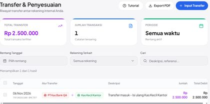 |
| 6 | Arus Kas › Pemasukan & Pengeluaran: 0 hasil — isi ulang bukan pemasukan/pengeluaran. | 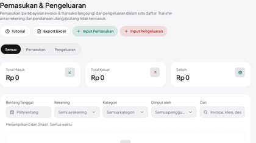 |

### C02 · Kas di picker Input Pemasukan (Arus Kas) — Pass

| # | Langkah & yang terlihat | Layar |
|---|---|---|
| 1 | Picker Rekening di Catat Pemasukan: kas tampil … — Tunai, rekening … — BCA. | 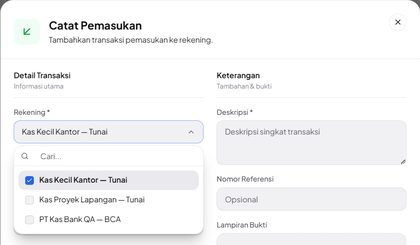 |
| 2 | Pemasukan 100.000 ke Kas Proyek Lapangan, kategori Kembali Dana. | 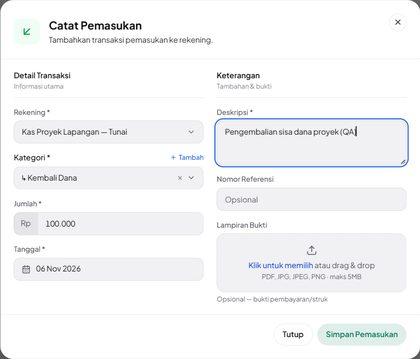 |
| 3 | Saldo kas naik 250.000 → 350.000; Total Kas Rp 3.350.000. | 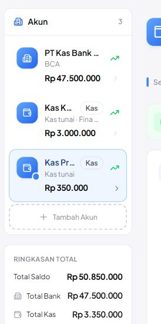 |

### C03 · Kas di picker pembayaran invoice — Pass

| # | Langkah & yang terlihat | Layar |
|---|---|---|
| 1 | Catat pembayaran: Rekening tujuan menampilkan Kas Kecil Kantor (Tunai) dan Kas Lama Kantor (Tunai). | 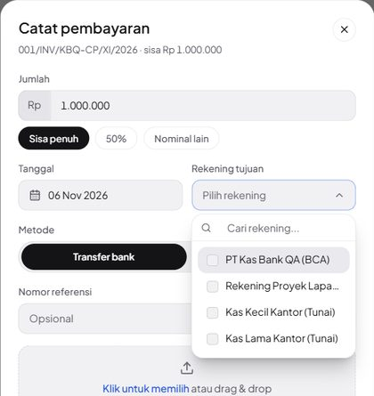 |
| 2 | Pembayaran 400.000 metode Tunai ke Kas Kecil Kantor. | 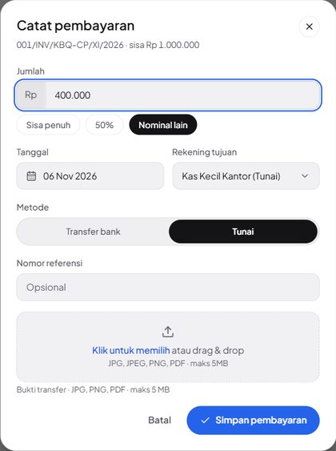 |
| 3 | Kas Kecil Kantor kini Rp 3.400.000 (di atas plafon, tanpa peringatan). | 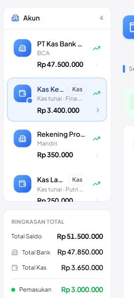 |
| 4 | Tab Pembayaran milik kas memuat 001/INV/KBQ-CP/XI/2026 · Sebagian · Tunai · +Rp 400.000. | 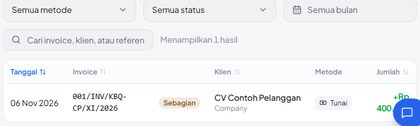 |

### C04 · Penanggung jawab dihapus → ditolak sampai diganti anggota — Pass

| # | Langkah & yang terlihat | Layar |
|---|---|---|
| 1 | Setelah Lukas dihapus: teks penanggung jawab di header terpotong pada 1280 px (UX-01); isi DOM-nya Penanggung jawab: Pengguna dihapus. | 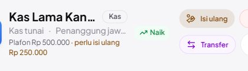 |
| 2 | Edit Kas: Pengguna dihapus (bukan anggota lagi); simpan ditolak Penanggung jawab harus anggota perusahaan ini. | 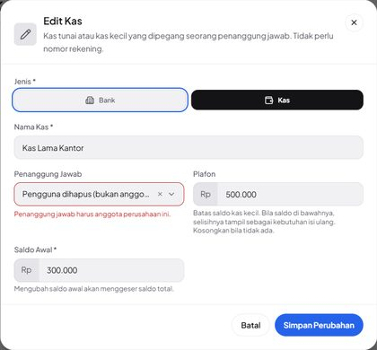 |
| 3 | Setelah diganti Putri Pemasukan QA (viewport 1600 px agar terbaca): Penanggung jawab: Putri Pemasuk… | 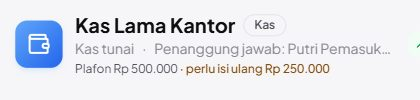 |

## Catatan tambahan

Ditemukan di luar kegagalan test case; tidak diperbaiki karena butuh keputusan produk/desain atau berada di luar perubahan rilis ini.

**UX-01 — Nama kas terpotong menjadi Kas … di daftar akun & header (1280 px).** Pada viewport 1280x800 dengan sidebar terbuka, lebar nama akun di daftar hanya 45 px (isi 108–144 px) karena badge Kas, sehingga Kas Kecil Kantor, Kas Proyek Lapangan, dan Kas Lama Kantor sama-sama tampil Kas …; tidak ada title/tooltip. Di header, tombol Isi ulang memotong nama dan penanggung jawab. Pada 1536 px hampir semua muat. Bukan kegagalan fungsi, tidak diperbaiki karena butuh keputusan tata letak (mis. badge pindah ke baris subjudul, atau title berisi nama lengkap). Di ponsel 390 px, ubin baru Total Bank/Total Kas terbaca penuh, tetapi ubin lama Total Saldo/Pemasukan/Pengeluaran memotong angka (Rp 51.500.…).

**UX-02 — Tambah Akun, Edit, dan Hapus ditawarkan ke pengguna yang hanya boleh melihat.** Halaman Kas & Bank menyembunyikan Isi ulang/Pemasukan/Pengeluaran/Transfer sesuai izin, tetapi tombol Tambah Akun dan menu Edit/Hapus tidak memeriksa create/edit/delete bank-accounts. Pengguna hanya-lihat yang mencobanya berakhir di halaman 403 penuh (server menegakkan dengan benar; tidak ada data berubah). Sudah begitu sebelum rilis ini (sama di 1c4c160), jadi bukan regresi; tidak diperbaiki karena di luar perubahan rilis. Saran: bungkus ketiganya dengan can('create|edit|delete bank-accounts') seperti tombol transaksi.

**K-06 — Peringatan aksesibilitas Radix pada dialog Transfer/transaksi.** Konsol mencatat 9 peringatan Missing Description or aria-describedby for DialogContent (dialog Transfer/Isi ulang, Catat Pengeluaran, dan dialog di halaman admin). Tidak ada error konsol selama seluruh sesi (dibaca dari storage/logs/browser.log baris ber-channel qakb).

**K-02 — Transfer isi ulang dihitung sebagai pemasukan & pengeluaran di Ringkasan.** Setelah satu isi ulang 2.500.000, Ringkasan menampilkan Pemasukan 1–6 Nov Rp 3.000.000 dan Pengeluaran Rp 2.550.000 (masing-masing termasuk 2.500.000 transfer), dan donat Pengeluaran: Antar Rekening Sendiri 98% — Terbesar: antar rekening sendiri. Ringkasan Total di Kas & Bank juga menjumlah transfer. Arus Kas › Pemasukan & Pengeluaran justru mengecualikannya. Perilaku ini sudah tercatat sebagai jebakan transfer di docs/module/dashboard.md, jadi bukan regresi; tetapi dengan kas kecil, isi ulang menjadi rutin. Saran: kecualikan kategori bertipe transfer dari ringkasan & donat (keputusan produk).

**K-03 — Deskripsi debit transfer selalu Transfer + Admin Fee walau biaya 0.** Isi ulang memakai biaya admin 0, tetapi baris debit tetap berdeskripsi Transfer + Admin Fee - Isi ulang …. Kosmetik, perilaku lama.

**K-04 — Kode KAS- tidak dijaga indeks unik di database (dibaca dari kode).** account_number unik hanya lewat validasi; kode KAS- dibuat model di event saving sesudah validasi. Dua penyimpanan kas yang benar-benar bersamaan secara teori bisa mendapat kode sama. Risiko rendah; tidak diuji karena butuh request paralel.

**K-05 — Pesan 403 masih berbahasa Inggris.** Halaman Akses ditolak menampilkan This action is unauthorized. (bawaan Laravel). Perilaku lama, di luar cakupan rilis ini.

## Kendala alat uji

Tidak satu pun dihitung sebagai kegagalan test case:

- Tangkapan pertama N01 mengenai elemen yang salah (hanya tautan Ringkasan) karena uid anak yang dipakai; diambil ulang dengan uid sidebar. Eksekusi case-nya sendiri tidak terganggu.
- Skrip pembuat pengguna menunggu 1,5 detik lalu menyimpulkan dialog masih terbuka; ternyata request hanya lebih lambat dan pengguna Staff sudah tersimpan. Kesalahan skrip saya, bukan aplikasi.
- Tangkapan fullPage hanya menghasilkan viewport karena halaman menggulir di dalam kontainer sendiri; wilayah yang perlu digulir ke tampilan dulu (scrollIntoView).
- Beberapa uid kedaluwarsa setelah halaman dimuat ulang (mis. tombol Isi ulang); aksi diulang lewat DOM.

## Yang diverifikasi dengan eksekusi vs dengan membaca kode

- **Eksekusi** (layar + request langsung + query DB): seluruh 22 case di tabel. Setiap klaim saldo dicocokkan dengan rumus saldo di SQL; setiap penolakan server dicek ulang lewat request rakitan dari sesi yang sama.
- **Membaca kode saja**: K-04 (kode `KAS-` tanpa indeks unik — butuh request paralel untuk dibuktikan), perilaku `artisan serve` yang hanya meneruskan `APP_ENV` (lalu dibuktikan empiris lewat baris sesi di `qakb_central`), dan status pra-ada UX-02/K-02 (dibandingkan dengan `1c4c160`).
- **Tidak diuji**: alat MCP Koneksi Claude untuk kas, ekspor PDF laporan kas, hapus akun kas, dan modul lain di luar Kas & Bank (cakupan dipersempit oleh pengguna di tengah sesi).

## Catatan kejujuran

Kode fitur Kas & Bank (commit cd01099) ditulis oleh model yang sama (Claude Opus 5.5) yang menjalankan pengujian ini, sehingga ada risiko pengujian mewarisi asumsi penulisnya. Yang paling perlu dicek manusia: buka Kas & Bank di laptop yang benar-benar dipakai tim keuangan dan putuskan apakah nama kas yang terpotong (UX-01) masih bisa dipakai untuk memilih kas yang benar, lalu lakukan satu isi ulang sungguhan dengan biaya admin bukan nol dan cocokkan saldo kedua akun dengan mutasi bank. Yang hanya diverifikasi dengan membaca kode (tidak dieksekusi): risiko kode KAS- ganda pada penyimpanan bersamaan (K-04) dan alat MCP rekening-bank/ringkasan-keuangan (tidak termasuk cakupan QA ini).

_Lingkungan uji: database qakb_central + qakb_central_tenant_qakb (dibuat khusus, di-drop setelah QA), server lokal php artisan serve --env=qakb di http://127.0.0.1:8137, aset dari Vite dev server pengguna ([::1]:5173), Chrome via Chrome DevTools MCP 1280x800 DPR 1 (beberapa tangkapan 1536/1600 px disebut di caption), kode main = origin/main 1c4c160 + cd01099._
