# QA Pra-Rilis — Kas & Bank

_QA PRA-RILIS 6 NOVEMBER 2026 · KAS & BANK (cd01099) · TINDAK LANJUT 9 NOVEMBER 2026_

Eksekusi 22 test case di test-cases/kas-bank.md untuk fitur baru jenis akun Kas & Bank (commit cd01099): penamaan menu, akun kas dengan kode KAS- dan bank Tunai, penanggung jawab anggota perusahaan, plafon dan Isi ulang, total Bank/Kas di halaman dan Ringkasan, edit bank<->kas, tampilan ponsel, serta tampilan kas di picker modul lain. Aktor: Admin QA, Staff dan pengguna hanya-lihat (uji izin).

**Tindak lanjut 9 November 2026:** tiga temuan catatan tambahan putaran ini — UX-01 (nama kas & angka terpotong), UX-02 (tombol kelola akun untuk pengguna hanya-lihat), K-02 (transfer dihitung sebagai pemasukan & pengeluaran) — diperbaiki di `2f6874d` dan `955a39c`, lalu diverifikasi ulang lewat empat case baru N11, N12, A09, C05 (bagian D) di lingkungan terisolasi baru `qafix_*`.

Dokumen sumber: [`test-cases/kas-bank.md`](../test-cases/kas-bank.md) (tabel + bukti per langkah), [`manifests/kas-bank.json`](../manifests/kas-bank.json), PDF: [`Laporan-QA-kas-bank.pdf`](Laporan-QA-kas-bank.pdf). Lingkungan & akun: [`README.md`](../README.md).

## Skor (dihitung dari tabel test case dan manifest)

```
 26  test case dijalankan (dari 26; belum diuji/blocked: 0)
 26  akhirnya lolos   (status tabel: Pass 26)
  4  gagal di percobaan pertama (N11, N12, A09, C05 — percobaan pertama = keadaan 6 Nov)
  3  temuan diperbaiki (UX-01, UX-02, K-02; tidak ada yang menggagalkan 22 case asli)
 22/22 case ber-lapisan FE/FE+BE punya bukti layar (gerbang check_evidence.py: LULUS)
```

Komposisi: A=9, C=5, N=12 (N normal, A tidak normal, C berantai); lapisan BE=4, FE=5, FE+BE=17. Putaran 6 Nov saja: 22 case, 22 lolos di percobaan pertama.

## Ringkasan

Seluruh 22 test case lolos pada percobaan pertama; tidak ada bug aplikasi pada perubahan rilis ini. Aturan inti ditegakkan server, bukan hanya form: nomor & bank wajib hanya untuk rekening bank, penanggung jawab harus anggota perusahaan (termasuk pengguna pusat yang bukan anggota, pengguna terhapus, id fiktif), plafon bulat >= 0, dan field kas dibuang untuk rekening bank.

Kode KAS-0001/KAS-0002 dan bank Tunai terisi otomatis dan tidak berubah saat kas diedit; rekening lama bernomor 0000 yang diubah menjadi kas mempertahankan nomornya beserta transaksinya. Isi ulang membuka dialog Transfer yang sama dengan nilai yang benar (2.500.000 = plafon - saldo, biaya admin 0) dan hasilnya hanya muncul di Transfer & Penyesuaian. Total Bank + Total Kas = Total Saldo, sama dengan hitungan SQL.

Temuan yang perlu keputusan (bukan kegagalan test case): nama kas terpotong menjadi “Kas …” di layar 1280 px sehingga beberapa kas tak terbedakan (UX-01); Ringkasan menghitung transfer isi ulang sebagai pemasukan sekaligus pengeluaran (K-02, perilaku lama yang terdokumentasi tetapi akan lebih sering terlihat); dan tombol Tambah Akun/Edit/Hapus ditawarkan ke pengguna hanya-lihat lalu berakhir 403 (UX-02, perilaku lama).

Tindak lanjut 9 November 2026: ketiga temuan diperbaiki dan diverifikasi ulang. UX-01 — nama setiap kas kini utuh di daftar 1280x800 (menu terbuka) dan header tidak lagi memotong nama/penanggung jawab; di ponsel 390 px ubin dua kolom menampilkan angka penuh. UX-02 — pengguna hanya-lihat tidak lagi ditawari Tambah Akun, Edit, atau Hapus; request langsung tetap 403. K-02 — isi ulang Rp 2.500.000 dengan biaya admin Rp 6.500 tidak lagi menambah Pemasukan; Pengeluaran hanya naik Rp 6.500 (irisan Biaya admin transfer), sama di Ringkasan, Ringkasan Total Kas & Bank, dan hitungan SQL; grafik satu rekening tetap menghitung transfernya.

Empat case baru (N11, N12, A09, C05) merekam temuan itu sebagai harapan yang bisa diuji: percobaan pertama = keadaan 6 November (gagal, bukti layar lama), percobaan kedua = setelah perbaikan (lolos). Karena itu skor tindak lanjut mencatat 4 case gagal di percobaan pertama; 22 case asli tidak berubah. Pemeriksaan akhir 9 November: suite PHPUnit penuh 922 lulus, 2 dilewati, 0 gagal (4269 asersi); `npm run types` dan `npm run build` lulus.

## Bug yang ditemukan & diperbaiki

Putaran 6 November: tidak ada case yang gagal karena cacat aplikasi. Tiga temuan catatan tambahan di bawah diperbaiki pada tindak lanjut 9 November. Pemeriksaan setelah perbaikan: PHPUnit terarah (6 tes baru `TransferAntarAkunTest` + suite Ringkasan, Kas & Bank, MCP terkait), `vendor/bin/pint --dirty`, `npm run types`; lalu sekali di akhir sesi suite penuh `php artisan test --compact` — 922 lulus, 2 dilewati (lewati bersyarat bawaan tes lain), 4269 asersi, 0 gagal — dan `npm run build` lulus.

### UX-01 · Nama kas terpotong menjadi “Kas …” (1280 px) dan angka ubin ringkasan terpotong (390 px) — DIPERBAIKI · `2f6874d`

| | |
|---|---|
| **SIFAT** | Sedang — kas tidak bisa dibedakan di daftar; bukan kegagalan fungsi (catatan tambahan 6 Nov). |
| **MENGGAGALKAN** | N11, N12 (percobaan 1 = keadaan 6 Nov yang terekam di N04-2, C04-1, N10-1). |
| **GEJALA** | Di 1280x800 dengan menu terbuka, Kas Kecil Kantor, Kas Proyek Lapangan, dan Kas Lama Kantor sama-sama tampil “Kas …” tanpa tooltip; header memotong nama dan “Penanggung jawab: …”; di ponsel ubin Total Saldo/Pemasukan/Pengeluaran menampilkan “Rp 51.500.…”. |
| **SEBAB** | Label Kas dan ikon tren berada di baris nama sehingga nama hanya mendapat ±45 px dari kolom ±130 px; header memakai flex-row tanpa wrap sehingga deret tombol aksi (±500 px) menekan blok judul; ubin ponsel grid tiga kolom (±90 px per angka) dengan truncate. |
| **CAKUPAN** | Daftar akun desktop, kartu akun ponsel, header akun terpilih, ubin ringkasan ponsel di halaman Kas & Bank. Halaman lain tidak memakai komponen ini. |
| **PERBAIKAN** | `2f6874d` — nama akun mendapat baris sendiri dan turun baris; label Kas, penanggung jawab (dengan Tooltip teks lengkap), dan tren pindah ke baris kedua; blok judul header berlebar dasar 24rem sehingga tombol turun ke baris bawah; ubin ponsel dua kolom tanpa truncate. Diverifikasi N11, N12 (1280x800, 1536x864, 390x844); `npm run types` lulus. Sisa: di bawah ±1200 px dengan menu terbuka kolom daftar tetap sempit (kondisi lama, K-09). |

### UX-02 · Tambah Akun, Edit, dan Hapus ditawarkan ke pengguna yang hanya boleh melihat — DIPERBAIKI · `2f6874d`

| | |
|---|---|
| **SIFAT** | Rendah — server sudah menolak 403; pengguna diberi tombol yang berakhir di halaman 403 penuh. |
| **MENGGAGALKAN** | A09 (percobaan 1 = keadaan 6 Nov di A08-1/A08-2). |
| **GEJALA** | Pengguna dengan `view bank-accounts` saja melihat Tambah Akun dan menu Edit/Hapus; menyimpan berakhir di halaman 403 Akses ditolak. |
| **SEBAB** | Tombol kelola akun tidak dibungkus `can()`, berbeda dari tombol transaksi di header yang sama. |
| **CAKUPAN** | Empat titik masuk Tambah Akun (header, kondisi kosong, kartu putus-putus daftar desktop, kartu Tambah ponsel) serta Edit/Hapus di menu •••. Tidak ada halaman lain yang membuka form akun. |
| **PERBAIKAN** | `2f6874d` — `can('create bank-accounts')`, `can('edit bank-accounts')`, `can('delete bank-accounts')` di semua titik itu; Export PDF tetap (izin halaman), jadi menu ••• tidak pernah kosong; tanpa perubahan backend. Diverifikasi A09: UI desktop & ponsel + POST/PUT/DELETE rakitan 403, DB tidak berubah. |

### K-02 · Transfer antar rekening sendiri dihitung sebagai pemasukan & pengeluaran di Ringkasan — DIPERBAIKI · `955a39c`

| | |
|---|---|
| **SIFAT** | Sedang — keputusan produk (perilaku lama yang terdokumentasi); angka Ringkasan menggelembung setiap isi ulang kas. |
| **MENGGAGALKAN** | C05 (percobaan 1 = keadaan 6 Nov di N06-1 dan catatan K-02). |
| **GEJALA** | Setelah satu isi ulang 2.500.000, Pemasukan 1–6 Nov Rp 3.000.000 dan Pengeluaran Rp 2.550.000 masing-masing memuat transfer; donat Pengeluaran “Antar Rekening Sendiri 98%”; Ringkasan Total Kas & Bank ikut menjumlahnya. |
| **SEBAB** | Ringkasan dan Ringkasan Total menjumlah semua kredit/debit bank tanpa membedakan kategori bertipe transfer; biaya admin melekat di kaki debit sehingga sekadar membuang baris transfer ikut membuang beban nyata. |
| **CAKUPAN** | Kartu Arus Kas bulan ini, grafik semua rekening, kedua donat Ringkasan, Ringkasan Total Kas & Bank, alat Claude `ringkasan-keuangan` (`kas.uang_masuk`/`uang_keluar`). Tidak terdampak: tab Arus Kas, Laba Rugi, statistik per akun, alat `mutasi-rekening`. |
| **PERBAIKAN** | `955a39c` — definisi tunggal `BankTransaction::internalTransferGroups()`/`internalTransferTotal()`: kaki berkategori transfer dikelompokkan per tanggal + tautan (`transfer_group_id`, atau referensi TRF warisan), internal = min(Σ kredit, Σ debit) dikurangkan dari kedua sisi; biaya admin menjadi irisan “Biaya admin transfer”; filter satu rekening tetap menghitung transfer. 6 tes baru (`TransferAntarAkunTest`, termasuk invarian Pemasukan − Pengeluaran = perubahan total saldo); dokumen modul, panduan, dan 18 screenshot panduan Ringkasan diperbarui. Diverifikasi C05 + SQL. |

## Hasil per test case

Percobaan: 🟩 lolos · 🟥 gagal karena bug aplikasi · ⬜ terganggu kendala alat uji (bukan bug).

| ID | Skenario | Lapisan | Percobaan | Catatan | Status |
|---|---|---|---|---|---|
| **A. KONDISI NORMAL** | | | | | |
| N01 | Menu & halaman bernama Kas & Bank | FE | 🟩 | Sidebar Keuangan › Kas & Bank; judul, tab browser, breadcrumb sesuai. | Pass |
| N02 | Tambah rekening bank | FE+BE | 🟩 | DB #1 type=bank, custodian/plafon NULL. | Pass |
| N03 | Kas pertama: Tunai + KAS-0001, penanggung jawab & plafon | FE+BE | 🟩 | DB #2 cash, KAS-0001, Tunai, custodian 2, plafon 2.000.000. | Pass |
| N04 | Kas kedua: KAS-0002, tanpa plafon tanpa peringatan | FE+BE | 🟩 | DB #3 KAS-0002, custodian & plafon NULL. | Pass |
| N05 | Total Kas + Total Bank = Total Saldo = hitungan SQL | FE+BE | 🟩 | Layar 51.500.000 / 47.850.000 / 3.650.000 = SQL. | Pass |
| N06 | Ringkasan (dashboard) merinci Bank/Kas dan menandai kas | FE | 🟩 | Kartu Arus Kas & Rekening sesuai. | Pass |
| N07 | Edit kas mempertahankan kode KAS- | FE+BE | 🟩 | KAS-0001 & Tunai tetap; plafon 3.000.000. | Pass |
| N08 | Rekening kas palsu (bank) diubah menjadi Kas | FE+BE | 🟩 | Nomor 0000 dipertahankan, bank jadi Tunai, transaksi utuh. | Pass |
| N09 | Kas diubah menjadi Bank: wajib isi nomor & bank | FE+BE | 🟩 | KAS-0002/Tunai dikosongkan; simpan kosong ditolak; lalu tersimpan. | Pass |
| N10 | Tampilan ponsel: kas & isi ulang ditandai | FE | 🟩 | 390x844: kartu kas berikon dompet + Isi ulang Rp 250.000; ubin Total Bank/Total Kas. | Pass |
| **B. KONDISI TIDAK NORMAL / EDGE CASE** | | | | | |
| A01 | Rekening bank tanpa nomor & bank ditolak (UI + request langsung) | FE+BE | 🟩 | Pesan wajib dari server di form; request langsung 422. | Pass |
| A02 | Penanggung jawab bukan anggota ditolak server | BE | 🟩 | BE — request rakitan: pengguna pusat non-anggota (fixture), pengguna terhapus, id 99999 → 422 Penanggung jawab harus anggota perusahaan ini.; abc → Penanggung jawab tidak dikenal. UI hanya menawarkan anggota. | Pass |
| A03 | Plafon negatif/desimal ditolak | BE | 🟩 | BE — 422 Plafon tidak boleh negatif. / Plafon harus berupa angka rupiah tanpa desimal. CurrencyInput tidak bisa menghasilkannya. | Pass |
| A04 | Field kas dibuang untuk rekening bank | BE | 🟩 | BE — create & update bank dengan custodian/plafon → tersimpan NULL. Form bank tidak mengirim field ini. | Pass |
| A05 | Jenis akun tidak valid / tidak dikirim | BE | 🟩 | BE — tabungan → 422 Jenis akun harus Bank atau Kas.; tanpa type → diperlakukan bank. | Pass |
| A06 | Nomor rekening duplikat ditolak | FE+BE | 🟩 | UI dan request langsung (KAS-0001) sama-sama 422. | Pass |
| A07 | Staff tanpa izin tidak bisa membuka/mengubah Kas & Bank | FE+BE | 🟩 | Menu tersembunyi; halaman, POST, dan /api/bank-accounts 403. | Pass |
| A08 | Hanya-lihat: tanpa tombol Isi ulang, transfer ditolak | FE+BE | 🟩 | view bank-accounts saja: Isi ulang tersembunyi, custodianOptions kosong, transfer rakitan 403. Tambah Akun/Edit/Hapus tetap ditawarkan → UX-02 (perilaku lama). | Pass |
| **C. ALUR BERANTAI** | | | | | |
| C01 | Isi ulang kas kecil lewat dialog Transfer | FE+BE | 🟩 | Prefill 2.500.000/biaya 0; dua transaksi TRF; saldo layar = SQL; hanya di Transfer & Penyesuaian. | Pass |
| C02 | Kas di picker Input Pemasukan (Arus Kas) | FE+BE | 🟩 | Label {nama} — Tunai; pemasukan 100.000 menambah saldo kas. | Pass |
| C03 | Kas di picker pembayaran invoice | FE+BE | 🟩 | Label {nama} (Tunai); pembayaran 400.000 ke kas, invoice partially_paid. | Pass |
| C04 | Penanggung jawab dihapus → ditolak sampai diganti anggota | FE+BE | 🟩 | Pengguna dihapus tampil; simpan ditolak; ganti Putri → tersimpan. | Pass |
| **D. TINDAK LANJUT 9 NOVEMBER 2026 (UX-01, UX-02, K-02)** | | | | | |
| N11 | Nama kas & penanggung jawab utuh di daftar dan header (1280x800, menu terbuka) | FE | 🟥🟩 | Ulangan N04 + C04. Percobaan 1 (6 Nov): nama kas “Kas …”, header terpotong (UX-01). Setelah `2f6874d`: 4 nama utuh (scrollWidth ≤ clientWidth; Kas Proyek Lapangan 2 baris), Tooltip penanggung jawab, header Kas Lama Kantor utuh, tombol di baris bawah. | Pass |
| N12 | Ponsel 390 px: ubin ringkasan & kartu akun tidak memotong angka/nama | FE | 🟥🟩 | Ulangan N10. Percobaan 1 (6 Nov): ubin tiga kolom “Rp 51.500.…” (UX-01). Setelah `2f6874d`: ubin dua kolom, kelima angka satu baris dan utuh; kartu & header kas turun baris. | Pass |
| A09 | Hanya-lihat: Tambah Akun, Edit, Hapus tidak ditawarkan; request langsung tetap 403 | FE+BE | 🟥🟩 | Ulangan A08. Percobaan 1 (6 Nov): Tambah Akun/Edit/Hapus tampil lalu 403 (UX-02). Setelah `2f6874d`: tanpa Tambah Akun di header/daftar/ponsel, menu ••• hanya Export PDF; POST/PUT/DELETE rakitan 403, `bank_accounts` tidak berubah. | Pass |
| C05 | Isi ulang dengan biaya admin Rp 6.500: transfer bukan pemasukan/pengeluaran, biaya admin tetap beban | FE+BE | 🟥🟩 | Percobaan 1 = perilaku 6 Nov yang diputuskan diubah (K-02: transfer di kedua sisi, donat 98%). Setelah `955a39c`: Pemasukan tetap 100.000, Pengeluaran 350.000 → 356.500 (+ biaya admin), donat tanpa transfer, filter satu rekening tetap menghitung 2.500.000; Ringkasan Total sama; = SQL. | Pass |

## Bukti visual langkah per langkah

Setiap case ber-lapisan FE/FE+BE direkam per langkah. Case BE tidak diberi gambar karena kondisinya tidak bisa dicapai dari layar; alasannya tertulis di kolom Hasil Aktual tabel test case.

### N01 · Menu & halaman bernama Kas & Bank — Pass

| # | Langkah & yang terlihat | Layar |
|---|---|---|
| 1 | Sidebar admin: grup **Keuangan** berisi Invoice, Invoice Berulang, dan **Kas & Bank** — label lama Rekening Bank sudah hilang. |  |
| 2 | Halaman `/c/qakb/bank-accounts`: judul & breadcrumb **Kas & Bank**, tombol Tambah Akun, kondisi kosong Belum ada akun. |  |

### N02 · Tambah rekening bank — Pass

| # | Langkah & yang terlihat | Layar |
|---|---|---|
| 1 | Jenis **Bank**: nomor, bank, cabang tampil dan terisi. Pesan merah adalah sisa percobaan A01 dan hilang saat dikirim ulang. |  |
| 2 | Rekening muncul di daftar Akun; Ringkasan Total: Total Saldo = Total Bank Rp 50.000.000, Total Kas Rp 0. |  |

### N03 · Kas pertama: Tunai + KAS-0001, penanggung jawab & plafon — Pass

| # | Langkah & yang terlihat | Layar |
|---|---|---|
| 1 | Jenis **Kas**: nomor/bank/cabang disembunyikan; Penanggung Jawab hanya berisi 5 anggota perusahaan; Plafon 2.000.000. |  |
| 2 | Daftar: kas berlabel **Kas**, subjudul Kas tunai · Fina…, **Perlu isi ulang Rp 1.500.000**; Total Kas Rp 500.000. |  |
| 3 | Header kas: Plafon Rp 2.000.000 · perlu isi ulang Rp 1.500.000, tombol **Isi ulang**. |  |

### N04 · Kas kedua: KAS-0002, tanpa plafon tanpa peringatan — Pass

| # | Langkah & yang terlihat | Layar |
|---|---|---|
| 1 | Kas kedua tanpa penanggung jawab dan plafon (0 = tanpa plafon). |  |
| 2 | Kas kedua hanya Kas tunai, tanpa peringatan isi ulang; Total Kas Rp 750.000. Nama kedua kas terpotong jadi Kas … (UX-01). |  |

### N05 · Total Kas + Total Bank = Total Saldo = hitungan SQL — Pass

| # | Langkah & yang terlihat | Layar |
|---|---|---|
| 1 | Ringkasan Total setelah transaksi: Total Saldo 51.500.000 = Bank 47.850.000 + Kas 3.650.000, sama dengan hitungan SQL. |  |

### N06 · Ringkasan (dashboard) merinci Bank/Kas dan menandai kas — Pass

| # | Langkah & yang terlihat | Layar |
|---|---|---|
| 1 | Kartu Arus Kas: Total saldo · Bank Rp 47.850.000 · Kas Rp 3.650.000. |  |
| 2 | Kartu Rekening: tile **KAS** + subjudul Kas tunai untuk akun kas; tile BCA/MAN untuk rekening. |  |

### N07 · Edit kas mempertahankan kode KAS- — Pass

| # | Langkah & yang terlihat | Layar |
|---|---|---|
| 1 | Edit Kas terisi data tersimpan; plafon diubah ke 3.000.000. |  |
| 2 | Header setelah simpan: Plafon Rp 3.000.000 · perlu isi ulang Rp 2.500.000 (DB: kode tetap KAS-0001). |  |

### N08 · Rekening kas palsu (bank) diubah menjadi Kas — Pass

| # | Langkah & yang terlihat | Layar |
|---|---|---|
| 1 | Rekening lama gaya kas palsu: Jenis Bank, nomor 0000, bank CASH. |  |
| 2 | Jenis diganti **Kas**: penanggung jawab Sari Staff QA, plafon 500.000. |  |
| 3 | Akun keempat kini berlabel Kas, saldo tetap Rp 250.000 (pengeluaran 50.000 utuh). DB: nomor 0000 dipertahankan. |  |

### N09 · Kas diubah menjadi Bank: wajib isi nomor & bank — Pass

| # | Langkah & yang terlihat | Layar |
|---|---|---|
| 1 | Kas diganti Bank: nomor & bank kosong (bukan KAS-0002/Tunai); simpan kosong ditolak dengan dua pesan wajib. |  |
| 2 | Setelah diisi: Rekening Proyek Lapangan · Mandiri · 9876500002 sebagai rekening bank. |  |

### N10 · Tampilan ponsel: kas & isi ulang ditandai — Pass

| # | Langkah & yang terlihat | Layar |
|---|---|---|
| 1 | Ponsel 390 px: kartu Kas Lama Kantor (ikon dompet, Kas tunai · Putri…, Isi ulang Rp 250.000), ubin **Total Bank** & **Total Kas**, header plafon + tombol Isi ulang. Ubin lama Total Saldo/Pemasukan/Pengeluaran memotong angka (UX-01). |  |

### A01 · Rekening bank tanpa nomor & bank ditolak (UI + request langsung) — Pass

| # | Langkah & yang terlihat | Layar |
|---|---|---|
| 1 | Simpan tanpa nomor & bank: dua pesan wajib dari server tampil di bawah field. |  |

### A02 · Penanggung jawab bukan anggota ditolak server — Pass

_Tanpa langkah UI — BE — request rakitan: pengguna pusat non-anggota (fixture), pengguna terhapus, id 99999 → 422 Penanggung jawab harus anggota perusahaan ini.; abc → Penanggung jawab tidak dikenal. UI hanya menawarkan anggota._

### A03 · Plafon negatif/desimal ditolak — Pass

_Tanpa langkah UI — BE — 422 Plafon tidak boleh negatif. / Plafon harus berupa angka rupiah tanpa desimal. CurrencyInput tidak bisa menghasilkannya._

### A04 · Field kas dibuang untuk rekening bank — Pass

_Tanpa langkah UI — BE — create & update bank dengan custodian/plafon → tersimpan NULL. Form bank tidak mengirim field ini._

### A05 · Jenis akun tidak valid / tidak dikirim — Pass

_Tanpa langkah UI — BE — tabungan → 422 Jenis akun harus Bank atau Kas.; tanpa type → diperlakukan bank._

### A06 · Nomor rekening duplikat ditolak — Pass

| # | Langkah & yang terlihat | Layar |
|---|---|---|
| 1 | Nomor 1234500001 milik rekening BCA: Nomor rekening ini sudah dipakai akun lain. |  |

### A07 · Staff tanpa izin tidak bisa membuka/mengubah Kas & Bank — Pass

| # | Langkah & yang terlihat | Layar |
|---|---|---|
| 1 | Staff membuka URL Kas & Bank langsung: halaman 403 Akses ditolak (menu juga tidak tampil). |  |

### A08 · Hanya-lihat: tanpa tombol Isi ulang, transfer ditolak — Pass

| # | Langkah & yang terlihat | Layar |
|---|---|---|
| 1 | Putri (hanya view bank-accounts): kas tetap menampilkan plafon & perlu isi ulang Rp 250.000, tetapi tanpa tombol Isi ulang/Pemasukan/Pengeluaran/Transfer. Tombol Tambah Akun masih tampil (UX-02). |  |
| 2 | Mencoba Tambah Akun → Kas lalu simpan: server menolak dan halaman berganti menjadi 403 Akses ditolak; tidak ada akun tercipta. |  |

### C01 · Isi ulang kas kecil lewat dialog Transfer — Pass

| # | Langkah & yang terlihat | Layar |
|---|---|---|
| 1 | Klik **Isi ulang**: dialog Transfer yang sama, tujuan Kas Kecil Kantor, jumlah 2.500.000 (= 3.000.000 − 500.000), biaya admin 0, deskripsi terisi; sumber belum dipilih. |  |
| 2 | Sumber PT Kas Bank QA — BCA dan kategori Antar Rekening Sendiri dipilih; nilai prefill tidak berubah. |  |
| 3 | Setelah transfer: BCA Rp 47.500.000, kas Rp 3.000.000 tanpa Perlu isi ulang; Total Bank 47.500.000, Total Kas 3.250.000. |  |
| 4 | Header kas: saldo sudah mencapai plafon, tombol Isi ulang hilang (nama kas kini muat penuh). |  |
| 5 | Arus Kas › Transfer & Penyesuaian: 1 transfer PT Kas Bank QA → Kas Kecil Kantor Rp 2.500.000. |  |
| 6 | Arus Kas › Pemasukan & Pengeluaran: 0 hasil — isi ulang bukan pemasukan/pengeluaran. |  |

### C02 · Kas di picker Input Pemasukan (Arus Kas) — Pass

| # | Langkah & yang terlihat | Layar |
|---|---|---|
| 1 | Picker Rekening di Catat Pemasukan: kas tampil … — Tunai, rekening … — BCA. |  |
| 2 | Pemasukan 100.000 ke Kas Proyek Lapangan, kategori Kembali Dana. |  |
| 3 | Saldo kas naik 250.000 → 350.000; Total Kas Rp 3.350.000. |  |

### C03 · Kas di picker pembayaran invoice — Pass

| # | Langkah & yang terlihat | Layar |
|---|---|---|
| 1 | Catat pembayaran: Rekening tujuan menampilkan Kas Kecil Kantor (Tunai) dan Kas Lama Kantor (Tunai). |  |
| 2 | Pembayaran 400.000 metode Tunai ke Kas Kecil Kantor. |  |
| 3 | Kas Kecil Kantor kini Rp 3.400.000 (di atas plafon, tanpa peringatan). |  |
| 4 | Tab Pembayaran milik kas memuat 001/INV/KBQ-CP/XI/2026 · Sebagian · Tunai · +Rp 400.000. |  |

### C04 · Penanggung jawab dihapus → ditolak sampai diganti anggota — Pass

| # | Langkah & yang terlihat | Layar |
|---|---|---|
| 1 | Setelah Lukas dihapus: teks penanggung jawab di header terpotong pada 1280 px (UX-01); isi DOM-nya Penanggung jawab: Pengguna dihapus. |  |
| 2 | Edit Kas: Pengguna dihapus (bukan anggota lagi); simpan ditolak Penanggung jawab harus anggota perusahaan ini. |  |
| 3 | Setelah diganti Putri Pemasukan QA (viewport 1600 px agar terbaca): Penanggung jawab: Putri Pemasuk… |  |

### N11 · Nama kas & penanggung jawab utuh di daftar dan header (1280x800, menu terbuka) — Pass (percobaan ke-2)

| # | Langkah & yang terlihat | Layar |
|---|---|---|
| 1 | **6 Nov (sebelum perbaikan)** — daftar 1280 px: nama kas terpotong “Kas …” karena label Kas di baris nama. |  |
| 2 | **6 Nov** — header kas: tombol Isi ulang/Transfer memotong nama dan penanggung jawab. |  |
| 3 | **9 Nov** — daftar 1280x800 menu terbuka: Kas Kecil Kantor, Kas Proyek Lapangan (2 baris), Kas Lama Kantor utuh; label Kas di baris kedua. | 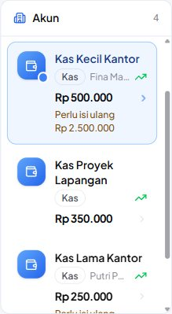 |
| 4 | Penanggung jawab yang tidak muat di daftar dipotong, Tooltip menampilkan “Penanggung jawab: Fina Manajer QA”. | 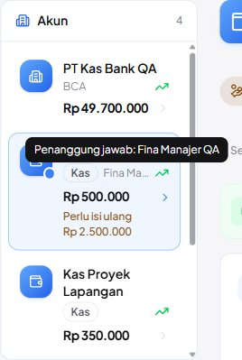 |
| 5 | Header Kas Lama Kantor: nama, “Kas tunai · Penanggung jawab: Putri Pemasukan QA”, plafon & perlu isi ulang utuh; tombol aksi di baris bawah. | 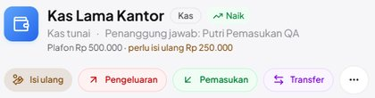 |

### N12 · Ponsel 390 px: ubin ringkasan & kartu akun tidak memotong angka/nama — Pass (percobaan ke-2)

| # | Langkah & yang terlihat | Layar |
|---|---|---|
| 1 | **6 Nov (sebelum perbaikan)** — 390 px: ubin Total Saldo/Pemasukan/Pengeluaran memotong angka. |  |
| 2 | **9 Nov** — Total Saldo selebar baris, lalu Total Bank & Total Kas serta Pemasukan & Pengeluaran berdampingan: semua angka utuh; kartu Kas Lama Kantor & header utuh. | 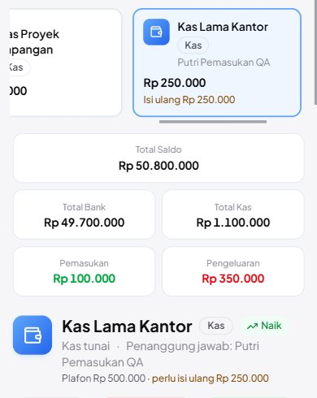 |

### A09 · Hanya-lihat: Tambah Akun, Edit, Hapus tidak ditawarkan; request langsung tetap 403 — Pass (percobaan ke-2)

| # | Langkah & yang terlihat | Layar |
|---|---|---|
| 1 | **6 Nov (sebelum perbaikan)** — pengguna hanya-lihat masih melihat Tambah Akun. |  |
| 2 | **9 Nov** — Putri (view bank-accounts saja): header hanya Tutorial; akun hanya punya menu •••. | 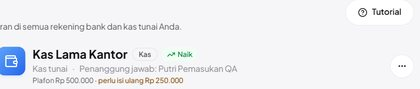 |
| 3 | Menu ••• hanya berisi **Export PDF** — Edit dan Hapus tidak ditawarkan. | 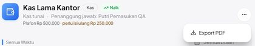 |
| 4 | Daftar akun berakhir di Kas Lama Kantor, tanpa kartu Tambah Akun. | 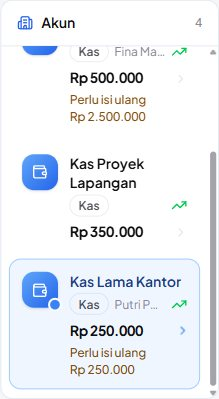 |
| 5 | Ponsel 390 px: header hanya Tutorial, deret kartu tanpa kartu Tambah, aksi akun hanya •••. | 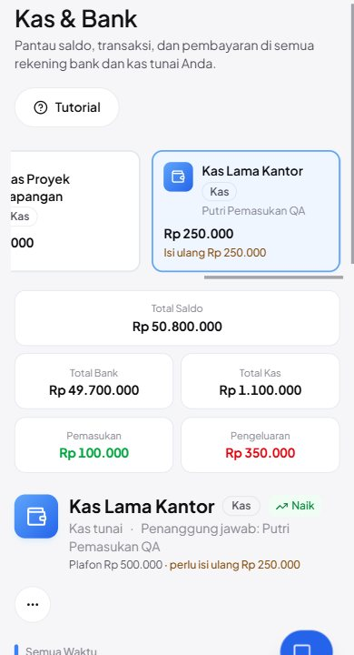 |

### C05 · Isi ulang dengan biaya admin Rp 6.500: transfer bukan pemasukan/pengeluaran, biaya admin tetap beban — Pass (percobaan ke-2)

| # | Langkah & yang terlihat | Layar |
|---|---|---|
| 1 | **6 Nov (sebelum perbaikan)** — setelah isi ulang 2.500.000: Pemasukan 3.000.000 dan Pengeluaran 2.550.000 sama-sama memuat transfer. |  |
| 2 | **9 Nov** — Ringkasan sebelum isi ulang: Pemasukan 1–9 Nov Rp 100.000, Pengeluaran Rp 350.000. |  |
| 3 | Dialog Isi ulang Kas Kecil Kantor: sumber BCA, kategori Antar Rekening Sendiri, jumlah 2.500.000, **Biaya Admin 6.500** (Total Debit 2.506.500). | 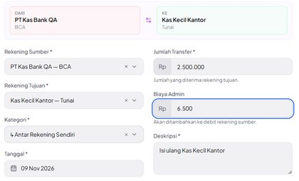 |
| 4 | Ringkasan sesudah: Pemasukan tetap **Rp 100.000**, Pengeluaran **Rp 356.500** (+6.500), Total saldo Rp 50.793.500. | 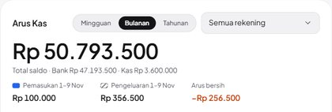 |
| 5 | Donat Pengeluaran (1920 px agar label terbaca, K-07): OPERASIONAL 98% + **Biaya admin transfer** 2%; tidak ada Antar Rekening Sendiri. | 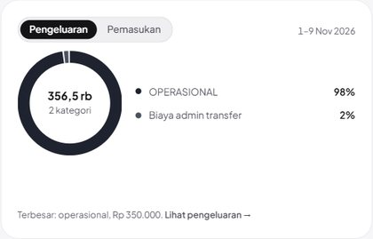 |
| 6 | Donat Pemasukan: hanya Kembali Dana 100% — transfer masuk tidak dihitung. | 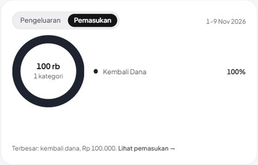 |
| 7 | Grafik difilter Tunai · Kas Kecil Kantor: Nov masuk 2,5 jt (transfer tetap terhitung untuk satu rekening); angka kartu tetap 100.000 / 356.500. | 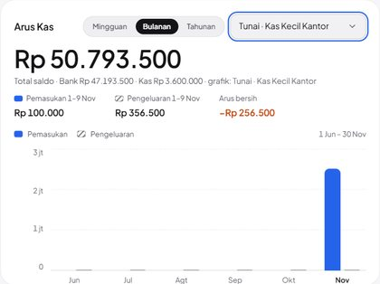 |
| 8 | Ringkasan Total Kas & Bank (semua akun, semua waktu): Pemasukan Rp 100.000, Pengeluaran Rp 356.500, Arus Bersih −Rp 256.500. | 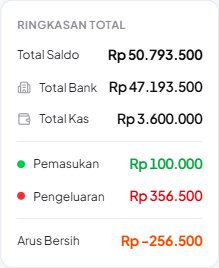 |
| 9 | Statistik akun Kas Kecil Kantor (satu akun): Pemasukan Rp 2.500.000 — isi ulang memang uang masuk kas ini. | 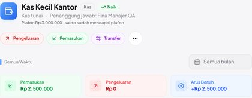 |

## Catatan tambahan

Ditemukan di luar kegagalan test case; tidak diperbaiki karena butuh keputusan produk/desain atau berada di luar perubahan rilis ini.

**UX-01, UX-02, K-02 — dipindah ke bagian bug, diperbaiki 9 November 2026.** Ketiganya tercatat di sini pada 6 November sebagai catatan tambahan (bukan kegagalan case) dan kini diperbaiki (`2f6874d`, `955a39c`); rincian gejala, sebab, cakupan, dan perbaikannya ada di **Bug yang ditemukan & diperbaiki**, buktinya di N11, N12, A09, C05.

**K-06 — Peringatan aksesibilitas Radix pada dialog Transfer/transaksi.** Konsol mencatat 9 peringatan Missing Description or aria-describedby for DialogContent (dialog Transfer/Isi ulang, Catat Pengeluaran, dan dialog di halaman admin). Tidak ada error konsol selama seluruh sesi (dibaca dari storage/logs/browser.log baris ber-channel qakb).

**K-03 — Deskripsi debit transfer selalu Transfer + Admin Fee walau biaya 0.** Isi ulang memakai biaya admin 0, tetapi baris debit tetap berdeskripsi Transfer + Admin Fee - Isi ulang …. Kosmetik, perilaku lama.

**K-04 — Kode KAS- tidak dijaga indeks unik di database (dibaca dari kode).** account_number unik hanya lewat validasi; kode KAS- dibuat model di event saving sesudah validasi. Dua penyimpanan kas yang benar-benar bersamaan secara teori bisa mendapat kode sama. Risiko rendah; tidak diuji karena butuh request paralel.

**K-05 — Pesan 403 masih berbahasa Inggris.** Halaman Akses ditolak menampilkan This action is unauthorized. (bawaan Laravel). Perilaku lama, di luar cakupan rilis ini.

Ditemukan saat tindak lanjut 9 November (tidak diperbaiki, di luar cakupan UX-01/UX-02/K-02):

**K-07 — Legenda donat Ringkasan memotong nama kategori.** Pada 1280 px (menu terbuka) dan 1536 px label legenda terpotong menjadi “O…”, “H…”, “Bi…”; baru utuh sekitar 1920 px. Tata letak lama; bukti C05-4 karena itu diambil di 1920x1080. Irisan “Biaya admin transfer” juga bisa masuk “Lainnya” bila ada lebih dari empat kategori yang lebih besar (aturan 4 irisan + Lainnya).

**K-08 — Label aksesibel donat selalu “Pengeluaran per kategori”, juga di tab Pemasukan.** Snapshot aksesibilitas tab Pemasukan: image “Pengeluaran per kategori: Kembali Dana 100 persen…”. Pembaca layar mendengar judul yang salah.

**K-09 — Kas & Bank di bawah ±1200 px dengan menu terbuka: kolom daftar terlalu sempit.** Di 1024 px dengan menu terbuka kartu daftar ±150 px: nama turun 2–3 baris dan saldo besar melebihi kartu (gulir horizontal). Sebelum perbaikan UX-01 kondisinya lebih buruk (nama ±38 px). Saran: pakai tata letak ponsel di bawah `xl` atau container query. Menciutkan menu (`[`) melebarkan daftar.

**K-10 — Skrip panduan `video/capture/dashboard.js` belum mengikuti URL multi-tenancy.** Skrip masih membuka `BASE + /dashboard` dan memilih tanggal Oktober 2026. Screenshot panduan Ringkasan diambil ulang 9 Nov secara manual lewat Chrome DevTools MCP dengan lokator yang sama.

**K-11 — Tombol ikon ••• akun tanpa `aria-label`.** Snapshot aksesibilitas menampilkan button tanpa nama di header akun Kas & Bank.

**K-12 — Sekali muncul: tab transaksi meminta URL tanpa perusahaan (404).** Pada kunjungan pertama Kas & Bank setelah Putri login, server mencatat `GET /api/transaction-categories` dan `GET /c/$slug/bank-accounts/transactions` (nilai bawaan Wayfinder saat slug perusahaan aktif belum terisi), lalu konsol mencatat *Unhandled Promise Rejection AxiosError 404*. Muat berikutnya memakai `/c/qafix/...` dan halaman tampil normal; tidak terulang di sesi admin/FM. Kode yang terlibat (`transactions-tab.tsx`, `lib/company.ts`, `inertia.tsx`) tidak diubah perbaikan ini. Sebabnya tidak diselidiki.

Konsol selama tindak lanjut (424 entri ber-channel `qafix` di `storage/logs/browser.log`, dihitung saat pembongkaran: 294 DEBUG, 125 INFO, 2 WARNING, 3 ERROR): 2 error *ReferenceError: AccountDetailText is not defined* plus 1 peringatan React tentang error boundary yang menyertainya, pukul 03:09 — hot reload di tengah penyuntingan UX-01, sebelum bukti diambil, bukan perilaku kode akhir —; 1 peringatan K-06 (dialog Isi ulang); 1 error K-12. Selebihnya pesan Vite dan React DevTools dari tiap muat halaman, termasuk muat ulang otomatis halaman QA yang masih terbuka selama dokumen disunting setelah bukti diambil.

## Kendala alat uji

Tidak satu pun dihitung sebagai kegagalan test case:

- Tangkapan pertama N01 mengenai elemen yang salah (hanya tautan Ringkasan) karena uid anak yang dipakai; diambil ulang dengan uid sidebar. Eksekusi case-nya sendiri tidak terganggu.
- Skrip pembuat pengguna menunggu 1,5 detik lalu menyimpulkan dialog masih terbuka; ternyata request hanya lebih lambat dan pengguna Staff sudah tersimpan. Kesalahan skrip saya, bukan aplikasi.
- Tangkapan fullPage hanya menghasilkan viewport karena halaman menggulir di dalam kontainer sendiri; wilayah yang perlu digulir ke tampilan dulu (scrollIntoView).
- Beberapa uid kedaluwarsa setelah halaman dimuat ulang (mis. tombol Isi ulang); aksi diulang lewat DOM.
- Tindak lanjut 9 Nov: opsi Combobox (cmdk) tidak muncul di snapshot aksesibilitas, sehingga rekening sumber, kategori, dan filter rekening dipilih dengan keyboard (ArrowDown/Enter), bukan klik uid. Hasil pilihan diverifikasi di layar dan DB.
- Tooltip kursor (N11-2) dimunculkan lewat event pointer sintetis (Radix membuka tooltip pada pointermove); efeknya sama dengan mengarahkan kursor, dan tooltip ditutup lagi sebelum langkah berikutnya.
- Saat mengambil ulang screenshot panduan (bukan case QA), tangkapan pertama `staff-mid` memuat tooltip grafik karena kursor tertinggal di batang Oktober setelah halaman digulir; diambil ulang setelah kursor dipindah ke breadcrumb.

## Yang diverifikasi dengan eksekusi vs dengan membaca kode

- **Eksekusi** (layar + request langsung + query DB): seluruh 22 case di tabel. Setiap klaim saldo dicocokkan dengan rumus saldo di SQL; setiap penolakan server dicek ulang lewat request rakitan dari sesi yang sama.
- **Membaca kode saja**: K-04 (kode `KAS-` tanpa indeks unik — butuh request paralel untuk dibuktikan), perilaku `artisan serve` yang hanya meneruskan `APP_ENV` (lalu dibuktikan empiris lewat baris sesi di `qakb_central`), dan status pra-ada UX-02/K-02 (dibandingkan dengan `1c4c160`).
- **Tidak diuji**: alat MCP Koneksi Claude untuk kas, ekspor PDF laporan kas, hapus akun kas, dan modul lain di luar Kas & Bank (cakupan dipersempit oleh pengguna di tengah sesi).
- **Tindak lanjut 9 Nov — eksekusi**: N11, N12, A09, C05 lewat layar (Chrome DevTools MCP) di MySQL 8.0.45; ukuran teks terpotong/tidak diukur lewat DOM (scrollWidth vs clientWidth), request rakitan A09 dari sesi Putri, angka C05 dicocokkan dengan query SQL ke database perusahaan. Tab Arus Kas › Semua, Transfer & Penyesuaian, dan Laba Rugi dibuka untuk memastikan tidak berubah. Pasangan transfer warisan (`transfer_group_id` kosong), kaki berkategori transfer tanpa pasangan, penyesuaian & pendanaan, invarian Pemasukan − Pengeluaran = perubahan total saldo, dan alat Claude `ringkasan-keuangan` dieksekusi di tes otomatis (`TransferAntarAkunTest`, `AlatKasTest`; SQLite), tidak di layar.
- **Tindak lanjut 9 Nov — membaca kode**: alat `mutasi-rekening` dan `rekening-bank` (tidak memuat angka pemasukan/pengeluaran tingkat perusahaan, jadi tidak diubah), `CashFlowExportService` (laporan kas PDF = daftar mutasi per baris), dan kelas `GeminiFinanceService` yang tidak dipanggil di mana pun.

## Catatan kejujuran

Kode fitur Kas & Bank (commit cd01099) ditulis oleh model yang sama (Claude Opus 5.5) yang menjalankan pengujian ini, sehingga ada risiko pengujian mewarisi asumsi penulisnya. Yang paling perlu dicek manusia: buka Kas & Bank di laptop yang benar-benar dipakai tim keuangan dan putuskan apakah nama kas yang terpotong (UX-01) masih bisa dipakai untuk memilih kas yang benar, lalu lakukan satu isi ulang sungguhan dengan biaya admin bukan nol dan cocokkan saldo kedua akun dengan mutasi bank. Yang hanya diverifikasi dengan membaca kode (tidak dieksekusi): risiko kode KAS- ganda pada penyimpanan bersamaan (K-04) dan alat MCP rekening-bank/ringkasan-keuangan (tidak termasuk cakupan QA ini).

Tindak lanjut 9 Nov: perbaikan UX-01, UX-02, dan K-02 juga ditulis lalu diverifikasi oleh model yang sama. Yang paling perlu dicek manusia setelah deploy: bandingkan Pemasukan/Pengeluaran Ringkasan satu bulan lampau dengan mutasi bank, terutama bulan yang memuat transfer warisan (`transfer_group_id` kosong) atau Pemasukan/Pengeluaran yang dicatat dengan kategori Antar Rekening Sendiri tanpa pasangan — kaki seperti itu dipasangkan per tanggal (heuristik), jadi dua kaki tanpa hubungan di tanggal yang sama ikut saling meniadakan. Skenario itu, pasangan warisan, dan penyesuaian hanya dieksekusi di tes otomatis (SQLite), bukan di layar/MySQL; alat Claude `ringkasan-keuangan` diverifikasi lewat tes, tidak lewat koneksi Claude sungguhan.

_Lingkungan uji: database qakb_central + qakb_central_tenant_qakb (dibuat khusus, di-drop setelah QA), server lokal php artisan serve --env=qakb di http://127.0.0.1:8137, aset dari Vite dev server pengguna ([::1]:5173), Chrome via Chrome DevTools MCP 1280x800 DPR 1 (beberapa tangkapan 1536/1600 px disebut di caption), kode main = origin/main 1c4c160 + cd01099. Tindak lanjut 9 Nov: database qafix_central + qafix_central_tenant_qafix (dibuat khusus, di-drop setelahnya), php artisan serve --env=qafix di http://127.0.0.1:8138, Vite dev server pengguna, Chrome DevTools MCP 1280x800 DPR 1 (N12 & A09-4: 390x844 ponsel; C05-4/C05-5: 1920x1080), kode main 33c2845 + 2f6874d + 955a39c._
