# Test Case — Kas & Bank (jenis akun Kas, penanggung jawab, plafon, isi ulang)

Sumber teknis: [`docs/module/bank-accounts.md`](../../../module/bank-accounts.md) (bagian *Jenis akun Kas & Bank*),
[`docs/module/dashboard.md`](../../../module/dashboard.md). Commit yang diuji: `cd01099`.
Cara baca tabel, kolom **Lapisan**, lingkungan & akun: lihat [`README.md`](../README.md).

**Prasyarat**: lingkungan terisolasi `qakb_*` (bukan production), perusahaan `/c/qakb` dengan profil
lengkap, akun Admin/FM/Staff/"Hanya pemasukan", dan satu pengguna tambahan yang nanti dihapus
(Lukas Luar QA) untuk C04. A08 menambahkan izin `view bank-accounts` ke peran uji "hanya pemasukan"
(dilakukan lewat Administrasi › Izin & Peran). Semua nominal rupiah penuh. Viewport 1280×800 kecuali
disebut lain (N10 memakai 390×844 mode ponsel; C04 langkah 3 memakai 1600×900).

**Tindak lanjut 9 November 2026** (bagian D): temuan catatan tambahan UX-01, UX-02, dan K-02 diperbaiki
(`2f6874d`, `955a39c`) lalu diuji ulang di lingkungan terisolasi baru `qafix_*` dengan data contoh yang
dibuat skrip (lihat [`README.md`](../README.md) › Tindak lanjut 9 November 2026). Case N11, N12, A09, C05
mengulang skenario N04/C04, N10, A08, dan isi ulang — kini dengan biaya admin bukan nol. Percobaan pertamanya
adalah keadaan 6 November yang sudah terekam (bukti layar lama), percobaan keduanya setelah perbaikan.

## A. Kondisi Normal

| ID | Skenario | Langkah | Hasil Diharapkan | Lapisan | Hasil Aktual | Status |
|---|---|---|---|---|---|---|
| N01 | Menu & halaman bernama "Kas & Bank" | Login admin → sidebar **Keuangan** → klik **Kas & Bank** | Sidebar: Keuangan › Invoice, Invoice Berulang, **Kas & Bank**; judul halaman & tab browser "Kas & Bank"; breadcrumb Keuangan › Kas & Bank; URL tetap `/c/qakb/bank-accounts` | FE | Sesuai. Tab browser "Kas & Bank · Finance Management", deskripsi "…semua rekening bank dan kas tunai Anda", kondisi kosong "Belum ada akun". | Pass |
| N02 | Tambah rekening bank (nomor & bank diisi) | Tambah Akun → Jenis **Bank**; Nama "PT Kas Bank QA", Nomor `1234500001`, Bank `BCA`, Cabang "KCP Balikpapan", Saldo awal 50.000.000 → Tambah Rekening | Toast "Rekening berhasil ditambahkan"; akun terpilih di daftar; DB `type=bank`, `custodian_id` & `cash_limit` NULL | FE+BE | Toast muncul, URL `?account=1`. DB #1: `bank`, `1234500001`, `BCA`, saldo awal 50000000, custodian/plafon NULL. Ringkasan Total: Total Bank Rp 50.000.000, Total Kas Rp 0. | Pass |
| N03 | Kas pertama tanpa nomor/bank → `Tunai` + `KAS-0001`, dengan penanggung jawab & plafon | Tambah Akun → Jenis **Kas**; Nama "Kas Kecil Kantor", Penanggung jawab "Fina Manajer QA", Plafon 2.000.000, Saldo awal 500.000 → Tambah Kas | Form kas menyembunyikan nomor/bank/cabang; pilihan penanggung jawab = anggota perusahaan; DB `KAS-0001`, `Tunai`, custodian = id Fina, plafon 2000000; daftar "Kas tunai · Fina Manajer QA" + "Perlu isi ulang Rp 1.500.000"; header plafon + tombol **Isi ulang** | FE+BE | Pilihan penanggung jawab tepat 5 anggota perusahaan. Toast "Kas berhasil ditambahkan". DB #2: `cash`, `KAS-0001`, `Tunai`, branch NULL, custodian_id 2, cash_limit 2000000. Daftar & header sesuai harapan; Total Saldo 50.500.000 = Bank 50.000.000 + Kas 500.000. | Pass |
| N04 | Kas kedua → `KAS-0002`; tanpa plafon tidak ada peringatan isi ulang | Tambah Kas "Kas Proyek Lapangan", tanpa penanggung jawab & plafon, Saldo awal 250.000 | DB `KAS-0002`, `Tunai`, custodian & plafon NULL (plafon kosong = tanpa plafon); daftar "Kas tunai" tanpa "Perlu isi ulang" | FE+BE | DB #3: `cash`, `KAS-0002`, `Tunai`, custodian NULL, cash_limit NULL. Daftar tanpa peringatan; Total Kas Rp 750.000. | Pass |
| N05 | Total Kas + Total Bank = Total Saldo dan cocok dengan saldo terhitung di DB | Setelah C01–C03, N08, N09: buka Kas & Bank; hitung saldo per jenis di DB dengan rumus `initial_balance + payments + credit − debit` | Angka layar = angka SQL | FE+BE | Layar: Total Saldo Rp 51.500.000, Total Bank Rp 47.850.000, Total Kas Rp 3.650.000. SQL: bank 47.850.000 (2 akun), cash 3.650.000 (2 akun), total 51.500.000. | Pass |
| N06 | Ringkasan (dashboard): kartu Arus Kas merinci Bank/Kas; kartu Rekening menandai kas | Buka **Ringkasan** setelah N05 | "Total saldo · Bank Rp 47.850.000 · Kas Rp 3.650.000"; kas bertile `KAS` dengan subjudul "Kas tunai" | FE | Sesuai persis. Kartu Rekening: `BCA` PT Kas Bank QA · BCA · 1234500001; `KAS` Kas Kecil Kantor · Kas tunai · Rp 3.400.000. | Pass |
| N07 | Edit kas mempertahankan kode `KAS-` | Edit Kas "Kas Kecil Kantor": plafon 2.000.000 → 3.000.000 → Simpan Perubahan | Toast "Kas berhasil diperbarui"; DB `account_number` tetap `KAS-0001`, `bank_name` tetap `Tunai`; header "perlu isi ulang Rp 2.500.000" | FE+BE | Dialog Edit terisi (Fina, 2.000.000, 500.000). DB #2 setelah simpan: `KAS-0001`, `Tunai`, custodian 2, cash_limit 3000000. Header "Plafon Rp 3.000.000 · perlu isi ulang Rp 2.500.000". | Pass |
| N08 | Rekening "kas palsu" (bank) diubah menjadi Kas: nomor lama dipertahankan, saldo & transaksi utuh | Buat rekening bank "Kas Lama Kantor" nomor `0000`, bank `CASH`, saldo awal 300.000; catat pengeluaran 50.000 (OPERASIONAL); Edit Rekening → Jenis **Kas**, penanggung jawab Sari Staff QA, plafon 500.000 → Simpan | DB `type=cash`, nomor tetap `0000`, `bank_name` menjadi `Tunai`; transaksi lama tetap di akun; saldo 250.000; "Perlu isi ulang Rp 250.000" | FE+BE | DB #4: `cash`, `0000`, `Tunai`, custodian 3, cash_limit 500000; transaksi #4 (debit 50.000) tetap ber-`bank_account_id` 4; saldo Rp 250.000 dan "Perlu isi ulang Rp 250.000". | Pass |
| N09 | Kas diubah menjadi Bank: nilai bawaan `KAS-`/`Tunai` dikosongkan dan wajib diisi | Edit Kas "Kas Proyek Lapangan" → Jenis **Bank** → Simpan (kosong) → isi Nama "Rekening Proyek Lapangan", Nomor `9876500002`, Bank `Mandiri` → Simpan | Langkah 1: nomor & bank kosong, server menolak dengan dua pesan wajib; langkah 2: DB `bank`, nomor baru, custodian & plafon NULL, transaksi tetap | FE+BE | Setelah ganti jenis, isian nomor/bank kosong (bukan `KAS-0002`/`Tunai`). Simpan kosong → "Nomor rekening wajib diisi untuk rekening bank." + "Nama bank wajib diisi untuk rekening bank.". Setelah diisi: DB #3 `bank`, `9876500002`, `Mandiri`, custodian/plafon NULL; 1 transaksi tetap. | Pass |
| N10 | Tampilan ponsel: daftar akun menandai kas dan kebutuhan isi ulang | Viewport 390×844 (mobile, touch), buka Kas & Bank akun "Kas Lama Kantor" (saldo 250.000 < plafon 500.000), geser daftar kartu ke kas | Kartu kas berikon dompet, subjudul "Kas tunai · {penanggung jawab}", penanda isi ulang; ubin Total Bank & Total Kas; header kas memuat plafon & tombol Isi ulang | FE | Kartu "Kas Lama Kantor · Kas tunai · Putri Pemas… · Rp 250.000 · Isi ulang Rp 250.000"; ubin Total Bank Rp 47.850.000 dan Total Kas Rp 3.650.000 terbaca penuh; header "Plafon Rp 500.000 · perlu isi ulang Rp 250.000" + tombol Isi ulang. Ubin lama Total Saldo/Pemasukan/Pengeluaran memotong angka ("Rp 51.500.…") — lihat UX-01 (diperbaiki 9 Nov di `2f6874d`, diuji ulang N12). | Pass |

## B. Kondisi Tidak Normal / Edge Case

| ID | Skenario | Langkah | Hasil Diharapkan | Lapisan | Hasil Aktual | Status |
|---|---|---|---|---|---|---|
| A01 | Rekening bank tanpa nomor & nama bank ditolak — lewat form dan request langsung | UI: Tambah Akun, Jenis Bank, hanya Nama "Rekening Tanpa Nomor" → Tambah Rekening. BE: `POST /c/qakb/bank-accounts` JSON `{type:"bank", account_name, initial_balance:0}` | Form: "Nomor rekening wajib diisi untuk rekening bank." dan "Nama bank wajib diisi untuk rekening bank."; request langsung 422 dengan pesan sama | FE+BE | Form menampilkan kedua pesan (berasal dari server — form tidak punya validasi klien) + toast "Periksa kembali isian form". Request langsung: 422, `account_number` & `bank_name` dengan pesan yang sama. Tidak ada baris tercipta. | Pass |
| A02 | Penanggung jawab bukan anggota perusahaan ditolak server | Request rakitan `POST` kas dengan `custodian_id`: (a) 6 = pengguna pusat yang ada tetapi bukan anggota `qakb` (fixture dibuat lewat tinker, dihapus lagi sesudahnya), (b) 5 = pengguna yang sudah dihapus, (c) 99999, (d) `"abc"` | (a)–(c) 422 "Penanggung jawab harus anggota perusahaan ini."; (d) 422 "Penanggung jawab tidak dikenal."; tidak ada akun tercipta | BE | Sesuai keempatnya. UI tidak bisa mencapai kondisi ini karena Combobox hanya menawarkan anggota (`custodianOptions`); karena itu diuji dengan request rakitan. Fixture pengguna #6 dihapus setelah uji. | Pass |
| A03 | Plafon negatif / desimal ditolak | Request rakitan kas dengan `cash_limit` -1 dan 1500.5 | 422 "Plafon tidak boleh negatif." / "Plafon harus berupa angka rupiah tanpa desimal." | BE | Sesuai. `CurrencyInput` tidak bisa menghasilkan nilai negatif/desimal, jadi hanya terjangkau lewat request langsung. | Pass |
| A04 | Penanggung jawab & plafon dibuang untuk rekening bank (create dan update) | `POST` bank + `custodian_id` 2 + `cash_limit` 1.000.000; `PUT /bank-accounts/1` (bank) + `custodian_id` 2 + `cash_limit` 500 | Keduanya sukses (302); DB `custodian_id` & `cash_limit` NULL | BE | Sesuai: akun probe #5 dan akun #1 sama-sama custodian/plafon NULL. Form bank tidak pernah mengirim field ini (`transform()` mengosongkannya), jadi hanya terjangkau lewat request rakitan. Akun probe #5 dihapus lagi. | Pass |
| A05 | Jenis akun tidak valid / tidak dikirim | Request rakitan `type:"tabungan"`; request tanpa `type` | 422 "Jenis akun harus Bank atau Kas."; tanpa `type` diperlakukan sebagai bank → wajib nomor & bank | BE | Sesuai. UI hanya punya dua pilihan (SegmentedControl), jadi nilai lain/kosong hanya bisa dikirim klien lama atau request rakitan. | Pass |
| A06 | Nomor rekening duplikat ditolak, termasuk kode `KAS-` | UI: rekening bank baru nomor `1234500001` (milik akun #1). BE: `POST` kas dengan `account_number:"KAS-0001"` | Form: "Nomor rekening ini sudah dipakai akun lain."; request langsung 422 pesan sama | FE+BE | Sesuai di kedua lapisan. | Pass |
| A07 | Pengguna tanpa izin `bank-accounts` tidak bisa membuka/mengubah Kas & Bank | Login Staff: lihat sidebar Keuangan; buka `/c/qakb/bank-accounts` langsung; `POST /c/qakb/bank-accounts`; `GET /c/qakb/api/bank-accounts` | Menu tidak tampil; halaman 403 "Akses ditolak"; POST 403; API 403 | FE+BE | Sidebar Staff: Keuangan hanya berisi Invoice. URL langsung → halaman "Kode 403 · Akses ditolak" (ID ERR-S5IR8SRN7F). POST 403, API 403. | Pass |
| A08 | Pengguna yang hanya boleh melihat Kas & Bank tidak mendapat tombol Isi ulang dan tidak bisa mentransfer | Peran uji "hanya pemasukan" diberi `view bank-accounts` (tanpa `create transfer`, tanpa `create/edit bank-accounts`) lewat Izin & Peran; login Putri; buka "Kas Lama Kantor" (perlu isi ulang 250.000); `POST /c/qakb/bank-transactions/transfer` rakitan ke kas itu | Info plafon & "perlu isi ulang" tetap tampil; tombol **Isi ulang** (dan Pemasukan/Pengeluaran/Transfer) tidak tampil; prop `custodianOptions` kosong; transfer rakitan 403 | FE+BE | Sesuai: header "Plafon Rp 500.000 · perlu isi ulang Rp 250.000" tanpa tombol aksi transaksi; `custodianOptions` = `[]`; transfer rakitan 403, jumlah baris `TRF` di DB tetap 2. Catatan terpisah UX-02: tombol **Tambah Akun** serta menu **Edit Kas / Hapus Kas** tetap ditawarkan ke pengguna ini; mengirim Tambah Kas berakhir di halaman 403 penuh (server menegakkan, perilaku lama — sama di `1c4c160`). Diperbaiki 9 Nov di `2f6874d`, diuji ulang A09. | Pass |

## C. Alur Berantai (lintas aktor / modul)

Semua aksi dilakukan Admin kecuali disebut lain. Isi ulang memakai dialog Transfer yang sama dengan
modul Arus Kas, jadi efeknya diperiksa juga di halaman Arus Kas.

| ID | Skenario | Langkah | Hasil Diharapkan | Lapisan | Hasil Aktual | Status |
|---|---|---|---|---|---|---|
| C01 | Isi ulang kas kecil: dialog Transfer terisi otomatis, kedua saldo bergerak, hanya masuk Transfer & Penyesuaian | Akun "Kas Kecil Kantor" (saldo 500.000, plafon 3.000.000) → **Isi ulang** → pilih sumber "PT Kas Bank QA — BCA", kategori "Antar Rekening Sendiri" → Lakukan Transfer; lalu buka Arus Kas › Transfer & Penyesuaian dan › Pemasukan & Pengeluaran | Dialog: tujuan "Kas Kecil Kantor — Tunai", jumlah 2.500.000 (= plafon − saldo), biaya admin 0, deskripsi "Isi ulang Kas Kecil Kantor", sumber belum dipilih. Setelah simpan: kas 3.000.000 "saldo sudah mencapai plafon" tanpa tombol Isi ulang; BCA 47.500.000; dua baris `bank_transactions` ber-ref `TRF…`; tampil di Transfer & Penyesuaian, tidak di Pemasukan & Pengeluaran | FE+BE | Dialog terisi persis seperti harapan. Toast "Transfer berhasil dicatat". DB: #1 debit 2.500.000 akun 1 "Transfer + Admin Fee - Isi ulang Kas Kecil Kantor", #2 credit 2.500.000 akun 2, ref sama `TRF20261106-BMC7D7`, kategori bertipe `transfer`, `created_by` 1. Saldo SQL = layar (47.500.000 / 3.000.000). Transfer & Penyesuaian: 1 baris PT Kas Bank QA → Kas Kecil Kantor. Pemasukan & Pengeluaran: 0 hasil. | Pass |
| C02 | Kas tampil wajar di picker modul lain — Arus Kas "Input Pemasukan" | Arus Kas › Pemasukan & Pengeluaran → **Input Pemasukan** → buka Rekening; pilih "Kas Proyek Lapangan — Tunai", kategori "Kembali Dana", 100.000, deskripsi "Pengembalian sisa dana proyek (QA)" → Simpan | Label picker "{nama} — Tunai"; transaksi tersimpan di akun kas; saldo kas naik 100.000 | FE+BE | Picker: "Kas Kecil Kantor — Tunai", "Kas Proyek Lapangan — Tunai", "PT Kas Bank QA — BCA". DB #3: credit 100.000 akun 3, kategori 28, `created_by` 1. Baris tab Semua: "…(QA) Tunai · Kembali Dana · Admin QA · +Rp 100.000". Saldo kas 250.000 → 350.000, Total Kas 3.350.000. | Pass |
| C03 | Kas di picker pembayaran invoice; pembayaran menambah saldo kas | Fixture: klien "CV Contoh Pelanggan", invoice Rp 1.000.000 diterbitkan → `001/INV/KBQ-CP/XI/2026`. Drawer → **Catat pembayaran** → Rekening tujuan "Kas Kecil Kantor (Tunai)", metode Tunai, Nominal lain 400.000 → Simpan | Label "{nama} (Tunai)"; `payments` di akun kas; status invoice `partially_paid`; saldo kas +400.000; tab Pembayaran kas memuat pembayaran ini | FE+BE | Picker: "PT Kas Bank QA (BCA)", "Rekening Proyek Lapangan (Mandiri)", "Kas Kecil Kantor (Tunai)", "Kas Lama Kantor (Tunai)". Toast "Pembayaran Rp 400.000 dicatat.". DB payments #1: akun 2, 400000, `cash`, `created_by` 1; invoice `partially_paid`. Kas 3.000.000 → 3.400.000 (di atas plafon → tetap tanpa Isi ulang). | Pass |
| C04 | Penanggung jawab dihapus dari aplikasi → kas menampilkan "Pengguna dihapus", simpan ditolak sampai diganti anggota | Set penanggung jawab "Kas Lama Kantor" = Lukas Luar QA → Admin menghapus Lukas di Administrasi › Pengguna → buka Kas & Bank → Edit Kas → Simpan → pilih "Putri Pemasukan QA" → Simpan | Daftar & header "Pengguna dihapus"; dialog menampilkan "Pengguna dihapus (bukan anggota lagi)"; simpan ditolak "Penanggung jawab harus anggota perusahaan ini."; setelah diganti anggota, tersimpan | FE+BE | DOM daftar: "Kas tunai · Pengguna dihapus"; header: "Penanggung jawab: Pengguna dihapus" (teksnya terpotong di layar 1280 px — lihat UX-01; diperbaiki 9 Nov di `2f6874d`, diuji ulang N11). Dialog & penolakan sesuai. Setelah pilih Putri: toast "Kas berhasil diperbarui", DB #4 custodian_id 4. Pengguna #5 terhapus permanen di pusat. | Pass |

## D. Tindak Lanjut 9 November 2026 (UX-01, UX-02, K-02)

Lingkungan `qafix_*` (bukan production), perusahaan `/c/qafix` "PT Kas Bank QA". Data contoh dibuat skrip:
rekening BCA "PT Kas Bank QA" (saldo awal 50.000.000), Kas Kecil Kantor (penanggung jawab Fina Manajer QA,
plafon 3.000.000, saldo 500.000), Kas Proyek Lapangan (tanpa plafon), Kas Lama Kantor (penanggung jawab Putri
Pemasukan QA, plafon 500.000, saldo 250.000), tiga transaksi November (ATK 300.000, Kembali Dana 100.000,
bensin 50.000). Putri memegang peran uji "hanya lihat kas & bank" (`view bank-accounts` saja). Isi ulang di
C05 dilakukan lewat layar.

| ID | Skenario | Langkah | Hasil Diharapkan | Lapisan | Hasil Aktual | Status |
|---|---|---|---|---|---|---|
| N11 | Nama kas & penanggung jawab terbaca utuh di daftar dan header (ulangan N04 + C04, UX-01) | Admin, 1280×800 DPR 1, menu terbuka: buka Kas & Bank; gulir daftar akun; arahkan kursor ke penanggung jawab di daftar; pilih Kas Lama Kantor | Semua nama akun utuh (boleh turun baris, tanpa "…"); penanggung jawab yang tidak muat di daftar punya Tooltip teks lengkap; header menampilkan nama, "Kas tunai · Penanggung jawab: …", dan baris plafon utuh; tombol aksi turun ke baris bawah | FE | Percobaan 1 (6 Nov, `cd01099`): ketiga kas tampil "Kas …", header terpotong (N04-2, C04-1). Setelah `2f6874d`: pengukuran DOM — keempat nama tidak terpotong (scrollWidth ≤ clientWidth, kolom 118 px; "Kas Proyek Lapangan" 2 baris); Tooltip "Penanggung jawab: Fina Manajer QA"; header "Kas Lama Kantor · Kas · Naik / Kas tunai · Penanggung jawab: Putri Pemasukan QA / Plafon Rp 500.000 · perlu isi ulang Rp 250.000" utuh, tombol Isi ulang/Pengeluaran/Pemasukan/Transfer/••• di baris bawah. Dicek juga 1536×864 (semua satu baris). | Pass |
| N12 | Ponsel 390 px: ubin ringkasan & kartu akun tidak memotong angka/nama (ulangan N10, UX-01) | 390×844 mobile+touch; Kas & Bank akun Kas Lama Kantor; geser deret kartu ke Kas Lama Kantor | Total Saldo, Total Bank, Total Kas, Pemasukan, Pengeluaran terbaca penuh; nama & penanggung jawab kartu utuh; header utuh | FE | Percobaan 1 (6 Nov): ubin tiga kolom "Rp 51.500.…" (N10-1). Setelah `2f6874d`: ubin dua kolom (Total Saldo selebar baris) — Rp 50.800.000, Rp 49.700.000, Rp 1.100.000, Rp 100.000, Rp 350.000, semuanya satu baris dan tidak terpotong (diukur scrollWidth); kartu "Kas Lama Kantor · Kas · Putri Pemasukan QA · Rp 250.000 · Isi ulang Rp 250.000" utuh; header penanggung jawab turun baris. | Pass |
| A09 | Hanya-lihat: Tambah Akun, Edit, Hapus tidak ditawarkan; request langsung tetap 403 (ulangan A08, UX-02) | Login Putri; Kas & Bank 1280×800: header, ujung daftar akun, menu •••; 390×844: ujung deret kartu. BE dari sesi Putri: `POST /c/qafix/bank-accounts`, `PUT /c/qafix/bank-accounts/4`, `DELETE /c/qafix/bank-accounts/3` | Tidak ada Tambah Akun di header/daftar/kartu ponsel; menu ••• hanya Export PDF; ketiga request 403; `bank_accounts` tidak berubah | FE+BE | Percobaan 1 (6 Nov): Tambah Akun & Edit/Hapus ditawarkan, simpan berakhir 403 penuh (A08-1, A08-2). Setelah `2f6874d`: header hanya Tutorial; daftar berakhir di Kas Lama Kantor tanpa kartu Tambah Akun; menu ••• hanya "Export PDF"; ponsel tanpa kartu Tambah. POST/PUT/DELETE rakitan → 403 "This action is unauthorized." (K-05); DB tetap 4 akun, nama & `updated_at` tidak berubah. | Pass |
| C05 | Isi ulang dengan biaya admin Rp 6.500: transfer bukan pemasukan/pengeluaran, biaya admin tetap beban, satu rekening tetap menghitung transfer (K-02) | Admin: catat Ringkasan; Kas & Bank › Kas Kecil Kantor (saldo 500.000, plafon 3.000.000) → **Isi ulang** → sumber "PT Kas Bank QA — BCA", kategori Antar Rekening Sendiri, Biaya Admin 6.500 → Lakukan Transfer; Ringkasan (kartu, donat Pengeluaran & Pemasukan, grafik filter "Tunai · Kas Kecil Kantor"); Kas & Bank (Ringkasan Total, statistik Kas Kecil Kantor); cocokkan SQL | Pemasukan 1–9 Nov tetap Rp 100.000; Pengeluaran naik hanya Rp 6.500; donat Pengeluaran tanpa "Antar Rekening Sendiri" dan ada "Biaya admin transfer"; donat Pemasukan tanpa transfer; grafik satu rekening: Nov masuk 2.500.000; Ringkasan Total Pemasukan 100.000 / Pengeluaran 356.500; statistik kas Pemasukan 2.500.000; semua = SQL | FE+BE | Percobaan 1 (6 Nov, perilaku lama yang diputuskan diubah): Pemasukan 1–6 Nov Rp 3.000.000 dan Pengeluaran Rp 2.550.000 memuat transfer, donat "Antar Rekening Sendiri 98%" (N06-1, K-02). Setelah `955a39c`: Total Debit 2.506.500, toast "Transfer berhasil dicatat"; DB #4 debit 2.506.500 akun 1 & #5 credit 2.500.000 akun 2, `transfer_group_id` sama, ref `TRF20261109-0NZBA5`, kategori bertipe transfer. Ringkasan: Total saldo Rp 50.793.500 (Bank 47.193.500 · Kas 3.600.000), Pemasukan Rp 100.000, Pengeluaran Rp 356.500, Arus bersih −Rp 256.500; donat Pengeluaran "OPERASIONAL 98% · Biaya admin transfer 2%"; Pemasukan "Kembali Dana 100%"; filter kas: Nov 2.500.000/0 sementara kartu tetap 100.000/356.500. Ringkasan Total: 100.000 / 356.500 / −256.500; statistik Kas Kecil Kantor Pemasukan 2.500.000. SQL November: kredit 2.600.000, debit 2.856.500, pembayaran 0, kredit transfer bertautan 2.500.000 → 100.000 / 356.500; saldo per akun = layar. Arus Kas › Semua (Total Keluar 350.000), Transfer & Penyesuaian ("+ admin Rp 6.500"), dan Laba Rugi tidak berubah. | Pass |

<!-- qa-evidence:start -->

# Bukti visual langkah per langkah

Screenshot diambil per langkah, bukan hanya hasil akhirnya, supaya alurnya
bisa ditelusuri ulang oleh orang lain. Test case yang kondisinya tidak bisa
dicapai dari layar dijalankan lewat API/DB dan ditandai eksplisit — tidak
dibuatkan screenshot seolah-olah ada alur UI-nya.

## N01 · Menu & halaman bernama Kas & Bank — Pass

| # | Langkah & yang terlihat | Layar |
|---|---|---|
| 1 | Sidebar admin: grup **Keuangan** berisi Invoice, Invoice Berulang, dan **Kas & Bank** — label lama Rekening Bank sudah hilang. | 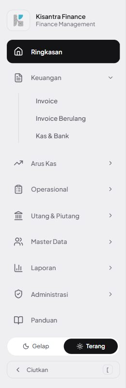 |
| 2 | Halaman `/c/qakb/bank-accounts`: judul & breadcrumb **Kas & Bank**, tombol Tambah Akun, kondisi kosong Belum ada akun. | 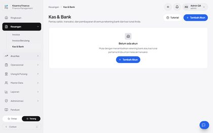 |

## N02 · Tambah rekening bank — Pass

| # | Langkah & yang terlihat | Layar |
|---|---|---|
| 1 | Jenis **Bank**: nomor, bank, cabang tampil dan terisi. Pesan merah adalah sisa percobaan A01 dan hilang saat dikirim ulang. | 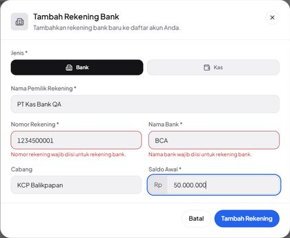 |
| 2 | Rekening muncul di daftar Akun; Ringkasan Total: Total Saldo = Total Bank Rp 50.000.000, Total Kas Rp 0. | 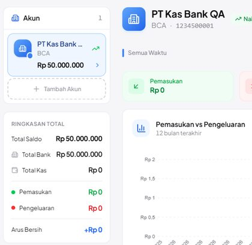 |

## N03 · Kas pertama: Tunai + KAS-0001, penanggung jawab & plafon — Pass

| # | Langkah & yang terlihat | Layar |
|---|---|---|
| 1 | Jenis **Kas**: nomor/bank/cabang disembunyikan; Penanggung Jawab hanya berisi 5 anggota perusahaan; Plafon 2.000.000. | 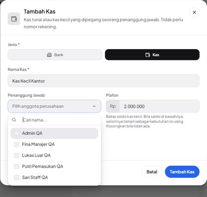 |
| 2 | Daftar: kas berlabel **Kas**, subjudul Kas tunai · Fina…, **Perlu isi ulang Rp 1.500.000**; Total Kas Rp 500.000. | 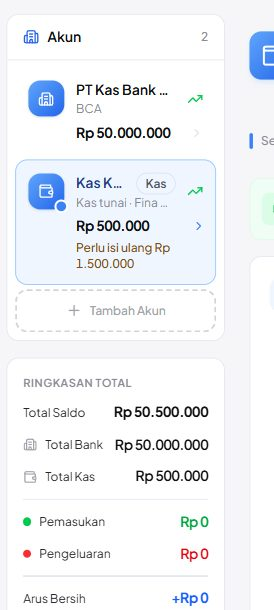 |
| 3 | Header kas: Plafon Rp 2.000.000 · perlu isi ulang Rp 1.500.000, tombol **Isi ulang**. | 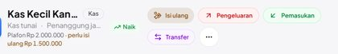 |

## N04 · Kas kedua: KAS-0002, tanpa plafon tanpa peringatan — Pass

| # | Langkah & yang terlihat | Layar |
|---|---|---|
| 1 | Kas kedua tanpa penanggung jawab dan plafon (0 = tanpa plafon). | 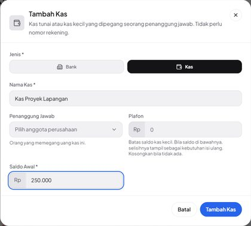 |
| 2 | Kas kedua hanya Kas tunai, tanpa peringatan isi ulang; Total Kas Rp 750.000. Nama kedua kas terpotong jadi Kas … (UX-01). | 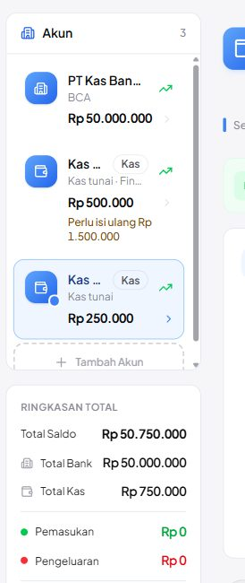 |

## N05 · Total Kas + Total Bank = Total Saldo = hitungan SQL — Pass

| # | Langkah & yang terlihat | Layar |
|---|---|---|
| 1 | Ringkasan Total setelah transaksi: Total Saldo 51.500.000 = Bank 47.850.000 + Kas 3.650.000, sama dengan hitungan SQL. | 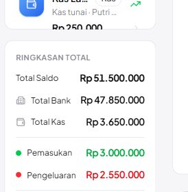 |

## N06 · Ringkasan (dashboard) merinci Bank/Kas dan menandai kas — Pass

| # | Langkah & yang terlihat | Layar |
|---|---|---|
| 1 | Kartu Arus Kas: Total saldo · Bank Rp 47.850.000 · Kas Rp 3.650.000. | 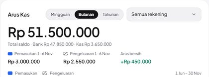 |
| 2 | Kartu Rekening: tile **KAS** + subjudul Kas tunai untuk akun kas; tile BCA/MAN untuk rekening. | 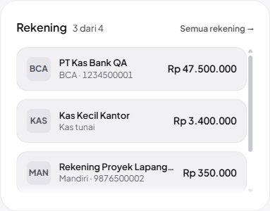 |

## N07 · Edit kas mempertahankan kode KAS- — Pass

| # | Langkah & yang terlihat | Layar |
|---|---|---|
| 1 | Edit Kas terisi data tersimpan; plafon diubah ke 3.000.000. |  |
| 2 | Header setelah simpan: Plafon Rp 3.000.000 · perlu isi ulang Rp 2.500.000 (DB: kode tetap KAS-0001). | 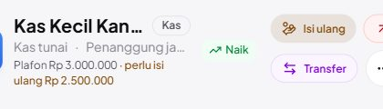 |

## N08 · Rekening kas palsu (bank) diubah menjadi Kas — Pass

| # | Langkah & yang terlihat | Layar |
|---|---|---|
| 1 | Rekening lama gaya kas palsu: Jenis Bank, nomor 0000, bank CASH. |  |
| 2 | Jenis diganti **Kas**: penanggung jawab Sari Staff QA, plafon 500.000. | 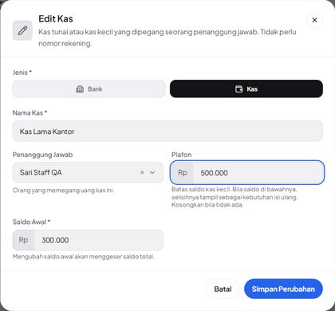 |
| 3 | Akun keempat kini berlabel Kas, saldo tetap Rp 250.000 (pengeluaran 50.000 utuh). DB: nomor 0000 dipertahankan. | 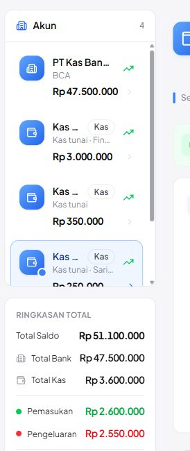 |

## N09 · Kas diubah menjadi Bank: wajib isi nomor & bank — Pass

| # | Langkah & yang terlihat | Layar |
|---|---|---|
| 1 | Kas diganti Bank: nomor & bank kosong (bukan KAS-0002/Tunai); simpan kosong ditolak dengan dua pesan wajib. | 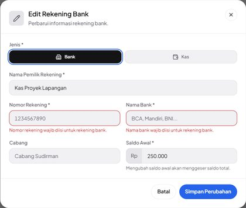 |
| 2 | Setelah diisi: Rekening Proyek Lapangan · Mandiri · 9876500002 sebagai rekening bank. | 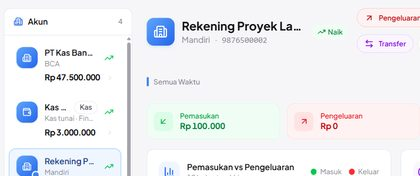 |

## N10 · Tampilan ponsel: kas & isi ulang ditandai — Pass

| # | Langkah & yang terlihat | Layar |
|---|---|---|
| 1 | Ponsel 390 px: kartu Kas Lama Kantor (ikon dompet, Kas tunai · Putri…, Isi ulang Rp 250.000), ubin **Total Bank** & **Total Kas**, header plafon + tombol Isi ulang. Ubin lama Total Saldo/Pemasukan/Pengeluaran memotong angka (UX-01). | 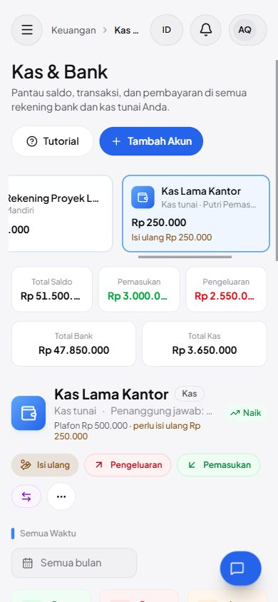 |

## A01 · Rekening bank tanpa nomor & bank ditolak (UI + request langsung) — Pass

| # | Langkah & yang terlihat | Layar |
|---|---|---|
| 1 | Simpan tanpa nomor & bank: dua pesan wajib dari server tampil di bawah field. | 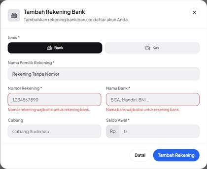 |

## A02 · Penanggung jawab bukan anggota ditolak server — Pass

_Tanpa langkah UI — BE — request rakitan: pengguna pusat non-anggota (fixture), pengguna terhapus, id 99999 → 422 Penanggung jawab harus anggota perusahaan ini.; abc → Penanggung jawab tidak dikenal. UI hanya menawarkan anggota._

## A03 · Plafon negatif/desimal ditolak — Pass

_Tanpa langkah UI — BE — 422 Plafon tidak boleh negatif. / Plafon harus berupa angka rupiah tanpa desimal. CurrencyInput tidak bisa menghasilkannya._

## A04 · Field kas dibuang untuk rekening bank — Pass

_Tanpa langkah UI — BE — create & update bank dengan custodian/plafon → tersimpan NULL. Form bank tidak mengirim field ini._

## A05 · Jenis akun tidak valid / tidak dikirim — Pass

_Tanpa langkah UI — BE — tabungan → 422 Jenis akun harus Bank atau Kas.; tanpa type → diperlakukan bank._

## A06 · Nomor rekening duplikat ditolak — Pass

| # | Langkah & yang terlihat | Layar |
|---|---|---|
| 1 | Nomor 1234500001 milik rekening BCA: Nomor rekening ini sudah dipakai akun lain. | 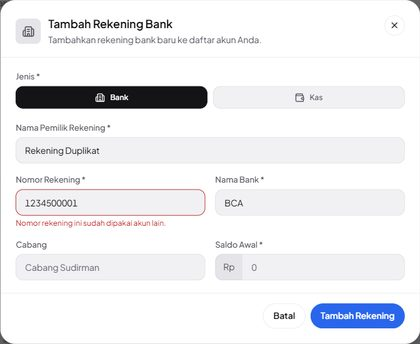 |

## A07 · Staff tanpa izin tidak bisa membuka/mengubah Kas & Bank — Pass

| # | Langkah & yang terlihat | Layar |
|---|---|---|
| 1 | Staff membuka URL Kas & Bank langsung: halaman 403 Akses ditolak (menu juga tidak tampil). | 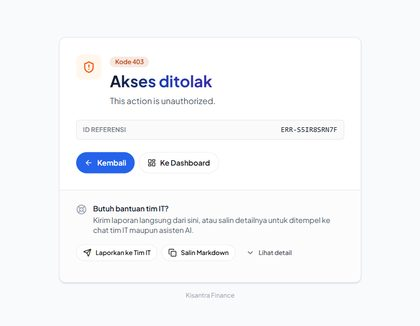 |

## A08 · Hanya-lihat: tanpa tombol Isi ulang, transfer ditolak — Pass

| # | Langkah & yang terlihat | Layar |
|---|---|---|
| 1 | Putri (hanya view bank-accounts): kas tetap menampilkan plafon & perlu isi ulang Rp 250.000, tetapi tanpa tombol Isi ulang/Pemasukan/Pengeluaran/Transfer. Tombol Tambah Akun masih tampil (UX-02). | 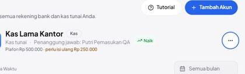 |
| 2 | Mencoba Tambah Akun → Kas lalu simpan: server menolak dan halaman berganti menjadi 403 Akses ditolak; tidak ada akun tercipta. | 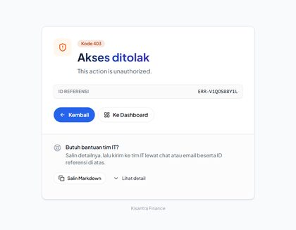 |

## C01 · Isi ulang kas kecil lewat dialog Transfer — Pass

| # | Langkah & yang terlihat | Layar |
|---|---|---|
| 1 | Klik **Isi ulang**: dialog Transfer yang sama, tujuan Kas Kecil Kantor, jumlah 2.500.000 (= 3.000.000 − 500.000), biaya admin 0, deskripsi terisi; sumber belum dipilih. | 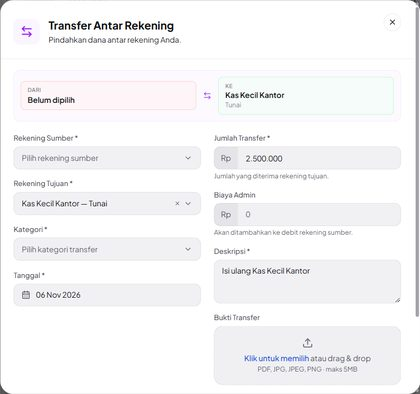 |
| 2 | Sumber PT Kas Bank QA — BCA dan kategori Antar Rekening Sendiri dipilih; nilai prefill tidak berubah. | 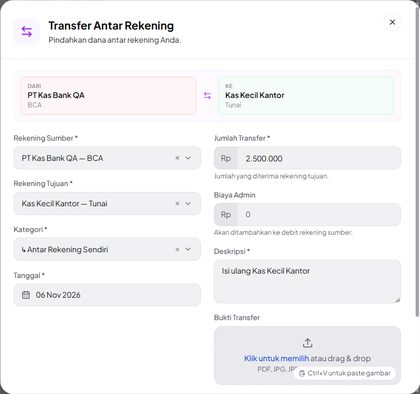 |
| 3 | Setelah transfer: BCA Rp 47.500.000, kas Rp 3.000.000 tanpa Perlu isi ulang; Total Bank 47.500.000, Total Kas 3.250.000. | 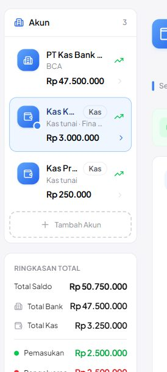 |
| 4 | Header kas: saldo sudah mencapai plafon, tombol Isi ulang hilang (nama kas kini muat penuh). | 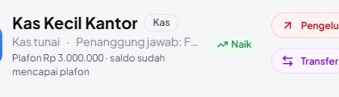 |
| 5 | Arus Kas › Transfer & Penyesuaian: 1 transfer PT Kas Bank QA → Kas Kecil Kantor Rp 2.500.000. | 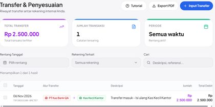 |
| 6 | Arus Kas › Pemasukan & Pengeluaran: 0 hasil — isi ulang bukan pemasukan/pengeluaran. | 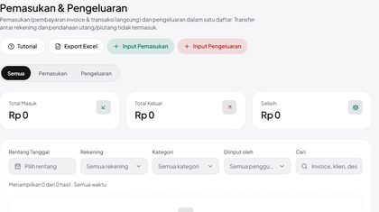 |

## C02 · Kas di picker Input Pemasukan (Arus Kas) — Pass

| # | Langkah & yang terlihat | Layar |
|---|---|---|
| 1 | Picker Rekening di Catat Pemasukan: kas tampil … — Tunai, rekening … — BCA. | 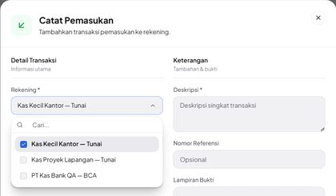 |
| 2 | Pemasukan 100.000 ke Kas Proyek Lapangan, kategori Kembali Dana. | 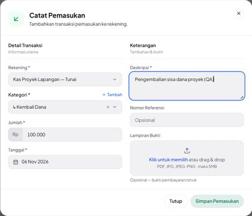 |
| 3 | Saldo kas naik 250.000 → 350.000; Total Kas Rp 3.350.000. | 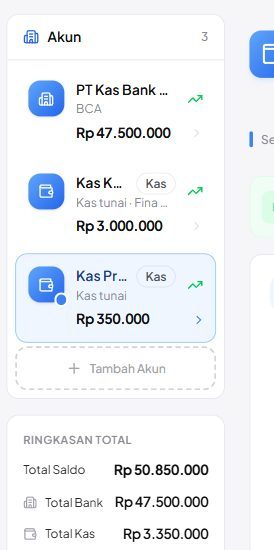 |

## C03 · Kas di picker pembayaran invoice — Pass

| # | Langkah & yang terlihat | Layar |
|---|---|---|
| 1 | Catat pembayaran: Rekening tujuan menampilkan Kas Kecil Kantor (Tunai) dan Kas Lama Kantor (Tunai). | 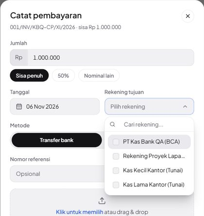 |
| 2 | Pembayaran 400.000 metode Tunai ke Kas Kecil Kantor. | 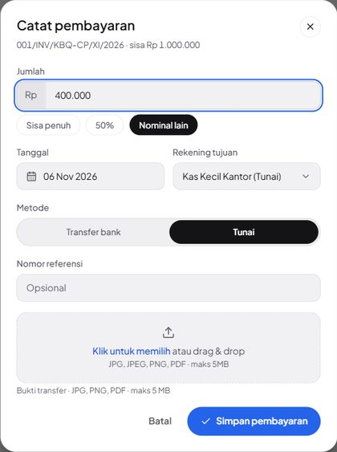 |
| 3 | Kas Kecil Kantor kini Rp 3.400.000 (di atas plafon, tanpa peringatan). | 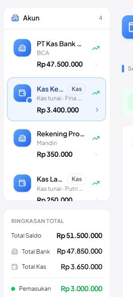 |
| 4 | Tab Pembayaran milik kas memuat 001/INV/KBQ-CP/XI/2026 · Sebagian · Tunai · +Rp 400.000. | 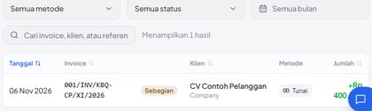 |

## C04 · Penanggung jawab dihapus → ditolak sampai diganti anggota — Pass

| # | Langkah & yang terlihat | Layar |
|---|---|---|
| 1 | Setelah Lukas dihapus: teks penanggung jawab di header terpotong pada 1280 px (UX-01); isi DOM-nya Penanggung jawab: Pengguna dihapus. | 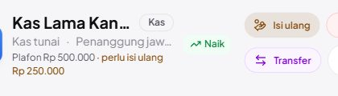 |
| 2 | Edit Kas: Pengguna dihapus (bukan anggota lagi); simpan ditolak Penanggung jawab harus anggota perusahaan ini. | 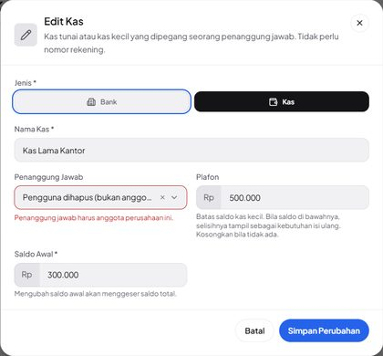 |
| 3 | Setelah diganti Putri Pemasukan QA (viewport 1600 px agar terbaca): Penanggung jawab: Putri Pemasuk… | 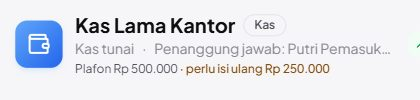 |

## N11 · Nama kas & penanggung jawab utuh di daftar dan header (1280x800, menu terbuka) — Pass (percobaan ke-2)

| # | Langkah & yang terlihat | Layar |
|---|---|---|
| 1 | **6 Nov (sebelum perbaikan)** — daftar 1280 px: nama kas terpotong “Kas …” karena label Kas di baris nama. |  |
| 2 | **6 Nov** — header kas: tombol Isi ulang/Transfer memotong nama dan penanggung jawab. |  |
| 3 | **9 Nov** — daftar 1280x800 menu terbuka: Kas Kecil Kantor, Kas Proyek Lapangan (2 baris), Kas Lama Kantor utuh; label Kas di baris kedua. | 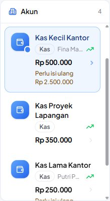 |
| 4 | Penanggung jawab yang tidak muat di daftar dipotong, Tooltip menampilkan “Penanggung jawab: Fina Manajer QA”. | 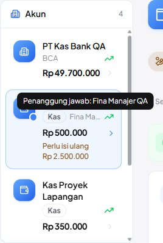 |
| 5 | Header Kas Lama Kantor: nama, “Kas tunai · Penanggung jawab: Putri Pemasukan QA”, plafon & perlu isi ulang utuh; tombol aksi di baris bawah. | 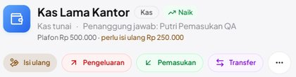 |

## N12 · Ponsel 390 px: ubin ringkasan & kartu akun tidak memotong angka/nama — Pass (percobaan ke-2)

| # | Langkah & yang terlihat | Layar |
|---|---|---|
| 1 | **6 Nov (sebelum perbaikan)** — 390 px: ubin Total Saldo/Pemasukan/Pengeluaran memotong angka. |  |
| 2 | **9 Nov** — Total Saldo selebar baris, lalu Total Bank & Total Kas serta Pemasukan & Pengeluaran berdampingan: semua angka utuh; kartu Kas Lama Kantor & header utuh. | 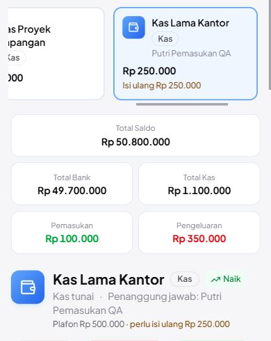 |

## A09 · Hanya-lihat: Tambah Akun, Edit, Hapus tidak ditawarkan; request langsung tetap 403 — Pass (percobaan ke-2)

| # | Langkah & yang terlihat | Layar |
|---|---|---|
| 1 | **6 Nov (sebelum perbaikan)** — pengguna hanya-lihat masih melihat Tambah Akun. |  |
| 2 | **9 Nov** — Putri (view bank-accounts saja): header hanya Tutorial; akun hanya punya menu •••. | 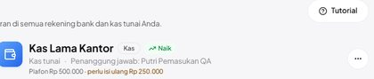 |
| 3 | Menu ••• hanya berisi **Export PDF** — Edit dan Hapus tidak ditawarkan. | 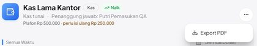 |
| 4 | Daftar akun berakhir di Kas Lama Kantor, tanpa kartu Tambah Akun. | 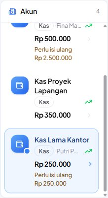 |
| 5 | Ponsel 390 px: header hanya Tutorial, deret kartu tanpa kartu Tambah, aksi akun hanya •••. | 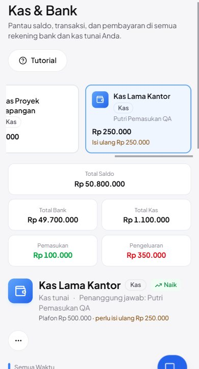 |

## C05 · Isi ulang dengan biaya admin Rp 6.500: transfer bukan pemasukan/pengeluaran, biaya admin tetap beban — Pass (percobaan ke-2)

| # | Langkah & yang terlihat | Layar |
|---|---|---|
| 1 | **6 Nov (sebelum perbaikan)** — setelah isi ulang 2.500.000: Pemasukan 3.000.000 dan Pengeluaran 2.550.000 sama-sama memuat transfer. |  |
| 2 | **9 Nov** — Ringkasan sebelum isi ulang: Pemasukan 1–9 Nov Rp 100.000, Pengeluaran Rp 350.000. |  |
| 3 | Dialog Isi ulang Kas Kecil Kantor: sumber BCA, kategori Antar Rekening Sendiri, jumlah 2.500.000, **Biaya Admin 6.500** (Total Debit 2.506.500). | 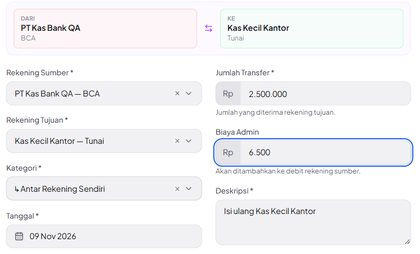 |
| 4 | Ringkasan sesudah: Pemasukan tetap **Rp 100.000**, Pengeluaran **Rp 356.500** (+6.500), Total saldo Rp 50.793.500. | 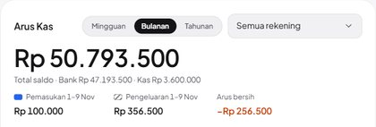 |
| 5 | Donat Pengeluaran (1920 px agar label terbaca, K-07): OPERASIONAL 98% + **Biaya admin transfer** 2%; tidak ada Antar Rekening Sendiri. | 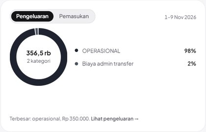 |
| 6 | Donat Pemasukan: hanya Kembali Dana 100% — transfer masuk tidak dihitung. |  |
| 7 | Grafik difilter Tunai · Kas Kecil Kantor: Nov masuk 2,5 jt (transfer tetap terhitung untuk satu rekening); angka kartu tetap 100.000 / 356.500. |  |
| 8 | Ringkasan Total Kas & Bank (semua akun, semua waktu): Pemasukan Rp 100.000, Pengeluaran Rp 356.500, Arus Bersih −Rp 256.500. |  |
| 9 | Statistik akun Kas Kecil Kantor (satu akun): Pemasukan Rp 2.500.000 — isi ulang memang uang masuk kas ini. |  |

<!-- qa-evidence:end -->
