# QA — Jurnal tampilan (Cara A): debit/kredit dari rekening & kategori

_QA 9 NOVEMBER 2026 · ARUS KAS · KAS & BANK · INVOICE · JURNAL — 9 November 2026_

Eksekusi 16 test case di test-cases/jurnal.md untuk kotak Jurnal (Cara A): pratinjau langsung di Catat Pemasukan/Pengeluaran, Transfer, dan Catat pembayaran invoice; jurnal tersimpan di rincian/ubah Arus Kas dan rincian hanya-lihat Kas & Bank; setiap aturan (pemasukan, pengeluaran, pendanaan template & buatan pengguna, pokok utang/piutang dengan nama pihak dan cadangannya, transfer + biaya admin, penyesuaian, pembayaran invoice titipan dulu); pratinjau = jurnal tersimpan; baris pokok utang hanya-lihat yang kini bisa dibuka sementara PUT/DELETE tetap 403; pengguna tanpa izin ubah; ponsel 390 px; pembayaran mundur tanggal; invarian Laba Rugi. Aktor: Finance manager (Rina), pengguna hanya-lihat (Lina).

Dokumen sumber: [`test-cases/jurnal.md`](../test-cases/jurnal.md) (tabel + bukti per langkah), [`manifests/jurnal.json`](../manifests/jurnal.json), PDF: [`Laporan-QA-jurnal.pdf`](Laporan-QA-jurnal.pdf). Lingkungan & akun: [`README.md`](../README.md).

## Skor (dihitung dari tabel test case dan manifest)

```
 16  test case dijalankan (dari 16; belum diuji/blocked: 0)
 16  akhirnya lolos   (status tabel: Pass 16)
  0  gagal di percobaan pertama karena aplikasi
  2  percobaan pertama batal karena skrip uji (N07, N09 — bukan cacat aplikasi)
  0  bug aplikasi diperbaiki
 16/16 case ber-lapisan FE/FE+BE punya bukti layar (gerbang check_evidence.py: LULUS)
```

Komposisi: A=5, C=2, N=9 (N normal, A tidak normal, C berantai); lapisan FE=4, FE+BE=12.

## Ringkasan

Seluruh 16 test case lolos; tidak ada cacat aplikasi yang ditemukan. Dua case (N07, N09) lolos di percobaan ke-2 karena percobaan pertama digagalkan skrip uji (lokator), bukan aplikasi — dicatat di Kendala alat uji.

Untuk setiap aturan, jurnal pratinjau di formulir sama persis dengan jurnal tersimpan yang dikirim server (dibandingkan baris per baris dari DOM): pengeluaran Listrik, setoran modal ke Mandiri (Modal Pemilik), prive dari kas (Prive Pemilik / Kas Kecil), transfer BCA → Mandiri (Debit tujuan 5.000.000 + Biaya Admin Transfer 2.500 / Kredit asal 5.002.500), dan pembayaran invoice (PPN saja, titipan + PPN, mundur tanggal). Debit = kredit di semua 22 transaksi dan 6 pembayaran.

Pembayaran invoice dipecah 'titipan dulu', bukan proporsional: DP 300.000 seluruhnya Titipan Pajak Klien; 4.000.000 = Titipan 200.000 + PPN Keluaran 1.100.000 + Pendapatan 2.700.000; pelunasan 7.300.000 seluruhnya pendapatan. Laba Rugi November (pendapatan invoice Rp 17.950.000, PPN Keluaran diterima Rp 1.650.000) sama persis dengan jumlah kredit jurnal pembayaran November, dicocokkan di DB.

Baris pokok utang kini membuka rincian hanya-lihat dengan jurnal 'Utang Pinjaman – Bank BRI' (nama dari data utangnya); PUT/DELETE lewat Arus Kas tetap 403 dan DB tidak berubah. Nama debitur piutang karyawan (database pusat) tampil, dan utang yatim jatuh ke 'Utang Pinjaman' tanpa nama. Pengguna tanpa izin ubah kini mendapat rincian hanya-lihat dengan jurnal (dulu formulir ubah tanpa tombol simpan). Di 390 px kotak Jurnal tidak meluap.

## Bug yang ditemukan & diperbaiki

Tidak ada. Tidak ada case yang gagal karena cacat aplikasi, sehingga tidak ada perbaikan kode dalam putaran QA ini. Temuan di luar kegagalan case ada di **Catatan tambahan**.

## Hasil per test case

Percobaan: 🟩 lolos · 🟥 gagal karena bug aplikasi · ⬜ terganggu kendala alat uji (bukan bug).

| ID | Skenario | Lapisan | Percobaan | Catatan | Status |
|---|---|---|---|---|---|
| **A. KONDISI NORMAL** | | | | | |
| N01 | Catat Pengeluaran: pratinjau langsung, lalu jurnal tersimpan = pratinjau | FE+BE | 🟩 | Perbandingan baris DOM pratinjau vs tersimpan: sama. DB transaksi #18 debit 1.250.000 Listrik/BCA; JournalService sama. | Pass |
| N02 | Pemasukan pendanaan template → akun neraca Modal Pemilik | FE+BE | 🟩 | DB #19 credit 7.500.000 kategori Setoran Modal Pemilik (financing). | Pass |
| N03 | Pendanaan keluar dari kas + akun Setor PPN & Setor Titipan Pajak Klien | FE+BE | 🟩 | DB #20 debit 400.000 kategori Prive Pemilik di Kas Kecil. | Pass |
| N04 | Pendanaan buatan pengguna memakai labelnya sendiri | FE | 🟩 |  | Pass |
| N05 | Transfer: pratinjau Debit tujuan + biaya admin / Kredit asal; Detail Transfer = pratinjau | FE+BE | 🟩 | Placeholder sebelum rekening dipilih: "Pilih rekening sumber dan tujuan untuk melihat jurnalnya." DB #21 debit 5.002.500 + #22 credit 5.000.000. | Pass |
| N06 | Pembayaran invoice PPN saja: PPN dulu, sisanya pendapatan | FE+BE | 🟩 |  | Pass |
| N07 | Invoice titipan + PPN: tiga pembayaran mengikuti titipan dulu | FE+BE | ⬜🟩 | Percobaan 1: langkah 2 memotret pembayaran 7.300.000 karena lokator skrip mencocokkan teks "300.000" di dalam "7.300.000" (alat uji). Percobaan 2 hanya membuka ulang ketiga pembayaran dengan pencocokan nominal persis; pembayaran disimpan sekali (percobaan 1). | Pass |
| N08 | Ubah: jurnal tersimpan → Pratinjau saat jumlah/kategori diubah; Batal tidak menyimpan | FE+BE | 🟩 | DB: transaksi #4 tetap 8.500.000 Gaji Karyawan, updated_at tidak berubah. | Pass |
| N09 | Kas & Bank: rincian hanya-lihat + jurnal (penyesuaian, kaki transfer, pembayaran) | FE | ⬜🟩 | Percobaan 1 berhenti di langkah 4: Playwright tidak bisa mengurai lokator regex skrip yang berisi '/' (nomor invoice). Diganti teks biasa, percobaan 2 lolos seluruhnya. | Pass |
| **B. KONDISI TIDAK NORMAL / EDGE CASE** | | | | | |
| A01 | Pokok utang: baris hanya-lihat kini bisa dibuka (rincian + jurnal), server tetap menolak ubah/hapus | FE+BE | 🟩 | PUT #12, DELETE #12, PUT #13 → 403 'Transaksi ini pokok utang yang dicatat otomatis oleh modul Utang, jadi tidak bisa diubah atau dihapus dari sini. Kelola lewat menu Utang.'; DB tidak berubah. | Pass |
| A02 | Nama debitur piutang (karyawan di database pusat) + cadangan tanpa nama untuk utang yatim | FE+BE | 🟩 | Utang yatim dibuat sebagai fixture lewat tinker (tidak bisa dibuat dari layar), lalu dihapus; pemeriksaan akhir DB tidak menemukan LOAN-99999. | Pass |
| A03 | Pengguna tanpa izin ubah melihat jurnal tanpa kontrol ubah; PUT ditolak | FE+BE | 🟩 | PUT /bank-transactions/4 dari sesi Lina → 403 'This action is unauthorized.' | Pass |
| A04 | Ponsel 390 px: kotak Jurnal terbaca tanpa geser samping | FE | 🟩 | Ukur: overflow halaman 0, kotak 340 px, overflow tabel 0 (dialog Catat & rincian pembayaran). | Pass |
| A05 | Pembayaran mundur tanggal: urutan menurut tanggal bayar, jurnal pembayaran lain ikut bergeser | FE+BE | 🟩 |  | Pass |
| **C. ALUR BERANTAI** | | | | | |
| C01 | Invarian: Σ kredit jurnal pembayaran November = angka Laba Rugi November | FE+BE | 🟩 | DB: revenue.invoice 17.950.000 = Σ kredit Pendapatan dari Invoice 17.950.000; ppn_output 1.650.000 = Σ kredit PPN Keluaran 1.650.000; semua jurnal seimbang. | Pass |
| C02 | PPN Keluaran saling menutup: dikredit pembayaran invoice, didebit Setor PPN | FE | 🟩 |  | Pass |

## Bukti visual langkah per langkah

Setiap case ber-lapisan FE/FE+BE direkam per langkah. Case BE tidak diberi gambar karena kondisinya tidak bisa dicapai dari layar; alasannya tertulis di kolom Hasil Aktual tabel test case.

### N01 · Catat Pengeluaran: pratinjau langsung, lalu jurnal tersimpan = pratinjau — Pass

| # | Langkah & yang terlihat | Layar |
|---|---|---|
| 1 | **Catat Pengeluaran**, rekening BCA dipilih, kategori belum: kotak **Jurnal · Pratinjau** berisi "Pilih kategori untuk melihat jurnalnya." | 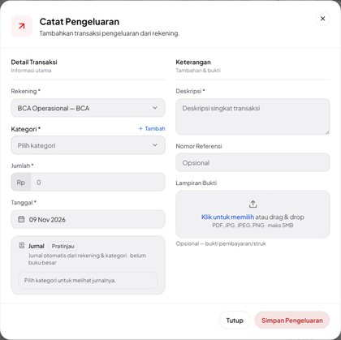 |
| 2 | Kategori **↳ Listrik** tanpa jumlah: akun sudah tampil (Debit Listrik, Kredit BCA Operasional — BCA) dengan nominal "—". | 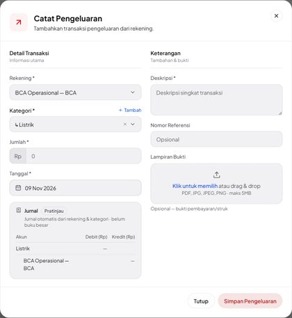 |
| 3 | Jumlah 1.250.000: **Debit Listrik 1.250.000 / Kredit BCA Operasional — BCA 1.250.000**, baris Jumlah seimbang. | 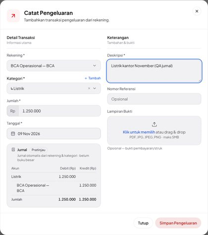 |
| 4 | Setelah disimpan, baris dibuka: **Edit Pengeluaran** menampilkan jurnal tersimpan dari server — sama persis, tanpa penanda Pratinjau. | 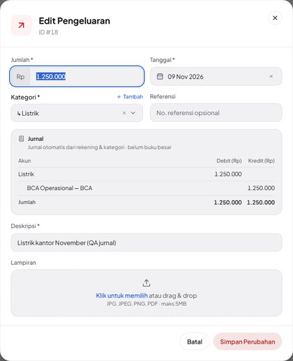 |

### N02 · Pemasukan pendanaan template → akun neraca Modal Pemilik — Pass

| # | Langkah & yang terlihat | Layar |
|---|---|---|
| 1 | **↳ Setoran Modal Pemilik** ke Mandiri Cadangan 7.500.000: Debit **Mandiri Cadangan — Mandiri** / Kredit **Modal Pemilik** (akun neraca, bukan label kategori). | 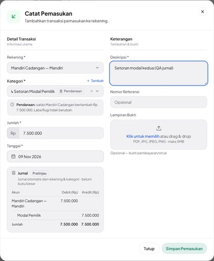 |
| 2 | Baris tersimpan dibuka: jurnal yang sama, kini tanpa penanda Pratinjau. | 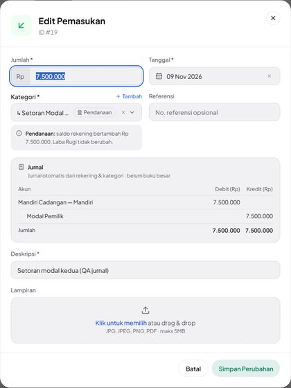 |

### N03 · Pendanaan keluar dari kas + akun Setor PPN & Setor Titipan Pajak Klien — Pass

| # | Langkah & yang terlihat | Layar |
|---|---|---|
| 1 | **↳ Prive Pemilik** dari **Kas Kecil** 400.000: Debit Prive Pemilik / Kredit **Kas Kecil** (kas ditulis dengan namanya saja). | 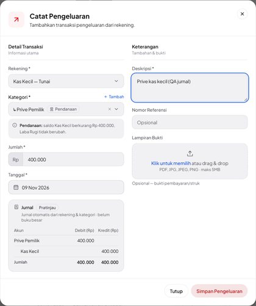 |
| 2 | Tersimpan: jurnal sama dengan pratinjau. | 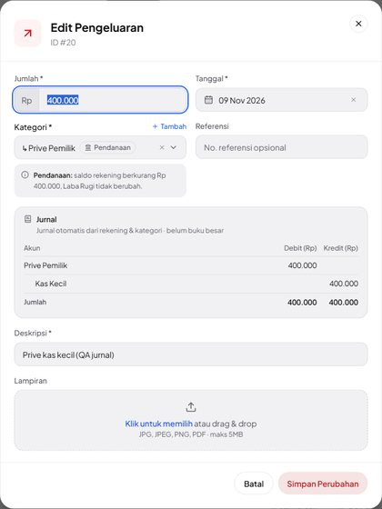 |
| 3 | Baris **Setor PPN masa Oktober**: Debit **PPN Keluaran** 1.100.000 / Kredit BCA. | 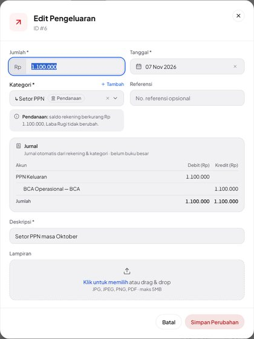 |
| 4 | Baris **Setor PPh 21 titipan PT Maju Jaya**: Debit **Titipan Pajak Klien** 500.000 / Kredit BCA. | 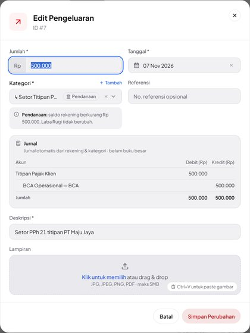 |

### N04 · Pendanaan buatan pengguna memakai labelnya sendiri — Pass

| # | Langkah & yang terlihat | Layar |
|---|---|---|
| 1 | Pratinjau (tidak disimpan) **↳ Pinjaman dari Direksi** — sub pendanaan buatan pengguna: Kredit **Pinjaman dari Direksi**. | 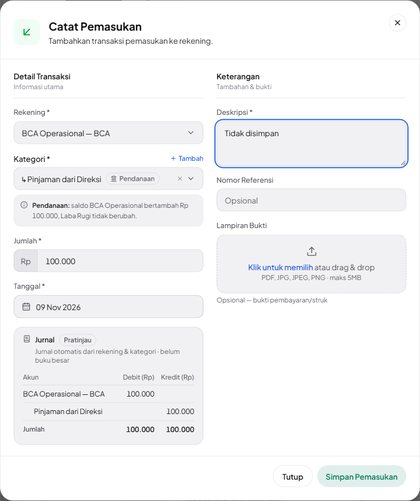 |
| 2 | Baris tersimpan "Pinjaman sementara dari direksi": Debit Mandiri Cadangan — Mandiri / Kredit Pinjaman dari Direksi 3.000.000. | 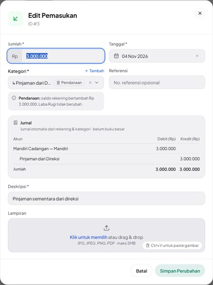 |

### N05 · Transfer: pratinjau Debit tujuan + biaya admin / Kredit asal; Detail Transfer = pratinjau — Pass

| # | Langkah & yang terlihat | Layar |
|---|---|---|
| 1 | **Transfer Antar Rekening** BCA → Mandiri 5.000.000, biaya admin 2.500: Debit **Mandiri Cadangan — Mandiri 5.000.000** + Debit **Biaya Admin Transfer 2.500** / Kredit **BCA 5.002.500**. | 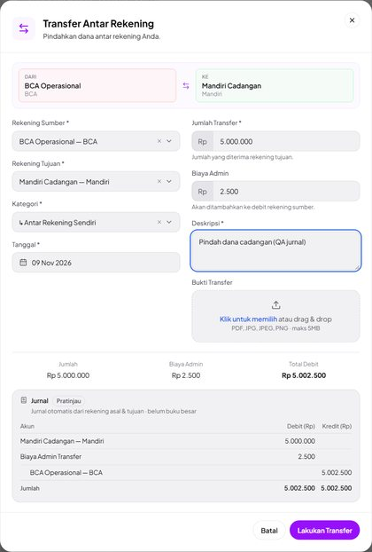 |
| 2 | **Detail Transfer** baris baru: jurnal tersimpan sama dengan pratinjau. | 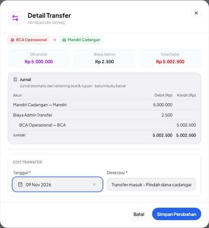 |

### N06 · Pembayaran invoice PPN saja: PPN dulu, sisanya pendapatan — Pass

| # | Langkah & yang terlihat | Layar |
|---|---|---|
| 1 | **Catat pembayaran** INV-3 2.000.000 ke BCA: Kredit **PPN Keluaran 550.000** + **Pendapatan dari Invoice 1.450.000**. | 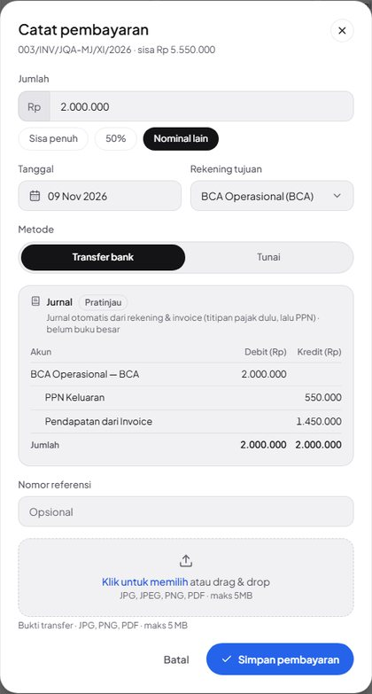 |
| 2 | Arus Kas › Pemasukan → **Detail Pembayaran Invoice**: jurnal tersimpan sama. |  |

### N07 · Invoice titipan + PPN: tiga pembayaran mengikuti titipan dulu — Pass (percobaan ke-2)

| # | Langkah & yang terlihat | Layar |
|---|---|---|
| 1 | INV-1 **Sisa penuh** 7.300.000 (titipan & PPN sudah tertutup oleh dua pembayaran sebelumnya): Kredit **Pendapatan dari Invoice 7.300.000**. | 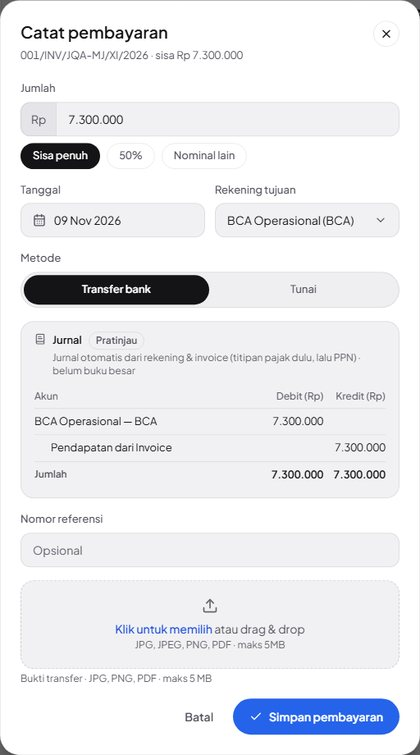 |
| 2 | DP 300.000 (3 Nov), lebih kecil dari titipan 500.000: seluruhnya Kredit **Titipan Pajak Klien 300.000**. | 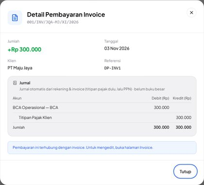 |
| 3 | Pembayaran 4.000.000 (5 Nov) melewati semua batas: **Titipan 200.000 + PPN Keluaran 1.100.000 + Pendapatan dari Invoice 2.700.000**. |  |
| 4 | Pelunasan 7.300.000 tersimpan: sama dengan pratinjau langkah 1. | 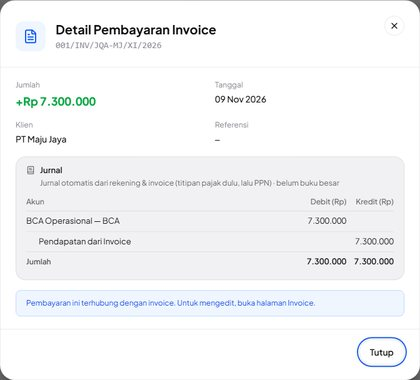 |

### N08 · Ubah: jurnal tersimpan → Pratinjau saat jumlah/kategori diubah; Batal tidak menyimpan — Pass

| # | Langkah & yang terlihat | Layar |
|---|---|---|
| 1 | **Edit Pengeluaran** "Gaji karyawan Oktober": jurnal tersimpan Debit Gaji Karyawan 8.500.000 / Kredit BCA, tanpa penanda Pratinjau. | 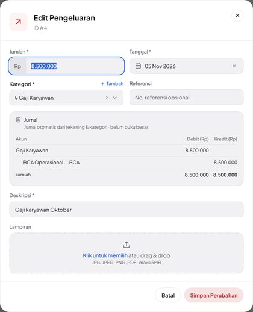 |
| 2 | Jumlah diubah 8.750.000: kotak berganti **Pratinjau** dengan nominal baru. | 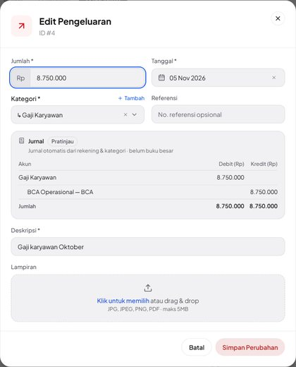 |
| 3 | Kategori diganti **↳ Tunjangan & Lembur**: akun debit ikut berganti (rekening tetap). | 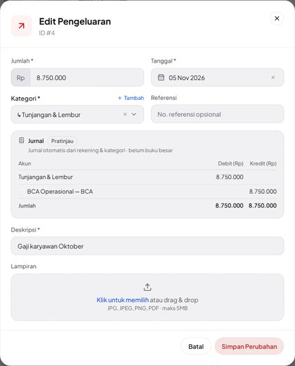 |
| 4 | Setelah **Batal** dan dibuka ulang: kembali 8.500.000 Gaji Karyawan, tanpa Pratinjau (tidak tersimpan). |  |

### N09 · Kas & Bank: rincian hanya-lihat + jurnal (penyesuaian, kaki transfer, pembayaran) — Pass (percobaan ke-2)

| # | Langkah & yang terlihat | Layar |
|---|---|---|
| 1 | **Kas & Bank › Kas Kecil**, tab Transaksi: deskripsi tiap baris kini tombol menuju rincian. | 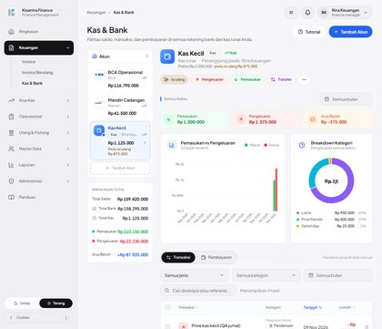 |
| 2 | "Selisih hitung kas" (kategori **penyesuaian**): **Rincian Pengeluaran** hanya-lihat, Debit **Selisih Kas** / Kredit **Kas Kecil** 25.000 — satu-satunya tempat jurnal penyesuaian terlihat. | 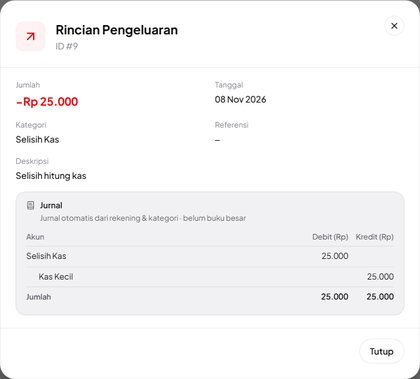 |
| 3 | Kaki masuk transfer isi ulang: jurnal transfer lengkap (Debit Kas Kecil 1.000.000 + Biaya Admin Transfer 2.500 / Kredit BCA 1.002.500). | 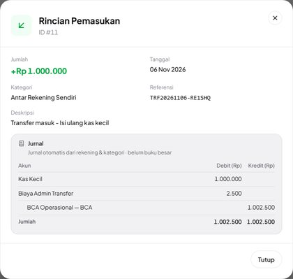 |
| 4 | BCA Operasional › tab **Pembayaran** → nomor invoice: **Detail Pembayaran Invoice** dengan jurnal titipan dulu. | 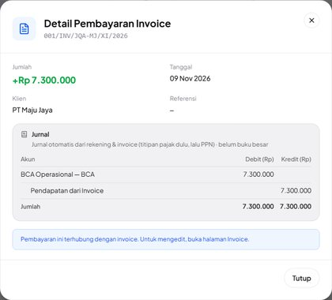 |

### A01 · Pokok utang: baris hanya-lihat kini bisa dibuka (rincian + jurnal), server tetap menolak ubah/hapus — Pass

| # | Langkah & yang terlihat | Layar |
|---|---|---|
| 1 | Pemasukan: baris "Penerimaan pinjaman dari Bank BRI" bergembok, "Hanya-lihat · kelola di Utang". | 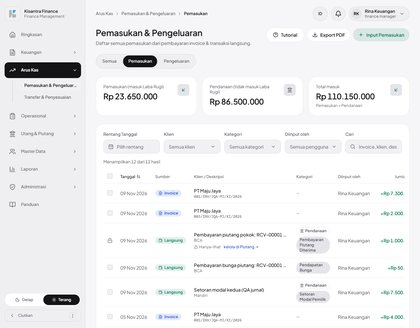 |
| 2 | Diklik: **Rincian Pemasukan** tanpa isian & tanpa Simpan, catatan kelola di Utang, jurnal Kredit **Utang Pinjaman – Bank BRI** 50.000.000. | 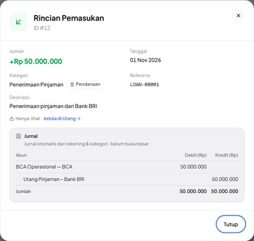 |
| 3 | Pembayaran pokok (Pengeluaran): Debit **Utang Pinjaman – Bank BRI** 2.000.000 / Kredit BCA. | 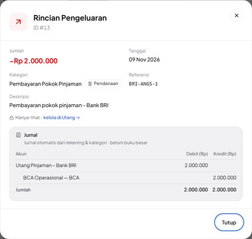 |

### A02 · Nama debitur piutang (karyawan di database pusat) + cadangan tanpa nama untuk utang yatim — Pass

| # | Langkah & yang terlihat | Layar |
|---|---|---|
| 1 | Pencairan piutang RCV-00001: Debit **Piutang – Budi Kasir** (nama debitur karyawan dari database pusat). | 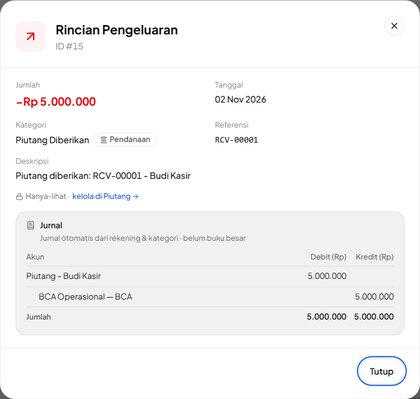 |
| 2 | Cicilan pokok piutang: Kredit **Piutang – Budi Kasir**. | 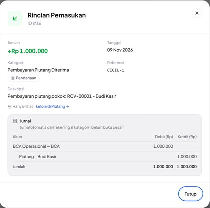 |
| 3 | Fixture utang yatim (LOAN-99999 tidak ada): tidak dikunci (dialog ubah biasa) dan jurnalnya jatuh ke **Utang Pinjaman** tanpa nama. | 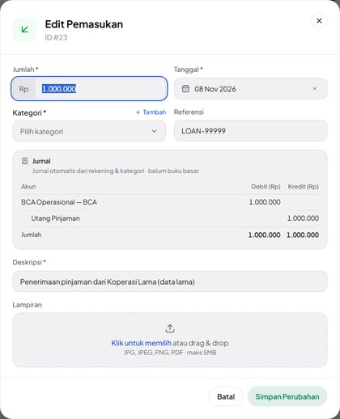 |

### A03 · Pengguna tanpa izin ubah melihat jurnal tanpa kontrol ubah; PUT ditolak — Pass

| # | Langkah & yang terlihat | Layar |
|---|---|---|
| 1 | Lina: "Gaji karyawan Oktober" terbuka sebagai **Rincian Pengeluaran** hanya-lihat (0 isian, 0 Simpan) dengan jurnalnya. | 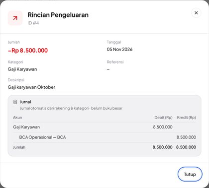 |
| 2 | **Detail Transfer** tanpa bagian Edit Transfer (Lina tidak punya `edit transfer`), jurnal tetap tampil. | 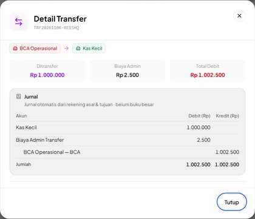 |

### A04 · Ponsel 390 px: kotak Jurnal terbaca tanpa geser samping — Pass

| # | Langkah & yang terlihat | Layar |
|---|---|---|
| 1 | Ponsel 390 px, **Catat Pengeluaran** dengan label terpanjang "Jasa Profesional (Notaris, Konsultan)" 12.500.000: nama akun turun baris, nominal utuh. | 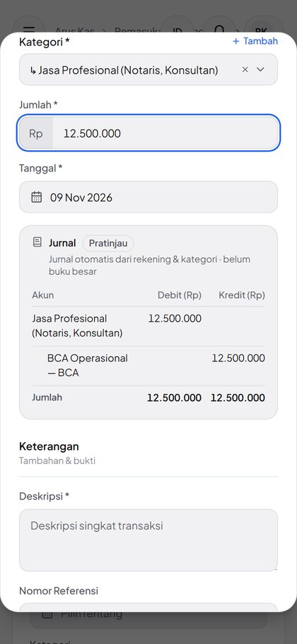 |
| 2 | Rincian pembayaran 4 baris jurnal di 390 px: tidak meluap. | 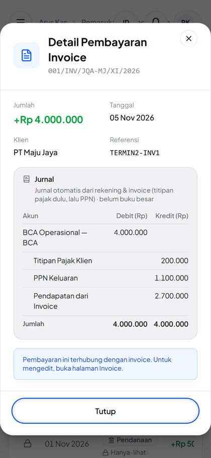 |

### A05 · Pembayaran mundur tanggal: urutan menurut tanggal bayar, jurnal pembayaran lain ikut bergeser — Pass

| # | Langkah & yang terlihat | Layar |
|---|---|---|
| 1 | INV-3, pembayaran baru 500.000 bertanggal **05 Nov** (sebelum pembayaran 9 Nov): pratinjau Kredit **PPN Keluaran 500.000**. | 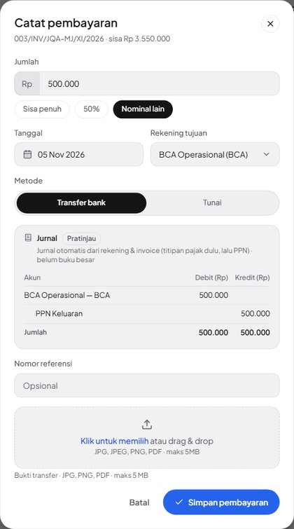 |
| 2 | Tersimpan: sama dengan pratinjau. | 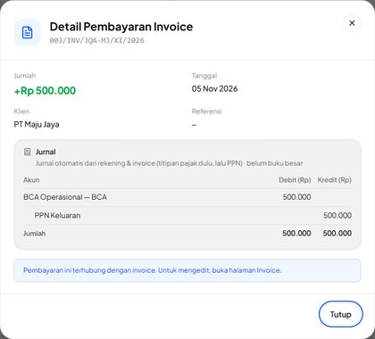 |
| 3 | Pembayaran 9 Nov 2.000.000 kini PPN Keluaran 50.000 + Pendapatan dari Invoice 1.950.000 (sebelumnya 550.000 + 1.450.000) — titipan dulu mengikuti tanggal bayar. | 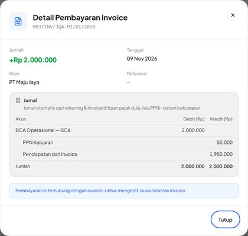 |

### C01 · Invarian: Σ kredit jurnal pembayaran November = angka Laba Rugi November — Pass

| # | Langkah & yang terlihat | Layar |
|---|---|---|
| 1 | Laporan › Laba Rugi 1–30 Nov 2026: Pendapatan dari Invoice (kas) Rp 17.950.000. | 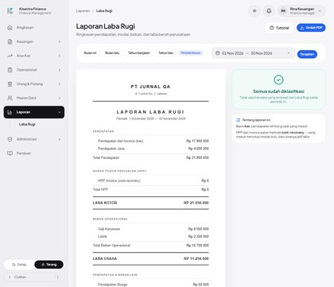 |
| 2 | Catatan **PPN Keluaran diterima Rp 1.650.000** — sama dengan Σ kredit PPN Keluaran jurnal pembayaran November. | 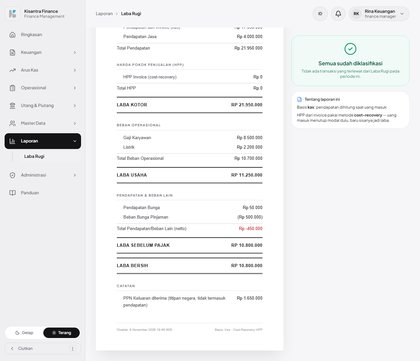 |

### C02 · PPN Keluaran saling menutup: dikredit pembayaran invoice, didebit Setor PPN — Pass

| # | Langkah & yang terlihat | Layar |
|---|---|---|
| 1 | Pembayaran 4.000.000 INV-1: Kredit **PPN Keluaran 1.100.000**. | 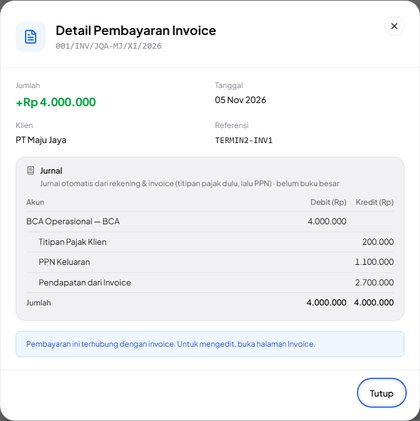 |
| 2 | Setor PPN masa Oktober: Debit **PPN Keluaran 1.100.000** — nama akun sama persis. | 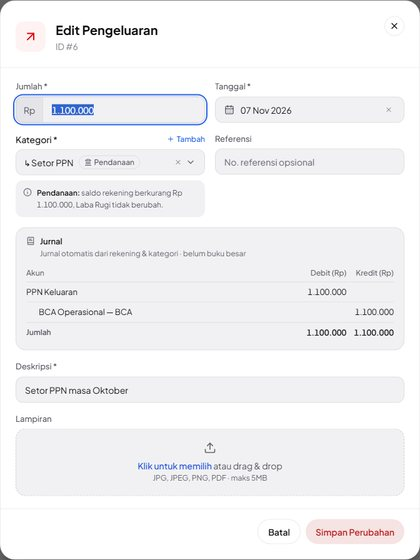 |

## Catatan tambahan

Ditemukan di luar kegagalan test case; tidak diperbaiki karena butuh keputusan produk/desain atau berada di luar perubahan rilis ini.

**K-J1 — Jurnal pembayaran tersimpan bisa berubah bila pembayaran mundur tanggal dicatat belakangan.** Sengaja (A05): bagian satu pembayaran = alokasi kumulatif sesudah − sebelum menurut (tanggal bayar, id), sama dengan Laba Rugi per periode. Jumlah per invoice dan per periode tidak berubah; yang bergeser hanya pembagian antar pembayaran. Didokumentasikan di cash-flow.md.

**K-J2 — Dialog Catat Pemasukan/Pengeluaran kini lebih tinggi dari layar 720 px.** Kotak Jurnal di bawah Tanggal menambah ±240 px; di layar setinggi 720 px tombol Simpan berada di bawah dan isi dialog perlu digulir (dialog memang bergulir). Di 1280×800 ke atas tombolnya terlihat. Tidak diubah; dicatat untuk pemilik.

**K-J3 — Kategori Penyesuaian ditawarkan pemilih Catat (pratinjau jurnalnya tampil) tetapi server menolak simpan.** Perilaku lama di luar lingkup (sama dengan K-P3 QA Pendanaan). Jurnal penyesuaian yang sudah ada terlihat di rincian Kas & Bank (N09).

**K-J4 — Biaya admin transfer tampil sebagai akun 'Biaya Admin Transfer' tetapi tidak masuk Laba Rugi.** Jurnal hanya menampilkan apa yang terjadi pada kas; biaya admin berkategori transfer tetap di luar Laba Rugi seperti sebelumnya (lihat dashboard.md › Transfer antar akun sendiri).

## Kendala alat uji

Tidak satu pun dihitung sebagai kegagalan test case:

- N07 percobaan 1: lokator skrip `has_text='300.000'` juga cocok dengan baris 7.300.000, sehingga langkah 2 memotret pembayaran yang salah. Bukan cacat aplikasi; diganti regex `\+Rp 300\.000` dan langkah lihat diulang tanpa menyimpan lagi.
- N09 percobaan 1: `get_by_role(name=re.compile('001/INV/...'))` gagal diurai Playwright (garis miring di regex). Diganti teks biasa; seluruh case diulang.
- Di luar case (pengambilan screenshot PR): `context.route_web_socket()` untuk memutus HMR Vite membuat `page.goto()` menggantung di Playwright 1.58 sinkron; dihapus, dan berkas tidak diubah selama pengambilan gambar. Placeholder baru 'Pilih kategori untuk melihat jurnalnya.' membuat lokator `get_by_text('Pilih kategori')` ambigu; diganti `exact=True` (berlaku sama untuk mode sebelum & sesudah).

## Yang diverifikasi dengan eksekusi vs dengan membaca kode

- **Eksekusi** (layar + request langsung + query DB): seluruh 16 case. Angka jurnal di layar dibaca dari DOM kotak Jurnal; jurnal tersimpan dicocokkan dengan `JournalService` di DB; invarian Laba Rugi (C01) dihitung dengan `ProfitLossService` dan Σ kredit jurnal pembayaran; penolakan server dicek lewat request dari sesi yang sama.
- **Tes otomatis** (`tests/Feature/JurnalTest.php`, 25 tes): aturan yang tidak dijalankan lewat layar — nama debitur klien (polimorfik), kaki transfer tanpa pasangan, pembayaran bertanggal sama (urut id), jumlah query per halaman konstan, normalisasi nama sub pendanaan, bunga utang/piutang sebagai beban/pendapatan biasa.
- **Membaca kode saja**: format deskripsi/referensi transaksi utang & piutang yang dipakai fixture QA (sama dengan `LoanController`/`ReceivableController`).
- **Tidak diuji lewat layar**: dialog ubah pembayaran invoice yang sudah ada (memakai pratinjau yang sama dengan Catat pembayaran), mode gelap, dan layar modul Utang/Piutang/Reimbursement/Permintaan Dana (di luar lingkup).

## Catatan kejujuran

Kode fitur, test otomatis, dan QA ini dikerjakan oleh asisten yang sama, sehingga QA mewarisi titik buta penulisnya. Aturan jurnal sendiri (akun mana di sisi mana) adalah keputusan pemilik di brief; yang diuji di sini adalah bahwa aplikasi menerapkannya secara konsisten, bukan kebenaran akuntansinya. Spot-check yang disarankan untuk manusia: (1) baca kotak Jurnal untuk beberapa transaksi nyata di perusahaan Anda (terutama pendanaan buatan sendiri dan pembayaran invoice bertitipan) dan pastikan istilah akunnya sesuai kebiasaan akuntan Anda; (2) catat satu pembayaran mundur tanggal dan pastikan pergeseran jurnal pembayaran lain (K-J1) bisa diterima. Data utang & piutang di lingkungan QA diisi langsung ke DB dengan format deskripsi/referensi persis seperti controller-nya (diverifikasi dengan membaca kode), bukan lewat layar Utang/Piutang yang di luar lingkup; JurnalTest juga memakai format itu, jadi bila format deskripsi di LoanController/ReceivableController berubah, resolusi nama FIN-LOAN-OUT/FIN-RCV-IN jatuh ke cadangan tanpa nama (tidak salah, tetapi kurang informatif). Angka di kolom Hasil Aktual dibaca dari DOM dan DB oleh skrip, bukan dibaca manusia dari gambar.

_Lingkungan uji: database jrn_central + jrn_central_tenant_jurnalqa (dibuat khusus, di-drop setelah QA), php artisan serve --env=jrn di http://127.0.0.1:8147 (APP_ENV=jrn, sesi & cache database, antrean sync, mail log), MySQL 8.0.45, aset dari Vite dev server pengguna ([::1]:5173, tidak diubah), Chromium headless lewat Python Playwright 1.58 viewport 1280x1000-1400 DPR 1 (A04: 390x844 DPR 2, sentuh), kode cabang fitur/jurnal b6cfdcd + 6afad9d (+ f234992 panduan), belum di-push._
