# Test Case — Jurnal tampilan (Cara A): debit/kredit dari rekening & kategori

Sumber teknis: [`docs/module/cash-flow.md`](../../../module/cash-flow.md) (bagian *Jurnal tampilan (Cara A)*),
[`docs/module/profit-loss.md`](../../../module/profit-loss.md) (rumus "titipan dulu" bersama),
[`docs/module/bank-accounts.md`](../../../module/bank-accounts.md), [`docs/module/invoices.md`](../../../module/invoices.md),
[`docs/module/transaction-categories.md`](../../../module/transaction-categories.md) (akun jurnal sub pendanaan).
Cara baca tabel & kolom **Lapisan**: [`docs/qa/README.md`](../../README.md). Lingkungan, akun, dan data: [`README.md`](../README.md).

**Prasyarat**: lingkungan terisolasi `jrn_*` (bukan production). Perusahaan `/c/jurnalqa` ("PT Jurnal QA", PKP 11 %)
berisi data contoh November 2026: rekening **BCA Operasional** (bank), **Mandiri Cadangan** (bank), **Kas Kecil** (kas);
invoice INV-1 `001/INV/JQA-MJ/XI/2026` (jasa 10.000.000 + titipan PPh 21 500.000 + PPN 1.100.000 = 11.600.000, dibayar
DP 300.000 tgl 3 Nov + 4.000.000 tgl 5 Nov), INV-2 `002/…` (6.000.000 tanpa PPN, lunas), INV-3 `003/…` (5.000.000 + PPN
550.000, belum dibayar); 17 transaksi bank (setoran modal, pemasukan jasa, pinjaman dari direksi (pendanaan buatan
pengguna), gaji, prive, setor PPN, setor titipan, listrik, selisih kas (penyesuaian), transfer BCA → Kas Kecil
1.000.000 + biaya admin 2.500, utang Bank BRI LOAN-00001 (pencairan 50.000.000, pokok 2.000.000, bunga 500.000), piutang
karyawan RCV-00001 Budi Kasir (cair 5.000.000, cicilan pokok 1.000.000, bunga 50.000)). Utang & piutang diisi dengan
format deskripsi/referensi persis seperti `LoanController`/`ReceivableController`. Akun: Rina Keuangan (finance
manager), Lina Hanya Lihat (peran uji "lihat arus kas": `view dashboard/income/expense/transfer/categories/bank-accounts`,
tanpa izin ubah). Viewport 1280×(1000–1400) DPR 1 (dialog difoto per elemen); A04: 390×844 DPR 2, sentuh. Nominal rupiah
penuh. Setiap angka jurnal di kolom Hasil Aktual dibaca dari DOM kotak Jurnal (bukan ditebak dari gambar); pemeriksaan DB
memakai skrip baca-saja di luar repo yang menolak berjalan di luar `jrn_central` dan memanggil `JournalService` +
`ProfitLossService` langsung (keluaran mencatat database `jrn_central_tenant_jurnalqa`).

Kondisi awal (DB, sebelum N01): 17 transaksi + 3 pembayaran, **semua jurnal seimbang**; Laba Rugi November:
pendapatan invoice **8.700.000**, PPN Keluaran diterima **1.100.000**; Σ kredit "Pendapatan dari Invoice" jurnal
pembayaran November **8.700.000**, Σ kredit "PPN Keluaran" **1.100.000** (sudah sama sebelum QA).

## A. Kondisi Normal

| ID | Skenario | Langkah | Hasil Diharapkan | Lapisan | Hasil Aktual | Status |
|---|---|---|---|---|---|---|
| N01 | Catat Pengeluaran: pratinjau langsung, lalu jurnal tersimpan = pratinjau | FM → Arus Kas › Pengeluaran → **Input Pengeluaran** → Rekening BCA Operasional → (kategori belum dipilih) → Kategori **↳ Listrik** → Jumlah 1.250.000 + Deskripsi → **Simpan Pengeluaran** → Esc → klik baris baru | Sebelum kategori: placeholder "Pilih kategori untuk melihat jurnalnya."; kategori tanpa jumlah: akun tampil dengan "—"; dengan jumlah: **Debit Listrik 1.250.000 / Kredit BCA Operasional — BCA 1.250.000**, berpenanda Pratinjau, baris Jumlah seimbang; setelah disimpan dialog ubah menampilkan jurnal yang sama tanpa penanda Pratinjau; DB: transaksi debit 1.250.000 kategori Listrik, `JournalService` sama | FE+BE | Sesuai. Placeholder persis "Pilih kategori untuk melihat jurnalnya."; tanpa jumlah: `Listrik — / BCA Operasional — BCA —`; pratinjau `Listrik 1.250.000 │ BCA Operasional — BCA 1.250.000`, Jumlah 1.250.000 = 1.250.000, penanda Pratinjau ada; tersimpan identik (perbandingan baris DOM `sama = true`), penanda Pratinjau tidak ada. DB: transaksi #18 debit 1.250.000 kategori Listrik di BCA; `JournalService` `[Listrik debit 1.250.000, BCA Operasional — BCA credit 1.250.000]`. | Pass |
| N02 | Pemasukan pendanaan template → akun neraca **Modal Pemilik** | Input Pemasukan → Rekening Mandiri Cadangan → **↳ Setoran Modal Pemilik** → 7.500.000 → Simpan → buka barisnya | Pratinjau **Debit Mandiri Cadangan — Mandiri / Kredit Modal Pemilik** (bukan label kategori); tersimpan = pratinjau; DB credit 7.500.000 kategori Setoran Modal Pemilik | FE+BE | Sesuai. Pratinjau & tersimpan `Mandiri Cadangan — Mandiri 7.500.000 │ Modal Pemilik 7.500.000` (`sama = true`). DB #19 credit 7.500.000, kategori Setoran Modal Pemilik (`financing`), jurnal server sama. | Pass |
| N03 | Pendanaan keluar dari **kas** + akun Setor PPN & Setor Titipan Pajak Klien | Input Pengeluaran → Rekening Kas Kecil → **↳ Prive Pemilik** → 400.000 → Simpan → buka barisnya; buka baris "Setor PPN masa Oktober" dan "Setor PPh 21 titipan PT Maju Jaya" | Prive: **Debit Prive Pemilik / Kredit Kas Kecil** (kas tanpa "— Tunai"); Setor PPN: **Debit PPN Keluaran**; Setor Titipan: **Debit Titipan Pajak Klien**; tersimpan = pratinjau | FE+BE | Sesuai. Prive pratinjau = tersimpan `Prive Pemilik 400.000 │ Kas Kecil 400.000`. Setor PPN `PPN Keluaran 1.100.000 │ BCA Operasional — BCA 1.100.000`; Setor titipan `Titipan Pajak Klien 500.000 │ BCA Operasional — BCA 500.000`. DB #20 debit 400.000 kategori Prive Pemilik di Kas Kecil. | Pass |
| N04 | Pendanaan **buatan pengguna** memakai labelnya sendiri | Input Pemasukan → BCA → **↳ Pinjaman dari Direksi** (induk "Pendanaan Lain", dibuat pengguna) → 100.000 → Esc (tidak disimpan); buka baris "Pinjaman sementara dari direksi" | Pratinjau & tersimpan memakai akun **Pinjaman dari Direksi** | FE | Sesuai. Pratinjau `BCA Operasional — BCA 100.000 │ Pinjaman dari Direksi 100.000`; tersimpan `Mandiri Cadangan — Mandiri 3.000.000 │ Pinjaman dari Direksi 3.000.000`. | Pass |
| N05 | Transfer: pratinjau Debit tujuan + biaya admin / Kredit asal; Detail Transfer = pratinjau | Transfer & Penyesuaian → **Input Transfer** (placeholder dicatat) → BCA → Mandiri Cadangan, kategori Antar Rekening Sendiri, 5.000.000, biaya admin 2.500 (bawaan) → **Lakukan Transfer** → klik baris transfer | Placeholder "Pilih rekening sumber dan tujuan …"; pratinjau **Debit Mandiri 5.000.000 + Debit Biaya Admin Transfer 2.500 / Kredit BCA 5.002.500**; Detail Transfer sama; DB dua kaki (debit 5.002.500, credit 5.000.000) satu `transfer_group_id` | FE+BE | Sesuai. Placeholder persis "Pilih rekening sumber dan tujuan untuk melihat jurnalnya."; pratinjau = tersimpan `Mandiri Cadangan — Mandiri 5.000.000 │ Biaya Admin Transfer 2.500 │ BCA Operasional — BCA 5.002.500`, Jumlah 5.002.500 = 5.002.500 (`sama = true`). DB #21 debit 5.002.500 (BCA) + #22 credit 5.000.000 (Mandiri); jurnal server kedua kaki identik dengan di atas. | Pass |
| N06 | Pembayaran invoice **PPN saja**: PPN dulu, sisanya pendapatan | Invoice INV-3 → **Catat pembayaran** → Nominal lain 2.000.000 → Rekening tujuan BCA → Simpan → Arus Kas › Pemasukan → klik pembayaran 2.000.000 INV-3 | Pratinjau **Debit BCA 2.000.000 / Kredit PPN Keluaran 550.000 + Pendapatan dari Invoice 1.450.000**; Detail Pembayaran sama | FE+BE | Sesuai. Pratinjau = tersimpan `BCA Operasional — BCA 2.000.000 │ PPN Keluaran 550.000 │ Pendapatan dari Invoice 1.450.000` (`sama = true`). DB pembayaran #4 (9 Nov) 2.000.000; jurnal server sama. | Pass |
| N07 | Invoice **titipan + PPN**: tiga pembayaran mengikuti "titipan dulu" (DP < titipan, melewati batas, pelunasan) | INV-1 → Catat pembayaran → **Sisa penuh** (7.300.000) → BCA → Simpan → Arus Kas › Pemasukan → buka pembayaran 300.000, 4.000.000, 7.300.000 | DP 300.000 → **Titipan Pajak Klien 300.000**; 4.000.000 → **Titipan 200.000 + PPN Keluaran 1.100.000 + Pendapatan 2.700.000**; pelunasan → **Pendapatan 7.300.000** (pratinjau = tersimpan); bukan proporsional | FE+BE | Sesuai pada percobaan ke-2. Pratinjau pelunasan `BCA 7.300.000 │ Pendapatan dari Invoice 7.300.000` = tersimpan. DP `BCA 300.000 │ Titipan Pajak Klien 300.000`; termin `BCA 4.000.000 │ Titipan Pajak Klien 200.000 │ PPN Keluaran 1.100.000 │ Pendapatan dari Invoice 2.700.000`. DB: INV-1 `paid`, dibayar 11.600.000; jurnal server ketiga pembayaran sama. Percobaan 1: langkah 2 memotret baris yang salah (lokator skrip mencocokkan "300.000" di dalam "7.300.000") — lihat Kendala alat uji; pembayaran hanya disimpan sekali. | Pass |
| N08 | Ubah: jurnal tersimpan → **Pratinjau** saat jumlah/kategori diubah; Batal tidak menyimpan | Pengeluaran → klik "Gaji karyawan Oktober" → ubah Jumlah 8.750.000 → ganti Kategori **↳ Tunjangan & Lembur** → **Batal** → buka lagi | Awal: jurnal tersimpan tanpa penanda; ubah jumlah → Pratinjau 8.750.000; ganti kategori → akun debit Tunjangan & Lembur; setelah Batal kembali 8.500.000 Gaji Karyawan; DB tidak berubah | FE+BE | Sesuai. Awal `Gaji Karyawan 8.500.000 │ BCA 8.500.000` (tanpa Pratinjau) → `Gaji Karyawan 8.750.000 …` (Pratinjau) → `Tunjangan & Lembur 8.750.000 …` (Pratinjau) → dibuka ulang `Gaji Karyawan 8.500.000` (tanpa Pratinjau). DB: transaksi #4 tetap 8.500.000 kategori Gaji Karyawan, `updated_at` tidak berubah. | Pass |
| N09 | Kas & Bank: rincian hanya-lihat + jurnal untuk **penyesuaian**, **kaki transfer**, dan **pembayaran** | Kas & Bank › Kas Kecil → tab Transaksi → klik "Selisih hitung kas" → klik "Transfer masuk - Isi ulang kas kecil" → BCA Operasional → tab **Pembayaran** → klik nomor invoice teratas | Penyesuaian: **Debit Selisih Kas / Kredit Kas Kecil**, tanpa tombol simpan; kaki transfer menampilkan jurnal transfer lengkap; pembayaran menampilkan jurnal "titipan dulu" | FE | Sesuai pada percobaan ke-2. Penyesuaian `Selisih Kas 25.000 │ Kas Kecil 25.000`, tombol Simpan Perubahan 0; kaki masuk transfer `Kas Kecil 1.000.000 │ Biaya Admin Transfer 2.500 │ BCA 1.002.500`; pembayaran INV-1 teratas (pelunasan) `BCA 7.300.000 │ Pendapatan dari Invoice 7.300.000`. Percobaan 1 berhenti di langkah 4: lokator regex skrip berisi "/" tidak bisa diurai Playwright (alat uji). | Pass |

## B. Kondisi Tidak Normal / Edge Case

| ID | Skenario | Langkah | Hasil Diharapkan | Lapisan | Hasil Aktual | Status |
|---|---|---|---|---|---|---|
| A01 | Pokok utang: baris hanya-lihat kini **bisa dibuka** (rincian + jurnal), server tetap menolak ubah/hapus | Pemasukan → klik "Penerimaan pinjaman dari Bank BRI"; Pengeluaran → klik "Pembayaran pokok pinjaman - Bank BRI"; dari sesi FM: `PUT /bank-transactions/12`, `DELETE /bank-transactions/12`, `PUT /bank-transactions/13` | Dialog **Rincian Pemasukan** tanpa isian & tanpa Simpan, catatan "kelola di Utang", jurnal **Kredit Utang Pinjaman – Bank BRI**; pokok **Debit Utang Pinjaman – Bank BRI**; ketiga permintaan 403 berpesan; DB tidak berubah | FE+BE | Sesuai. Judul "Rincian Pemasukan", 0 input/textarea, 0 tombol Simpan; jurnal `BCA 50.000.000 │ Utang Pinjaman – Bank BRI 50.000.000`; pokok `Utang Pinjaman – Bank BRI 2.000.000 │ BCA 2.000.000`. PUT #12, DELETE #12, PUT #13 → **403** "Transaksi ini pokok utang yang dicatat otomatis oleh modul Utang, jadi tidak bisa diubah atau dihapus dari sini. Kelola lewat menu Utang.". DB: #12 & #13 tidak berubah (`updated_at` sama dengan kondisi awal). | Pass |
| A02 | Nama debitur piutang (karyawan di database **pusat**) + cadangan tanpa nama untuk utang yatim | Pengeluaran → "Piutang diberikan: RCV-00001 …"; Pemasukan → "Pembayaran piutang pokok: RCV-00001 …"; fixture DB: pencairan `FIN-LOAN-IN` ber-referensi `LOAN-99999` (utangnya tidak ada) → buka barisnya → fixture dihapus | Cair: **Debit Piutang – Budi Kasir**; cicilan: **Kredit Piutang – Budi Kasir**; utang yatim: akun **Utang Pinjaman** tanpa nama, dan karena yatim ia tidak dikunci (dialog ubah biasa); fixture dipulihkan | FE+BE | Sesuai. Cair `Piutang – Budi Kasir 5.000.000 │ BCA 5.000.000`; cicilan `BCA 1.000.000 │ Piutang – Budi Kasir 1.000.000`. Fixture #23 dibuat lewat tinker (kondisi yang tidak bisa dibuat dari layar: utang dihapus sebelum perbaikan lama) → dialog "Edit Pemasukan" (tidak dikunci, sesuai aturan yatim) dengan jurnal `BCA 1.000.000 │ Utang Pinjaman 1.000.000`. Fixture dihapus ("dihapus 1"); pemeriksaan akhir DB: tidak ada transaksi `LOAN-99999`. | Pass |
| A03 | Pengguna **tanpa izin ubah** melihat jurnal tanpa kontrol ubah; PUT ditolak | Login Lina → Pengeluaran → klik "Gaji karyawan Oktober"; Transfer & Penyesuaian → klik transfer isi ulang; dari sesi Lina `PUT /bank-transactions/4` | **Rincian Pengeluaran** hanya-lihat (0 isian, 0 Simpan) dengan jurnal; Detail Transfer tanpa bagian "Edit Transfer" tetapi dengan jurnal; PUT 403 | FE+BE | Sesuai. Judul "Rincian Pengeluaran", 0 input, 0 Simpan, jurnal `Gaji Karyawan 8.500.000 │ BCA 8.500.000`; Detail Transfer: "Edit Transfer" 0 elemen, jurnal `Kas Kecil 1.000.000 │ Biaya Admin Transfer 2.500 │ BCA 1.002.500`. PUT → **403** "This action is unauthorized.". Sebelum fitur ini pengguna yang sama mendapat formulir ubah (tanpa tombol simpan). | Pass |
| A04 | Ponsel 390 px: kotak Jurnal terbaca tanpa geser samping | 390×844 DPR 2 → Input Pengeluaran → BCA → **↳ Jasa Profesional (Notaris, Konsultan)** (label terpanjang) → 12.500.000; lalu rincian pembayaran 4.000.000 INV-1 | Halaman, kotak, dan tabel jurnal tidak meluap; nama akun panjang turun baris, nominal 12.500.000 utuh | FE | Sesuai. Ukur: `scrollWidth − clientWidth` halaman 0, kotak lebar 340 px, overflow tabel 0, overflow kotak 0; "Jasa Profesional (Notaris, Konsultan)" turun dua baris, "12.500.000" utuh di kolom Debit & Kredit & Jumlah. Rincian pembayaran (4 baris jurnal): overflow halaman 0, tabel 0. | Pass |
| A05 | Pembayaran **mundur tanggal**: urutan menurut tanggal bayar, jurnal pembayaran lain ikut bergeser | INV-3 (sudah dibayar 2.000.000 tgl 9 Nov di N06) → Catat pembayaran 500.000 dengan **Tanggal 5 Nov** → Simpan → buka pembayaran 500.000 dan 2.000.000 | Pratinjau 500.000 = **PPN Keluaran 500.000** (dihitung sebelum pembayaran 9 Nov); tersimpan sama; jurnal pembayaran 9 Nov menjadi **PPN 50.000 + Pendapatan 1.950.000**; total kedua pembayaran tetap PPN 550.000 + Pendapatan 1.950.000 | FE+BE | Sesuai. Tanggal "05 Nov 2026"; pratinjau = tersimpan `BCA 500.000 │ PPN Keluaran 500.000`; pembayaran 9 Nov kini `BCA 2.000.000 │ PPN Keluaran 50.000 │ Pendapatan dari Invoice 1.950.000` (sebelumnya 550.000 + 1.450.000). Ini sifat "titipan dulu" per tanggal, sama dengan cara Laba Rugi menghitung per periode (lihat C01). | Pass |

## C. Alur Berantai (lintas modul)

| ID | Skenario | Langkah | Hasil Diharapkan | Lapisan | Hasil Aktual | Status |
|---|---|---|---|---|---|---|
| C01 | Invarian: Σ kredit jurnal pembayaran November = angka Laba Rugi November | Setelah N06, N07, A05: Laporan › Laba Rugi 1–30 Nov 2026; DB: `ProfitLossService::generate(1–30 Nov)` vs Σ kredit jurnal semua pembayaran November (`JournalService::forPayment`) | Pendapatan invoice Laba Rugi = Σ kredit "Pendapatan dari Invoice"; memo PPN Keluaran diterima = Σ kredit "PPN Keluaran"; titipan tidak menjadi pendapatan | FE+BE | Sesuai. Halaman: Pendapatan dari Invoice (kas) **Rp 17.950.000**, Catatan "PPN Keluaran diterima" **Rp 1.650.000**, Laba Bersih Rp 10.800.000. DB: `revenue.invoice` 17.950.000 = Σ kredit Pendapatan dari Invoice 17.950.000; `ppn_output` 1.650.000 = Σ kredit PPN Keluaran 1.650.000; Σ kredit Titipan Pajak Klien 500.000 (tidak masuk pendapatan). Semua 22 jurnal transaksi + 6 jurnal pembayaran seimbang. | Pass |
| C02 | PPN Keluaran saling menutup: dikredit pembayaran invoice, didebit Setor PPN | Pemasukan → pembayaran 4.000.000 INV-1; Pengeluaran → "Setor PPN masa Oktober" | Nama akun **PPN Keluaran** persis sama di kedua jurnal (kredit 1.100.000 vs debit 1.100.000) | FE | Sesuai. Pembayaran: Kredit `PPN Keluaran 1.100.000`; Setor PPN: Debit `PPN Keluaran 1.100.000`. Teksnya identik (dari satu konstanta `JournalService::PPN_KELUARAN`, dites otomatis). | Pass |

<!-- qa-evidence:start -->

# Bukti visual langkah per langkah

Screenshot diambil per langkah, bukan hanya hasil akhirnya, supaya alurnya
bisa ditelusuri ulang oleh orang lain. Test case yang kondisinya tidak bisa
dicapai dari layar dijalankan lewat API/DB dan ditandai eksplisit — tidak
dibuatkan screenshot seolah-olah ada alur UI-nya.

## N01 · Catat Pengeluaran: pratinjau langsung, lalu jurnal tersimpan = pratinjau — Pass

| # | Langkah & yang terlihat | Layar |
|---|---|---|
| 1 | **Catat Pengeluaran**, rekening BCA dipilih, kategori belum: kotak **Jurnal · Pratinjau** berisi "Pilih kategori untuk melihat jurnalnya." | 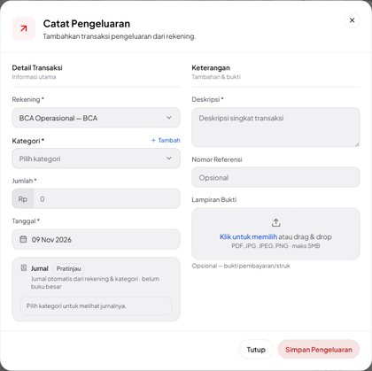 |
| 2 | Kategori **↳ Listrik** tanpa jumlah: akun sudah tampil (Debit Listrik, Kredit BCA Operasional — BCA) dengan nominal "—". | 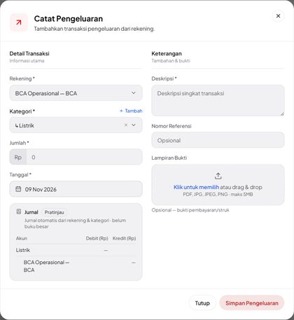 |
| 3 | Jumlah 1.250.000: **Debit Listrik 1.250.000 / Kredit BCA Operasional — BCA 1.250.000**, baris Jumlah seimbang. | 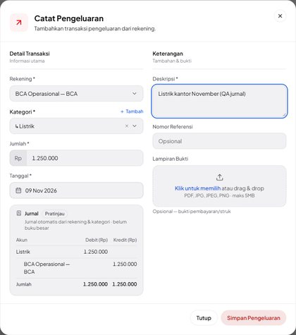 |
| 4 | Setelah disimpan, baris dibuka: **Edit Pengeluaran** menampilkan jurnal tersimpan dari server — sama persis, tanpa penanda Pratinjau. | 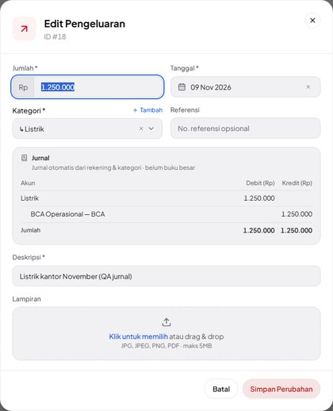 |

## N02 · Pemasukan pendanaan template → akun neraca Modal Pemilik — Pass

| # | Langkah & yang terlihat | Layar |
|---|---|---|
| 1 | **↳ Setoran Modal Pemilik** ke Mandiri Cadangan 7.500.000: Debit **Mandiri Cadangan — Mandiri** / Kredit **Modal Pemilik** (akun neraca, bukan label kategori). | 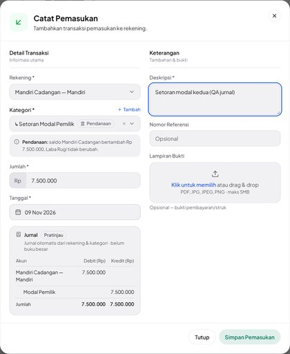 |
| 2 | Baris tersimpan dibuka: jurnal yang sama, kini tanpa penanda Pratinjau. | 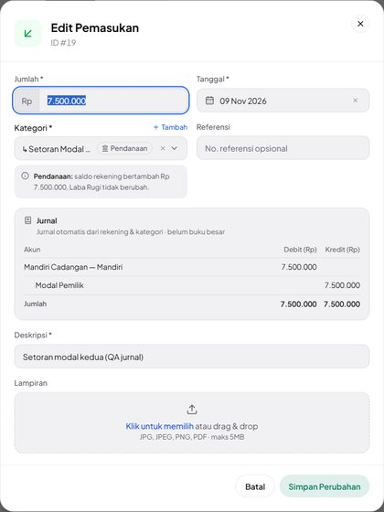 |

## N03 · Pendanaan keluar dari kas + akun Setor PPN & Setor Titipan Pajak Klien — Pass

| # | Langkah & yang terlihat | Layar |
|---|---|---|
| 1 | **↳ Prive Pemilik** dari **Kas Kecil** 400.000: Debit Prive Pemilik / Kredit **Kas Kecil** (kas ditulis dengan namanya saja). | 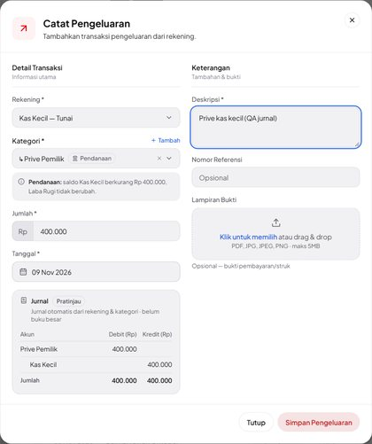 |
| 2 | Tersimpan: jurnal sama dengan pratinjau. | 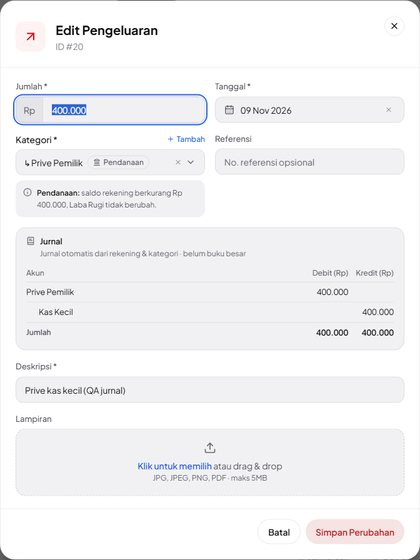 |
| 3 | Baris **Setor PPN masa Oktober**: Debit **PPN Keluaran** 1.100.000 / Kredit BCA. | 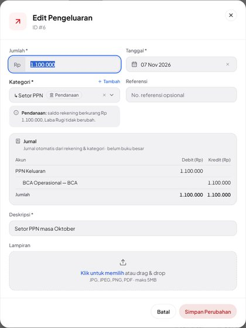 |
| 4 | Baris **Setor PPh 21 titipan PT Maju Jaya**: Debit **Titipan Pajak Klien** 500.000 / Kredit BCA. | 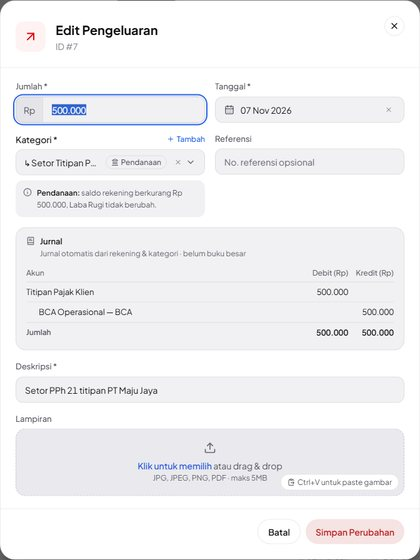 |

## N04 · Pendanaan buatan pengguna memakai labelnya sendiri — Pass

| # | Langkah & yang terlihat | Layar |
|---|---|---|
| 1 | Pratinjau (tidak disimpan) **↳ Pinjaman dari Direksi** — sub pendanaan buatan pengguna: Kredit **Pinjaman dari Direksi**. | 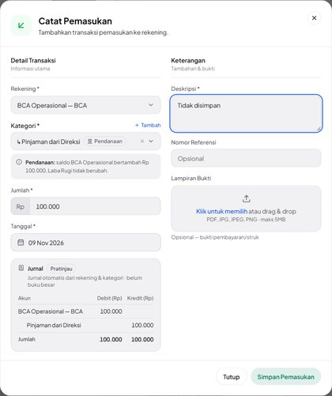 |
| 2 | Baris tersimpan "Pinjaman sementara dari direksi": Debit Mandiri Cadangan — Mandiri / Kredit Pinjaman dari Direksi 3.000.000. | 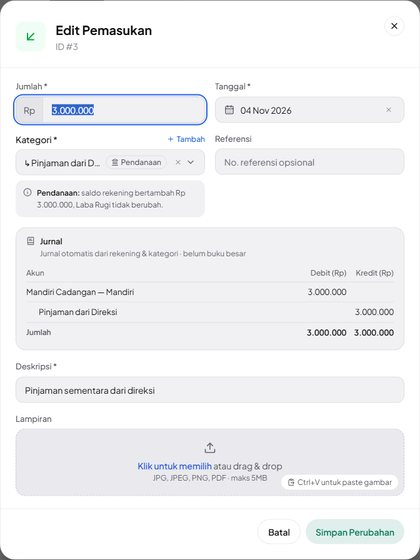 |

## N05 · Transfer: pratinjau Debit tujuan + biaya admin / Kredit asal; Detail Transfer = pratinjau — Pass

| # | Langkah & yang terlihat | Layar |
|---|---|---|
| 1 | **Transfer Antar Rekening** BCA → Mandiri 5.000.000, biaya admin 2.500: Debit **Mandiri Cadangan — Mandiri 5.000.000** + Debit **Biaya Admin Transfer 2.500** / Kredit **BCA 5.002.500**. | 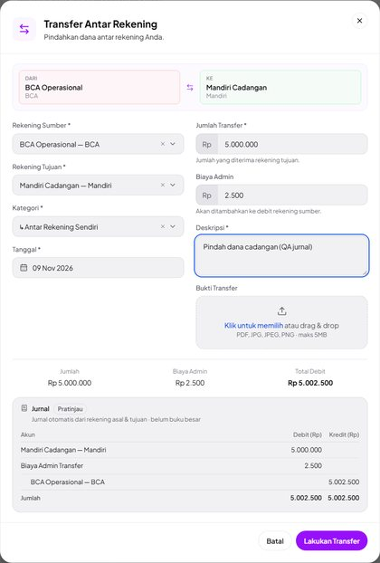 |
| 2 | **Detail Transfer** baris baru: jurnal tersimpan sama dengan pratinjau. | 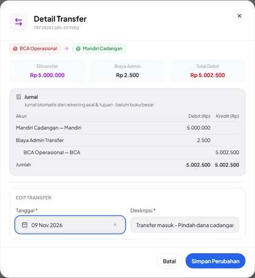 |

## N06 · Pembayaran invoice PPN saja: PPN dulu, sisanya pendapatan — Pass

| # | Langkah & yang terlihat | Layar |
|---|---|---|
| 1 | **Catat pembayaran** INV-3 2.000.000 ke BCA: Kredit **PPN Keluaran 550.000** + **Pendapatan dari Invoice 1.450.000**. | 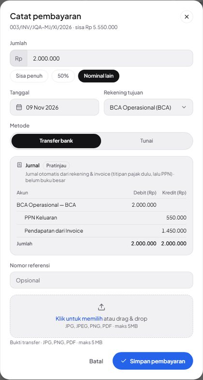 |
| 2 | Arus Kas › Pemasukan → **Detail Pembayaran Invoice**: jurnal tersimpan sama. |  |

## N07 · Invoice titipan + PPN: tiga pembayaran mengikuti titipan dulu — Pass (percobaan ke-2)

| # | Langkah & yang terlihat | Layar |
|---|---|---|
| 1 | INV-1 **Sisa penuh** 7.300.000 (titipan & PPN sudah tertutup oleh dua pembayaran sebelumnya): Kredit **Pendapatan dari Invoice 7.300.000**. | 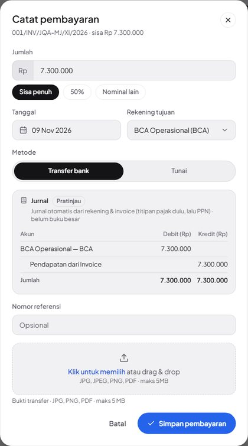 |
| 2 | DP 300.000 (3 Nov), lebih kecil dari titipan 500.000: seluruhnya Kredit **Titipan Pajak Klien 300.000**. | 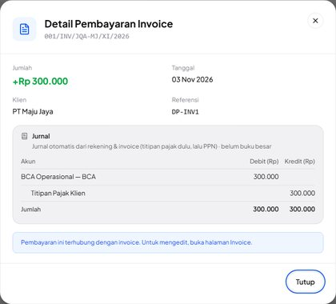 |
| 3 | Pembayaran 4.000.000 (5 Nov) melewati semua batas: **Titipan 200.000 + PPN Keluaran 1.100.000 + Pendapatan dari Invoice 2.700.000**. |  |
| 4 | Pelunasan 7.300.000 tersimpan: sama dengan pratinjau langkah 1. | 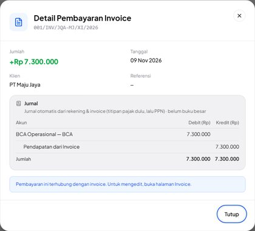 |

## N08 · Ubah: jurnal tersimpan → Pratinjau saat jumlah/kategori diubah; Batal tidak menyimpan — Pass

| # | Langkah & yang terlihat | Layar |
|---|---|---|
| 1 | **Edit Pengeluaran** "Gaji karyawan Oktober": jurnal tersimpan Debit Gaji Karyawan 8.500.000 / Kredit BCA, tanpa penanda Pratinjau. | 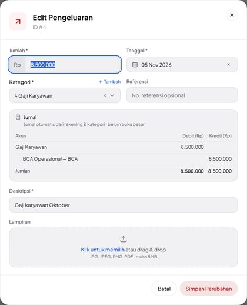 |
| 2 | Jumlah diubah 8.750.000: kotak berganti **Pratinjau** dengan nominal baru. | 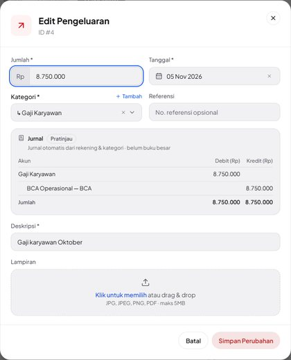 |
| 3 | Kategori diganti **↳ Tunjangan & Lembur**: akun debit ikut berganti (rekening tetap). | 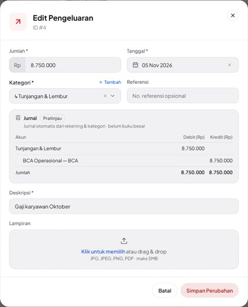 |
| 4 | Setelah **Batal** dan dibuka ulang: kembali 8.500.000 Gaji Karyawan, tanpa Pratinjau (tidak tersimpan). |  |

## N09 · Kas & Bank: rincian hanya-lihat + jurnal (penyesuaian, kaki transfer, pembayaran) — Pass (percobaan ke-2)

| # | Langkah & yang terlihat | Layar |
|---|---|---|
| 1 | **Kas & Bank › Kas Kecil**, tab Transaksi: deskripsi tiap baris kini tombol menuju rincian. | 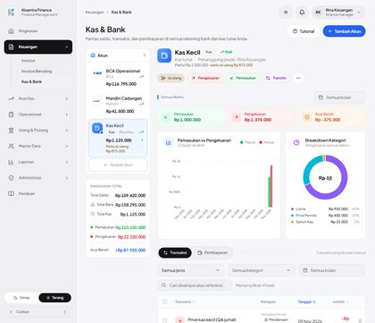 |
| 2 | "Selisih hitung kas" (kategori **penyesuaian**): **Rincian Pengeluaran** hanya-lihat, Debit **Selisih Kas** / Kredit **Kas Kecil** 25.000 — satu-satunya tempat jurnal penyesuaian terlihat. | 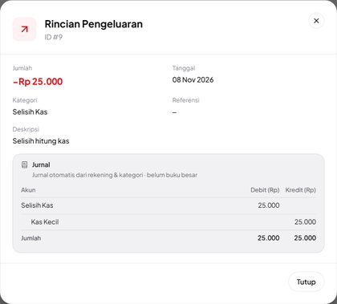 |
| 3 | Kaki masuk transfer isi ulang: jurnal transfer lengkap (Debit Kas Kecil 1.000.000 + Biaya Admin Transfer 2.500 / Kredit BCA 1.002.500). | 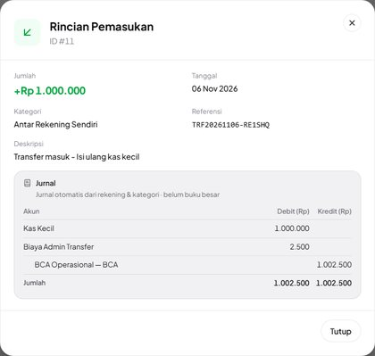 |
| 4 | BCA Operasional › tab **Pembayaran** → nomor invoice: **Detail Pembayaran Invoice** dengan jurnal titipan dulu. | 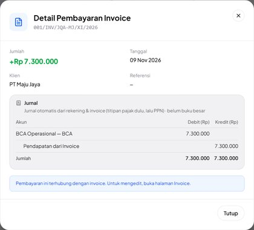 |

## A01 · Pokok utang: baris hanya-lihat kini bisa dibuka (rincian + jurnal), server tetap menolak ubah/hapus — Pass

| # | Langkah & yang terlihat | Layar |
|---|---|---|
| 1 | Pemasukan: baris "Penerimaan pinjaman dari Bank BRI" bergembok, "Hanya-lihat · kelola di Utang". | 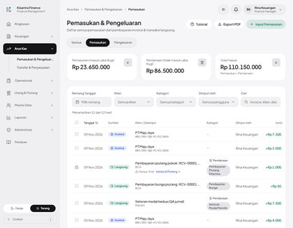 |
| 2 | Diklik: **Rincian Pemasukan** tanpa isian & tanpa Simpan, catatan kelola di Utang, jurnal Kredit **Utang Pinjaman – Bank BRI** 50.000.000. | 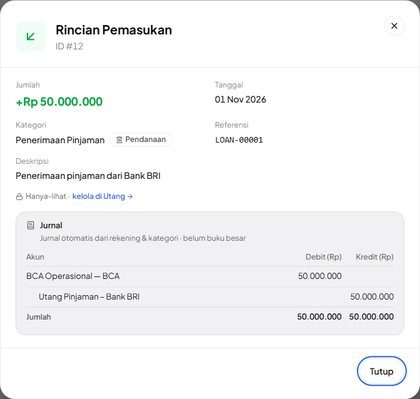 |
| 3 | Pembayaran pokok (Pengeluaran): Debit **Utang Pinjaman – Bank BRI** 2.000.000 / Kredit BCA. | 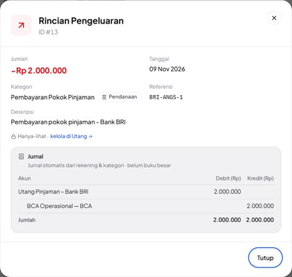 |

## A02 · Nama debitur piutang (karyawan di database pusat) + cadangan tanpa nama untuk utang yatim — Pass

| # | Langkah & yang terlihat | Layar |
|---|---|---|
| 1 | Pencairan piutang RCV-00001: Debit **Piutang – Budi Kasir** (nama debitur karyawan dari database pusat). | 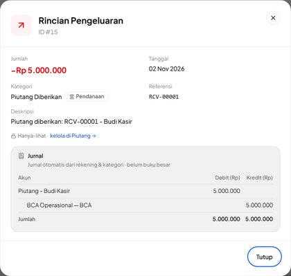 |
| 2 | Cicilan pokok piutang: Kredit **Piutang – Budi Kasir**. | 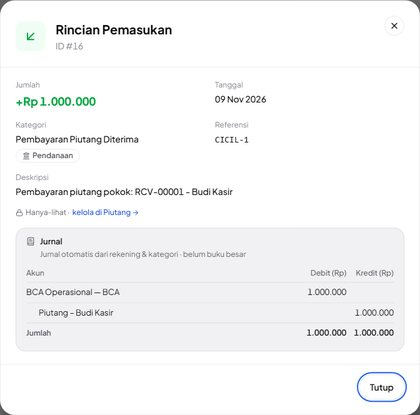 |
| 3 | Fixture utang yatim (LOAN-99999 tidak ada): tidak dikunci (dialog ubah biasa) dan jurnalnya jatuh ke **Utang Pinjaman** tanpa nama. | 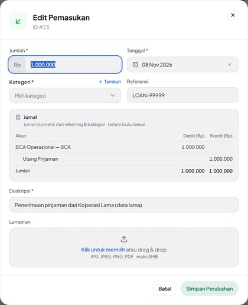 |

## A03 · Pengguna tanpa izin ubah melihat jurnal tanpa kontrol ubah; PUT ditolak — Pass

| # | Langkah & yang terlihat | Layar |
|---|---|---|
| 1 | Lina: "Gaji karyawan Oktober" terbuka sebagai **Rincian Pengeluaran** hanya-lihat (0 isian, 0 Simpan) dengan jurnalnya. | 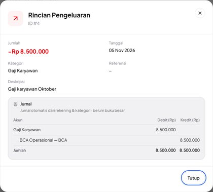 |
| 2 | **Detail Transfer** tanpa bagian Edit Transfer (Lina tidak punya `edit transfer`), jurnal tetap tampil. | 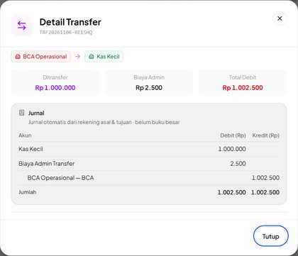 |

## A04 · Ponsel 390 px: kotak Jurnal terbaca tanpa geser samping — Pass

| # | Langkah & yang terlihat | Layar |
|---|---|---|
| 1 | Ponsel 390 px, **Catat Pengeluaran** dengan label terpanjang "Jasa Profesional (Notaris, Konsultan)" 12.500.000: nama akun turun baris, nominal utuh. | 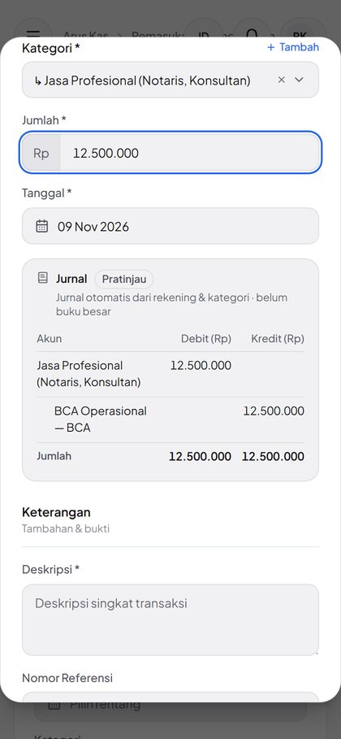 |
| 2 | Rincian pembayaran 4 baris jurnal di 390 px: tidak meluap. | 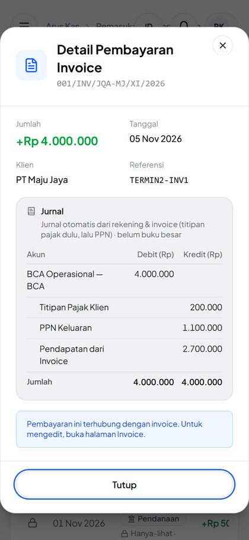 |

## A05 · Pembayaran mundur tanggal: urutan menurut tanggal bayar, jurnal pembayaran lain ikut bergeser — Pass

| # | Langkah & yang terlihat | Layar |
|---|---|---|
| 1 | INV-3, pembayaran baru 500.000 bertanggal **05 Nov** (sebelum pembayaran 9 Nov): pratinjau Kredit **PPN Keluaran 500.000**. | 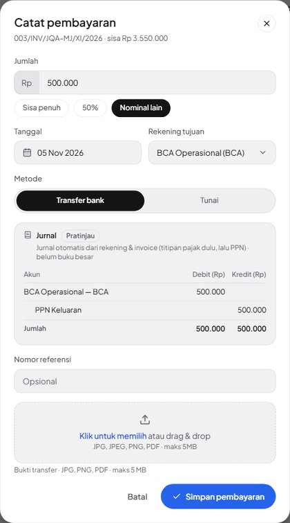 |
| 2 | Tersimpan: sama dengan pratinjau. | 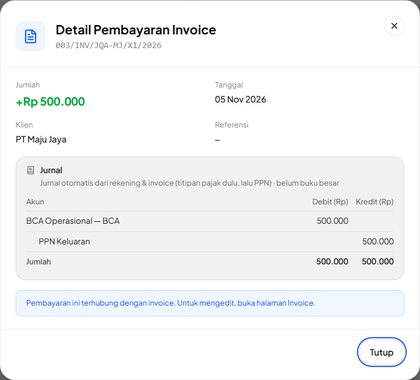 |
| 3 | Pembayaran 9 Nov 2.000.000 kini PPN Keluaran 50.000 + Pendapatan dari Invoice 1.950.000 (sebelumnya 550.000 + 1.450.000) — titipan dulu mengikuti tanggal bayar. | 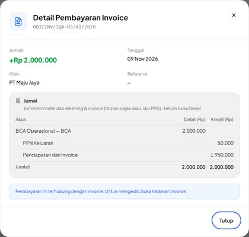 |

## C01 · Invarian: Σ kredit jurnal pembayaran November = angka Laba Rugi November — Pass

| # | Langkah & yang terlihat | Layar |
|---|---|---|
| 1 | Laporan › Laba Rugi 1–30 Nov 2026: Pendapatan dari Invoice (kas) Rp 17.950.000. | 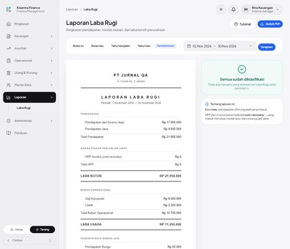 |
| 2 | Catatan **PPN Keluaran diterima Rp 1.650.000** — sama dengan Σ kredit PPN Keluaran jurnal pembayaran November. | 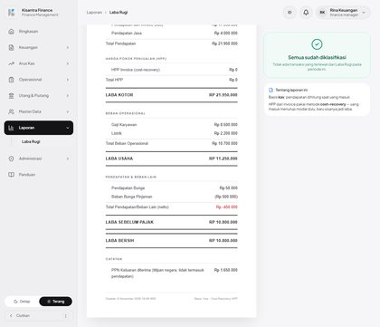 |

## C02 · PPN Keluaran saling menutup: dikredit pembayaran invoice, didebit Setor PPN — Pass

| # | Langkah & yang terlihat | Layar |
|---|---|---|
| 1 | Pembayaran 4.000.000 INV-1: Kredit **PPN Keluaran 1.100.000**. | 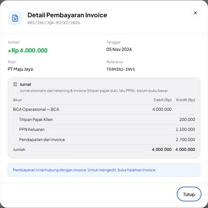 |
| 2 | Setor PPN masa Oktober: Debit **PPN Keluaran 1.100.000** — nama akun sama persis. | 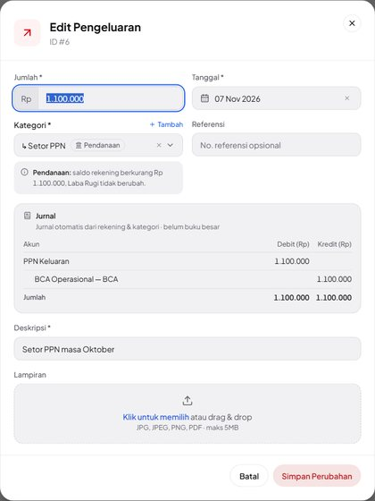 |

<!-- qa-evidence:end -->
