# Test Case — Pendanaan (Opsi A): Arus Kas, Template Kategori, Utang hanya-lihat

Sumber teknis: [`docs/module/cash-flow.md`](../../../module/cash-flow.md) (bagian *Pendanaan — dicatat, ditandai, tidak
masuk Laba Rugi*), [`docs/module/transaction-categories.md`](../../../module/transaction-categories.md) (*Pakai Template*,
*Kategori Awal Perusahaan Baru*), [`docs/module/profit-loss.md`](../../../module/profit-loss.md),
[`docs/module/dashboard.md`](../../../module/dashboard.md).
Cara baca tabel & kolom **Lapisan**: [`docs/qa/README.md`](../../README.md). Lingkungan, akun, dan data: [`README.md`](../README.md).

**Prasyarat**: lingkungan terisolasi `pdn_*` (bukan production). Perusahaan `/c/pdnlama` diprovisioning di kode `main`
sebelum fitur ini (77 kategori; induk pendanaan "Setoran Modal" & "Penarikan Modal" tanpa anak) lalu diisi data
November: invoice lunas Rp 11.000.000, pemasukan Rp 4.120.000, pengeluaran Rp 12.465.000. Akun: Rina Keuangan
(finance manager), Lina Hanya Lihat (peran uji "lihat arus kas"), Admin QA. Viewport 1280×800 DPR 1 kecuali N07
(390×844 DPR 2, ponsel). Semua nominal rupiah penuh. Pemeriksaan DB memakai skrip baca-saja di luar repo yang menolak
berjalan di luar `pdn_central`; keluarannya mencatat database tenant `pdn_central_tenant_pdnlama`.

Kondisi awal DB `pdnlama` (sebelum N01): 77 kategori, rencana template **5 baru / 69 sudah ada / 0 dilewati**,
saldo BCA Operasional Rp 53.605.000, Laba Rugi November: pendapatan 15.000.000, beban operasional 12.450.000,
pendapatan lain 120.000, beban lain 15.000, **laba bersih Rp 2.655.000**, 0 belum diklasifikasi.

## A. Kondisi Normal

| ID | Skenario | Langkah | Hasil Diharapkan | Lapisan | Hasil Aktual | Status |
|---|---|---|---|---|---|---|
| N01 | Pakai Template di perusahaan lama: induk pendanaan lama dipakai ulang, 5 kategori baru, idempoten | FM → Operasional › Kategori Transaksi → **Pakai Template** → gulir ke bagian Pendanaan → **Buat 5 kategori** → buka lagi **Pakai Template** | Ringkasan Baru 5 / Sudah ada 69 / Dilewati 0; bagian ketiga **Pendanaan** dengan kolom Baris Laba Rugi "Tidak masuk Laba Rugi"; Setoran Modal & Penarikan Modal **Sudah ada**, sub Setoran Modal Pemilik & Prive Pemilik + grup Pajak Titipan & PPN (Setor PPN, Setor Titipan Pajak Klien) **Baru**; toast "5 kategori dibuat, 69 dilewati karena sudah ada."; klik ulang 0 / 74 / 0, tombol nonaktif; DB 82 kategori, sub menempel ke induk lama, `pl_group` null | FE+BE | Sesuai. Ringkasan "Baru 5 · Sudah ada 69 · Dilewati 0", tombol **Buat 5 kategori**. Toast persis "5 kategori dibuat, 69 dilewati karena sudah ada.". Buka ulang: "Baru 0 · Sudah ada 74 · Dilewati 0", tombol **Tidak ada kategori baru** (nonaktif). DB: 82 kategori; Setoran Modal Pemilik → induk Setoran Modal (id lama), Prive Pemilik → Penarikan Modal, Setor PPN & Setor Titipan Pajak Klien → Pajak Titipan & PPN; ketujuhnya `type=financing`, `pl_group` null, `system_key` null; rencana 0/74/0. Konsol tanpa error. | Pass |
| N02 | Catat Setoran Modal lewat Catat Pemasukan | FM → Arus Kas › Pemasukan (1–30 Nov) → **Input Pemasukan** → Kategori: gulir ke grup terakhir → **↳ Setoran Modal Pemilik** → Jumlah 25.000.000, Deskripsi "Setoran modal pemilik November" → **Simpan Pemasukan** → Tutup | Pemilih: grup terakhir berjudul "PENDANAAN · TIDAK MASUK LABA RUGI"; setelah dipilih: penanda **Pendanaan** di pemicu + petunjuk "Pendanaan: saldo BCA Operasional bertambah Rp 25.000.000, Laba Rugi tidak berubah." (tanpa nominal sebelum Jumlah diisi); baris berbadge Pendanaan; kartu Pendanaan Rp 0 → Rp 25.000.000, Pemasukan (masuk Laba Rugi) tetap; DB transaksi credit berkategori pendanaan, saldo BCA +25.000.000 | FE+BE | Sesuai. Petunjuk sebelum Jumlah: "Pendanaan: saldo BCA Operasional bertambah, Laba Rugi tidak berubah."; sesudah: "… bertambah Rp 25.000.000, …". Toast "Pemasukan berhasil dicatat". Kartu: Pemasukan (masuk Laba Rugi) Rp 15.120.000 (tetap) · Pendanaan Rp 0 → **Rp 25.000.000** · Total masuk Rp 15.120.000 → **Rp 40.120.000** ("Pemasukan + Pendanaan"). DB (diperiksa setelah N03): transaksi #7 credit 25.000.000, kategori Setoran Modal Pemilik (`financing`), `created_by` = Rina; saldo BCA ikut naik (lihat N03). | Pass |
| N03 | Catat Setor PPN lewat Catat Pengeluaran; kartu Beban/Pendanaan/Total keluar | FM → Pengeluaran (1–30 Nov) → **Input Pengeluaran** → **↳ Setor PPN** → 3.300.000, "Setor PPN masa Oktober" → **Simpan Pengeluaran** | Petunjuk "…berkurang Rp 3.300.000, Laba Rugi tidak berubah."; kartu Beban (masuk Laba Rugi) tetap Rp 12.465.000, Pendanaan Rp 3.300.000, Total keluar Rp 15.765.000 "Beban + Pendanaan" (persis mockup 03A); baris berbadge Pendanaan + kategori Setor PPN; DB debit pendanaan, saldo −3.300.000 | FE+BE | Sesuai. Petunjuk "Pendanaan: saldo BCA Operasional berkurang Rp 3.300.000, Laba Rugi tidak berubah.". Kartu: Beban Rp 12.465.000 · Pendanaan Rp 0 → **Rp 3.300.000** · Total keluar Rp 12.465.000 → **Rp 15.765.000**. Baris: "09 Nov 2026 · Setor PPN masa Oktober · [Pendanaan] Setor PPN · BCA Operasional · Rina Keuangan · −Rp 3.300.000". DB: transaksi #8 debit 3.300.000 kategori Setor PPN (`financing`); saldo BCA akhir Rp 75.305.000 = 53.605.000 + 25.000.000 − 3.300.000. | Pass |
| N04 | Laba Rugi November tidak berubah oleh pendanaan | FM → Laporan › Laba Rugi 1–30 Nov 2026; bandingkan dengan keluaran `ProfitLossService` sebelum N02 | Semua angka sama dengan sebelum pendanaan dicatat; pendanaan tidak muncul di baris mana pun maupun panel belum diklasifikasi | FE+BE | Sesuai. Halaman: Pendapatan Rp 15.000.000, Laba Kotor 15.000.000, "Semua sudah diklasifikasi". DB: keluaran `ProfitLossService::generate(1–30 Nov)` setelah N03 **identik** dengan sesudah N01 (perbandingan seluruh struktur: revenue, cogs, opex, other_income/expense, tax, net_profit 2.655.000, unclassified kosong). | Pass |
| N05 | Tab Semua: kartu menyebut porsi pendanaan; filter Kategori grup Pendanaan; ekspor Excel kolom Jenis di akhir | FM → Semua (1–30 Nov) → buka filter **Kategori** → gulir ke grup Pendanaan → pilih **↳ Setor PPN** → kembali tanpa filter → **Export Excel** (unduhan dibaca openpyxl) | Kartu: Total masuk "Termasuk pendanaan Rp 25.000.000", Total keluar "Termasuk pendanaan Rp 3.300.000", Selisih "Tanpa pendanaan: +Rp 2.655.000"; filter punya judul bagian Pendanaan + "Dari Utang & Piutang"; filter Setor PPN → 1 baris; Excel 11 kolom, 10 judul lama tetap di posisinya, kolom 11 "Jenis (Laba Rugi/Pendanaan)" berisi Laba Rugi / Pendanaan | FE+BE | Sesuai. Kartu: Total masuk Rp 40.120.000 (termasuk pendanaan Rp 25.000.000), Total keluar Rp 15.765.000 (termasuk Rp 3.300.000), Selisih +Rp 24.355.000 ("Tanpa pendanaan: +Rp 2.655.000" = laba bersih N04). Filter: judul bagian terlihat, judul "Dari Utang & Piutang" ada; hasil "Menampilkan 1 dari 1 hasil", kartu terfilter Total keluar Rp 3.300.000. Excel `arus-kas_2026-11-01_2026-11-30.xlsx`: judul `Tanggal, Jenis, Sumber, Rekening, Keterangan, Kategori, Diinput oleh, Masuk (Rp), Keluar (Rp), No. Referensi, Jenis (Laba Rugi/Pendanaan)`; 9 baris: 7 "Laba Rugi" (termasuk pembayaran invoice), "Setoran modal pemilik November" → Masuk 25.000.000 · **Pendanaan**, "Setor PPN masa Oktober" → Keluar 3.300.000 · **Pendanaan**. Percobaan 1 batal karena lokator skrip (lihat Kendala alat uji). | Pass |
| N06 | Perusahaan baru: 82 kategori dari template termasuk Pendanaan; Pakai Template 0 baru | Admin → Administrasi › Perusahaan → **Perusahaan baru** "PT Pendanaan Baru QA", kode `pdnbaru`, singkatan `PDB` → Buat → buka `/c/pdnbaru` → lengkapi profil → Kategori Transaksi → **Pakai Template**; opsi pemilih `GET /c/pdnbaru/api/transaction-categories?type=debit` | Provisioning sukses; Total 82 (22 utama, 60 sub), 0 belum diklasifikasi; dialog 0 / 74 / 0 dengan bagian Pendanaan "Sudah ada"; opsi pemilih diakhiri grup Pendanaan (7 opsi), tanpa kategori sistem; DB `pl_group` pendanaan null | FE+BE | Sesuai. `companies.pdnbaru` aktif, DB `pdn_central_tenant_pdnbaru` terbentuk; gerbang profil mengarah ke form, profil disimpan. Halaman: "Total Kategori 82 · Kategori Utama 22 · Sub Kategori 60 · Belum Diklasifikasi 0". Dialog: "Baru 0 · Sudah ada 74 · Dilewati 0", Setoran Modal / Penarikan Modal / Pajak Titipan & PPN beserta sub berstatus Sudah ada, kolom "Tidak masuk Laba Rugi". API 200: grup terakhir `Pajak Titipan & PPN, ↳ Setor PPN, ↳ Setor Titipan Pajak Klien, Penarikan Modal, ↳ Prive Pemilik, Setoran Modal, ↳ Setoran Modal Pemilik` (bertanda `financing`), tanpa FIN-*. DB: 82 kategori, rencana 0/74/0. Catatan: tombol **Input Pengeluaran** tidak tampil di perusahaan tanpa rekening (perilaku lama), jadi pemilihnya diperiksa lewat endpoint yang dipanggil dialog. Percobaan 1 terhenti setelah perusahaan terbentuk (lokator skrip). | Pass |
| N07 | Ponsel 390 px: daftar & dialog pendanaan tanpa geser samping | Viewport 390×844 DPR 2 (sentuh) → Pengeluaran (1–30 Nov) → gulir ke tabel → **Input Pengeluaran** → **↳ Prive Pemilik** → Jumlah 5.000.000 → Esc (tidak disimpan) | Halaman tanpa overflow horizontal; badge Pendanaan tetap terlihat di bawah deskripsi (kolom Kategori disembunyikan di layar kecil); dialog selebar layar; petunjuk "berkurang Rp 5.000.000" terbaca | FE | Sesuai. `scrollWidth − clientWidth` halaman = 0 (daftar) dan 0 (dialog terbuka); dialog lebar 390 px. Baris ponsel: "09 Nov 2026 · Setor PPN masa Oktober · Pendanaan · −Rp 3.300.000". Petunjuk "Pendanaan: saldo BCA Operasional berkurang Rp 5.000.000, Laba Rugi tidak berubah.". Kolom Jumlah ada di dalam wadah gulir tabel (perilaku lama). Catatan K-P2: breadcrumb header bertumpuk dengan tombol ID/notifikasi di 390 px — sudah sama di kode `main` (screenshot "sebelum"), di luar lingkup. | Pass |

## B. Kondisi Tidak Normal / Edge Case

| ID | Skenario | Langkah | Hasil Diharapkan | Lapisan | Hasil Aktual | Status |
|---|---|---|---|---|---|---|
| A01 | Payload rakitan: kategori sistem, induk, dan arah salah ditolak server | Sesi FM, `POST /c/pdnlama/bank-transactions` (JSON + X-XSRF-TOKEN) BCA 1.000.000: (a) credit + FIN-LOAN-IN, (b) debit + FIN-RCV-OUT, (c) debit + EXP-INTEREST, (d) debit + induk "Pajak Titipan & PPN", (e) debit + "Pendapatan Jasa" | Kelimanya 422 dengan pesan terbaca; tidak ada transaksi tercipta | BE | Formulir tidak pernah menawarkan kategori ini (pemilih hanya memuat sub non-sistem), jadi hanya terjangkau lewat permintaan rakitan. (a) 422 "Kategori \"Penerimaan Pinjaman\" dipakai otomatis oleh modul Utang/Piutang dan tidak bisa dipilih di sini. Catat lewat menu Utang atau Piutang."; (b) 422 sama untuk "Piutang Diberikan"; (c) 422 sama untuk "Beban Bunga Pinjaman"; (d) 422 "Kategori \"Pajak Titipan & PPN\" adalah kategori induk. Pilih salah satu sub-kategorinya."; (e) 422 "Kategori pengeluaran atau pendanaan diperlukan untuk transaksi keluar.". DB: daftar transaksi sebelum = sesudah (8 baris identik sampai `updated_at`). | Pass |
| A02 | Pengguna hanya-lihat: melihat pendanaan & kartu, tanpa tombol catat/centang; POST ditolak | Login Lina (peran `view dashboard`, `view income`, `view expense`, `view categories`) → Pengeluaran (1–30 Nov); dari sesi yang sama `POST /bank-transactions` debit Setor PPN | Kartu & badge Pendanaan tampil; 0 tombol Input Pengeluaran, 0 checkbox; POST 403; tidak ada transaksi baru | FE+BE | Sesuai. Kartu: Beban Rp 12.465.000 · Pendanaan Rp 3.300.000 · Total keluar Rp 15.765.000; tombol Input Pengeluaran: 0; checkbox: 0; badge "Pendanaan" di tabel: 2 elemen (badge kolom Kategori + badge ponsel yang tersembunyi). POST: 403 "This action is unauthorized.". DB tidak berubah. | Pass |
| A03 | Ubah transaksi: dialog menawarkan grup Pendanaan; ganti ke kategori sistem lewat PUT rakitan ditolak | FM → Pengeluaran → klik "Biaya administrasi bank" → buka pemilih Kategori → gulir ke grup Pendanaan → Esc; lalu `PUT /bank-transactions/4` dengan `category_id` FIN-LOAN-OUT | Dialog **Edit Pengeluaran** memuat grup "Pendanaan · tidak masuk Laba Rugi"; PUT 422 dengan pesan kategori sistem; transaksi tidak berubah | FE+BE | Sesuai. Judul bagian Pendanaan terlihat di pemilih dialog ubah (Setor PPN, Setor Titipan Pajak Klien, Prive Pemilik …). PUT: 422 "Kategori \"Pembayaran Pokok Pinjaman\" dipakai otomatis oleh modul Utang/Piutang …". DB: transaksi #4 tetap kategori Biaya Administrasi Bank, `updated_at` tidak berubah. | Pass |

## C. Alur Berantai (lintas modul)

Aktor: Rina Keuangan (finance manager: `view/create/pay loans` + izin Arus Kas). Utang dicatat dan dibayar di menu
Utang; yang diuji adalah jejaknya di Arus Kas, Kas & Bank, dan Ringkasan, serta penjagaan servernya.

| ID | Skenario | Langkah | Hasil Diharapkan | Lapisan | Hasil Aktual | Status |
|---|---|---|---|---|---|---|
| C01 | Utang dari modul Utang tampil hanya-lihat di Arus Kas & Kas & Bank, menaut ke utangnya, dan server menolak ubah/hapus | Utang › **Tambah utang**: Bank BRI, pokok 50.000.000, 6 % p.a., 12 bulan, rekening BCA Operasional → Simpan; Pemasukan (1–30 Nov) → klik **kelola di Utang**; di Utang buka LOAN-00001 → **Catat pembayaran** pokok 4.000.000 + bunga 200.000 (BCA) → Pengeluaran; lalu dari sesi FM: `PUT /bank-transactions/{pokok}`, `DELETE /bank-transactions/{pencairan}`, `POST /bank-transactions/bulk-delete`, `POST /cash-flow/bulk-delete` (pencairan + 1 transaksi biasa); Kas & Bank › BCA Operasional tab transaksi | Pencairan tampil di Pemasukan berbadge Pendanaan, gembok, tanpa centang, "Hanya-lihat · kelola di Utang" → `/loans?search=LOAN-00001`; pokok tampil di Pengeluaran hanya-lihat (tautan disaring nama pemberi), bunga tampil sebagai beban biasa (bercentang, tanpa badge); klik baris pokok tidak membuka dialog; keempat permintaan 403 dengan pesan; DB tidak berubah; Kas & Bank tanpa tombol hapus | FE+BE | Sesuai. Pemasukan: "Penerimaan pinjaman dari Bank BRI … Hanya-lihat · kelola di Utang … [Pendanaan] Penerimaan Pinjaman … +Rp 50.000.000", 0 checkbox, href `/c/pdnlama/loans?search=LOAN-00001`; kartu Pendanaan Rp 75.000.000. Klik tautan → halaman Utang tersaring "LOAN-00001" (1 utang). Pengeluaran: pokok "Pembayaran pokok pinjaman - Bank BRI" 0 checkbox, href `/c/pdnlama/loans?search=Bank%20BRI`; bunga "Pembayaran bunga pinjaman - Bank BRI" kategori Beban Bunga Pinjaman, 1 checkbox; kartu Beban Rp 12.665.000 · Pendanaan Rp 7.300.000 · Total keluar Rp 19.965.000; klik baris pokok: 0 dialog. Server: PUT #10 → 403 "Transaksi ini pokok utang yang dicatat otomatis oleh modul Utang, jadi tidak bisa diubah atau dihapus dari sini. Kelola lewat menu Utang."; DELETE #9 → 403 pesan sama; bulk-delete [10] → 403 "Seleksi berisi pokok utang/piutang …"; cash-flow bulk-delete [9, 4] → 403 (transaksi #4 yang sah pun tidak terhapus). DB: daftar transaksi sebelum = sesudah serangan; utang LOAN-00001 aktif. Kas & Bank: baris pencairan "Hanya-lihat · kelola di Utang", tombol Hapus 0, checkbox 0. Laba Rugi November: hanya Beban Lain bertambah 200.000 (bunga) → laba bersih 2.455.000; baris lain tetap. | Pass |
| C02 | Ringkasan bulan ini = Arus Kas Semua November (tanpa transfer & penyesuaian) | FM → Ringkasan (kartu Arus Kas bulan ini) → Arus Kas › Semua 1–30 Nov | Pemasukan, Pengeluaran, Arus bersih Ringkasan = Total masuk, Total keluar, Selisih tab Semua | FE+BE | Sesuai. Ringkasan: Pemasukan 1–9 Nov **Rp 90.120.000**, Pengeluaran **Rp 19.965.000**, Arus bersih **+Rp 70.155.000**. Tab Semua: Total masuk **Rp 90.120.000** (termasuk pendanaan Rp 75.000.000), Total keluar **Rp 19.965.000** (termasuk Rp 7.300.000), Selisih **+Rp 70.155.000** (tanpa pendanaan +Rp 2.455.000). Sebelum fitur ini kedua angka berbeda karena tab Semua mengecualikan pendanaan. Juga dites otomatis (`PendanaanTest::test_tanpa_transfer_dan_penyesuaian_selisih_arus_kas_semua_sama_dengan_dashboard`). | Pass |

<!-- qa-evidence:start -->

# Bukti visual langkah per langkah

Screenshot diambil per langkah, bukan hanya hasil akhirnya, supaya alurnya
bisa ditelusuri ulang oleh orang lain. Test case yang kondisinya tidak bisa
dicapai dari layar dijalankan lewat API/DB dan ditandai eksplisit — tidak
dibuatkan screenshot seolah-olah ada alur UI-nya.

## N01 · Pakai Template di perusahaan lama: induk pendanaan lama dipakai ulang, 5 baru, idempoten — Pass

| # | Langkah & yang terlihat | Layar |
|---|---|---|
| 1 | Kategori Transaksi perusahaan lama (77 kategori, dibuat di kode `main`): induk **Setoran Modal** dan **Penarikan Modal** masih tanpa sub. |  |
| 2 | **Pakai Template**: deskripsi baru menyebut pendanaan, poin **Pendanaan** di daftar penjelasan, ringkasan **Baru 5 · Sudah ada 69 · Dilewati 0**, tombol **Buat 5 kategori**. | 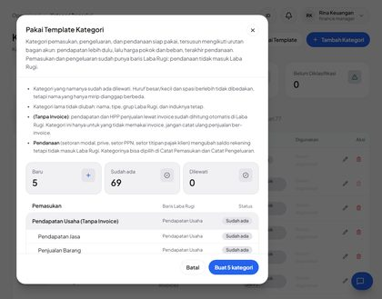 |
| 3 | Bagian ketiga **Pendanaan**: Setoran Modal & Penarikan Modal **Sudah ada**, sub barunya **Baru**; grup **Pajak Titipan & PPN** (Setor PPN, Setor Titipan Pajak Klien) **Baru**; kolom Baris Laba Rugi **Tidak masuk Laba Rugi**. | 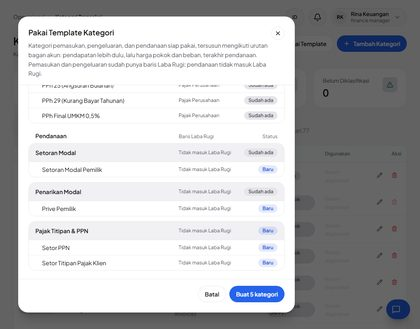 |
| 4 | Setelah **Buat 5 kategori**: toast "5 kategori dibuat, 69 dilewati karena sudah ada."; Total 82, Utama 22, Sub 60, Belum Diklasifikasi 0. | 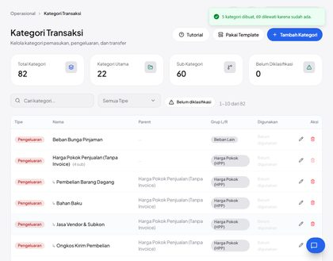 |
| 5 | Dibuka ulang: **Baru 0 · Sudah ada 74 · Dilewati 0**, tombol **Tidak ada kategori baru** nonaktif (idempoten). | 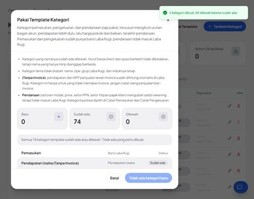 |

## N02 · Catat Setoran Modal lewat Catat Pemasukan — Pass

| # | Langkah & yang terlihat | Layar |
|---|---|---|
| 1 | Pemasukan 1–30 Nov sebelum: **Pemasukan (masuk Laba Rugi) Rp 15.120.000 · Pendanaan Rp 0 · Total masuk Rp 15.120.000**. | 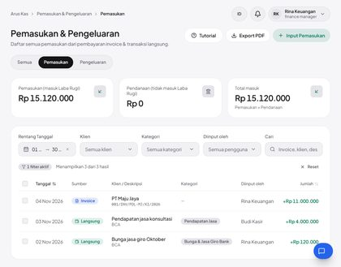 |
| 2 | **Catat Pemasukan**, pemilih Kategori digulir ke bawah: grup terakhir **Pajak Titipan & PPN**, **Penarikan Modal**, **Setoran Modal** di bawah judul Pendanaan. | 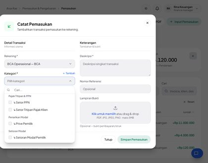 |
| 3 | **↳ Setoran Modal Pemilik** dipilih: penanda **Pendanaan** di pemicu, petunjuk "Pendanaan: saldo BCA Operasional **bertambah Rp 25.000.000**, Laba Rugi tidak berubah." | 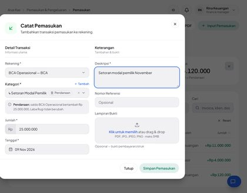 |
| 4 | Setelah disimpan: baris berbadge **Pendanaan** + Setoran Modal Pemilik; kartu **Pendanaan Rp 25.000.000**, **Total masuk Rp 40.120.000**, Pemasukan (masuk Laba Rugi) tetap. | 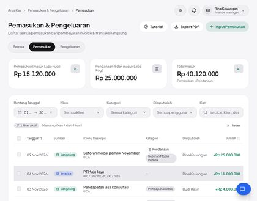 |

## N03 · Catat Setor PPN lewat Catat Pengeluaran; kartu Beban/Pendanaan/Total keluar — Pass

| # | Langkah & yang terlihat | Layar |
|---|---|---|
| 1 | Pengeluaran sebelum: **Beban (masuk Laba Rugi) Rp 12.465.000 · Pendanaan Rp 0 · Total keluar Rp 12.465.000** ("Beban + Pendanaan"). | 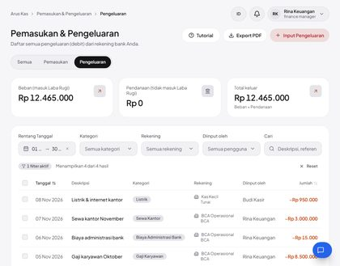 |
| 2 | **Catat Pengeluaran**: grup Pendanaan berada **setelah** Transfer Internal, dipisah garis dan berjudul "PENDANAAN · TIDAK MASUK LABA RUGI". | 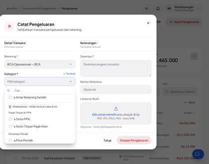 |
| 3 | **↳ Setor PPN** dipilih: penanda **Pendanaan**, petunjuk "saldo BCA Operasional **berkurang Rp 3.300.000**, Laba Rugi tidak berubah." | 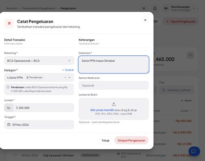 |
| 4 | Daftar: **Beban Rp 12.465.000 · Pendanaan Rp 3.300.000 · Total keluar Rp 15.765.000**; baris Setor PPN berbadge **Pendanaan**. | 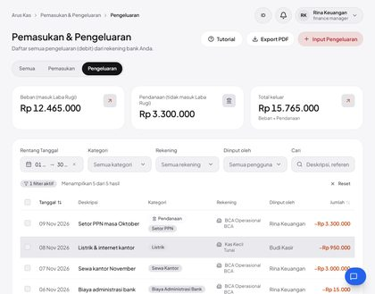 |

## N04 · Laba Rugi November tidak berubah oleh pendanaan — Pass

| # | Langkah & yang terlihat | Layar |
|---|---|---|
| 1 | Laba Rugi 1–30 Nov: Pendapatan Rp 15.000.000, Laba Kotor Rp 15.000.000, panel "Semua sudah diklasifikasi" — setoran modal & setor PPN tidak muncul di baris mana pun. | 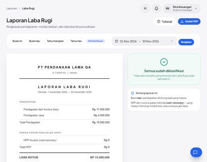 |

## N05 · Tab Semua: porsi pendanaan di kartu, filter Kategori grup Pendanaan, Excel kolom Jenis di akhir — Pass (percobaan ke-2)

| # | Langkah & yang terlihat | Layar |
|---|---|---|
| 1 | Tab **Semua**: Total masuk Rp 40.120.000 "Termasuk pendanaan Rp 25.000.000", Total keluar Rp 15.765.000 "Termasuk pendanaan Rp 3.300.000", Selisih +Rp 24.355.000 "**Tanpa pendanaan: +Rp 2.655.000**" (= laba bersih N04). | 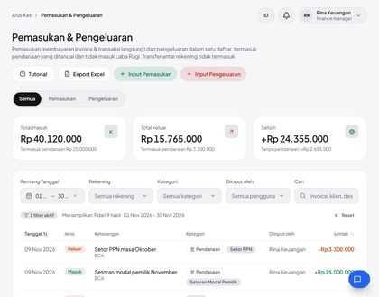 |
| 2 | Filter **Kategori**: grup Pendanaan di bagian bawah (Setor PPN, Setor Titipan Pajak Klien, Prive Pemilik …) dengan judul bagiannya. | 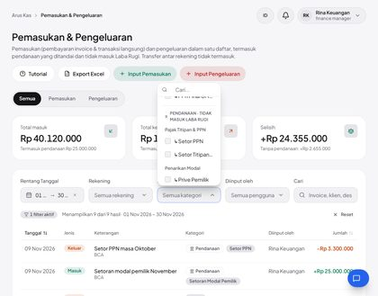 |
| 3 | Filter **Setor PPN**: 1 hasil, kartu terfilter Total keluar Rp 3.300.000 (termasuk pendanaan Rp 3.300.000). | 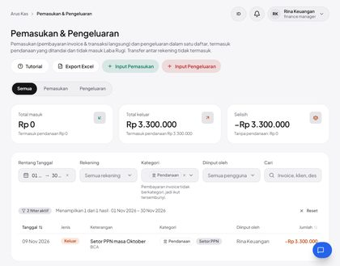 |

## N06 · Perusahaan baru: 82 kategori termasuk Pendanaan; Pakai Template 0 baru — Pass (percobaan ke-2)

| # | Langkah & yang terlihat | Layar |
|---|---|---|
| 1 | Admin › Perusahaan › **Perusahaan baru**: PT Pendanaan Baru QA, kode `pdnbaru`, singkatan PDB; pratinjau menyebut data awal berisi template kategori. | 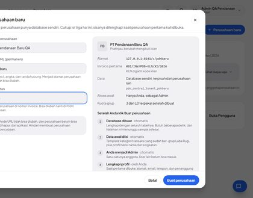 |
| 2 | Membuka `/c/pdnbaru` → gerbang profil mengarahkan ke form Profil Perusahaan; isian wajib dilengkapi lalu disimpan. | 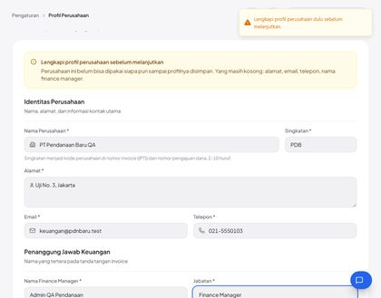 |
| 3 | Kategori perusahaan baru: **Total 82 · Utama 22 · Sub 60 · Belum Diklasifikasi 0**. | 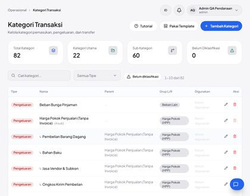 |
| 4 | **Pakai Template**: Baru 0 · Sudah ada 74 · Dilewati 0; bagian **Pendanaan** sudah lengkap (Setoran Modal Pemilik, Prive Pemilik, Setor PPN, Setor Titipan Pajak Klien); tombol nonaktif. | 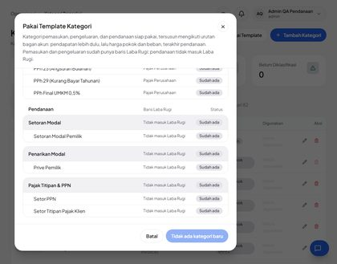 |

## N07 · Ponsel 390 px: daftar & dialog pendanaan tanpa geser samping — Pass

| # | Langkah & yang terlihat | Layar |
|---|---|---|
| 1 | Ponsel 390 px: judul, tombol **Input Pengeluaran**, tab, dan kartu **Beban (masuk Laba Rugi)** bertumpuk satu kolom. | 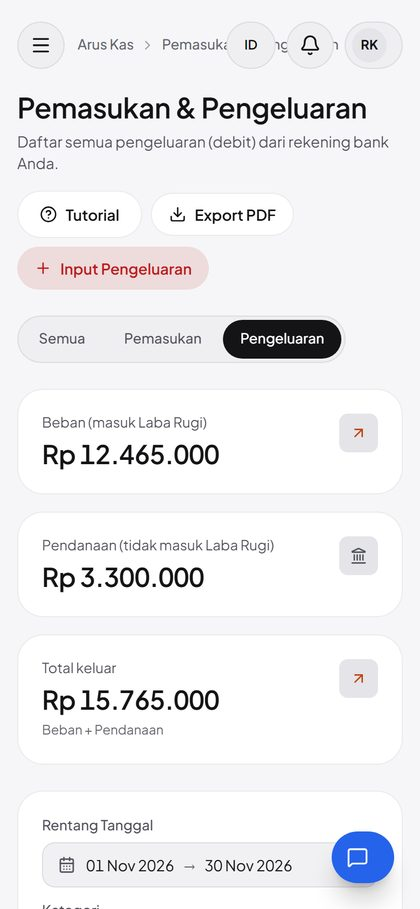 |
| 2 | Tabel di ponsel: baris **Setor PPN masa Oktober** membawa badge **Pendanaan** di bawah deskripsi (kolom Kategori disembunyikan di layar kecil). | 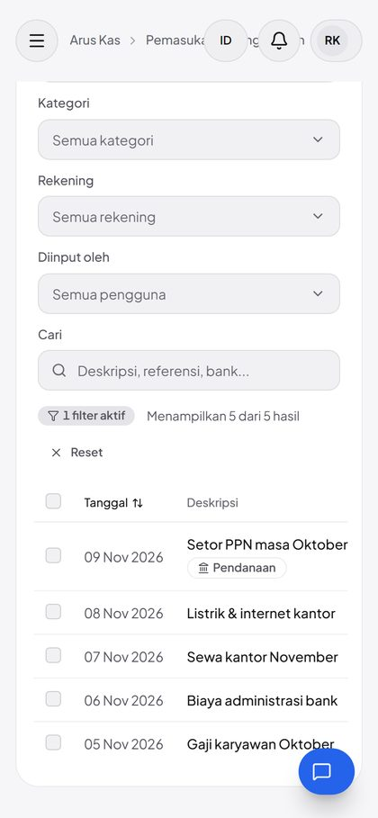 |
| 3 | **Catat Pengeluaran** selebar layar; pemilih Kategori dibuka (daftar di bawah lipatan). | 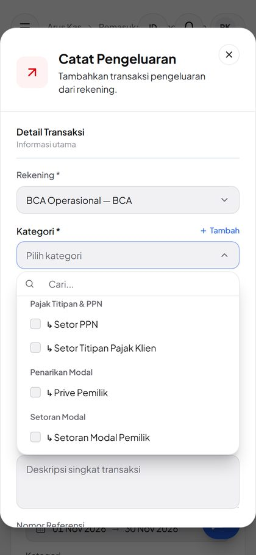 |
| 4 | **↳ Prive Pemilik** dipilih: penanda Pendanaan di pemicu + petunjuk "saldo BCA Operasional berkurang Rp 5.000.000, Laba Rugi tidak berubah." (tidak disimpan). | 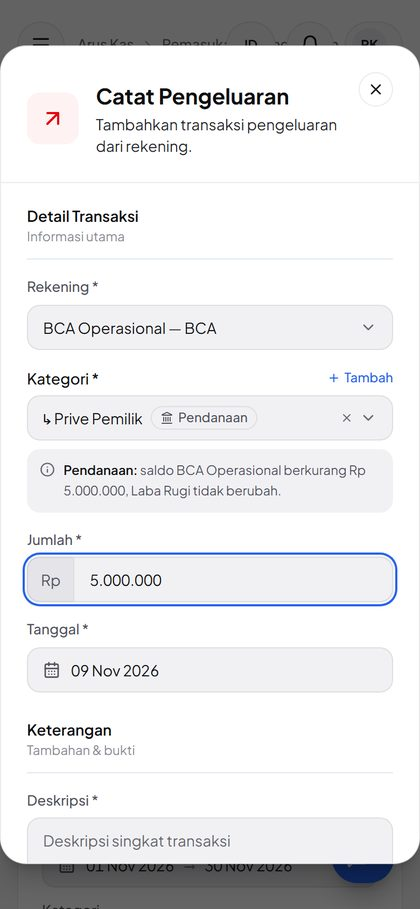 |

## A01 · Payload rakitan: kategori sistem, induk, dan arah salah ditolak server — Pass

_Tanpa langkah UI — Pemilih tidak pernah menawarkan kategori ini, jadi hanya terjangkau lewat permintaan rakitan. Lima POST /bank-transactions → 422 dengan pesan terbaca (sistem FIN-LOAN-IN, FIN-RCV-OUT, EXP-INTEREST; induk Pajak Titipan & PPN; Pendapatan Jasa untuk debit). DB: 8 transaksi identik sebelum & sesudah._

## A02 · Pengguna hanya-lihat: melihat pendanaan, tanpa tombol catat/centang; POST ditolak — Pass

| # | Langkah & yang terlihat | Layar |
|---|---|---|
| 1 | Lina (hanya-lihat): kartu **Beban Rp 12.465.000 · Pendanaan Rp 3.300.000 · Total keluar Rp 15.765.000** dan badge Pendanaan tampil; tidak ada **Input Pengeluaran** maupun kotak centang. | 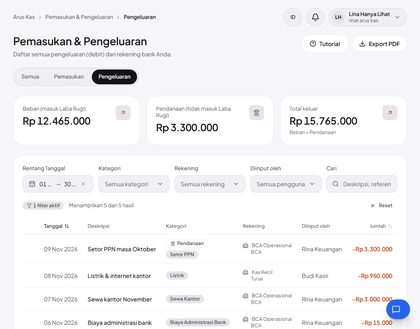 |

## A03 · Ubah transaksi: dialog menawarkan grup Pendanaan; ganti ke kategori sistem lewat PUT rakitan ditolak — Pass

| # | Langkah & yang terlihat | Layar |
|---|---|---|
| 1 | **Edit Pengeluaran** "Biaya administrasi bank": pemilih Kategori memuat bagian **Pendanaan · tidak masuk Laba Rugi** (Setor PPN, Setor Titipan Pajak Klien, Prive Pemilik …). | 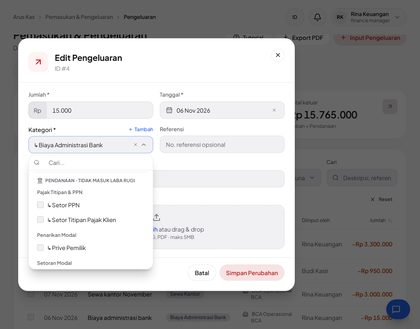 |

## C01 · Utang dari modul Utang: hanya-lihat di Arus Kas & Kas & Bank, tautan ke utangnya, server menolak ubah/hapus — Pass

| # | Langkah & yang terlihat | Layar |
|---|---|---|
| 1 | Utang › **Tambah utang**: Bank BRI, pokok Rp 50.000.000, 6 % p.a., 12 bulan, rekening BCA Operasional; nomor otomatis **LOAN-00001**. | 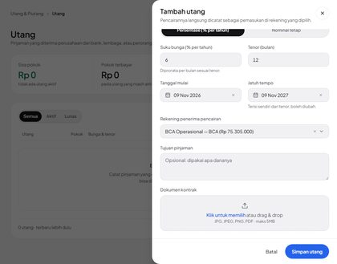 |
| 2 | Pemasukan: "Penerimaan pinjaman dari Bank BRI" bergembok, **Hanya-lihat · kelola di Utang →**, badge Pendanaan, tanpa centang; kartu Pendanaan Rp 75.000.000. | 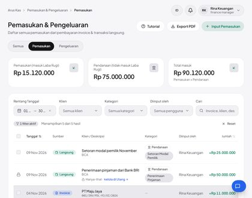 |
| 3 | Klik **kelola di Utang** → halaman Utang tersaring **LOAN-00001** (1 utang, Rp 50.000.000, Aktif). | 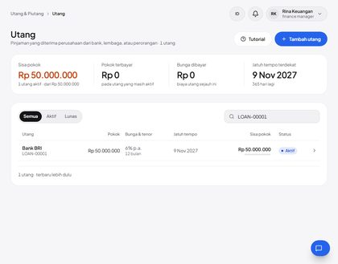 |
| 4 | **Catat pembayaran** LOAN-00001: pokok Rp 4.000.000 + bunga Rp 200.000 dari BCA Operasional. | 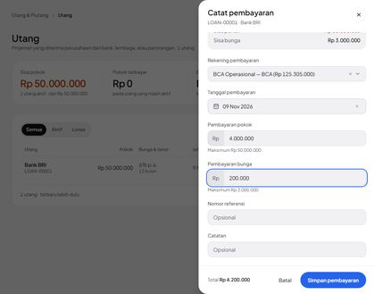 |
| 5 | Pengeluaran: pokok bergembok hanya-lihat (badge Pendanaan), bunga tampil sebagai beban biasa bercentang; kartu **Beban Rp 12.665.000 · Pendanaan Rp 7.300.000 · Total keluar Rp 19.965.000**. | 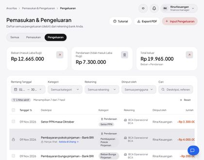 |
| 6 | Kas & Bank › BCA Operasional: pencairan bertanda **Hanya-lihat · kelola di Utang**, badge Pendanaan, tanpa tombol hapus dan centang. | 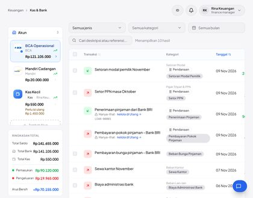 |

## C02 · Ringkasan bulan ini = Arus Kas Semua November — Pass

| # | Langkah & yang terlihat | Layar |
|---|---|---|
| 1 | Ringkasan: **Pemasukan 1–9 Nov Rp 90.120.000 · Pengeluaran Rp 19.965.000 · Arus bersih +Rp 70.155.000** (pendanaan ikut dihitung, seperti sejak dulu). | 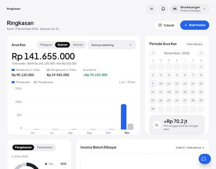 |
| 2 | Arus Kas › Semua 1–30 Nov: **Total masuk Rp 90.120.000 · Total keluar Rp 19.965.000 · Selisih +Rp 70.155.000** — kini sama dengan Ringkasan. | 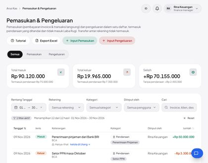 |

<!-- qa-evidence:end -->
