# Test Case — Kategori Transaksi › Pakai Template

Sumber teknis: [`docs/module/transaction-categories.md`](../../../module/transaction-categories.md) (bagian *Pakai Template*
dan *Kategori Awal Perusahaan Baru*), [`docs/module/profit-loss.md`](../../../module/profit-loss.md).
Cara baca tabel & kolom **Lapisan**: [`docs/qa/README.md`](../../README.md). Lingkungan, akun, dan data: [`README.md`](../README.md).

**Prasyarat**: lingkungan terisolasi `tplkat_*` (bukan production). Perusahaan `/c/tpllama` meniru perusahaan
**lama** (kategori dibuat sebelum template ada) — fixture skrip, lihat README › Data uji. Perusahaan `/c/tplbaru`
dibuat lewat layar di N01. Akun: Admin QA (admin), Fina Manajer QA (finance manager, `tpllama`), Lia Lihat QA
(peran uji "hanya lihat kategori" = `view dashboard` + `view categories`, `tpllama`). Viewport 1280×800 DPR 1
kecuali N04 (390×844 DPR 2, mode ponsel). Semua nominal rupiah penuh.

Fixture `tpllama` (35 kategori, 2 transaksi) — yang relevan untuk template:

| Kategori lama | Tipe | Grup L/R | Fungsi uji |
|---|---|---|---|
| `BEBAN  KANTOR` (huruf besar + spasi ganda) → sub `LISTRIK` | expense | induk kosong, sub opex | induk & sub sama dengan template (beda huruf/spasi) |
| `Operational Expenses` → sub `Internet & telepon` (+ 6 sub lama) | expense | kosong | sub template sudah ada di induk lain |
| `Beban Karyawan Proyek` → sub `Gaji Proyek` | expense | opex | nama **mirip**, bukan sama |
| `Beban Pemasaran` (datar) — dipakai 1 transaksi "Iklan Instagram Oktober" | expense | opex | penjaga: induk dipakai langsung |
| `PENGELUARAN LAIN-LAIN`, `HPP`, `CAPEX`, `Penghasilan` (+ sub lama) | — | kosong | kategori bawaan lama, tidak boleh tersentuh |

Rencana yang diharapkan untuk `tpllama`: **59 baru, 3 sudah ada** (induk Beban Kantor + sub Listrik + sub Internet &
Telepon), **5 dilewati** (grup Beban Pemasaran: induk + 4 sub). 59 + 3 + 5 = 67 = isi template.

## A. Kondisi Normal

| ID | Skenario | Langkah | Hasil Diharapkan | Lapisan | Hasil Aktual | Status |
|---|---|---|---|---|---|---|
| N01 | Perusahaan baru langsung berisi template; pratinjau semua "Sudah ada" | Admin › Administrasi › Perusahaan › **Perusahaan baru**: "PT Template Baru QA", kode `tplbaru`, singkatan `TPB` → Buat perusahaan → lengkapi profil → Operasional › Kategori Transaksi → **Pakai Template** | Langkah "Data awal diisi" menyebut template; DB perusahaan baru: 77 kategori (6 sistem, 2 modal, Transfer Internal → Antar Rekening Sendiri, 12 induk + 55 sub template), 0 pemasukan/pengeluaran tanpa grup L/R, tanpa label khas Kisantra; dialog Baru 0 / Sudah ada 67 / Dilewati 0, tombol nonaktif "Tidak ada kategori baru" | FE+BE | Provisioning `tplkat_central_tenant_tplbaru` OK. SQL: 77 total, 21 induk, 56 sub, 6 `system_key`, 0 belum diklasifikasi, 0 label lama, 1 sub "Antar Rekening Sendiri". Halaman: Total 77, Utama 21, Sub 56, Belum Diklasifikasi 0. Dialog: Baru 0, Sudah ada 67, Dilewati 0, "Semua 67 kategori template sudah ada atau dilewati. Tidak ada yang perlu dibuat.", tombol **Tidak ada kategori baru** (nonaktif). | Pass |
| N02 | Pratinjau campuran di perusahaan lama | FM (`tpllama`) → Kategori Transaksi → **Pakai Template**; gulir ke Beban Karyawan, Beban Kantor, Beban Pemasaran | Ringkasan 59 / 3 / 5. "Beban Kantor" **Sudah ada** + "Sub baru ditempel ke kategori induk lama …"; Listrik **Sudah ada**; Internet & Telepon **Sudah ada** di grup "Operational Expenses" dengan baris L/R "Belum diklasifikasi"; Beban Karyawan **Baru** (tidak digabung dengan "Beban Karyawan Proyek"); Beban Pemasaran + 4 sub **Dilewati** dengan alasan; tiap baris menampilkan baris Laba Rugi tujuan | FE | Sesuai seluruhnya. Alasan: "\"Beban Pemasaran\" sudah dipakai langsung oleh 1 transaksi. Sub-kategori akan menjadikannya judul grup yang tidak bisa dipilih, padahal data lama itu memakainya."; sub-subnya "Grup induknya dilewati.". Tombol **Buat 59 kategori**. Konsol tanpa error. Catatan: setelah case ini, catatan "Sudah ada di grup …" dibatasi untuk sub yang tinggal di grup **lain** (UX-T1, lihat laporan); bukti N02-4 masih memperlihatkan catatan itu juga pada Listrik. | Pass |
| N03 | Buat kategori dari template: hanya yang baru dibuat, kategori lama tidak berubah, tombol nonaktif saat memproses | Snapshot SQL 35 baris lama → dialog → **Buat 59 kategori** (jaringan diperlambat "Slow 3G"; satu klik kedua dikirim saat tombol nonaktif) → cari "Kantor" → SQL | Tombol & Batal nonaktif + spinner selama proses, hanya 1 POST; toast "59 kategori dibuat, 3 dilewati karena sudah ada. 5 lainnya dilewati, alasannya tercantum di pratinjau Pakai Template."; DB 94 kategori; 35 baris lama identik (termasuk `updated_at`); sub baru Beban Kantor menempel ke `BEBAN  KANTOR` tanpa membuat induk kembar; "Internet & Telepon" tidak dibuat; Beban Pemasaran tetap tanpa sub; semua kategori baru ber-grup L/R | FE+BE | Linimasa DOM: 52 ms "tombol nonaktif + spinner, Batal nonaktif" … 4.733 ms dialog tertutup; klik kedua saat nonaktif tidak mengirim apa pun (Network: 1× `POST …/template` 302). Toast persis sesuai harapan (dibaca dari DOM; toast hilang sebelum tangkapan layar berikutnya). Halaman: Total 94, Utama 27, Sub 67, Belum Diklasifikasi tetap 21. SQL: md5 35 baris lama sebelum = sesudah (`16ed566d…`); 59 baru (10 induk, 49 sub), 0 tanpa grup; anak id 97 `BEBAN  KANTOR` = LISTRIK + Sewa Kantor, Air, Kebersihan & Keamanan, Konsumsi Kantor & Rapat (opex); 1 induk "beban kantor" ternormalisasi; "Internet & telepon" tetap 1 baris di Operational Expenses; anak Beban Pemasaran 0; 0 sub baru yang tipe/grupnya beda dengan induk baru. | Pass |
| N04 | Dialog di layar ponsel tidak meluap ke samping | Viewport 390×844 (mobile, touch) → Kategori Transaksi → **Pakai Template** → gulir ke Beban Kantor | Tombol header turun baris; dialog selebar layar tanpa geser samping; baris L/R turun ke bawah nama; catatan membungkus; tombol footer terlihat | FE | `document.scrollWidth − clientWidth` = 0; isi gulir dialog `scrollWidth − clientWidth` = 0; tidak ada elemen di luar batas dialog; tombol **Buat 59 kategori** & Batal (bertumpuk, lebar penuh) terlihat. Nama, "Laba Rugi: …", catatan, dan badge terbaca. | Pass |

## B. Kondisi Tidak Normal / Edge Case

| ID | Skenario | Langkah | Hasil Diharapkan | Lapisan | Hasil Aktual | Status |
|---|---|---|---|---|---|---|
| A01 | Pengguna hanya-lihat: tombol tidak tampil, pratinjau tidak tersedia, POST ditolak | Login Lia (peran `view dashboard` + `view categories`) → Kategori Transaksi; dari halaman yang sama: partial reload `templatePreview` (header Inertia persis seperti dialog) dan `POST /c/tpllama/transaction-categories/template` | Tidak ada tombol **Pakai Template**; partial reload 200 dengan `templatePreview: null`; POST 403; jumlah kategori tidak berubah | FE+BE | Header hanya Tutorial + Tambah Kategori. Izin dari prop `auth.permissions`: `["view dashboard","view categories"]`. Partial reload: 200, prop `errors` + `templatePreview` = `null`. POST: 403 `This action is unauthorized.`. SQL: tetap 94 kategori, `MAX(id)` 161. Catatan K-T1: tombol **Tambah Kategori** & ikon edit/hapus tetap tampil untuk pengguna ini (perilaku lama, server menolak 403). | Pass |
| A02 | Induk dipakai langsung → grupnya dilewati, transaksi lamanya tetap bisa diedit | Setelah N03: cari "Pemasaran" di Kategori Transaksi; Arus Kas › Pengeluaran › cari "Iklan" → klik baris → ubah Deskripsi menjadi "Iklan Instagram Oktober (revisi QA)" → **Simpan Perubahan** | "Beban Pemasaran" tetap kategori datar (tanpa "(N sub)") dengan 1 pemakaian; sub Iklan & Promosi dkk. tidak dibuat; edit transaksi tersimpan, kategorinya tetap Beban Pemasaran | FE+BE | Daftar: "Beban Pemasaran · Beban Operasional · 1 pemakaian", tanpa sub. Toast "Transaksi berhasil diperbarui". SQL transaksi #1: deskripsi baru, `category_id` 102 (Beban Pemasaran, 0 anak), `updated_by` 2 (Fina). Catatan K-T2: di dialog Edit, kolom Kategori menampilkan "Pilih kategori" karena kategori datar tidak ditawarkan pemilih — perilaku lama, tidak menghalangi simpan. | Pass |
| A03 | Klik ulang setelah diterapkan tidak membuat apa pun | Setelah N03 buka lagi **Pakai Template**; lalu `POST …/template` langsung dari sesi FM | Ringkasan 0 / 62 / 5, tombol nonaktif "Tidak ada kategori baru"; POST langsung → flash "0 kategori dibuat, 62 dilewati karena sudah ada. 5 lainnya dilewati, …"; DB tetap 94 | FE+BE | Dialog: Baru 0, Sudah ada 62, Dilewati 5; tombol **Tidak ada kategori baru** (nonaktif). POST langsung: redirect ke daftar, flash persis sesuai harapan. SQL: 94 kategori, `MAX(id)` 161 (= 102 + 59), tidak ada baris baru. | Pass |
| A04 | Pratinjau gagal dimuat → state galat + Coba lagi; skeleton saat memuat | Jaringan DevTools "Offline" → **Pakai Template**; lalu "Slow 3G" → **Coba lagi**; buka ulang dialog sambil merekam linimasa DOM | Dialog tetap terbuka (halaman tidak berpindah) dengan "Pratinjau template gagal dimuat" + **Coba lagi**, tombol Buat nonaktif; setelah Coba lagi pratinjau tampil; selama memuat tampil skeleton dan tombol nonaktif | FE | Galat: alert "Pratinjau template gagal dimuat · Belum ada kategori yang dibuat. Periksa koneksi, lalu coba lagi." + **Coba lagi**, tombol "Buat kategori" nonaktif, URL tetap. Coba lagi → ringkasan 59/3/5. Linimasa DOM (Slow 3G): 103 ms skeleton + "Buat kategori (nonaktif)" → 2.406 ms pratinjau + "Buat 59 kategori". Skeleton hanya terbukti lewat DOM, tidak tertangkap layar (lihat Kendala alat uji). | Pass |
| A05 | Daftar dari klien diabaikan server | Sesi FM: `POST …/template` JSON berisi grup rakitan `{label: "Kategori Titipan Klien", children: ["Sisipan Klien"], status: "new"}` | Server menghitung rencana sendiri: flash "0 kategori dibuat, 62 …"; kategori rakitan tidak tercipta | BE | Sesuai: flash "0 kategori dibuat, 62 dilewati karena sudah ada. 5 lainnya dilewati, …"; SQL: 0 baris "Kategori Titipan Klien"/"Sisipan Klien", tetap 94. UI tidak pernah mengirim daftar (POST tanpa isi), jadi kondisi ini hanya terjangkau lewat request rakitan. | Pass |

## C. Alur Berantai (lintas modul)

| ID | Skenario | Langkah | Hasil Diharapkan | Lapisan | Hasil Aktual | Status |
|---|---|---|---|---|---|---|
| C01 | Sub template dipakai transaksi → masuk Beban Operasional di Laba Rugi, bukan "belum diklasifikasi" | FM: Arus Kas › Pengeluaran › **Input Pengeluaran** → Rekening BCA Operasional, Kategori (pemilih) "Beban Karyawan › ↳ Gaji Karyawan", 5.000.000, 9 Nov 2026, "Gaji staf administrasi November 2026" → Simpan; Laporan › Laba Rugi 1 Okt–30 Nov 2026 | Pemilih menampilkan judul kelompok "Beban Karyawan" + "↳ Gaji Karyawan"; transaksi tersimpan; Laba Rugi: Beban Operasional › Gaji Karyawan Rp 5.000.000; panel Perlu Diklasifikasi hanya berisi kategori lama (MAKAN MINUM), bukan Gaji Karyawan | FE+BE | Pemilih: kelompok "Beban Karyawan" dengan ↳ BPJS Kesehatan … ↳ Gaji Karyawan. Toast "Pengeluaran berhasil dicatat". SQL #3: debit 5.000.000, kategori Gaji Karyawan (opex) di Beban Karyawan, `created_by` 2. Laba Rugi: Beban Operasional = Beban Pemasaran Rp 750.000 + **Gaji Karyawan Rp 5.000.000** = Rp 5.750.000; Perlu Diklasifikasi (1) = MAKAN MINUM Rp 250.000. | Pass |

<!-- qa-evidence:start -->

# Bukti visual langkah per langkah

Screenshot diambil per langkah, bukan hanya hasil akhirnya, supaya alurnya
bisa ditelusuri ulang oleh orang lain. Test case yang kondisinya tidak bisa
dicapai dari layar dijalankan lewat API/DB dan ditandai eksplisit — tidak
dibuatkan screenshot seolah-olah ada alur UI-nya.

## N01 · Perusahaan baru langsung berisi template; pratinjau semua Sudah ada — Pass

| # | Langkah & yang terlihat | Layar |
|---|---|---|
| 1 | Dialog **Perusahaan baru** (PT Template Baru QA, `tplbaru`): langkah *Data awal diisi* kini menyebut template kategori yang sudah ber-grup Laba Rugi. | 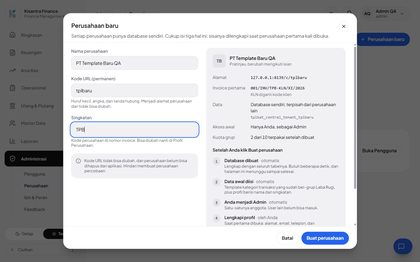 |
| 2 | Perusahaan baru setelah profil dilengkapi: **Total 77**, Utama 21, Sub 56, **Belum Diklasifikasi 0**; grup HPP (Tanpa Invoice) sudah bergrup Harga Pokok (HPP). | 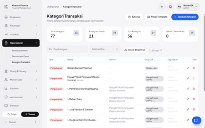 |
| 3 | **Pakai Template**: Baru 0, Sudah ada 67, Dilewati 0, "Tidak ada yang perlu dibuat"; tombol **Tidak ada kategori baru** nonaktif. | 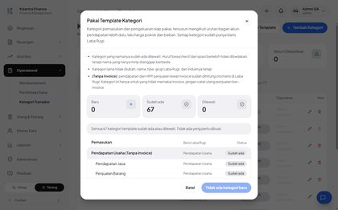 |

## N02 · Pratinjau campuran di perusahaan lama — Pass

| # | Langkah & yang terlihat | Layar |
|---|---|---|
| 1 | Perusahaan lama (FM): header baru berisi **Tutorial · Pakai Template · Tambah Kategori**; 35 kategori, 21 belum diklasifikasi. | 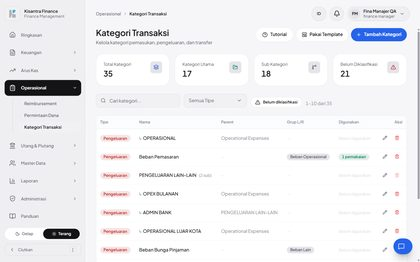 |
| 2 | Pratinjau: penjelasan (dilewati bila sudah ada, kategori lama tidak diubah, arti *(Tanpa Invoice)*), ringkasan **Baru 59 · Sudah ada 3 · Dilewati 5**, tombol **Buat 59 kategori**. |  |
| 3 | **Beban Karyawan** berstatus Baru dengan 8 sub — tidak digabung dengan induk lama *Beban Karyawan Proyek* (nama mirip ≠ sama). Kolom kanan = baris Laba Rugi tujuan. | 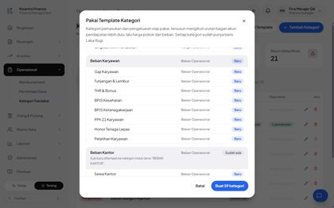 |
| 4 | **Beban Kantor**: Sudah ada, sub baru ditempel ke induk lama *BEBAN  KANTOR*; Listrik Sudah ada; Internet & Telepon Sudah ada di grup *Operational Expenses* (L/R: Belum diklasifikasi). Catatan pada Listrik dihapus kemudian (UX-T1). | 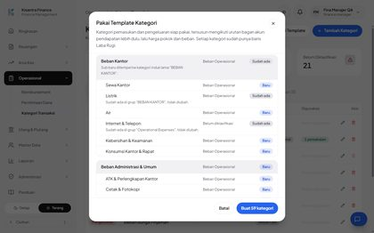 |
| 5 | **Beban Pemasaran** + 4 sub Dilewati: induknya dipakai langsung oleh 1 transaksi; alasannya tertulis di baris. | 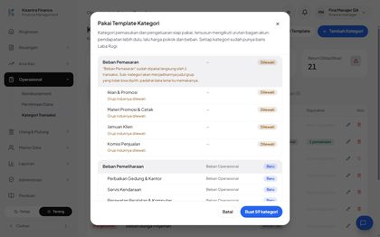 |

## N03 · Buat kategori dari template: hanya yang baru, kategori lama tidak berubah — Pass

| # | Langkah & yang terlihat | Layar |
|---|---|---|
| 1 | Sebelum menerapkan: dialog siap dengan tombol **Buat 59 kategori** (snapshot SQL 35 baris lama diambil sebelumnya). |  |
| 2 | Sesudah: **Total 94**, Utama 27, Sub 67, Belum Diklasifikasi tetap **21** (kategori baru semuanya bergrup). Toast "59 kategori dibuat, 3 dilewati karena sudah ada. 5 lainnya dilewati…" dibaca dari DOM. |  |
| 3 | Cari "Kantor": *BEBAN KANTOR (5 sub)* tetap tanpa grup L/R (tidak diubah); sub baru Sewa Kantor & Konsumsi Kantor & Rapat menempel padanya, bergrup Beban Operasional. | 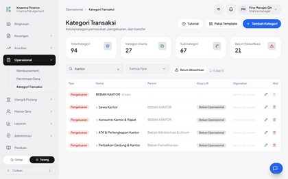 |

## N04 · Dialog di layar ponsel tidak meluap ke samping — Pass

| # | Langkah & yang terlihat | Layar |
|---|---|---|
| 1 | Ponsel 390 px: tombol header (Tutorial, Pakai Template, Tambah Kategori) turun baris, tidak meluap. | 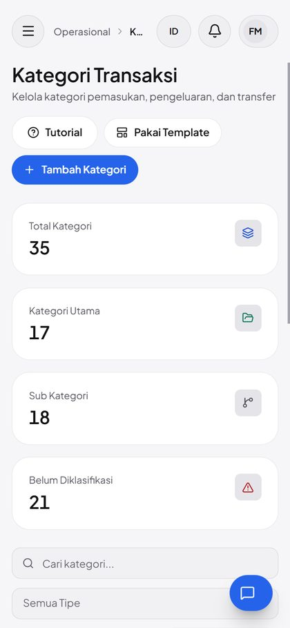 |
| 2 | Dialog selebar layar; penjelasan & ringkasan terbaca; tombol **Buat 59 kategori** dan Batal (lebar penuh) tetap terlihat di bawah. | 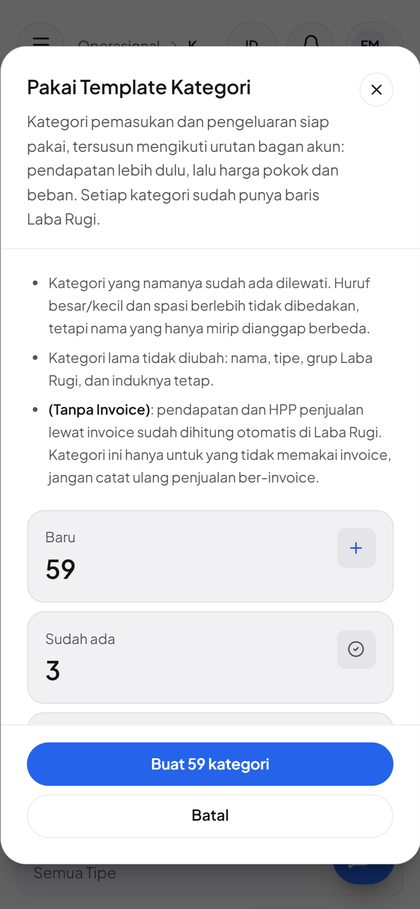 |
| 3 | Baris grup: "Laba Rugi: …" turun ke bawah nama, catatan membungkus, badge status di kanan — tanpa geser samping. | 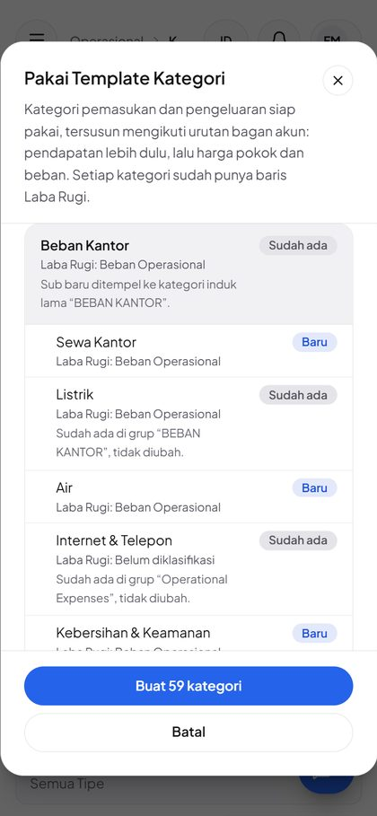 |

## A01 · Pengguna hanya-lihat: tanpa tombol, pratinjau null, POST 403 — Pass

| # | Langkah & yang terlihat | Layar |
|---|---|---|
| 1 | Lia (hanya `view dashboard` + `view categories`): header hanya **Tutorial** dan Tambah Kategori — tombol **Pakai Template** tidak ada. | 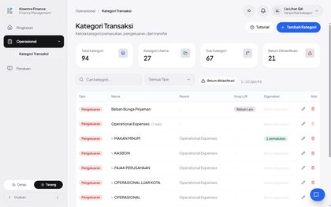 |

## A02 · Induk dipakai langsung: grup dilewati, transaksi lama tetap bisa diedit — Pass

| # | Langkah & yang terlihat | Layar |
|---|---|---|
| 1 | Setelah N03: *Beban Pemasaran* tetap kategori datar (tanpa sub), 1 pemakaian — template tidak menempelkan sub ke induk yang dipakai langsung. | 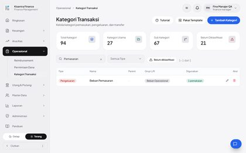 |
| 2 | Arus Kas › Pengeluaran › edit "Iklan Instagram Oktober" (ID #1). Kolom Kategori kosong karena kategori datar tidak ditawarkan pemilih (K-T2, perilaku lama). | 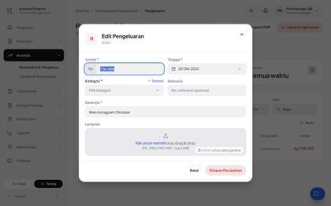 |
| 3 | Simpan berhasil: toast *Transaksi berhasil diperbarui*, baris kini "(revisi QA)" dan tetap berkategori **Beban Pemasaran**. | 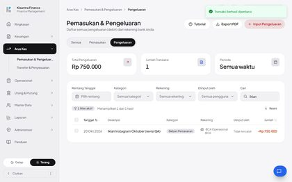 |

## A03 · Klik ulang setelah diterapkan tidak membuat apa pun — Pass

| # | Langkah & yang terlihat | Layar |
|---|---|---|
| 1 | Dibuka ulang: **Baru 0 · Sudah ada 62 · Dilewati 5**, "Tidak ada yang perlu dibuat", tombol **Tidak ada kategori baru** nonaktif. Catatan "Sudah ada di grup" tidak lagi muncul untuk sub di grupnya sendiri (setelah UX-T1). | 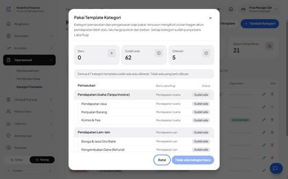 |

## A04 · Pratinjau gagal dimuat: state galat + Coba lagi — Pass

| # | Langkah & yang terlihat | Layar |
|---|---|---|
| 1 | Jaringan *Offline*: alert **Pratinjau template gagal dimuat** + **Coba lagi**; tombol "Buat kategori" nonaktif; halaman tetap di Kategori Transaksi. | 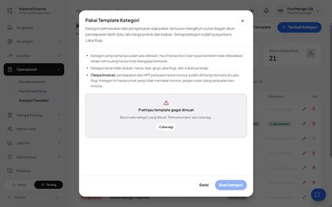 |
| 2 | Jaringan pulih → **Coba lagi**: pratinjau 59 / 3 / 5 tampil kembali. | 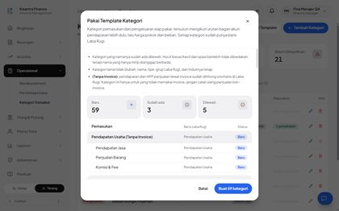 |

## A05 · Daftar kategori dari klien diabaikan server — Pass

_Tanpa langkah UI — POST rakitan berisi grup palsu → 0 kategori dibuat; UI tidak pernah mengirim daftar sehingga hanya terjangkau lewat request langsung._

## C01 · Gaji Karyawan dari template → Beban Operasional di Laba Rugi — Pass

| # | Langkah & yang terlihat | Layar |
|---|---|---|
| 1 | Input Pengeluaran: pemilih menampilkan judul kelompok **Beban Karyawan** dan sub-subnya, termasuk **↳ Gaji Karyawan**. | 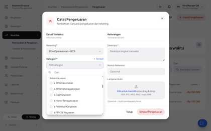 |
| 2 | Form terisi: BCA Operasional, ↳ Gaji Karyawan, Rp 5.000.000, 09 Nov 2026, "Gaji staf administrasi November 2026". | 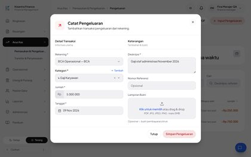 |
| 3 | Laba Rugi 1 Okt–30 Nov: panel **Perlu Diklasifikasi (1)** hanya berisi kategori lama MAKAN MINUM Rp 250.000 — Gaji Karyawan tidak ada di sana. | 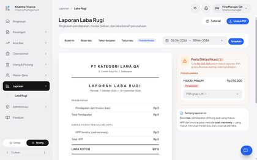 |
| 4 | Beban Operasional: **Gaji Karyawan Rp 5.000.000** (+ Beban Pemasaran Rp 750.000) = Rp 5.750.000. | 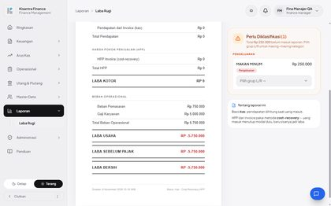 |

<!-- qa-evidence:end -->
