# Test Case — Multi bahasa (ID · EN · ZH), keadaan SEBELUM perubahan

Sumber dugaan: rencana multi bahasa §1–§2 (pembacaan kode). Rujukan kode: `app/Http/Middleware/SetLocale.php`, `routes/web.php` (`/language`),
`config/app.php`, `app/Providers/AppServiceProvider.php`, `resources/js/layouts/header.tsx`.
Cara baca tabel & kolom **Lapisan**: [`docs/qa/README.md`](../../README.md). Lingkungan, akun, dan langkah reproduksi: [`README.md`](../README.md).

**Tujuan**: membuktikan atau membantah dugaan tentang perilaku multi bahasa di kode saat ini, **sebelum** ada perubahan.
Status memakai **Terbukti / Terbantah / Terbukti sebagian** (bukan Pass/Fail) karena kasus ini mengukur dugaan, bukan fungsi yang diharapkan benar.

**Prasyarat**: lingkungan terisolasi `bhs_*` (bukan production). Perusahaan `/c/bahasaqa` ("PT Bahasa QA", PKP 11 %): 3 rekening
(BCA Operasional, Mandiri Cadangan, Kas Kecil), 3 invoice terbit (`001–003/INV/BQA-…/XI/2026`), 17 transaksi seed + 1 transaksi uji.
Akun UI: Rina Keuangan (finance manager); kata sandi tidak dicantumkan.

## A. Kondisi Normal

| ID | Skenario | Langkah | Hasil Diharapkan (dugaan) | Lapisan | Hasil Aktual | Status |
|---|---|---|---|---|---|---|
| N01 | Tampilan ID sebagai pembanding | Login Rina (finance manager) → Dashboard → Arus Kas › Semua → Input Pemasukan → Invoice. | Semua layar berbahasa Indonesia, pemilih bahasa menunjukkan ID. | FE | Sesuai. Dashboard (Ringkasan), Arus Kas, dialog Catat Pemasukan, dan daftar Invoice berbahasa Indonesia; pemilih di header menunjukkan ID. Console browser: hanya peringatan Radix "Missing `Description` or `aria-describedby`" pada DialogContent (bukan soal bahasa). `users.locale` awal = `id` (bawaan kolom). | Pass |

## B. Kasus berdugaan (dibuktikan atau dibantah)

| ID | Skenario | Langkah | Hasil Diharapkan (dugaan) | Lapisan | Hasil Aktual | Status |
|---|---|---|---|---|---|---|
| A01 | Memilih English di pemilih bahasa header | Dashboard → klik tombol bahasa di header → pilih **EN** → periksa layar, respons jaringan, `users.locale`, dan sesi di DB. | Dugaan: tidak ada yang berubah dan tanpa pesan (`config/app.php` hanya `['id','zh']`, rute `/language` menolak diam-diam). | FE+BE | **Terbukti.** Menu menawarkan tiga bahasa (Indonesia, English, 中文). Setelah klik EN: `POST /language` → **302** (tanpa pesan), tombol header tetap **ID**, seluruh halaman tetap Indonesia, tanpa toast. DB: `users.locale` tetap `id`, sesi tetap `id`. Empat layar utama dalam "EN" identik dengan ID (screenshot PR `en-*` = `id-*`). | Terbukti |
| A02 | Pilih ZH → simpan transaksi pemasukan → kirim formulir kosong | Dashboard → pilih **ZH** → Arus Kas › Semua → Input Pemasukan → Jumlah 1.500.000, kategori Pendapatan Jasa, deskripsi "Uji bahasa ZH pemasukan" → Simpan → buka lagi dialog, Simpan tanpa mengisi apa pun. Pembanding: formulir kosong yang sama di sesi ID. | Dugaan: label tetap Indonesia; toast sukses mungkin Mandarin; pesan validasi berbahasa Inggris (`lang/zh/validation.php` berisi teks Inggris). | FE+BE | (1) Label tetap Indonesia: **terbukti**: pemilih menunjukkan ZH, `users.locale` = `zh`, tetapi menu, dialog, kotak Jurnal, dan tombol semuanya Indonesia. (2) Toast sukses Mandarin: **terbantah**: toast = "Pemasukan berhasil dicatat" (Indonesia); teksnya tertulis langsung di klien (`transaction-form-dialog.tsx`, `toast.success(...)`), bukan dari server, jadi bahasa server tidak berperan. Toast galat juga Indonesia: "Periksa kembali isian form". (3) Validasi Inggris: **terbukti**: pesan kolom "The nominal field must be at least 1.", "The kategori transaksi field is required.", "The deskripsi field is required." (kalimat Inggris + nama kolom Indonesia). Pembanding sesi ID: "Nominal minimal 1.", "Kategori transaksi wajib diisi.", "Deskripsi wajib diisi.". DB: transaksi tersimpan (id 20). | Terbukti sebagian (toast terbantah) |
| A03 | Preferensi bahasa tersimpan tidak dipakai di sesi baru | Login → pilih ZH → menu pengguna › Keluar → bersihkan semua cookie → buka halaman login → login lagi. Periksa `users.locale` sebelum/sesudah. | Dugaan: kembali ID walau `users.locale = zh` (urutan prioritas `SetLocale`: sesi mengalahkan pengguna dan sesi ditulis setiap request). | FE+BE | **Terbukti.** `users.locale`: **zh** sebelum (sudah zh dari A02), **zh** setelah memilih ZH, **zh** setelah keluar, **zh** setelah login ulang. Namun halaman login (sesi baru, 0 cookie) berbahasa Indonesia, dan setelah login pemilih menunjukkan **ID**, `<html lang="id">`, seluruh tampilan Indonesia. Preferensi tersimpan tidak pernah terbaca. | Terbukti |
| A04 | PDF invoice ikut bahasa tampilan dan font tanpa huruf Mandarin | Sesi ID: Invoice › buka 001/INV/BQA-MJ/XI/2026 › Cetak › Unduh PDF (pembanding). Pilih ZH → ulangi. Simpan PDF, render halaman 1 (PyMuPDF), baca teksnya. | Dugaan: label Mandarin atau tanda "?" karena font tanpa huruf Mandarin; terbilang tetap Indonesia. | FE | **Terbukti.** PDF ZH (1 halaman): label diganti Mandarin lalu **tercetak sebagai "?"** (judul "?? ??", "????? :", kepala tabel "??", total "????" dst.); kata Mandarin tidak terbaca sama sekali. Terbilang tetap Indonesia: "Tujuh Juta Tiga Ratus Ribu ???" (ekor Mandarin juga jadi "?"). Nama, nomor invoice, dan angka normal. PDF ID pembanding berlabel Indonesia penuh ("INVOICE PELUNASAN", "Ditagih Kepada :"). Dialog Cetak sendiri Indonesia di kedua sesi. | Terbukti |
| A05 | Nama bulan & hari kalender ikut bahasa aktif | Sesi ZH → Input Pemasukan → klik kolom Tanggal. Baca judul kalender, kepala hari, dan aria-label tombol. | Dugaan: tetap Indonesia. | FE | **Terbukti.** Judul "November 2026", kepala hari "Sen Sel Rab Kam Jum Sab Min" (aria: Senin…Minggu), minggu dimulai Senin, tanggal terpilih "10 Nov 2026". Tambahan: tombol navigasi bulan memuat aria-label ganda: bawaan pustaka berbahasa Inggris "Go to the Previous Month"/"Go to the Next Month" dan "Bulan sebelumnya"/"Bulan berikutnya". | Terbukti |
| A06 | Label bulan/tanggal buatan server ikut Carbon | Sesi ZH → Dashboard (Bulanan, Mingguan) → Kas & Bank › grafik Pemasukan vs Pengeluaran. Baca label dari DOM. | Dugaan lemah: kemungkinan sudah Mandarin karena Carbon ikut `App::setLocale`. | FE | **Terbukti, dengan catatan campuran.** Label buatan server memang Mandarin: sumbu Dashboard "6月 7月 8月 9月 10月 11月", keterangan "Pemasukan 1–10 11月" / "Pengeluaran 1–10 11月" / "1–10 11月 2026"; sumbu Kas & Bank "12月 2025 … 11月 2026". Label buatan klien tetap Indonesia: "1 Jun – 30 Nov", "24 Agu – 15 Nov", legenda, judul kartu. Akibatnya satu kalimat bisa bercampur ("1–10 11月"); tanggal panjang "Selasa, 10 November 2026" tetap Indonesia. | Terbukti |
| A07 | Email reset kata sandi di sesi ID dan ZH | Tamu (sesi ID): /forgot-password → kirim fm@bhs.test (dan admin@bhs.test). Tamu pilih ZH (POST /language) → kirim budi@bhs.test. Ambil isi email dari log (`MAIL_MAILER=log`, saluran `daily`). | Dugaan: email berbahasa Inggris baik saat sesi ID maupun ZH. | FE+BE | **Terbukti.** Ketiga email berjudul "Reset Password Notification", isi Inggris ("Hello!", "You are receiving this email because we received a password reset request…", "Regards, Finance Management", tombol "Reset Password"). Tidak ada perbedaan antara sesi ID dan ZH. Pesan di halaman setelah kirim juga Inggris: "A reset link will be sent if the account exists." sementara sisa halaman Indonesia. Token tautan disamarkan. | Terbukti |
| A08 | Temuan tambahan: tamu tidak bisa memilih bahasa | Buka /login sebagai tamu; hitung tombol pemilih bahasa; kirim POST /language `en` lalu `zh` lewat skrip; muat ulang login. | (Tidak ada dugaan tertulis.) | FE | Halaman login tidak punya pemilih bahasa (0 tombol `aria-haspopup=listbox`). Setelah POST /language en/zh sebagai tamu, tampilan login tetap Indonesia sepenuhnya; hanya atribut `<html lang>` menjadi `zh` untuk ZH. Panel pratinjau di kanan juga Indonesia. | Terbukti |
| A09 | Hitung kasar teks Latin/Indonesia yang tersisa di layar ZH | Sesi ZH: ekstrak `document.body.innerText` Dashboard, Arus Kas (Semua), Invoice, dan Login; hitung baris berhuruf Mandarin vs Latin. | (Temuan bebas.) | FE | Dashboard 214 baris (165 bermakna): hanya **15** mengandung Mandarin, semuanya label bulan buatan server; **145** berhuruf Latin. Arus Kas 207 baris (203 bermakna): **0** Mandarin, 203 Latin. Invoice 105 baris (94): **0** Mandarin, 94 Latin. Login 54 baris (48): **0** Mandarin, 41 Latin. Contoh yang tidak diterjemahkan: "Ringkasan", "Keuangan", "Arus Kas", "Utang & Piutang", "Master Data", "Laporan", "Administrasi", "Tutorial", "Buat Invoice", "Pemasukan & Pengeluaran", "Selamat datang kembali", "Masuk ke Dasbor", "Kirim Tautan Reset". Sebagian baris Latin adalah data seed (nama klien/rekening, nomor invoice), jadi angka Latin dilebihkan; baris UI hampir seluruhnya Indonesia. Console: hanya peringatan Radix tentang `aria-describedby`; tidak ada galat. | Terbukti |

<!-- qa-evidence:start -->

# Bukti visual langkah per langkah

Screenshot diambil per langkah, bukan hanya hasil akhirnya, supaya alurnya
bisa ditelusuri ulang oleh orang lain. Test case yang kondisinya tidak bisa
dicapai dari layar dijalankan lewat API/DB dan ditandai eksplisit — tidak
dibuatkan screenshot seolah-olah ada alur UI-nya.

## N01 · Tampilan Indonesia (baseline) — Pass

| # | Langkah & yang terlihat | Layar |
|---|---|---|
| 1 | Dashboard dalam bahasa Indonesia (pemilih bahasa menunjukkan ID). |  |
| 2 | Arus Kas tab Semua dalam bahasa Indonesia. |  |
| 3 | Dialog Catat Pemasukan dalam bahasa Indonesia. | 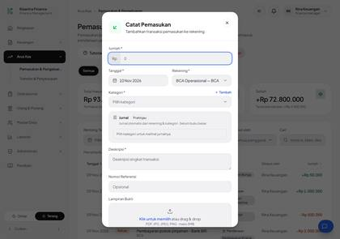 |
| 4 | Daftar Invoice dalam bahasa Indonesia. | 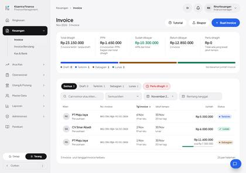 |

## A01 · Pilih EN: tidak ada yang berubah, tanpa pesan — Terbukti

| # | Langkah & yang terlihat | Layar |
|---|---|---|
| 1 | Menu bahasa di header terbuka: tiga pilihan Indonesia, English, 中文. |  |
| 2 | Setelah memilih EN: halaman tetap berbahasa Indonesia, tanpa pesan apa pun. |  |

## A02 · Pilih ZH: label Indonesia, toast, dan validasi — Terbukti sebagian: toast terbantah

| # | Langkah & yang terlihat | Layar |
|---|---|---|
| 1 | Setelah memilih ZH: pemilih menunjukkan ZH, tetapi menu dan seluruh isi halaman tetap berbahasa Indonesia. |  |
| 2 | Dialog Catat Pemasukan di sesi ZH terisi: seluruh label, kotak Jurnal, dan tombol tetap bahasa Indonesia. | 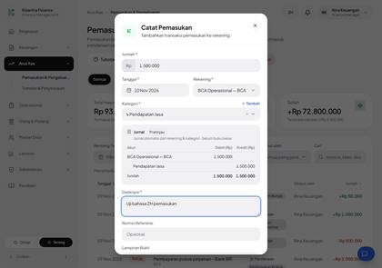 |
| 3 | Toast sukses setelah menyimpan di sesi ZH. | 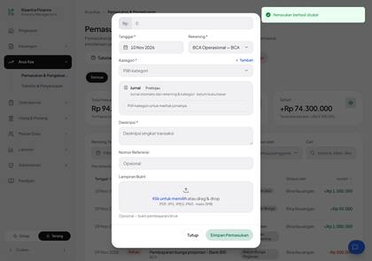 |
| 4 | Formulir kosong dikirim di sesi ZH: pesan validasi dari server (Inggris bercampur nama kolom Indonesia) dan toast "Periksa kembali isian form" (Indonesia). | 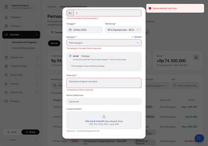 |
| 5 | Pembanding: formulir kosong yang sama dikirim di sesi ID (users.locale = zh di DB, tetapi sesi baru berbahasa ID): pesan validasi. | 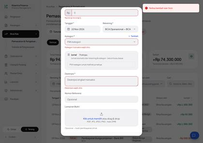 |

## A03 · ZH → keluar → sesi baru → login: bahasa kembali ke ID — Terbukti

| # | Langkah & yang terlihat | Layar |
|---|---|---|
| 1 | Sesi pertama: bahasa ZH dipilih (pemilih menunjukkan ZH); users.locale = zh di database. |  |
| 2 | Menu pengguna dibuka; pilih Keluar. | 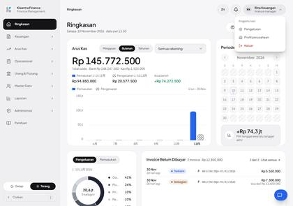 |
| 3 | Setelah Keluar dan cookie dibersihkan (sesi baru): halaman login berbahasa Indonesia; users.locale masih zh di database. | 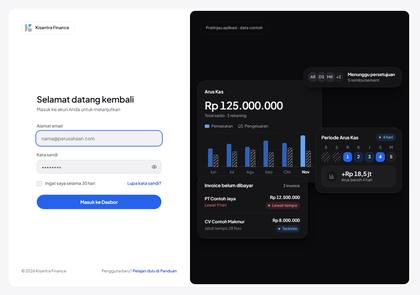 |
| 4 | Login ulang di sesi baru: pemilih menunjukkan ID dan seluruh tampilan Indonesia walau users.locale tetap zh. | 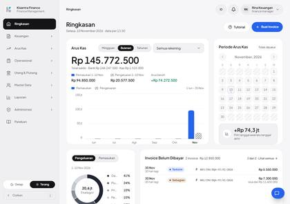 |

## A04 · Unduh PDF invoice saat ZH — Terbukti

| # | Langkah & yang terlihat | Layar |
|---|---|---|
| 1 | Sesi ZH: invoice 001/INV/BQA-MJ/XI/2026 dibuka, dialog "Cetak invoice" tampil dalam bahasa Indonesia. | 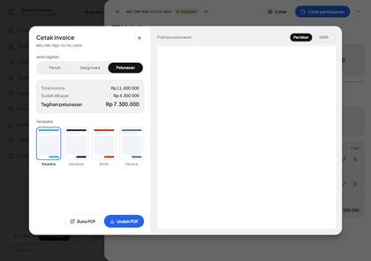 |
| 2 | Halaman 1 PDF invoice yang diunduh saat bahasa ZH. | 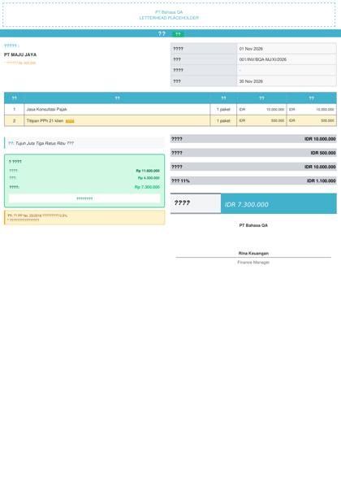 |
| 3 | Pembanding: PDF invoice yang sama diunduh saat bahasa ID. | 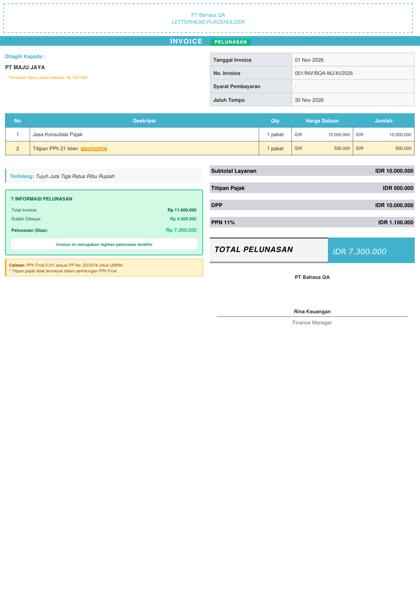 |

## A05 · DatePicker saat ZH — Terbukti

| # | Langkah & yang terlihat | Layar |
|---|---|---|
| 1 | Sesi ZH: DatePicker pada dialog Catat Pemasukan dibuka — judul bulan "November 2026", nama hari S R K J S M, tombol, dan teks bantu tetap Indonesia. | 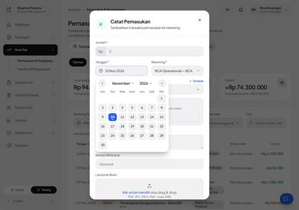 |

## A06 · Grafik Dashboard & Kas & Bank saat ZH — Terbukti (campur)

| # | Langkah & yang terlihat | Layar |
|---|---|---|
| 1 | Dashboard sesi ZH: sumbu bulan pada grafik Arus Kas (label buatan server) tampil dalam Mandarin; judul kartu dan teks lain tetap Indonesia. |  |
| 2 | Grafik Arus Kas periode Mingguan (sesi ZH), diperbesar: rentang "24 Agu – 15 Nov" dan label sumbu Indonesia (dibuat di sisi klien), tetapi keterangan kartu "Pemasukan 1–10 11月" memakai bulan Mandarin dari server. | 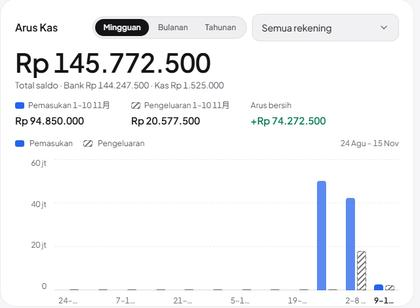 |
| 3 | Kas & Bank sesi ZH (potongan grafik "Pemasukan vs Pengeluaran"): sumbu bulan buatan server "12月 2025 … 11月 2026" Mandarin, sementara judul, legenda, dan angka Indonesia. | 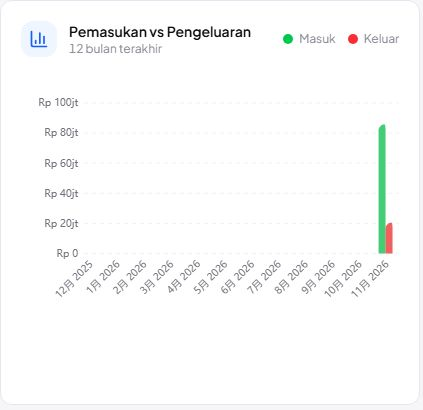 |

## A07 · Lupa kata sandi: bahasa email — Terbukti

| # | Langkah & yang terlihat | Layar |
|---|---|---|
| 1 | Halaman Lupa kata sandi, sesi ID: berbahasa Indonesia. |  |
| 2 | Setelah mengirim permintaan (sesi ID, akun admin@bhs.test): pesan konfirmasi di halaman berbahasa Inggris. |  |
| 3 | Halaman Lupa kata sandi, sesi ZH: berbahasa Indonesia. | 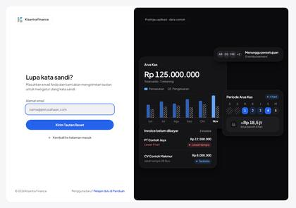 |
| 4 | Setelah mengirim permintaan (sesi ZH): pesan konfirmasi di halaman. | 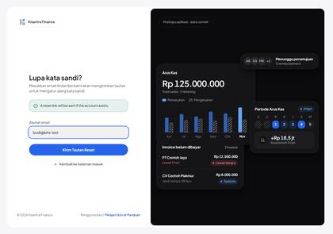 |

## A08 · Halaman login: tanpa pemilih bahasa — Terbukti

| # | Langkah & yang terlihat | Layar |
|---|---|---|
| 1 | Halaman login (tamu, bahasa Indonesia). Tidak ada pemilih bahasa di halaman ini. |  |
| 2 | Sesudah memilih EN lewat permintaan POST /language sebagai tamu (halaman tidak punya pemilih, jadi dikirim lewat skrip): tampilan sama persis. |  |
| 3 | Sesudah memilih ZH sebagai tamu: halaman tetap Indonesia (hanya atribut lang pada tag html yang menjadi zh). |  |

## A09 · Pindai teks DOM saat ZH — Terbukti

| # | Langkah & yang terlihat | Layar |
|---|---|---|
| 1 | Dashboard sesi ZH: hanya label bulan buatan server yang Mandarin; seluruh sisanya Indonesia. |  |
| 2 | Arus Kas (Semua) sesi ZH: 0 baris Mandarin dari 207 baris teks. | 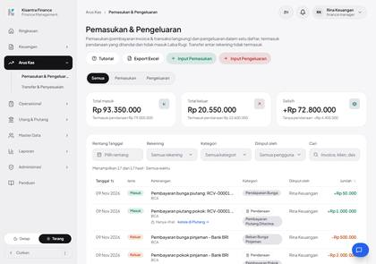 |
| 3 | Daftar Invoice sesi ZH: 0 baris Mandarin dari 105 baris teks. |  |

<!-- qa-evidence:end -->
