# Test Case — Multi bahasa (ID · EN · ZH), keadaan SESUDAH perubahan (putaran 1 dan putaran 2 setelah perbaikan)

Sumber: rencana multi bahasa §1 (dugaan lama, kini dibalik), §6 (matriks 29 modul), §7 lapis 4–5. Pembanding: [`multi-bahasa-sebelum.md`](multi-bahasa-sebelum.md).
Cara baca tabel & kolom **Lapisan**: [`docs/qa/README.md`](../../README.md). Lingkungan, akun, dan langkah reproduksi: [`README.md`](../README.md). Hasil pemindai DOM per layar, daftar pengecualian sah, dan daftar temuan: [`pemindai-dom.md`](../pemindai-dom.md).

**Kriteria lulus utama (K7):** di setiap menu, tab, dialog, dan keadaan, bila 中文 dipilih semua komponen tampil Mandarin tanpa sisa teks antarmuka Indonesia maupun Inggris; bila English dipilih tidak ada sisa Indonesia. Pengecualian sah (data buatan pengguna/perusahaan, data bawaan sistem, nama diri/merek, akronim pajak, Rp dan angka, kode/ID/nomor/token, label aplikasi lain yang dikutip, isi dokumen PDF/Excel) didaftarkan di `pemindai-dom.md` dan tidak dihitung gagal.

**Status:** `Pass` = sesuai harapan; `Pass (percobaan ke-2)` = gagal pada putaran 1, diperbaiki di commit `1e7de08`, lulus pada putaran 2 (riwayat tertulis di Hasil Aktual dan di laporan PDF/manifest); `Terbantah (dugaan lama dibalik: lulus)` = dugaan gelombang 1 yang dulu terbukti kini terbantah, jadi fiturnya berfungsi; `Fail (Fxx)` = ada temuan non-pengecualian, kode temuan di `pemindai-dom.md`.

**Prasyarat**: lingkungan `bhs_*` gelombang 1 + data tambahan (invoice draft/terbit/sebagian/lunas/lewat tempo, reimbursement dan pengajuan dana tiap status, utang dan piutang aktif dan lunas, template berulang, tiga Masukan, notifikasi). Akun: qa1–qa3 (finance manager), qa4 dan admin (admin), fm dan budi (finance manager dan staf). Kata sandi tidak dicantumkan.

## A. Kondisi normal

| ID | Skenario | Langkah | Hasil Diharapkan | Lapisan | Hasil Aktual | Status |
|---|---|---|---|---|---|---|
| N01 | Tampilan ID tetap normal | Login qa1 (finance manager) dengan users.locale = id → Dashboard → Arus Kas › Semua → Catat Pemasukan → Invoice. | Semua layar berbahasa Indonesia, pemilih menunjukkan ID. | FE | Sesuai. Pemilih "ID", `<html lang="id">`; Dashboard, Arus Kas, dialog Catat Pemasukan, dan Invoice berbahasa Indonesia. | Pass |
| N02 | Tampilan ID sama seperti sebelum, kecuali perapian disengaja | Bandingkan 5 layar ID (Dashboard, Arus Kas, dialog Catat Pemasukan, Invoice, Login) antara screenshot gelombang 1 dan sekarang. | Tata letak identik; beda hanya pada perapian teks yang disengaja. | FE | Sesuai. Perbedaan teramati seluruhnya disengaja: pemilih bahasa berikon di header dan di halaman login; "Terkirim" → "Terbit"; "Lewat tempo" → "Lewat jatuh tempo"; "Masuk ke Dasbor" → "Masuk"; "drag & drop" → "seret & lepas"; draft tanpa nomor "belum bernomor"; badge Operasional dan jumlah data bertambah karena data uji. Tidak ada pergeseran tata letak atau teks hilang. Regresi sampel per modul tersebar di C03–C29 (ID dipindai oleh crawler yang sama: 517 layar admin, 277 FM, 182 staf, tanpa halaman gagal selain 403 yang wajar untuk staf). | Pass |
| N03 | ID tetap normal | Sesi ID: Dashboard, Invoice, Izin & Peran, Arus Kas; kirim kosong Tambah Layanan. | Tampilan ID normal; validasi ID "Jenis wajib diisi.". | FE | Sesuai. Keempat layar ID normal, tanpa pergeseran tata letak. Validasi ID: "Nama wajib diisi." dan "Jenis wajib diisi." (sebelumnya "Type wajib diisi."). Grup izin ID tidak lagi slug mentah. | Pass |

## B. Kasus berdugaan gelombang 1 (dibalik) dan tata letak

| ID | Skenario | Langkah | Hasil Diharapkan | Lapisan | Hasil Aktual | Status |
|---|---|---|---|---|---|---|
| A01 | EN bisa dipilih dan seluruh tampilan, toast, dan validasi berbahasa Inggris | Menu bahasa → English → Dashboard, Arus Kas, dialog Record Income; simpan pemasukan (toast); kirim formulir kosong (validasi). DB: users.locale, sesi. | EN berfungsi; toast dan validasi Inggris; users.locale = en. | FE+BE | Lulus. POST /language → 409 (muat ulang penuh), pemilih "EN", `<html lang="en-GB">`, users.locale = `en`. Toast sukses "Income recorded", toast galat "Please review the form entries". Validasi server: "The amount field must be at least 1.", "The transaction category field is required." Dialog dan Dashboard tanpa sisa Indonesia (kecuali data). | Pass (dugaan lama dibalik) |
| A02 | ZH: label, toast, dan validasi berbahasa Mandarin | Menu bahasa → 中文 → Dashboard, Arus Kas, dialog 登记收入; simpan pemasukan (toast); kirim formulir kosong (validasi). | Seluruh antarmuka, toast, dan validasi Mandarin; deskripsi yang disimpan tetap apa adanya. | FE+BE | Lulus. Pemilih "ZH", `<html lang="zh-CN">`, users.locale = `zh`. Toast sukses "收入已登记", toast galat "请检查表单填写内容". Validasi: "金额不能小于 1。", "交易类别不能为空。". Dialog, kotak Jurnal, tombol, dan Dashboard seluruhnya Mandarin; hanya data (nama rekening, kategori, deskripsi input pengguna) dan angka Rupiah tetap. DB: transaksi uji tersimpan dengan deskripsi persis seperti yang diketik. | Pass (dugaan lama dibalik) |
| A03 | ZH → keluar → sesi baru → login: bahasa kembali ZH | Dalam ZH: menu pengguna › 退出登录 → bersihkan cookie → halaman login → login ulang. Cek users.locale di tiap tahap. | Setelah login, tampilan ZH walau halaman login (tamu, tanpa identitas) berbahasa bawaan. | FE+BE | Lulus. users.locale: `zh` sebelum keluar, `zh` setelah keluar, `zh` sesudah login. Halaman login sesi baru berbahasa bawaan (ID), setelah login pemilih "ZH", `<html lang="zh-CN">`, seluruh layar Mandarin. (Lihat juga A08: pilihan tamu ikut tersimpan.) | Pass (dugaan lama dibalik) |
| A04 | Dokumen terkunci Indonesia | Sesi ZH: Invoice › 001/INV/BQA-MJ/XI/2026 › 打印 › 下载 PDF. Render halaman 1 dan baca teksnya; ulangi di sesi ID dan EN. | PDF Indonesia penuh, tanpa "?" dari huruf Mandarin. | FE | Lulus. PDF ZH (1 halaman): "INVOICE", "Ditagih Kepada :", "Syarat Pembayaran", "Terbilang: Tujuh Juta Tiga Ratus Ribu Rupiah", "TOTAL PELUNASAN"; karakter Mandarin di PDF: False. Satu "?" tersisa di judul kotak "? INFORMASI PELUNASAN" (ikon template yang tidak punya glyph; sudah ada di PDF ID sebelum perubahan, bukan akibat locale). PDF yang diunduh dari sesi ID dan EN juga Indonesia. Dialog Cetak sendiri ikut bahasa tampilan. | Pass (dugaan lama dibalik) |
| A05 | Kalender ikut bahasa aktif | Buka dialog Catat Pemasukan → klik kolom Tanggal di sesi ZH lalu EN. Baca judul, kepala hari, aria-label. | ZH: bulan dan hari Mandarin; EN: Inggris, minggu mulai Senin. | FE | Lulus. ZH: kolom "2026年11月10日", judul "2026年11月", kepala hari 一 二 三 四 五 六 日 (Senin pertama), aria-label 上个月/下个月 dan 星期一…星期日. EN: kolom "10 Nov 2026", kepala Mo Tu We Th Fr Sa Su, aria "Previous month"/"Next month"/"Monday…". Tidak ada lagi aria-label ganda berbahasa Inggris bawaan pustaka di ZH. | Pass (dugaan lama dibalik) |
| A06 | Label tanggal dan satuan grafik mengikuti bahasa | Sesi ZH dan EN: Dashboard (sumbu bulan, keterangan periode) dan Kas & Bank (grafik Pemasukan vs Pengeluaran). | Sumbu, keterangan, dan satuan mengikuti bahasa; nilai Rupiah tetap. | FE | Percobaan 1 SEBAGIAN (F06, F07). Dashboard ZH: sumbu "6月…11月", satuan "150 百万", keterangan "1–10 11月 收入", rentang "6月1日 – 11月30日"; EN: "Jun…Nov", "100M", "Jan–… Nov" — seragam. Kas & Bank: sumbu X mengikuti bahasa ("12月 2025…", "Dec 2025…"), tetapi sumbu Y tetap "Rp 100jt … Rp 20jt" di EN dan ZH (juga ID): lihat F06; label aksesibilitas grafik berbahasa Inggris (F07). Percobaan 2 (A15, A16, A17): sumbu Y Kas & Bank "Rp 100 百万" / "Rp 100M" / "Rp 100 jt"; label aksesibilitas grafik mengikuti bahasa; bulan Analitik mengikuti bahasa. LULUS. | Pass (percobaan ke-2) |
| A07 | Email id/en/zh sesuai bahasa halaman peminta | Tamu pilih ID, EN, ZH lewat pemilih di halaman login → /forgot-password → kirim untuk qa1 (ID), qa2 (EN), qa3 (ZH). Baca isi email dari log mail. | Tiga email, masing-masing sesuai bahasa; pesan konfirmasi di halaman juga sesuai. | FE+BE | Lulus. Email ID: judul "Pemberitahuan Atur Ulang Kata Sandi", isi "Halo! … Salam hormat"; email EN: "Reset Password Notification", "Hello! … Regards"; email ZH: judul "重置密码", isi "您好！… 此致". Pesan di halaman: ID "Tautan atur ulang kata sandi akan dikirim bila akunnya terdaftar.", EN "A password reset link will be sent if the account is registered.", ZH "如果该账户已注册，我们会发送重置密码的链接。". Token tautan disamarkan. | Pass (dugaan lama dibalik) |
| A08 | Tamu bisa memilih bahasa dan pilihannya ikut ke akun | Buka /login (sesi baru) → menu bahasa → EN → ZH → EN lalu login. Cek tampilan dan users.locale. | Halaman login berganti bahasa; setelah login langsung EN dan users.locale = en. | FE+BE | Lulus. 1 pemilih di halaman login. EN: `<html lang="en">`, ZH: `<html lang="zh-CN">`, teks "欢迎回来 / 登录您的账户以继续 / 登录". Setelah memilih EN lalu login: pemilih "EN", users.locale = `en`. | Pass (dugaan lama dibalik) |
| A09 | Cek teks terpotong, tumpang tindih, dan gulir horizontal | 26 halaman indeks × ID/EN/ZH × 1280 px dan 390 px: ukur gulir horizontal, elemen terpotong elipsis dibanding ID, dan teks yang melewati tepi layar; tinjau screenshot sampel. | Tanpa gulir horizontal; teks EN yang lebih panjang tidak memecah tata letak. | FE | Gulir horizontal halaman: 0 di semua kombinasi. 1280 px: tidak ada selisih terhadap ID. 390 px: (1) EN Invoice: tombol "Create Invoice" terpotong di tepi kanan dan tab "Partially paid" terpotong; (2) EN Profil Perusahaan: 3 deskripsi tambahan terpotong elipsis; (3) ZH: judul "应付借款"/"应收借款" terpotong elipsis di 390 px (1 elemen lebih banyak dari ID). Tidak ada tumpang tindih teks. Percobaan 1 GAGAL (F13). Setelah perbaikan percobaan 2 (A21): EN 390 px tombol "Create Invoice" turun baris dan utuh, tab status membungkus, gulir horizontal 0; 1280 px identik. Sisa pengamatan ringan tidak berubah: deskripsi Profil Perusahaan EN dan judul "应付借款"/"应收借款" ZH terpotong elipsis pada 390 px (bukan temuan: elipsis disengaja). | Pass (percobaan ke-2) |

## C. Verifikasi perbaikan F01–F13 (putaran 2)

| ID | Skenario | Langkah | Hasil Diharapkan | Lapisan | Hasil Aktual | Status |
|---|---|---|---|---|---|---|
| A10 | F01: label "Alamat" diterjemahkan | Klien › Tambah Klien (ZH, EN); Perusahaan › Perusahaan baru (ZH). Cek DOM dan console. | Label berbahasa Mandarin/Inggris, 0 "[i18n] belum diterjemahkan". | FE | Percobaan 1 GAGAL (temuan putaran 1, lihat pemindai-dom.md); screenshot SEBELUM ada di langkah terakhir bila tersedia. Setelah perbaikan 1e7de08, percobaan 2: Lulus. ZH klien: label "地址", sisa "Alamat" = False; EN klien: "Address", sisa Indonesia = False; ZH perusahaan: sisa "Alamat" = False. Console i18n ZH [], EN []. | Pass (percobaan ke-2) |
| A11 | F02: nama template "Generik" | Invoice baru › Pratinjau › pemilih template (ZH, EN). | "Generik" diterjemahkan. | FE | Percobaan 1 GAGAL (temuan putaran 1, lihat pemindai-dom.md); screenshot SEBELUM ada di langkah terakhir bila tersedia. Setelah perbaikan 1e7de08, percobaan 2: Lulus. ZH: sisa "Generik" = False, terjemahan "通用" ada = True; EN: sisa = False, "Generic" ada = True; console i18n kosong. | Pass (percobaan ke-2) |
| A12 | F03: nama atribut validasi | Kirim kosong: Tambah Layanan (ZH, ID, EN), Kategori Transaksi (ZH), Pengguna (ZH). | Nama atribut baku, bukan nama kolom mentah. | FE | Percobaan 1 GAGAL (temuan putaran 1, lihat pemindai-dom.md); screenshot SEBELUM ada di langkah terakhir bila tersedia. Setelah perbaikan 1e7de08, percobaan 2: Lulus. ZH layanan: 1. 名称不能为空。 2. 类型不能为空。; ID layanan: 1. Nama wajib diisi. 2. Jenis wajib diisi. (sebelumnya "Type wajib diisi."); EN: 1. The name field is required. 2. The type field is required.; ZH kategori: 1. 类型不能为空。 2. 类别名称不能为空。; ZH pengguna: 名称不能为空。 邮箱不能为空。 角色不能为空。 密码不能为空。. | Pass (percobaan ke-2) |
| A13 | F04: pesan 403 diterjemahkan | Staf (budi) membuka /admin/users di sesi ZH dan ID. | Pesan 403 sesuai bahasa. | FE | Percobaan 1 GAGAL (temuan putaran 1, lihat pemindai-dom.md); screenshot SEBELUM ada di langkah terakhir bila tersedia. Setelah perbaikan 1e7de08, percobaan 2: Lulus. ZH: "访问被拒绝 / 您无权执行此操作。"; ID: "Akses ditolak / Anda tidak memiliki izin untuk melakukan tindakan ini." | Pass (percobaan ke-2) |
| A14 | F05: judul grup Izin & Peran | Admin membuka Izin & Peran (ZH, EN). | Judul grup modul terjemah, bukan slug. | FE | Percobaan 1 GAGAL (temuan putaran 1, lihat pemindai-dom.md); screenshot SEBELUM ada di langkah terakhir bila tersedia. Setelah perbaikan 1e7de08, percobaan 2: Lulus. Judul grup berbentuk slug mentah: ZH 0, EN 0. Kode izin kecil ("view invoices") tetap, pengecualian kode. | Pass (percobaan ke-2) |
| A15 | F06: sumbu Y Kas & Bank | Kas & Bank › grafik Pemasukan vs Pengeluaran (ZH, EN, ID). | Satuan mengikuti bahasa. | FE | Percobaan 1 GAGAL (temuan putaran 1, lihat pemindai-dom.md); screenshot SEBELUM ada di langkah terakhir bila tersedia. Setelah perbaikan 1e7de08, percobaan 2: Lulus. ZH Rp 100 百万; EN Rp 100M; ID Rp 100 jt. | Pass (percobaan ke-2) |
| A16 | F07: label aksesibilitas grafik | Baca aria-label grafik Kas & Bank (ZH, EN, ID). | aria-label sesuai bahasa. | FE | Percobaan 1 GAGAL (temuan putaran 1, lihat pemindai-dom.md); screenshot SEBELUM ada di langkah terakhir bila tersedia. Setelah perbaikan 1e7de08, percobaan 2: Lulus. ZH ['按月收入与支出柱状图\|', '按类别支出环形图\|']; EN ['Bar chart of income and expenses per month\|', 'Donut chart of expenses by category\|']; ID ['Grafik batang pemasukan dan pengeluaran per bulan\|', 'Grafik donat pengeluaran per kategori\|']. | Pass (percobaan ke-2) |
| A17 | F08: grafik Analitik Invoice Berulang | Invoice Berulang › Analitik (ZH, EN, ID). | Bulan dan satuan mengikuti bahasa. | FE | Percobaan 1 GAGAL (temuan putaran 1, lihat pemindai-dom.md); screenshot SEBELUM ada di langkah terakhir bila tersedia. Setelah perbaikan 1e7de08, percobaan 2: Lulus. ZH 1月…12月; EN Jan…Dec (September "Sept"); ID Mei, Agt, Okt, Des (Mei, Agt, Okt, Des). Satuan sumbu Y ringkas per bahasa. | Pass (percobaan ke-2) |
| A18 | F09: label daftar Combobox | Buka Combobox "Semua rekening" di Dashboard (ZH, EN, ID). | Label daftar sesuai bahasa. | FE | Percobaan 1 GAGAL (temuan putaran 1, lihat pemindai-dom.md); screenshot SEBELUM ada di langkah terakhir bila tersedia. Setelah perbaikan 1e7de08, percobaan 2: Lulus. ZH 选项列表; EN Options; ID Daftar pilihan. | Pass (percobaan ke-2) |
| A19 | F10: daftar Template PDF dan Template Builder | Pengaturan › Template PDF (daftar) dan editor template (ZH, EN). | Kolom dan lencana terjemah. | FE | Percobaan 1 GAGAL (temuan putaran 1, lihat pemindai-dom.md); screenshot SEBELUM ada di langkah terakhir bila tersedia. Setelah perbaikan 1e7de08, percobaan 2: Lulus. Baris Indonesia tersisa: ZH daftar [], ZH editor [], EN editor []; EN daftar ['Status'] (kata "Status" sama di Inggris). | Pass (percobaan ke-2) |
| A20 | F11: dialog Tutorial | Dashboard › 教程 (ZH): judul, tab peran, durasi, kontrol pemutar. | Chrome dialog terjemah; kontrol pemutar Remotion didaftarkan sebagai pengecualian. | FE | Percobaan 1 GAGAL (temuan putaran 1, lihat pemindai-dom.md); screenshot SEBELUM ada di langkah terakhir bila tersedia. Setelah perbaikan 1e7de08, percobaan 2: Lulus dengan pengecualian. Judul "教程：概览", tab peran dan durasi Mandarin; sisa Latin: "Pause video", "Mute sound", "Enter Fullscreen" (tertulis keras di pustaka Remotion, `node_modules/@remotion/player/dist/esm/index.mjs` ±baris 1689–1690, 2393–2394, 2449–2450) dan teks di dalam bingkai video "Tutorial · Ringkasan" (isi video Indonesia, K3). Keduanya didaftarkan sebagai pengecualian. | Pass (percobaan ke-2, dengan pengecualian) |
| A21 | F13: header dan tab Invoice di 390 px (EN) | EN 390×844 dan 1280×900: Invoice; ukur posisi tombol dan tab, gulir horizontal. | Tombol dan tab utuh; 1280 px sama. | FE | Percobaan 1 GAGAL (temuan putaran 1, lihat pemindai-dom.md); screenshot SEBELUM ada di langkah terakhir bila tersedia. Setelah perbaikan 1e7de08, percobaan 2: Lulus. 390 px: gulir horizontal 0, tab "Partially paid" kanan [305, 159] (< 390), tombol "Create Invoice" turun ke baris sendiri dan utuh (screenshot). 1280 px: gulir 0, satu baris seperti sebelumnya. | Pass (percobaan ke-2) |
| A22 | F12: nama ikon di Tambah Peran | Izin & Peran › Tambah Peran (ZH): baca title/aria-label pemilih ikon. | Tidak ada nama ikon mentah. | FE | Percobaan 1 GAGAL (temuan putaran 1, lihat pemindai-dom.md); screenshot SEBELUM ada di langkah terakhir bila tersedia. Setelah perbaikan 1e7de08, percobaan 2: Lulus. title/aria-label berisi nama ikon mentah: 0. | Pass (percobaan ke-2) |

## D. Matriks modul §6 (pemindai DOM ZH dan EN, putaran 2)

| ID | Skenario | Langkah | Hasil Diharapkan | Lapisan | Hasil Aktual | Status |
|---|---|---|---|---|---|---|
| C01 | Matriks §6: Kerangka aplikasi: sidebar, header, pemilih bahasa, menu pengguna | Kunjungi halaman indeks, tab, dialog/drawer/dropdown (klik semua tombol aman), picu validasi kosong pada dialog Tambah/Buat, di ZH dan EN; peran admin (semua halaman), finance manager, staf. | 0 teks non-pengecualian (Latin di ZH; teks Indonesia di EN); 0 "[i18n] belum diterjemahkan". | FE | Pindaian DOM putaran 2: ZH 7 layar / 1329 teks, EN 7 layar / 1329 teks (pengecualian sah tercatat ZH 0, EN 0). 0 temuan non-pengecualian; console tanpa "[i18n] belum diterjemahkan". | Pass |
| C02 | Matriks §6: Komponen katalog: Combobox, DatePicker, Dialog, FileUpload, Pagination | Kunjungi halaman indeks, tab, dialog/drawer/dropdown (klik semua tombol aman), picu validasi kosong pada dialog Tambah/Buat, di ZH dan EN; peran admin (semua halaman), finance manager, staf. | 0 teks non-pengecualian (Latin di ZH; teks Indonesia di EN); 0 "[i18n] belum diterjemahkan". | FE | Percobaan 1 GAGAL: temuan F09 (Rendah). Setelah perbaikan 1e7de08, percobaan 2 LULUS. Pindaian DOM putaran 2: ZH 1 layar / 355 teks, EN 1 layar / 355 teks (pengecualian sah tercatat ZH 0, EN 0). 0 temuan non-pengecualian; console tanpa "[i18n] belum diterjemahkan". | Pass (percobaan ke-2) |
| C03 | Matriks §6: Dashboard | Kunjungi halaman indeks, tab, dialog/drawer/dropdown (klik semua tombol aman), picu validasi kosong pada dialog Tambah/Buat, di ZH dan EN; peran admin (semua halaman), finance manager, staf. | 0 teks non-pengecualian (Latin di ZH; teks Indonesia di EN); 0 "[i18n] belum diterjemahkan". | FE | Pindaian DOM putaran 2: ZH 40 layar / 12476 teks, EN 40 layar / 12427 teks (pengecualian sah tercatat ZH 13, EN 0). 0 temuan non-pengecualian; console tanpa "[i18n] belum diterjemahkan". | Pass |
| C04 | Matriks §6: Klien | Kunjungi halaman indeks, tab, dialog/drawer/dropdown (klik semua tombol aman), picu validasi kosong pada dialog Tambah/Buat, di ZH dan EN; peran admin (semua halaman), finance manager, staf. | 0 teks non-pengecualian (Latin di ZH; teks Indonesia di EN); 0 "[i18n] belum diterjemahkan". | FE | Percobaan 1 GAGAL: temuan F01 (Sedang). Setelah perbaikan 1e7de08, percobaan 2 LULUS. Pindaian DOM putaran 2: ZH 23 layar / 2215 teks, EN 23 layar / 2211 teks (pengecualian sah tercatat ZH 20, EN 0). 0 temuan non-pengecualian; console tanpa "[i18n] belum diterjemahkan". | Pass (percobaan ke-2) |
| C05 | Matriks §6: Layanan | Kunjungi halaman indeks, tab, dialog/drawer/dropdown (klik semua tombol aman), picu validasi kosong pada dialog Tambah/Buat, di ZH dan EN; peran admin (semua halaman), finance manager, staf. | 0 teks non-pengecualian (Latin di ZH; teks Indonesia di EN); 0 "[i18n] belum diterjemahkan". | FE | Percobaan 1 GAGAL: temuan F03 (Sedang). Setelah perbaikan 1e7de08, percobaan 2 LULUS. Pindaian DOM putaran 2: ZH 40 layar / 3658 teks, EN 42 layar / 3833 teks (pengecualian sah tercatat ZH 13, EN 0). 0 temuan non-pengecualian; console tanpa "[i18n] belum diterjemahkan". | Pass (percobaan ke-2) |
| C06 | Matriks §6: Invoice & pembayaran | Kunjungi halaman indeks, tab, dialog/drawer/dropdown (klik semua tombol aman), picu validasi kosong pada dialog Tambah/Buat, di ZH dan EN; peran admin (semua halaman), finance manager, staf. | 0 teks non-pengecualian (Latin di ZH; teks Indonesia di EN); 0 "[i18n] belum diterjemahkan". | FE | Percobaan 1 GAGAL: temuan F02 (Sedang). Setelah perbaikan 1e7de08, percobaan 2 LULUS. Pindaian DOM putaran 2: ZH 148 layar / 20459 teks, EN 152 layar / 21562 teks (pengecualian sah tercatat ZH 100, EN 0). 0 temuan non-pengecualian; console tanpa "[i18n] belum diterjemahkan". | Pass (percobaan ke-2) |
| C07 | Matriks §6: Invoice berulang | Kunjungi halaman indeks, tab, dialog/drawer/dropdown (klik semua tombol aman), picu validasi kosong pada dialog Tambah/Buat, di ZH dan EN; peran admin (semua halaman), finance manager, staf. | 0 teks non-pengecualian (Latin di ZH; teks Indonesia di EN); 0 "[i18n] belum diterjemahkan". | FE | Percobaan 1 GAGAL: temuan F07 (Rendah), F08 (Sedang). Setelah perbaikan 1e7de08, percobaan 2 LULUS. Pindaian DOM putaran 2: ZH 114 layar / 14899 teks, EN 107 layar / 13338 teks (pengecualian sah tercatat ZH 8, EN 0). 0 temuan non-pengecualian; console tanpa "[i18n] belum diterjemahkan". | Pass (percobaan ke-2) |
| C08 | Matriks §6: Piutang | Kunjungi halaman indeks, tab, dialog/drawer/dropdown (klik semua tombol aman), picu validasi kosong pada dialog Tambah/Buat, di ZH dan EN; peran admin (semua halaman), finance manager, staf. | 0 teks non-pengecualian (Latin di ZH; teks Indonesia di EN); 0 "[i18n] belum diterjemahkan". | FE | Pindaian DOM putaran 2: ZH 40 layar / 4918 teks, EN 42 layar / 5232 teks (pengecualian sah tercatat ZH 13, EN 0). 0 temuan non-pengecualian; console tanpa "[i18n] belum diterjemahkan". | Pass |
| C09 | Matriks §6: Laporan Laba Rugi | Kunjungi halaman indeks, tab, dialog/drawer/dropdown (klik semua tombol aman), picu validasi kosong pada dialog Tambah/Buat, di ZH dan EN; peran admin (semua halaman), finance manager, staf. | 0 teks non-pengecualian (Latin di ZH; teks Indonesia di EN); 0 "[i18n] belum diterjemahkan". | FE | Pindaian DOM putaran 2: ZH 20 layar / 2180 teks, EN 20 layar / 2257 teks (pengecualian sah tercatat ZH 8, EN 0). 0 temuan non-pengecualian; console tanpa "[i18n] belum diterjemahkan". | Pass |
| C10 | Matriks §6: Kas & Bank | Kunjungi halaman indeks, tab, dialog/drawer/dropdown (klik semua tombol aman), picu validasi kosong pada dialog Tambah/Buat, di ZH dan EN; peran admin (semua halaman), finance manager, staf. | 0 teks non-pengecualian (Latin di ZH; teks Indonesia di EN); 0 "[i18n] belum diterjemahkan". | FE | Percobaan 1 GAGAL: temuan F06 (Rendah), F07 (Rendah). Setelah perbaikan 1e7de08, percobaan 2 LULUS. Pindaian DOM putaran 2: ZH 48 layar / 14547 teks, EN 46 layar / 14070 teks (pengecualian sah tercatat ZH 22, EN 0). 0 temuan non-pengecualian; console tanpa "[i18n] belum diterjemahkan". | Pass (percobaan ke-2) |
| C11 | Matriks §6: Pemasukan & Pengeluaran | Kunjungi halaman indeks, tab, dialog/drawer/dropdown (klik semua tombol aman), picu validasi kosong pada dialog Tambah/Buat, di ZH dan EN; peran admin (semua halaman), finance manager, staf. | 0 teks non-pengecualian (Latin di ZH; teks Indonesia di EN); 0 "[i18n] belum diterjemahkan". | FE | Pindaian DOM putaran 2: ZH 172 layar / 37065 teks, EN 192 layar / 46105 teks (pengecualian sah tercatat ZH 37, EN 0). 0 temuan non-pengecualian; console tanpa "[i18n] belum diterjemahkan". | Pass |
| C12 | Matriks §6: Kategori Transaksi | Kunjungi halaman indeks, tab, dialog/drawer/dropdown (klik semua tombol aman), picu validasi kosong pada dialog Tambah/Buat, di ZH dan EN; peran admin (semua halaman), finance manager, staf. | 0 teks non-pengecualian (Latin di ZH; teks Indonesia di EN); 0 "[i18n] belum diterjemahkan". | FE | Percobaan 1 GAGAL: temuan F03 (Sedang). Setelah perbaikan 1e7de08, percobaan 2 LULUS. Pindaian DOM putaran 2: ZH 23 layar / 2922 teks, EN 25 layar / 3179 teks (pengecualian sah tercatat ZH 8, EN 0). 0 temuan non-pengecualian; console tanpa "[i18n] belum diterjemahkan". | Pass (percobaan ke-2) |
| C13 | Matriks §6: Reimbursement | Kunjungi halaman indeks, tab, dialog/drawer/dropdown (klik semua tombol aman), picu validasi kosong pada dialog Tambah/Buat, di ZH dan EN; peran admin (semua halaman), finance manager, staf. | 0 teks non-pengecualian (Latin di ZH; teks Indonesia di EN); 0 "[i18n] belum diterjemahkan". | FE | Pindaian DOM putaran 2: ZH 102 layar / 12212 teks, EN 101 layar / 12230 teks (pengecualian sah tercatat ZH 31, EN 0). 0 temuan non-pengecualian; console tanpa "[i18n] belum diterjemahkan". | Pass |
| C14 | Matriks §6: Pengajuan Dana | Kunjungi halaman indeks, tab, dialog/drawer/dropdown (klik semua tombol aman), picu validasi kosong pada dialog Tambah/Buat, di ZH dan EN; peran admin (semua halaman), finance manager, staf. | 0 teks non-pengecualian (Latin di ZH; teks Indonesia di EN); 0 "[i18n] belum diterjemahkan". | FE | Percobaan 1 GAGAL: temuan F03 (Sedang). Setelah perbaikan 1e7de08, percobaan 2 LULUS. Pindaian DOM putaran 2: ZH 93 layar / 11664 teks, EN 92 layar / 11616 teks (pengecualian sah tercatat ZH 13, EN 0). 0 temuan non-pengecualian; console tanpa "[i18n] belum diterjemahkan". | Pass (percobaan ke-2) |
| C15 | Matriks §6: Utang | Kunjungi halaman indeks, tab, dialog/drawer/dropdown (klik semua tombol aman), picu validasi kosong pada dialog Tambah/Buat, di ZH dan EN; peran admin (semua halaman), finance manager, staf. | 0 teks non-pengecualian (Latin di ZH; teks Indonesia di EN); 0 "[i18n] belum diterjemahkan". | FE | Pindaian DOM putaran 2: ZH 26 layar / 2967 teks, EN 32 layar / 3988 teks (pengecualian sah tercatat ZH 8, EN 0). 0 temuan non-pengecualian; console tanpa "[i18n] belum diterjemahkan". | Pass |
| C16 | Matriks §6: Notifikasi | Kunjungi halaman indeks, tab, dialog/drawer/dropdown (klik semua tombol aman), picu validasi kosong pada dialog Tambah/Buat, di ZH dan EN; peran admin (semua halaman), finance manager, staf. | 0 teks non-pengecualian (Latin di ZH; teks Indonesia di EN); 0 "[i18n] belum diterjemahkan". | FE | Pindaian DOM putaran 2: ZH 4 layar / 334 teks, EN 4 layar / 334 teks (pengecualian sah tercatat ZH 0, EN 0). 0 temuan non-pengecualian; console tanpa "[i18n] belum diterjemahkan". | Pass |
| C17 | Matriks §6: Masukan (Feedback) | Kunjungi halaman indeks, tab, dialog/drawer/dropdown (klik semua tombol aman), picu validasi kosong pada dialog Tambah/Buat, di ZH dan EN; peran admin (semua halaman), finance manager, staf. | 0 teks non-pengecualian (Latin di ZH; teks Indonesia di EN); 0 "[i18n] belum diterjemahkan". | FE | Pindaian DOM putaran 2: ZH 26 layar / 2477 teks, EN 27 layar / 2643 teks (pengecualian sah tercatat ZH 13, EN 0). 0 temuan non-pengecualian; console tanpa "[i18n] belum diterjemahkan". | Pass |
| C18 | Matriks §6: Pengaturan: hub, Profil, Kata sandi | Kunjungi halaman indeks, tab, dialog/drawer/dropdown (klik semua tombol aman), picu validasi kosong pada dialog Tambah/Buat, di ZH dan EN; peran admin (semua halaman), finance manager, staf. | 0 teks non-pengecualian (Latin di ZH; teks Indonesia di EN); 0 "[i18n] belum diterjemahkan". | FE | Pindaian DOM putaran 2: ZH 30 layar / 1708 teks, EN 30 layar / 1705 teks (pengecualian sah tercatat ZH 13, EN 0). 0 temuan non-pengecualian; console tanpa "[i18n] belum diterjemahkan". | Pass |
| C19 | Matriks §6: Pengaturan: Profil Perusahaan | Kunjungi halaman indeks, tab, dialog/drawer/dropdown (klik semua tombol aman), picu validasi kosong pada dialog Tambah/Buat, di ZH dan EN; peran admin (semua halaman), finance manager, staf. | 0 teks non-pengecualian (Latin di ZH; teks Indonesia di EN); 0 "[i18n] belum diterjemahkan". | FE | Pindaian DOM putaran 2: ZH 7 layar / 602 teks, EN 7 layar / 602 teks (pengecualian sah tercatat ZH 6, EN 0). 0 temuan non-pengecualian; console tanpa "[i18n] belum diterjemahkan". | Pass |
| C20 | Matriks §6: Pengaturan: Penomoran Invoice | Kunjungi halaman indeks, tab, dialog/drawer/dropdown (klik semua tombol aman), picu validasi kosong pada dialog Tambah/Buat, di ZH dan EN; peran admin (semua halaman), finance manager, staf. | 0 teks non-pengecualian (Latin di ZH; teks Indonesia di EN); 0 "[i18n] belum diterjemahkan". | FE | Pindaian DOM putaran 2: ZH 25 layar / 3139 teks, EN 25 layar / 3139 teks (pengecualian sah tercatat ZH 24, EN 24). 0 temuan non-pengecualian; console tanpa "[i18n] belum diterjemahkan". | Pass |
| C21 | Matriks §6: Pengaturan: Template PDF & Builder | Kunjungi halaman indeks, tab, dialog/drawer/dropdown (klik semua tombol aman), picu validasi kosong pada dialog Tambah/Buat, di ZH dan EN; peran admin (semua halaman), finance manager, staf. | 0 teks non-pengecualian (Latin di ZH; teks Indonesia di EN); 0 "[i18n] belum diterjemahkan". | FE | Percobaan 1 GAGAL: temuan F10 (Sedang). Setelah perbaikan 1e7de08, percobaan 2 LULUS. Pindaian DOM putaran 2: ZH 33 layar / 2631 teks, EN 33 layar / 2565 teks (pengecualian sah tercatat ZH 140, EN 0). 0 temuan non-pengecualian; console tanpa "[i18n] belum diterjemahkan". | Pass (percobaan ke-2) |
| C22 | Matriks §6: Koneksi Claude | Kunjungi halaman indeks, tab, dialog/drawer/dropdown (klik semua tombol aman), picu validasi kosong pada dialog Tambah/Buat, di ZH dan EN; peran admin (semua halaman), finance manager, staf. | 0 teks non-pengecualian (Latin di ZH; teks Indonesia di EN); 0 "[i18n] belum diterjemahkan". | FE | Pindaian DOM putaran 2: ZH 9 layar / 771 teks, EN 9 layar / 771 teks (pengecualian sah tercatat ZH 36, EN 0). 0 temuan non-pengecualian; console tanpa "[i18n] belum diterjemahkan". | Pass |
| C23 | Matriks §6: Pengguna | Kunjungi halaman indeks, tab, dialog/drawer/dropdown (klik semua tombol aman), picu validasi kosong pada dialog Tambah/Buat, di ZH dan EN; peran admin (semua halaman), finance manager, staf. | 0 teks non-pengecualian (Latin di ZH; teks Indonesia di EN); 0 "[i18n] belum diterjemahkan". | FE | Percobaan 1 GAGAL: temuan F03 (Sedang). Setelah perbaikan 1e7de08, percobaan 2 LULUS. Pindaian DOM putaran 2: ZH 17 layar / 2031 teks, EN 17 layar / 2031 teks (pengecualian sah tercatat ZH 7, EN 0). 0 temuan non-pengecualian; console tanpa "[i18n] belum diterjemahkan". | Pass (percobaan ke-2) |
| C24 | Matriks §6: Perusahaan (admin) | Kunjungi halaman indeks, tab, dialog/drawer/dropdown (klik semua tombol aman), picu validasi kosong pada dialog Tambah/Buat, di ZH dan EN; peran admin (semua halaman), finance manager, staf. | 0 teks non-pengecualian (Latin di ZH; teks Indonesia di EN); 0 "[i18n] belum diterjemahkan". | FE | Percobaan 1 GAGAL: temuan F01 (Sedang), F03 (Sedang). Setelah perbaikan 1e7de08, percobaan 2 LULUS. Pindaian DOM putaran 2: ZH 7 layar / 521 teks, EN 7 layar / 521 teks (pengecualian sah tercatat ZH 6, EN 0). 0 temuan non-pengecualian; console tanpa "[i18n] belum diterjemahkan". | Pass (percobaan ke-2) |
| C25 | Matriks §6: Izin & Peran | Kunjungi halaman indeks, tab, dialog/drawer/dropdown (klik semua tombol aman), picu validasi kosong pada dialog Tambah/Buat, di ZH dan EN; peran admin (semua halaman), finance manager, staf. | 0 teks non-pengecualian (Latin di ZH; teks Indonesia di EN); 0 "[i18n] belum diterjemahkan". | FE | Percobaan 1 GAGAL: temuan F05 (Rendah), F12 (Rendah). Setelah perbaikan 1e7de08, percobaan 2 LULUS. Pindaian DOM putaran 2: ZH 15 layar / 4636 teks, EN 15 layar / 4635 teks (pengecualian sah tercatat ZH 1100, EN 0). 0 temuan non-pengecualian; console tanpa "[i18n] belum diterjemahkan". | Pass (percobaan ke-2) |
| C26 | Matriks §6: Autentikasi & email | Kunjungi halaman indeks, tab, dialog/drawer/dropdown (klik semua tombol aman), picu validasi kosong pada dialog Tambah/Buat, di ZH dan EN; peran admin (semua halaman), finance manager, staf. | 0 teks non-pengecualian (Latin di ZH; teks Indonesia di EN); 0 "[i18n] belum diterjemahkan". | FE | Pindaian DOM putaran 2: ZH 7 layar / 437 teks, EN 7 layar / 437 teks (pengecualian sah tercatat ZH 14, EN 0). 0 temuan non-pengecualian; console tanpa "[i18n] belum diterjemahkan". | Pass |
| C27 | Matriks §6: Setup & pemilihan perusahaan | Kunjungi halaman indeks, tab, dialog/drawer/dropdown (klik semua tombol aman), picu validasi kosong pada dialog Tambah/Buat, di ZH dan EN; peran admin (semua halaman), finance manager, staf. | 0 teks non-pengecualian (Latin di ZH; teks Indonesia di EN); 0 "[i18n] belum diterjemahkan". | FE | Pindaian DOM putaran 2: ZH 2 layar / 124 teks, EN 2 layar / 124 teks (pengecualian sah tercatat ZH 4, EN 0). 0 temuan non-pengecualian; console tanpa "[i18n] belum diterjemahkan". | Pass |
| C28 | Matriks §6: Halaman error | Kunjungi halaman indeks, tab, dialog/drawer/dropdown (klik semua tombol aman), picu validasi kosong pada dialog Tambah/Buat, di ZH dan EN; peran admin (semua halaman), finance manager, staf. | 0 teks non-pengecualian (Latin di ZH; teks Indonesia di EN); 0 "[i18n] belum diterjemahkan". | FE | Percobaan 1 GAGAL: temuan F04 (Sedang). Setelah perbaikan 1e7de08, percobaan 2 LULUS. Pindaian DOM putaran 2: ZH 3 layar / 37 teks, EN 3 layar / 37 teks (pengecualian sah tercatat ZH 0, EN 0). 0 temuan non-pengecualian; console tanpa "[i18n] belum diterjemahkan". | Pass (percobaan ke-2) |
| C29 | Matriks §6: Panduan & video (di luar cakupan K3) | Kunjungi halaman indeks, tab, dialog/drawer/dropdown (klik semua tombol aman), picu validasi kosong pada dialog Tambah/Buat, di ZH dan EN; peran admin (semua halaman), finance manager, staf. | 0 teks non-pengecualian (Latin di ZH; teks Indonesia di EN); 0 "[i18n] belum diterjemahkan". | FE | Percobaan 1 GAGAL: temuan F11 (Rendah). Setelah perbaikan 1e7de08, percobaan 2 LULUS. Pindaian DOM putaran 2: ZH 1 layar / 254 teks, EN 1 layar / 254 teks (pengecualian sah tercatat ZH 2, EN 0). 0 temuan non-pengecualian; console tanpa "[i18n] belum diterjemahkan". | Pass (percobaan ke-2) |

<!-- qa-evidence:start -->

# Bukti visual langkah per langkah

Screenshot diambil per langkah, bukan hanya hasil akhirnya, supaya alurnya
bisa ditelusuri ulang oleh orang lain. Test case yang kondisinya tidak bisa
dicapai dari layar dijalankan lewat API/DB dan ditandai eksplisit — tidak
dibuatkan screenshot seolah-olah ada alur UI-nya.

## N01 · Tampilan Indonesia (baseline sesudah perubahan) — Pass

| # | Langkah & yang terlihat | Layar |
|---|---|---|
| 1 | Dashboard (Ringkasan) bahasa Indonesia, pemilih ID. |  |
| 2 | Arus Kas tab Semua, Indonesia. |  |
| 3 | Dialog Catat Pemasukan, Indonesia. |  |
| 4 | Daftar Invoice, Indonesia (status "Terbit" menggantikan "Terkirim"). |  |

## N02 · Regresi tampilan Indonesia: sebelum vs sesudah — Pass

| # | Langkah & yang terlihat | Layar |
|---|---|---|
| 1 | Dashboard ID: kiri sebelum, kanan sesudah (pemilih bahasa kini berikon; badge Operasional; status "Terbit" menggantikan "Terkirim"; "Lewat jatuh tempo"). |  |
| 2 | Arus Kas (Semua) ID: kiri sebelum, kanan sesudah; tata letak sama (data bertambah karena transaksi uji). |  |
| 3 | Dialog Catat Pemasukan ID: kiri sebelum, kanan sesudah; "drag & drop" menjadi "seret & lepas"; selebihnya identik. |  |
| 4 | Daftar Invoice ID: kiri sebelum, kanan sesudah; "Terkirim" menjadi "Terbit"; draft tanpa nomor menampilkan "belum bernomor". |  |
| 5 | Login ID: kiri sebelum, kanan sesudah; tombol "Masuk ke Dasbor" menjadi "Masuk"; pemilih bahasa baru di pojok; panel pratinjau "Terkirim" menjadi "Terbit", "Lewat tempo" menjadi "Lewat jatuh tempo". |  |

## N03 · Regresi cepat ID pada layar yang disentuh perbaikan — Pass

| # | Langkah & yang terlihat | Layar |
|---|---|---|
| 1 | Regresi ID: Dashboard tetap normal. | 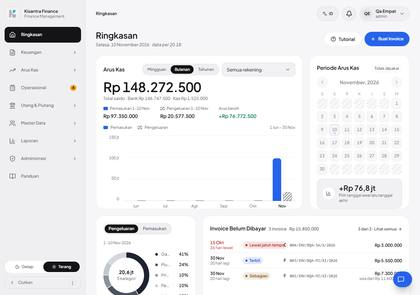 |
| 2 | Regresi ID: daftar Invoice. | 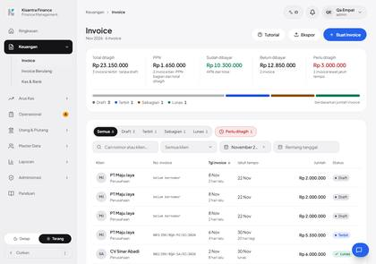 |
| 3 | Regresi ID: Izin & Peran. | 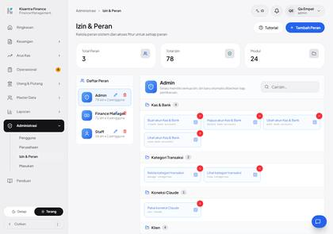 |
| 4 | Regresi ID: Arus Kas. | 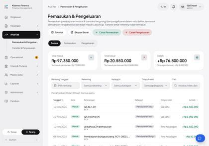 |

## A01 · Pilih EN: kini berfungsi — Pass

| # | Langkah & yang terlihat | Layar |
|---|---|---|
| 1 | Menu bahasa di header terbuka: Indonesia, English, 中文 (endonim) dengan ID terpilih. |  |
| 2 | Setelah memilih EN: seluruh Dashboard berbahasa Inggris, pemilih menunjukkan EN. |  |
| 3 | Dialog Record Income (EN) terisi: label, kotak Jurnal, tombol berbahasa Inggris. |  |
| 4 | Toast sukses setelah menyimpan di sesi EN. |  |
| 5 | Formulir kosong dikirim di sesi EN: pesan validasi server dan toast berbahasa Inggris. |  |

## A02 · Pilih ZH: label, toast, dan validasi Mandarin — Pass

| # | Langkah & yang terlihat | Layar |
|---|---|---|
| 1 | Setelah memilih ZH: Dashboard seluruhnya Mandarin; pemilih menunjukkan ZH. |  |
| 2 | Dialog 登记收入 (ZH) terisi: label, kotak Jurnal, dan tombol berbahasa Mandarin. |  |
| 3 | Toast sukses setelah menyimpan di sesi ZH. |  |
| 4 | Formulir kosong dikirim di sesi ZH: pesan validasi server dan toast berbahasa Mandarin. |  |

## A03 · Preferensi bahasa bertahan lintas sesi — Pass

| # | Langkah & yang terlihat | Layar |
|---|---|---|
| 1 | Sesi ZH: menu pengguna dibuka, pilih Keluar (退出登录). |  |
| 2 | Cookie dibersihkan (sesi baru), halaman login dibuka: tampilan mengikuti bahasa bawaan (belum ada identitas pengguna). |  |
| 3 | Login ulang di sesi baru: bahasa ZH dipakai kembali (pemilih ZH, tampilan Mandarin) sesuai users.locale. |  |

## A04 · PDF invoice di sesi ZH tetap Indonesia dengan huruf benar — Pass

| # | Langkah & yang terlihat | Layar |
|---|---|---|
| 1 | Sesi ZH: dialog 打印 (Cetak invoice) dalam bahasa Mandarin; dokumennya akan tetap Indonesia. |  |
| 2 | Halaman 1 PDF invoice yang diunduh saat bahasa ZH: label dan terbilang Indonesia dengan huruf benar. |  |

## A05 · DatePicker di sesi ZH dan EN — Pass

| # | Langkah & yang terlihat | Layar |
|---|---|---|
| 1 | DatePicker pada dialog Catat Pemasukan di sesi ZH: judul bulan, kepala hari, dan aria-label. |  |
| 2 | DatePicker pada dialog Catat Pemasukan di sesi EN: judul bulan, kepala hari, dan aria-label. |  |

## A06 · Grafik Dashboard dan Kas & Bank di ZH dan EN — Pass (percobaan ke-2)

| # | Langkah & yang terlihat | Layar |
|---|---|---|
| 1 | Dashboard sesi ZH: sumbu grafik, keterangan periode, dan kalender. |  |
| 2 | Kas & Bank sesi ZH, potongan grafik Pemasukan vs Pengeluaran. |  |
| 3 | Dashboard sesi EN: sumbu grafik, keterangan periode, dan kalender. |  |
| 4 | Kas & Bank sesi EN, potongan grafik Pemasukan vs Pengeluaran. |  |

## A07 · Email lupa kata sandi dalam bahasa peminta — Pass

| # | Langkah & yang terlihat | Layar |
|---|---|---|
| 1 | Halaman lupa kata sandi, sesi ID. |  |
| 2 | Setelah mengirim (ID): pesan konfirmasi berbahasa Indonesia di halaman. |  |
| 3 | Halaman lupa kata sandi, sesi EN. |  |
| 4 | Setelah mengirim (EN): pesan konfirmasi di halaman. |  |
| 5 | Halaman lupa kata sandi, sesi ZH. |  |
| 6 | Setelah mengirim (ZH): pesan konfirmasi di halaman. |  |

## A08 · Pemilih bahasa di halaman login — Pass

| # | Langkah & yang terlihat | Layar |
|---|---|---|
| 1 | Halaman login (tamu, sesi baru): pemilih bahasa ID di pojok halaman. |  |
| 2 | Menu pemilih bahasa di halaman login terbuka. |  |
| 3 | Memilih EN sebagai tamu: halaman login berbahasa Inggris. |  |
| 4 | Memilih ZH sebagai tamu: halaman login berbahasa Mandarin. |  |
| 5 | Tamu memilih EN lalu login: dashboard langsung berbahasa Inggris dan users.locale tersimpan en. |  |

## A09 · Tata letak EN dan ZH pada 1280 px dan 390 px — Pass (percobaan ke-2)

| # | Langkah & yang terlihat | Layar |
|---|---|---|
| 1 | 390 px, Invoice: EN (kiri) tombol "Create Invoice" terpotong di tepi kanan dan tab "Partially paid" terpotong; ZH (kanan) muat. |  |
| 2 | 390 px, Dashboard: EN (kiri) dan ZH (kanan) muat tanpa gulir horizontal; label sumbu grafik dipotong rapi (juga di ID). |  |
| 3 | 390 px, Arus Kas: EN (kiri) dan ZH (kanan); tombol aksi turun baris, tidak ada tumpang tindih. |  |
| 4 | 390 px, Profil Perusahaan: EN (kiri) deskripsi bagian terpotong elipsis; ZH (kanan) muat. |  |
| 5 | 1280 px, Reimbursement: EN (kiri) dan ZH (kanan) tanpa pemotongan. |  |

## A10 · F01: label "Alamat" diterjemahkan — Pass (percobaan ke-2)

| # | Langkah & yang terlihat | Layar |
|---|---|---|
| 1 | Klien › 新增客户 (ZH): label Alamat kini "地址". | 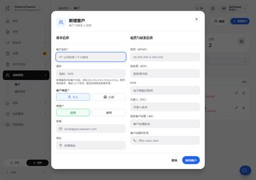 |
| 2 | Klien › Add Client (EN): label Alamat kini "Address". |  |
| 3 | Perusahaan › 新建公司 (ZH): baris pratinjau "Alamat" kini diterjemahkan. | 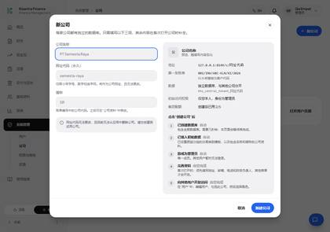 |
| 4 | SEBELUM perbaikan (percobaan 1, ZH): label Alamat tetap "Alamat". | 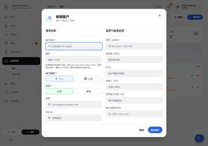 |

## A11 · F02: nama template "Generik" — Pass (percobaan ke-2)

| # | Langkah & yang terlihat | Layar |
|---|---|---|
| 1 | Invoice baru › Pratinjau › pilihan template (ZH): "Generik" menjadi "通用". | 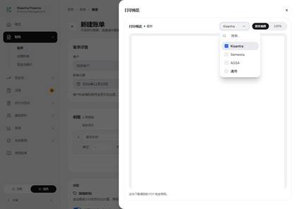 |
| 2 | Invoice baru › Pratinjau › pilihan template (EN): "Generik" menjadi "Generic". | 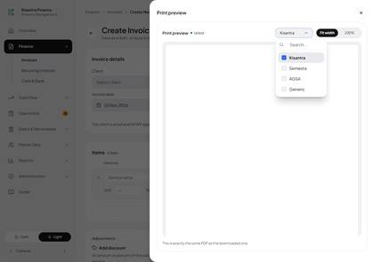 |

## A12 · F03: nama atribut validasi — Pass (percobaan ke-2)

| # | Langkah & yang terlihat | Layar |
|---|---|---|
| 1 | Validasi kosong Tambah Layanan (ZH): nama atribut baku. | 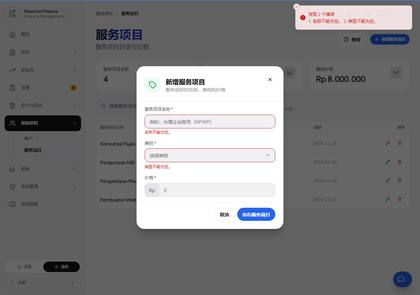 |
| 2 | Validasi kosong Tambah Layanan (ID): nama atribut baku. | 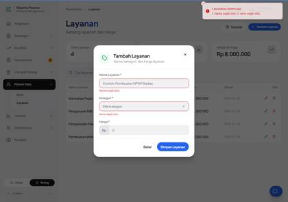 |
| 3 | Validasi kosong Tambah Layanan (EN): nama atribut baku. | 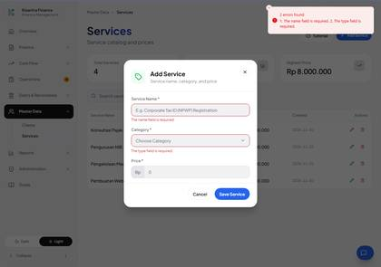 |
| 4 | Validasi kosong Kategori (ZH). | 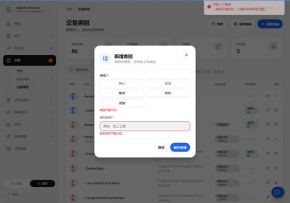 |
| 5 | Validasi kosong Pengguna (ZH). | 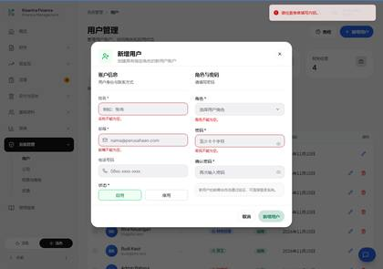 |
| 6 | SEBELUM perbaikan (percobaan 1, ZH): "type不能为空。" dengan nama atribut mentah. | 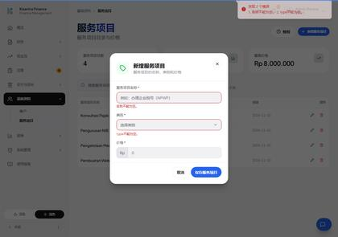 |

## A13 · F04: pesan 403 diterjemahkan — Pass (percobaan ke-2)

| # | Langkah & yang terlihat | Layar |
|---|---|---|
| 1 | Halaman 403 (ZH): pesan bawaan diterjemahkan. | 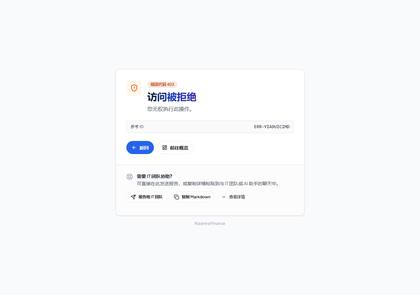 |
| 2 | Halaman 403 (ID): pesan bawaan diterjemahkan. | 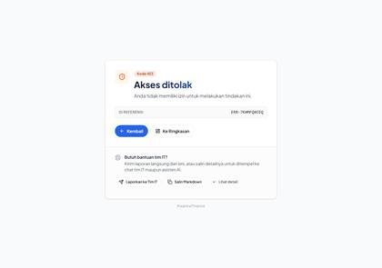 |
| 3 | SEBELUM perbaikan (percobaan 1, ZH): "This action is unauthorized." dalam bahasa Inggris. | 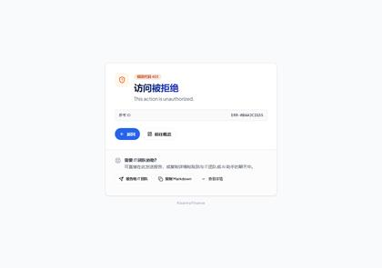 |

## A14 · F05: judul grup Izin & Peran — Pass (percobaan ke-2)

| # | Langkah & yang terlihat | Layar |
|---|---|---|
| 1 | Izin & Peran (ZH): judul grup modul bukan lagi slug mentah. | 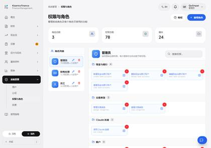 |
| 2 | Izin & Peran (EN): judul grup modul. | 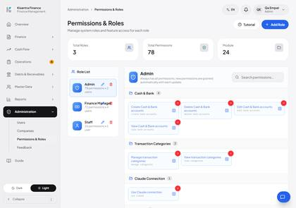 |
| 3 | SEBELUM perbaikan (percobaan 1, ZH): judul grup "Bank-accounts". | 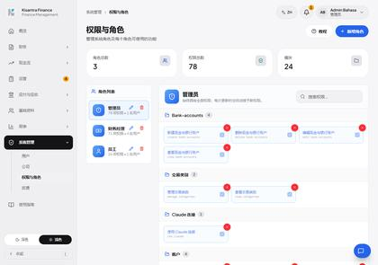 |

## A15 · F06: sumbu Y Kas & Bank — Pass (percobaan ke-2)

| # | Langkah & yang terlihat | Layar |
|---|---|---|
| 1 | Kas & Bank (ZH): sumbu Y grafik Pemasukan vs Pengeluaran. | 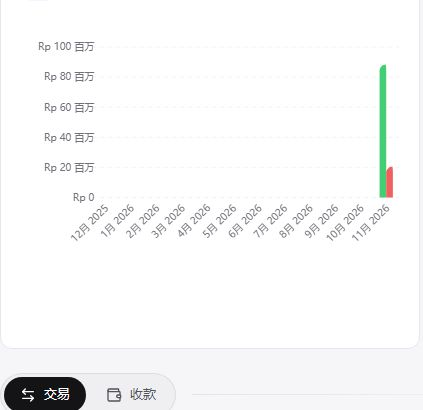 |
| 2 | Kas & Bank (EN): sumbu Y grafik Pemasukan vs Pengeluaran. | 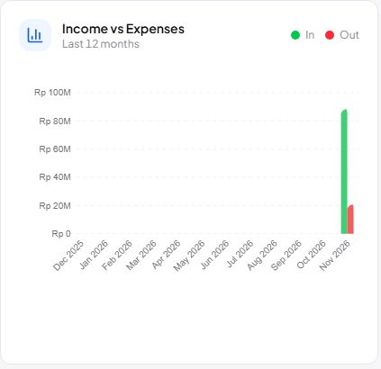 |
| 3 | Kas & Bank (ID): sumbu Y grafik Pemasukan vs Pengeluaran. | 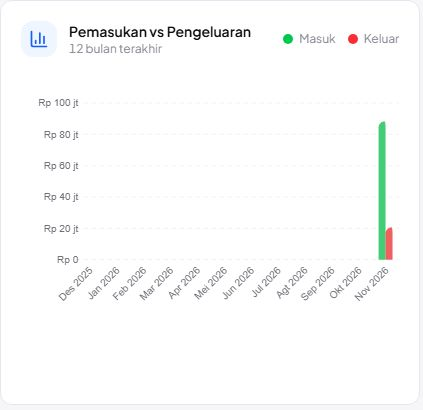 |
| 4 | SEBELUM perbaikan (percobaan 1, ZH): sumbu Y "Rp 100jt". | 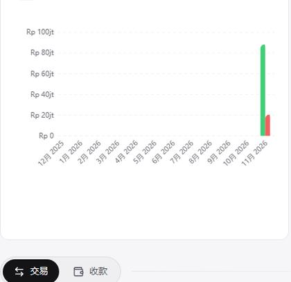 |

## A16 · F07: label aksesibilitas grafik — Pass (percobaan ke-2)

| # | Langkah & yang terlihat | Layar |
|---|---|---|
| 1 | Kas & Bank (ZH): label aksesibilitas grafik kini "按月收入与支出柱状图" dan "按类别支出环形图" (sebelumnya "bar chart with 2 data series…"). |  |

## A17 · F08: grafik Analitik Invoice Berulang — Pass (percobaan ke-2)

| # | Langkah & yang terlihat | Layar |
|---|---|---|
| 1 | Invoice Berulang › Analitik (ZH): sumbu bulan dan satuan. | 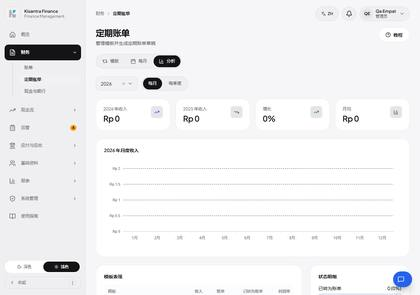 |
| 2 | Invoice Berulang › Analitik (EN): sumbu bulan dan satuan. |  |
| 3 | Invoice Berulang › Analitik (ID): sumbu bulan dan satuan. | 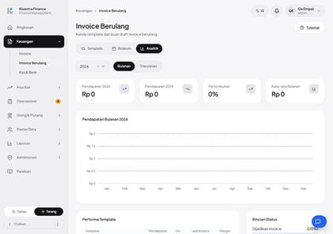 |

## A18 · F09: label daftar Combobox — Pass (percobaan ke-2)

| # | Langkah & yang terlihat | Layar |
|---|---|---|
| 1 | Combobox Dashboard dibuka (ZH); aria-label daftar = ['', '选项列表']. | 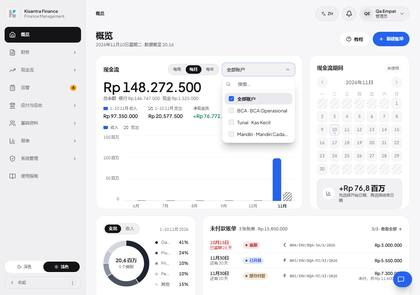 |
| 2 | Combobox Dashboard dibuka (EN); aria-label daftar = ['', 'Options']. | 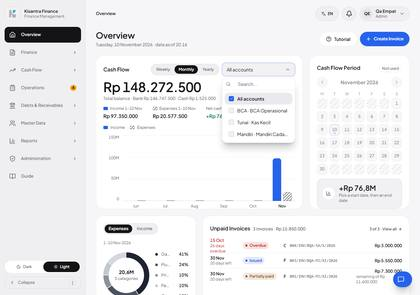 |

## A19 · F10: daftar Template PDF dan Template Builder — Pass (percobaan ke-2)

| # | Langkah & yang terlihat | Layar |
|---|---|---|
| 1 | Template PDF (ZH): judul kolom daftar. | 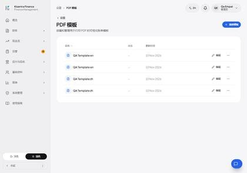 |
| 2 | Template Builder (ZH): lencana kanvas dan panel properti. | 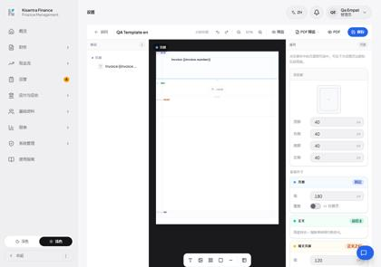 |
| 3 | Template PDF (EN): judul kolom daftar. | 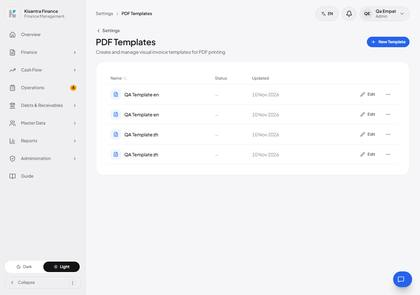 |
| 4 | Template Builder (EN): lencana kanvas dan panel properti. |  |
| 5 | SEBELUM perbaikan (percobaan 1, ZH): lencana kanvas "Halaman pertama", "Dinamis ⇕", "Setelah konten". | 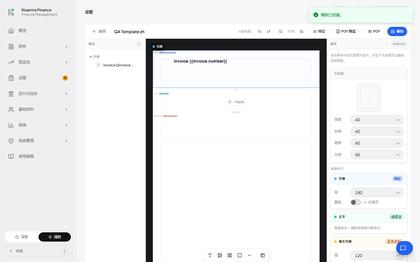 |

## A20 · F11: dialog Tutorial — Pass (percobaan ke-2, dengan pengecualian)

| # | Langkah & yang terlihat | Layar |
|---|---|---|
| 1 | Dialog Tutorial (ZH): judul, tab peran, durasi, dan kontrol pemutar. | 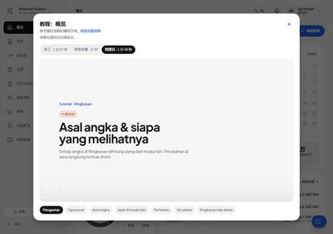 |

## A21 · F13: header dan tab Invoice di 390 px (EN) — Pass (percobaan ke-2)

| # | Langkah & yang terlihat | Layar |
|---|---|---|
| 1 | Invoice EN pada 390 px: tombol Create Invoice dan tab status utuh ({'vw': 390, 'hscroll': 0, 'btnRight': None, 'btnLeft': None, 'tabRight': [305, 159], 'tabLeft': [199, 43]}). | 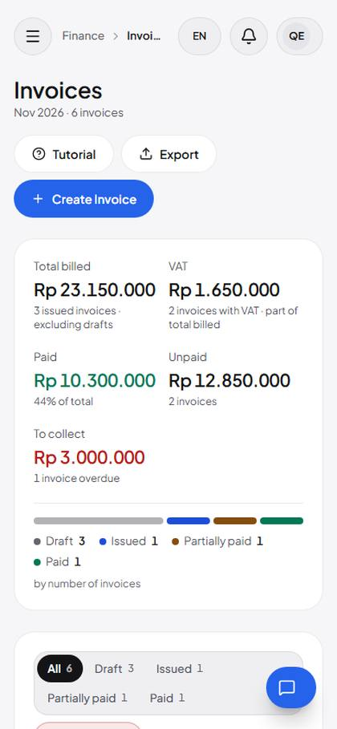 |
| 2 | Invoice EN pada 1280 px: tombol Create Invoice dan tab status tetap sama ({'vw': 1280, 'hscroll': 0, 'btnRight': None, 'btnLeft': None, 'tabRight': [581, 642], 'tabLeft': [475, 525]}). |  |
| 3 | SEBELUM perbaikan (percobaan 1, EN 390 px): tombol Create Invoice terpotong di tepi kanan. | 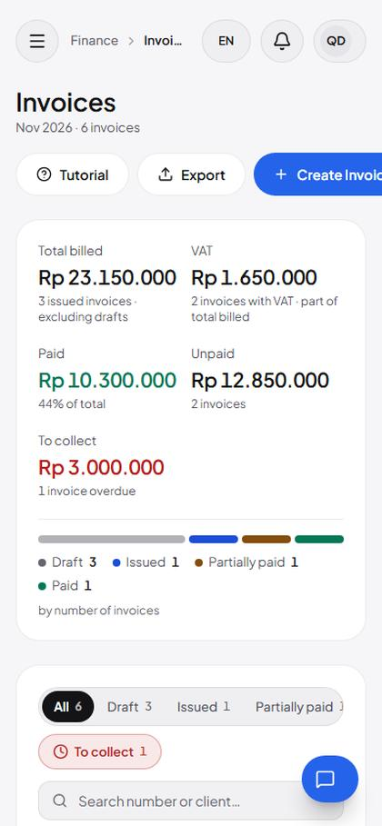 |

## A22 · F12: nama ikon di Tambah Peran — Pass (percobaan ke-2)

| # | Langkah & yang terlihat | Layar |
|---|---|---|
| 1 | Dialog Tambah Peran (ZH): pemilih ikon. | 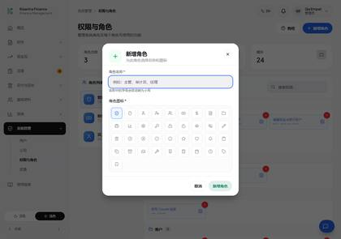 |

## C01 · Kerangka aplikasi: sidebar, header, pemilih bahasa, menu pengguna — Pass

| # | Langkah & yang terlihat | Layar |
|---|---|---|
| 1 | ZH: sidebar semua grup dibuka, header, pemilih bahasa. |  |
| 2 | EN: sidebar semua grup dibuka. |  |
| 3 | ZH: menu pengguna (pengaturan, profil perusahaan, keluar). |  |

## C02 · Komponen katalog: Combobox, DatePicker, Dialog, FileUpload, Pagination — Pass (percobaan ke-2)

| # | Langkah & yang terlihat | Layar |
|---|---|---|
| 1 | ZH: dialog Catat Pemasukan (Combobox, DatePicker, FileUpload, kotak Jurnal). |  |
| 2 | EN: dialog yang sama. |  |
| 3 | ZH: validasi kosong pada dialog. |  |

## C03 · Dashboard — Pass

| # | Langkah & yang terlihat | Layar |
|---|---|---|
| 1 | ZH: Dashboard. |  |
| 2 | EN: Dashboard. |  |

## C04 · Klien — Pass (percobaan ke-2)

| # | Langkah & yang terlihat | Layar |
|---|---|---|
| 1 | ZH: daftar klien. |  |
| 2 | ZH: dialog Tambah Klien. |  |
| 3 | EN: dialog Add Client. |  |

## C05 · Layanan — Pass (percobaan ke-2)

| # | Langkah & yang terlihat | Layar |
|---|---|---|
| 1 | ZH: daftar layanan. |  |
| 2 | ZH: validasi kosong Tambah Layanan. |  |
| 3 | EN: validasi kosong Add Service. |  |

## C06 · Invoice & pembayaran — Pass (percobaan ke-2)

| # | Langkah & yang terlihat | Layar |
|---|---|---|
| 1 | ZH: daftar invoice (status Draft/Terbit/Sebagian/Lunas). |  |
| 2 | EN: daftar invoice. |  |
| 3 | ZH: editor invoice baru. |  |
| 4 | ZH: drawer rincian invoice Sebagian dibayar (pembayaran, riwayat). |  |

## C07 · Invoice berulang — Pass (percobaan ke-2)

| # | Langkah & yang terlihat | Layar |
|---|---|---|
| 1 | ZH: Invoice Berulang (Template). |  |
| 2 | EN: Recurring Invoices. |  |
| 3 | ZH: form template baru. |  |

## C08 · Piutang — Pass

| # | Langkah & yang terlihat | Layar |
|---|---|---|
| 1 | ZH: daftar piutang. |  |
| 2 | EN: daftar piutang. |  |
| 3 | ZH: validasi dialog Tambah Piutang. |  |

## C09 · Laporan Laba Rugi — Pass

| # | Langkah & yang terlihat | Layar |
|---|---|---|
| 1 | ZH: Laba Rugi. |  |
| 2 | EN: Profit & Loss. |  |

## C10 · Kas & Bank — Pass (percobaan ke-2)

| # | Langkah & yang terlihat | Layar |
|---|---|---|
| 1 | ZH: Kas & Bank (grafik berlabel server). |  |
| 2 | EN: Cash & Bank. |  |

## C11 · Pemasukan & Pengeluaran — Pass

| # | Langkah & yang terlihat | Layar |
|---|---|---|
| 1 | ZH: Arus Kas tab Semua. |  |
| 2 | EN: Cash Flow tab All. |  |
| 3 | ZH: Transfer & Penyesuaian. |  |

## C12 · Kategori Transaksi — Pass (percobaan ke-2)

| # | Langkah & yang terlihat | Layar |
|---|---|---|
| 1 | ZH: kategori transaksi (nama kategori tetap Indonesia: data). |  |
| 2 | EN: kategori transaksi. |  |
| 3 | ZH: validasi dialog kategori. |  |

## C13 · Reimbursement — Pass

| # | Langkah & yang terlihat | Layar |
|---|---|---|
| 1 | ZH: Reimbursement (halaman yang dikeluhkan pengguna). |  |
| 2 | EN: Reimbursement. |  |
| 3 | ZH: validasi dialog pengajuan. |  |
| 4 | ZH: rincian reimbursement status Menunggu (tombol Tolak/Setujui), seluruh isi Mandarin. |  |
| 5 | ZH: rincian reimbursement status Disetujui (tombol Bayar). |  |

## C14 · Pengajuan Dana — Pass (percobaan ke-2)

| # | Langkah & yang terlihat | Layar |
|---|---|---|
| 1 | ZH: Pengajuan Dana (tiap status). |  |
| 2 | EN: Fund Requests. |  |
| 3 | ZH: form pengajuan baru. |  |
| 4 | ZH: rincian pengajuan dana (status Disetujui, tombol Cairkan). |  |

## C15 · Utang — Pass

| # | Langkah & yang terlihat | Layar |
|---|---|---|
| 1 | ZH: Utang. |  |
| 2 | EN: Debts. |  |
| 3 | ZH: validasi dialog Tambah Utang. |  |

## C16 · Notifikasi — Pass

| # | Langkah & yang terlihat | Layar |
|---|---|---|
| 1 | ZH: panel notifikasi (Masukan baru). |  |
| 2 | EN: panel notifikasi. |  |

## C17 · Masukan (Feedback) — Pass

| # | Langkah & yang terlihat | Layar |
|---|---|---|
| 1 | ZH: daftar Masukan. |  |
| 2 | EN: Feedback list. |  |
| 3 | ZH: dialog Masukan melayang, validasi kosong. |  |

## C18 · Pengaturan: hub, Profil, Kata sandi — Pass

| # | Langkah & yang terlihat | Layar |
|---|---|---|
| 1 | ZH: hub Pengaturan. |  |
| 2 | ZH: Profil. |  |
| 3 | EN: Kata sandi. |  |

## C19 · Pengaturan: Profil Perusahaan — Pass

| # | Langkah & yang terlihat | Layar |
|---|---|---|
| 1 | ZH: Profil Perusahaan. |  |
| 2 | EN: Company Profile. |  |

## C20 · Pengaturan: Penomoran Invoice — Pass

| # | Langkah & yang terlihat | Layar |
|---|---|---|
| 1 | ZH: Penomoran Invoice. |  |
| 2 | EN: Invoice Numbering. |  |

## C21 · Pengaturan: Template PDF & Builder — Pass (percobaan ke-2)

| # | Langkah & yang terlihat | Layar |
|---|---|---|
| 1 | ZH: dialog Template baru. |  |
| 2 | ZH: editor Template Builder (menu zh). |  |
| 3 | EN: editor Template Builder. |  |

## C22 · Koneksi Claude — Pass

| # | Langkah & yang terlihat | Layar |
|---|---|---|
| 1 | ZH: Koneksi Claude. |  |
| 2 | EN: Claude Connection. |  |

## C23 · Pengguna — Pass (percobaan ke-2)

| # | Langkah & yang terlihat | Layar |
|---|---|---|
| 1 | ZH: Pengguna. |  |
| 2 | ZH: validasi dialog Tambah Pengguna. |  |
| 3 | EN: Users. |  |

## C24 · Perusahaan (admin) — Pass (percobaan ke-2)

| # | Langkah & yang terlihat | Layar |
|---|---|---|
| 1 | ZH: Perusahaan. |  |
| 2 | ZH: dialog Perusahaan baru. |  |
| 3 | EN: Companies. |  |

## C25 · Izin & Peran — Pass (percobaan ke-2)

| # | Langkah & yang terlihat | Layar |
|---|---|---|
| 1 | ZH: Izin & Peran (kode izin kecil adalah pengecualian; judul grup modul kini terjemah). |  |
| 2 | EN: Permissions & Roles. |  |
| 3 | ZH: dialog Tambah Peran. |  |

## C26 · Autentikasi & email — Pass

| # | Langkah & yang terlihat | Layar |
|---|---|---|
| 1 | ZH: login. |  |
| 2 | ZH: login dengan kredensial salah. |  |
| 3 | ZH: lupa kata sandi, email tak valid. |  |
| 4 | EN: atur ulang kata sandi, token palsu. |  |

## C27 · Setup & pemilihan perusahaan — Pass

| # | Langkah & yang terlihat | Layar |
|---|---|---|
| 1 | ZH: /choose-company dibuka oleh tamu: dialihkan ke login. |  |
| 2 | EN: /setup dibuka oleh tamu: dialihkan ke login. |  |

## C28 · Halaman error — Pass (percobaan ke-2)

| # | Langkah & yang terlihat | Layar |
|---|---|---|
| 1 | ZH: halaman 403 (staf membuka /admin/users). |  |
| 2 | ZH: halaman 404. |  |
| 3 | EN: halaman 403. |  |

## C29 · Panduan & video (di luar cakupan K3) — Pass (percobaan ke-2)

| # | Langkah & yang terlihat | Layar |
|---|---|---|
| 1 | ZH: /panduan: isi tetap Indonesia sesuai keputusan K3. |  |
| 2 | EN: /panduan. |  |

<!-- qa-evidence:end -->
